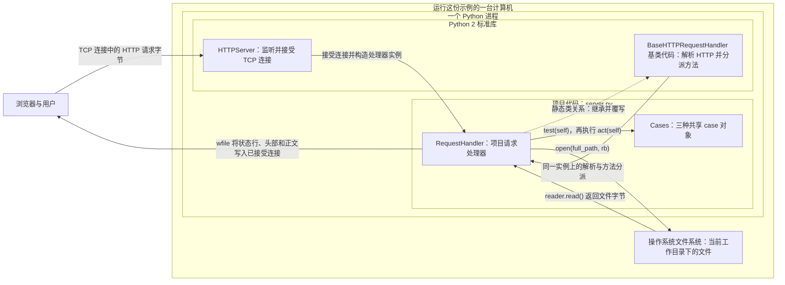
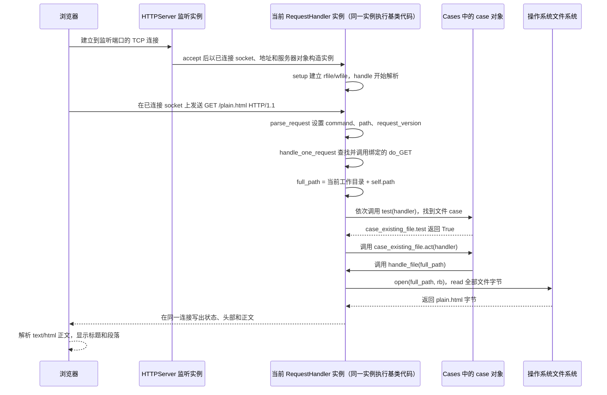

# 完整功能主课：浏览器打开 `/plain.html`，服务器如何识别请求、读取文件并返回页面

> **当前完整功能主课。** 本课沿一条完整路径：浏览器发出 `GET /plain.html`，Python 标准库解析请求并调用项目处理器，处理器从进程当前目录找到 `plain.html`，读出文件字节（每个字节由 8 个二进制位组成），组装 HTTP 响应，浏览器再把响应正文解释为 HTML。下方原有的 Markdown 标题检查课保留为历史局部读码参照，不能用它的篇幅或范围校准完整功能课。
>
> **源码与证据范围。** 项目源码固定为 [aosabook/500lines 提交 `fba689d101eb5600f5c8f4d7fd79912498e950e2` 的 `web-server/code/03-handlers/server.py` 原行 1–108](https://github.com/aosabook/500lines/blob/fba689d101eb5600f5c8f4d7fd79912498e950e2/web-server/code/03-handlers/server.py#L1-L108) 和同目录 [`plain.html` 原行 1–9](https://github.com/aosabook/500lines/blob/fba689d101eb5600f5c8f4d7fd79912498e950e2/web-server/code/03-handlers/plain.html#L1-L9)。行号来自固定提交的原始文件字节和 LF 换行，不来自网页抽取后的显示行号。机制依据是 CPython 2.7.18 的 `BaseHTTPServer.py`、`SocketServer.py` 与该版本标准库文档；HTTP/1.1 的消息边界只用 RFC 9112 说明通用格式。源码是 Python 2 时代的示例，本文不把它改写成 Python 3，也没有启动服务或打开浏览器；运行命令只作可选操作说明。

## 1. 业务场景与本课目标

你在浏览器地址栏输入 `http://127.0.0.1:8080/plain.html`。URL（Uniform Resource Locator，统一资源定位符）是标出访问方式、主机和目标的地址。HTTP（Hypertext Transfer Protocol，超文本传输协议）约定浏览器用请求消息说明要访问什么，服务器用响应消息返回处理状态、头部和正文；这里 `http` 是 URL 的 scheme（访问方案前缀），表示选择 HTTP。`127.0.0.1` 是一个 IPv4（Internet Protocol version 4，互联网协议第 4 版）地址，`8080` 是端口号。IP（Internet Protocol，互联网协议）负责网络寻址；`127.0.0.1` 属于回环地址，表示这次连接回到发起它的本机。端口让操作系统把到达该端口的网络连接交给监听它的服务。程序用 socket（套接字）代表网络连接的一端；它是网络输入/输出（Input/Output，I/O）接口，不是磁盘文件。

这里浏览器请求 `GET /plain.html`，服务器按文件规则查找目标并回送页面内容。

浏览器和服务器是两个程序角色；远端部署时它们的文件系统也可能位于不同机器。本例的 `127.0.0.1` 把客户端连接指回本机，但浏览器仍不会因为 URL 中出现了 `plain.html` 就直接读取服务器进程当前目录里的文件。它向服务器发请求，由服务器进程访问文件，再把内容写回网络连接。

HTML（HyperText Markup Language，超文本标记语言）用标签描述网页文档结构。固定版本把 `plain.html` 放在仓库相对路径 `web-server/code/03-handlers/plain.html`。文件的九行完整内容如下；这不是浏览器截图，而是服务器将读取的原始文件，来源定位为 [原行 1–9](https://github.com/aosabook/500lines/blob/fba689d101eb5600f5c8f4d7fd79912498e950e2/web-server/code/03-handlers/plain.html#L1-L9)：

```html
<html>
<head>
<title>Plain Page</title>
</head>
<body>
<h1>Plain Page</h1>
<p>Nothin' but HTML.</p>
</body>
</html>
```

`html` 根元素包住整个 HTML 文档；`head` 放文档信息，`title` 给文档一个标题；`body` 包住页面主体。主体里，`h1` 表示最高层级标题，`p` 表示一段正文。于是这九行给浏览器的可见结果是标题 `Plain Page` 和正文 `Nothin' but HTML.`；`title` 则用作文档标题。服务器不把这些标签画出来，而是按字节传回；响应头中的 `Content-Type: text/html` 告诉浏览器把正文作为 HTML 解析。可对照 [MDN 的标题元素说明](https://developer.mozilla.org/en-US/docs/Web/HTML/Reference/Elements/heading_elements)、[`p` 段落元素](https://developer.mozilla.org/en-US/docs/Web/HTML/Reference/Elements/p) 和 [`title` 文档标题元素](https://developer.mozilla.org/en-US/docs/Web/HTML/Reference/Elements/title)。

一次典型请求可以抽象成下面的起始行和头部。浏览器可能附带更多头部；这里只列出本课解释所需的部分：

```http
GET /plain.html HTTP/1.1
Host: 127.0.0.1:8080

```

`GET` 是客户端请求的方法；`/plain.html` 是这次请求的目标；`HTTP/1.1` 是客户端声明的请求版本。服务器按项目规则尝试取文件，成功时给出 `200` 响应；下面用占位正文表示它的状态行和头部：

```http
HTTP/1.0 200 OK
Content-type: text/html
Content-Length: <正文的字节数>

<html>...原文件正文...</html>
```

`Content-Length` 的尖括号部分是占位说明，不是字面响应值；实际代码把 `len(content)` 转成十进制文字。标准库还通过 `send_response` 加上 `Server` 和 `Date` 头。状态行使用 `HTTP/1.0`，即使浏览器请求行写 `HTTP/1.1`，因为 Python 2.7.18 的处理器默认 `protocol_version` 是 `HTTP/1.0`；请求版本与响应版本分别来自两处设置，不能把它们假设成相同。本课读完后，你应能沿这组具体值说明请求如何进入 `do_GET`、路径如何变成文件名、谁构造成功或失败响应，以及浏览器凭什么把返回字节当作 HTML；不会要求你安装或运行旧版 Python 才能阅读。

## 2. 系统位置与架构分工

图中的运行时对象与类关系分开画：浏览器在进程外；标准库服务器和项目处理器在同一个 Python 进程；文件系统通过操作系统 I/O 提供文件字节。TCP（Transmission Control Protocol，传输控制协议）让已连接的两端交换连续字节；本例的 HTTP 请求和响应都通过这条连接传送。实线是一次请求中的数据或调用，虚线是类继承关系；反向文件箭头表示读取结果返回给处理器。



`HTTPServer` 的项目创建点在 [`server.py` 原行 105–108](https://github.com/aosabook/500lines/blob/fba689d101eb5600f5c8f4d7fd79912498e950e2/web-server/code/03-handlers/server.py#L105-L108)；它继承的标准库 `HTTPServer` 再继承同步 `TCPServer`，其 socket 建立、绑定与监听见 [CPython 2.7.18 `BaseHTTPServer.py` 原行 102–111](https://github.com/python/cpython/blob/v2.7.18/Lib/BaseHTTPServer.py#L102-L111)、[`SocketServer.py` 原行 413–443](https://github.com/python/cpython/blob/v2.7.18/Lib/SocketServer.py#L413-L443)。

项目处理器的定义与规则表在 [`server.py` 原行 44–52](https://github.com/aosabook/500lines/blob/fba689d101eb5600f5c8f4d7fd79912498e950e2/web-server/code/03-handlers/server.py#L44-L52)；它继承的基类是 [CPython 2.7.18 `BaseHTTPServer.py` 原行 114](https://github.com/python/cpython/blob/v2.7.18/Lib/BaseHTTPServer.py#L114)，该基类再通过 [SocketServer 的流连接处理器与 `rfile`/`wfile` 设置](https://github.com/python/cpython/blob/v2.7.18/Lib/SocketServer.py#L677-L706)接入 socket。基类代码从连接读请求行、头部，并将请求字段派发给覆写方法；项目的 `RequestHandler` 提供 `do_GET`、文件读取、错误页和正文写出，不自行监听 TCP 端口或解析请求行。

实际数据链从 [`do_GET` 构造 `full_path` 与遍历规则](https://github.com/aosabook/500lines/blob/fba689d101eb5600f5c8f4d7fd79912498e950e2/web-server/code/03-handlers/server.py#L65-L79)开始，经 [`handle_file` 读取字节](https://github.com/aosabook/500lines/blob/fba689d101eb5600f5c8f4d7fd79912498e950e2/web-server/code/03-handlers/server.py#L81-L88)，再到 [`send_content` 输出](https://github.com/aosabook/500lines/blob/fba689d101eb5600f5c8f4d7fd79912498e950e2/web-server/code/03-handlers/server.py#L95-L101)。`open(...)` 请求操作系统文件读取能力，读出的字节回到 Python 处理器；响应经标准库提供的写流返回到同一已接受连接。图里的“文件系统”不是 Python 项目内部的另一个控制器。

模块按文件顺序先定义 `RequestHandler` 类，执行类体时建立 `Cases` 列表；之后到达行 105 的主程序才创建 `HTTPServer`，服务器对象保存处理器类和监听 socket。它此时没有处理器实例，也没有预读 `plain.html`。一个客户端 TCP 连接被接受后，标准库才创建该连接的处理器实例；这个示例的默认 HTTP/1.0 响应设置令它通常只处理此连接上的一个请求。`self.path`、`self.command`、`self.full_path`、`rfile` 和 `wfile` 属于这次连接的处理器实例；文件内容则是 `handle_file` 中局部变量 `content` 的值。`RequestHandler.Cases` 是类属性，多个处理器实例访问同一列表；列表里三个 case 对象不保存某个用户的路径，而是每次由调用处传入当前 handler。

这条边界适合展示本课的实际责任：通用网络协议由标准库处理，项目代码只回答“这个请求路径对应什么文件、怎样读、怎样把成功或失败写回去”。若把请求行解析也塞进 `RequestHandler`，项目就需要重新处理协议细节；若把文件选择交给标准库，这份代码中的 `Cases` 和文件映射规则又失去作用。当前 `HTTPServer` 是同步的 `TCPServer` 子类，没有混入线程服务器；一个请求处理期间，主服务循环不会并行处理另一个连接。慢文件读取或慢客户端因此可能拖住后续请求，这一点来自实际运行类，不是图中额外虚构出的工作队列。

## 3. 读懂本课所需的概念

### HTTP 消息怎样把请求和正文分开

浏览器是客户端：它提出取回页面的请求；服务器是接收请求并回送答复的程序。HTTP（Hypertext Transfer Protocol，超文本传输协议）约定请求和响应的消息结构。HTTP/1.1 消息由起始行、头部行、一个空行和可选正文组成；起始行和每个头部行以 `CRLF` 结束，CRLF 是 Carriage Return Line Feed（回车换行，即 `\r\n`）。请求起始行依次给出方法、请求目标和版本，例如 `GET /plain.html HTTP/1.1`；响应起始行给出服务器使用的版本、状态码和说明文字。空行结束头部，后面的字节才属于正文。可对照 [RFC 9112 的消息格式](https://www.rfc-editor.org/rfc/rfc9112.html#section-2.1) 与 [`Content-Length` 定义](https://www.rfc-editor.org/rfc/rfc9112.html#section-6.2)。本项目是 Python 2 时代的 HTTP/1.0 默认响应示例；RFC 9112 在此只帮助理解消息边界，不证明项目完整支持 HTTP/1.1。

TCP（Transmission Control Protocol，传输控制协议）把已连接的两端表现为连续字节流；它不替应用程序标出 HTTP 头部在哪里结束。标准库读请求行、各头部行和空行，才得到 HTTP 字段边界。`wfile.write(...)` 把响应字节交给这个 TCP 连接的输出流；调用返回不表示浏览器已收到全部字节。

### URL 目标、网络地址和文件路径分别是谁

URL（Uniform Resource Locator，统一资源定位符）把访问方案、主机、端口和目标写在一起；它不是磁盘路径。这里 `http` 是 URL 的 scheme（访问方式前缀），选择 HTTP 访问；`127.0.0.1` 是 IPv4（Internet Protocol version 4，互联网协议第 4 版）地址，`8080` 是服务器监听端口，`/plain.html` 是请求目标。IP（Internet Protocol，互联网协议）是网络寻址协议；IPv4 是地址格式之一。本例的 `127.0.0.1` 是回环地址，表示连接回到发起它的本机，不代表所有服务器地址。

端口让操作系统把到达某个监听端口的连接交给相应 socket。socket（套接字）是程序操作网络连接一端的对象；它不是磁盘文件。URL 中的 `/plain.html` 只是发来的目标文字，不会自动成为服务器上的 `/plain.html` 文件。标准库把目标存到 `self.path`；项目随后才用 `os.getcwd() + self.path` 构造文件路径。因此当前工作目录、请求目标和最终磁盘路径是三个不同值；查询文字也仍包含在本例的 `self.path` 中。Python 的 tuple（元组）按顺序保存多个值；入口中的 `('', 8080)` 是一个二元组，第一项为空主机文字，第二项是端口整数 `8080`。

### 类、实例、方法参数怎样组成这条调用

类是一种对象定义，实例是按类创建的具体对象。Python 2 的内置基类 `object` 出现在 `class case_no_file(object)` 中；`case_no_file()` 的括号会创建实例。`class RequestHandler(BaseHTTPServer.BaseHTTPRequestHandler)` 则表示项目处理器继承标准库处理器，保留基类的连接读取和请求分派，再覆写同名 `do_GET` 方法加入文件服务行为。

Python 源文件也可以作为模块被其他代码导入；`import os` 让当前模块能用名字 `os` 访问它。解释器给模块提供 `__name__`：直接运行文件时它是 `'__main__'`，被导入时通常是模块名。`==` 比较两边的值是否相等，结果是布尔值；因此 `if __name__ == '__main__':` 只在直接运行时进入缩进的入口代码。`sys.argv` 是包含脚本名和命令行参数的列表；源码虽然导入 `sys`，但没有读取它，所以不能从文件名或 README 推断它会处理目录参数。

`def method(self, handler):` 定义方法及它接收的参数；冒号后的缩进语句属于方法体。参数是函数声明中接收值的名字，调用时传入的值是实参。对象方法调用 `case.test(current_handler)` 会把 `case` 自动绑定为方法里的 `self`，而显式传入的 `current_handler` 才绑定到 `handler`。所以源码里 `case.test(self)` 这一行有**两个不同的 `self`**：外层 `self` 是当前 `RequestHandler` 实例；进入 `test` 后，方法里的 `self` 则是 case 实例，`handler` 才是刚才的处理器。相同名字不会让它们变成同一个对象。

点号 `.` 用来从对象或模块取属性：`os.getcwd` 是从 `os` 模块取函数，`handler.full_path` 是从当前处理器实例取路径状态，`self.Cases` 则会沿类查找到共享列表。普通 `do_GET(self)` 由标准库以绑定方法形式调用，所以当前处理器会自动成为 `self`；项目不再显式传一次自身。类或方法体第一条三引号字符串可以是 docstring（文档字符串）；多行三引号也可保存模板文字，原模板开头的反斜线会去掉开头换行。`pass` 是语法占位语句，执行时不增加动作。

### 条件、循环和返回值怎样选择一个 case

`Cases` 列表按顺序装三个 case 实例。`for case in self.Cases` 逐个取出它们；`if case.test(self)` 先调用规则的 `test`。`True` 和 `False` 是布尔值：`case_no_file.test` 在 `exists` 为假时用 `not` 取反并返回真，文件规则再用 `isfile` 判断是不是普通文件。`return expression` 结束这次方法调用并把表达式结果交给调用者，因此 `test` 返回的布尔值决定 `if` 的分支。

匹配后，`case.act(self)` 执行实际动作。`None` 是 Python 表示“没有交回具体结果”的特殊对象；这些方法没有显式 `return`，正常结束时仍会把 `None` 交给调用者。`do_GET` 不使用这个返回值，因为动作已经由 `handle_file` 写响应或由 `raise` 抛出错误完成。`break` 只在动作正常返回后执行，离开最近的 `for` 循环。兜底 case 的 `test` 永远返回 `True`，所以它必须在列表末尾，否则前面的请求会被它抢先截住。

### Python 异常和 HTTP 状态不是同一种结果

`raise ServerException(...)` 抛出 Python 异常，会中断当前正常语句并沿调用链寻找匹配的 `except`。`try` 标出可能失败的语句范围；`IOError` 是 Python 输入/输出操作的异常，`except IOError as msg` 接住它并把异常对象绑定到 `msg`。`except Exception as msg` 也能接住它以及其他普通异常。本例 `do_GET` 的 `except Exception as msg` 把缺失路径异常交给 `handle_error`；它也会接住其他普通程序错误，所以项目内部错误可能被误显示成文件访问错误。

`404` 则是 HTTP 响应中的状态码，表示当前目标未找到。异常不会自动写状态行或 HTML 页面；只有 `send_content(content, 404)` 才把状态码写入响应。成功调用 `send_content(content)` 省略状态参数，Python 使用签名中的默认值 `status=200`。相同的发送方法因此由调用点选择成功还是失败的语义。

字符串的 `.format(...)` 会把花括号占位符替换成调用者给的值。`"'{0}' not found".format('/missing.html')` 用第一个位置实参替换 `{0}`，得到 `"'/missing.html' not found"`；`"{path}: {msg}".format(path=self.path, msg=error)` 则按名字填两个占位符。`path=...` 和 `msg=...` 是传给格式化方法的关键字实参，不会给 `self` 的字段赋值；这也是错误页模板把请求路径和异常说明组合成正文的方式。

### 文件字节怎样成为浏览器能解释的 HTML

Python 2 的普通 `str` 是字节串；`unicode` 是保存已解码文字字符的文本类型，可以先把它理解成字符层面的内容。`open(full_path, 'rb')` 中 `r` 表示读取，`b` 表示不解码、保留字节；`.read()` 在本例得到 `plain.html` 的字节串。`with open(...) as reader` 把文件对象暂时绑定给 `reader`，离开缩进块时关闭它，即使读取抛出异常也会执行清理。这里一次读完整份小文件，因此内容会暂存在内存。

`Content-Type: text/html` 告诉浏览器正文应按 HTML 解释，不会转换文件内容。ASCII（American Standard Code for Information Interchange，美国信息交换标准代码）是常见英文字母、数字和标点的基本编码；这份 `plain.html` 只含 ASCII 字符，所以对它来说**字符数和字节数恰好相等**。`len(content)` 实际数的是读入的字节；HTTP 的 `Content-Length` 也声明正文的八位字节数量。Unicode 是不同文字字符的统一表示；Python 2 的 `unicode` 类型表达这种已解码文字，而不是原始文件字节。若文件中有 UTF-8 编码的 `中`，它是一个 Unicode 字符、在读入的 UTF-8 字节串中占三个字节，因此**字节数不是字符数**，用字符数代替编码后字节数会算错长度。`str(len(content))` 把字节整数转成头部所需的十进制文字；`wfile` 是标准库围绕已接受 socket 建立的输出文件接口。


## 4. 端到端流程与本课边界

### 启动阶段：先建规则表，再开始监听

为让路径值可以复算，以下静态示例假设仓库检出在 `/work/500lines`，启动进程时的当前工作目录为 `/work/500lines/web-server/code/03-handlers`。这是假设输入，不是本机运行记录。Python 按文件顺序先执行导入和类定义；执行 `class RequestHandler` 的类体时，原行 50–52 的三个 `case_*()` 调用立即创建三个共享对象。它发生在文件末尾主程序创建服务器之前，所以启动时已有规则列表，但还没有任何连接处理器。

文件定义全部完成后，`if __name__ == '__main__'` 才进入入口。`serverAddress = ('', 8080)` 把 IPv4 主机值与端口组成二元组。该版 socket 文档说明 IPv4 的空主机字符串代表 `INADDR_ANY`，即“任意本地 IPv4 接口”的地址常量，因此服务器绑定本机所有可用 IPv4 接口，而非只绑 `127.0.0.1`。`BaseHTTPServer.HTTPServer(serverAddress, RequestHandler)` 把监听地址和处理器类交给标准库；服务器构造 socket、绑定并监听，随后 `serve_forever()` 等待连接；构造与 `listen()` 的位置见 [CPython 2.7.18 `SocketServer.py` 原行 413–443](https://github.com/python/cpython/blob/v2.7.18/Lib/SocketServer.py#L413-L443)。入口和监听配置位于 [项目 `server.py` 原行 105–108](https://github.com/aosabook/500lines/blob/fba689d101eb5600f5c8f4d7fd79912498e950e2/web-server/code/03-handlers/server.py#L105-L108)，空主机的语义见 [CPython 2.7.18 socket 文档原行 54–58](https://github.com/python/cpython/blob/v2.7.18/Doc/library/socket.rst#L54-L58)。源码不读取命令行参数；启动目录取自进程当前工作目录，端口直接写在 tuple 中。

### 一次请求：连接被接受后才产生处理器实例

用户输入 `http://127.0.0.1:8080/plain.html` 后，浏览器对本机 8080 端口建立 TCP 连接，并在连接中写入请求。`serve_forever()` 轮询监听 socket；连接就绪时，标准库取出已接受 socket 和客户端地址，再沿同步默认路径创建处理器。`HTTPServer` 持有 `RequestHandler` 类；它不预先创建实例。每个被接受的连接才构造一个 `RequestHandler` 实例，实例绑定该连接的 `request`、客户端地址和服务器对象。



标准库 `BaseRequestHandler` 构造函数先存放 socket、客户端地址和服务器对象，再调用 `setup()`、`handle()`，最后清理；流处理器的 `setup()` 给同一连接建立 `rfile` 和 `wfile`。因此图中 `H` 是一个 handler 实例，基类方法和覆写方法都在它身上运行。服务器只接受连接并创建 handler；真正读请求行、识别 `GET` 并调用项目 `do_GET` 的是这个实例内部的 HTTP 基类分派代码，不是 `HTTPServer` 直接调用项目方法。[生命周期的原文位置](https://github.com/python/cpython/blob/v2.7.18/Lib/SocketServer.py#L649-L717)。

### 从请求行到文件路径：每次值变化由谁负责

对图中请求行 `GET /plain.html HTTP/1.1`，基类解析后把 `self.command` 设为 `'GET'`，把 `self.path` 设为 `'/plain.html'`，把 `self.request_version` 设为 `'HTTP/1.1'`。接着基类按 `do_` 加方法名的规则，在同一个实例上找到 `do_GET` 并调用。项目路径赋值所在位置是 [`server.py` 原行 64–79](https://github.com/aosabook/500lines/blob/fba689d101eb5600f5c8f4d7fd79912498e950e2/web-server/code/03-handlers/server.py#L64-L79)；基类解析与方法查找分别见 [`BaseHTTPServer.py` 原行 232–299](https://github.com/python/cpython/blob/v2.7.18/Lib/BaseHTTPServer.py#L232-L299) 和 [原行 301–343](https://github.com/python/cpython/blob/v2.7.18/Lib/BaseHTTPServer.py#L301-L343)。

本次静态值中，`os.getcwd()` 是 `/work/500lines/web-server/code/03-handlers`，`self.path` 是 `/plain.html`，所以 `self.full_path` 变成 `/work/500lines/web-server/code/03-handlers/plain.html`。这是项目的字符串拼接结果，不是标准库将 URL 自动转换成文件路径。随后循环先问缺失规则：`exists(full_path)` 为真，取反后该 case 返回 `False`；再问普通文件规则：`isfile(full_path)` 为真，选中它并调用 `act`。只有 `act` 正常返回后，`do_GET` 才执行 `break` 停止继续检查；`case_always_fail` 只有前两条都没处理时才轮到。

### 从选中的 case 到响应正文：文件字节由调用方消费

文件 case 把同一个 `full_path` 交给当前处理器的 `handle_file`。本例 `open(full_path, 'rb')` 返回二进制 reader，`read()` 读出 `plain.html` 九行字节；退出 `with` 块后文件关闭。成功路径随后调用 `send_content(content)`，没有传第二个参数，因此使用默认 `status=200`。这两个调用依次发生在 [`case_existing_file.act` 原行 22–29](https://github.com/aosabook/500lines/blob/fba689d101eb5600f5c8f4d7fd79912498e950e2/web-server/code/03-handlers/server.py#L22-L29)、[`handle_file` 原行 81–88](https://github.com/aosabook/500lines/blob/fba689d101eb5600f5c8f4d7fd79912498e950e2/web-server/code/03-handlers/server.py#L81-L88) 和 [`send_content` 原行 95–101](https://github.com/aosabook/500lines/blob/fba689d101eb5600f5c8f4d7fd79912498e950e2/web-server/code/03-handlers/server.py#L95-L101)。

`send_content` 先调用标准库 `send_response(200)`，再写项目选择的 `Content-type: text/html` 与按字节计算的 `Content-Length`，用空行结束头部，最后把正文交给 `wfile`。Python 2.7.18 的默认 `protocol_version` 使状态行是 `HTTP/1.0 200 OK`，即使输入请求写 `HTTP/1.1`。浏览器读取到完整响应后，按 `text/html` 解析原来的标签，页面主体显示 `Plain Page` 与 `Nothin' but HTML.`；`title` 是文档标题。`wfile.write` 调用只表明程序尝试向连接写字节，并不证明网络完整送达或浏览器成功绘制，本课没有实际观察这一步。

本课的链路范围是这一个 `GET /plain.html` 成功路径、缺失/非文件路径错误，以及它们依赖的标准库连接建立与分派。启动装配和每个请求的生命周期已分别追踪；浏览器缓存、CSS、JavaScript、域名解析与 TLS 不参与这份示例的文件读取链，因此不在本课展开。


## 5. 真实源码逐段逐行精读

本章按实际调用顺序展开完整职责：依赖与错误类型、三条匹配规则、规则表与模板、`do_GET`、文件读取、错误/成功响应和启动入口。每个代码块都来自 [固定提交 `fba689d101eb5600f5c8f4d7fd79912498e950e2` 的 `web-server/code/03-handlers/server.py`](https://github.com/aosabook/500lines/blob/fba689d101eb5600f5c8f4d7fd79912498e950e2/web-server/code/03-handlers/server.py#L1-L108)，原始文件共 108 行并以 LF 结束。代码中的新增行尾说明均标为“教学注释”，原语句、原注释和每个代码单元内部的空行保持不变。块间仅略去空白行与 `#-----` 分隔注释；这些非执行分隔行不改变源行定位。正文按完整原行解释，不让读者靠点击链接补课。

### 5.1 先准备路径工具和一个可传递的项目异常

当前请求可能命中“找不到文件”或“路径不是普通文件”。这两种情况都要从规则对象退回到处理器的统一错误出口。先看它依赖的模块和项目异常定义，来源是原行 1–7：

```python
import sys, os, BaseHTTPServer

#-------------------------------------------------------------------------------

class ServerException(Exception):
    '''For internal error reporting.'''
    pass
```

原行 1 一次导入三个模块名：后文用 `os.getcwd`、`os.path.exists` 和 `os.path.isfile`；`BaseHTTPServer` 提供历史版 HTTP 处理器；`sys` 虽然导入了，但这份文件没有使用它，也没有因此读取命令行参数。原行 3 的横线只是源文件分隔注释。

原行 5 定义 `ServerException`，括号里的 `Exception` 是 Python 内置异常基类；继承它使项目能像其他异常一样抛出和捕获这个类型。原行 6 的三引号字符串是类的文档字符串，说明它用于内部错误报告。原行 7 的 `pass` 表示类暂时没有再添加字段或方法；之后规则仍可构造并 `raise ServerException(...)`，让调用栈跳回 `do_GET` 的 `except`。

### 5.2 缺失规则先判断路径是否存在

处理器已经为本次请求保存 `handler.full_path`。当它指向不存在的文件或目录时，第一条规则要返回真并中断正常分支；规则对象本身不写网络响应。以下为原行 11–18：

```python
class case_no_file(object):
    '''File or directory does not exist.'''

    def test(self, handler):
        return not os.path.exists(handler.full_path)  # 教学注释：缺失路径时把规则判为匹配。

    def act(self, handler):
        raise ServerException("'{0}' not found".format(handler.path))  # 教学注释：把用户看到的请求路径放进项目异常文字。
```

原行 11 定义 `case_no_file` 类并继承内置 `object`；行 12 的 docstring 写明它代表文件或目录都不存在。每次请求复用的列表中会放此类的实例。

原行 14 的方法有两个参数：方法绑定时 `self` 自动是这个 case 对象，`handler` 则由调用点显式传入当前 `RequestHandler`。原行 15 读取该处理器的 `full_path`，`os.path.exists` 对文件或目录存在都返回真；`not` 将真假反转，因此缺失路径时 `return` 把 `True` 交给循环里的 `if`。这里返回的是**规则判断，不是 HTTP 响应**。

原行 17 定义对应动作。原行 18 用 `handler.path`（浏览器请求目标文字）替换格式串 `{0}`，形成例如 `'/missing.html' not found`，然后 `raise` 抛出自定义异常。`raise` 使本次 `act` 不会正常返回，调用处后面的 `break` 也不会执行；错误随后由处理器统一转换成响应。

### 5.3 存在且为普通文件时，把路径交给处理器读取

如果第一条规则判为假，第二条规则判断同一个路径是不是普通文件。匹配后，它必须调用能读取文件并发送结果的处理器方法；仅返回路径不会让浏览器收到正文。原行 22–29：

```python
class case_existing_file(object):
    '''File exists.'''

    def test(self, handler):
        return os.path.isfile(handler.full_path)  # 教学注释：只在目标是普通文件时匹配。

    def act(self, handler):
        handler.handle_file(handler.full_path)  # 教学注释：把完整磁盘路径交给当前连接的处理器。
```

原行 22–23 定义“文件存在”规则。原行 25 定义 `test` 方法，原行 26 才调用 `os.path.isfile`；它与上条的 `exists` 不同：目录虽然存在，但不会因此被当作普通文件。当前 `/plain.html` 映射到磁盘文件时它返回 `True`。

原行 28–29 的 `act` 接收同一个显式传入的 `handler`，从它取出 `full_path` 并调用 `handle_file`。该调用的返回值被规则忽略；实际结果依赖 `handle_file` 的写响应副作用。若文件在 `isfile` 检查之后消失，稍后的 `open` 仍可能失败，下一节会追这个时序。

### 5.4 兜底规则让未识别路径有明确出口

存在的目录会使 `exists` 为真、`isfile` 为假；它不会匹配前两条规则。第三条规则接住这种情况，也接住其他未匹配目标。它必须排在列表末尾。原行 33–40：

```python
class case_always_fail(object):
    '''Base case if nothing else worked.'''

    def test(self, handler):
        return True  # 教学注释：无条件匹配，依靠列表顺序保证它最后运行。

    def act(self, handler):
        raise ServerException("Unknown object '{0}'".format(handler.path))  # 教学注释：把未识别目标送回共同错误出口。
```

原行 33–34 定义兜底类与说明。原行 36–37 的 `return True` 不查看 `handler`，所以无论收到什么输入都会匹配；原行 39–40 的动作抛出带请求路径的 `ServerException`。这解释了为什么往规则表追加新规则时必须插在 `case_always_fail()` 前面，否则兜底会先被选中。

### 5.5 在处理器类建立共享规则表和错误页模板

三个 case 类已经定义，下面的类体可以创建实例并保存它们。错误模板也属于类级数据：它提供正文文字，但不负责发送响应。原行 44–62：

```python
class RequestHandler(BaseHTTPServer.BaseHTTPRequestHandler):
    '''
    If the requested path maps to a file, that file is served.
    If anything goes wrong, an error page is constructed.
    '''

    Cases = [case_no_file(),
             case_existing_file(),
             case_always_fail()]  # 教学注释：类定义执行时创建三个共享的 case 实例。

    # How to display an error.
    Error_Page = """\
        <html>
        <body>
        <h1>Error accessing {path}</h1>
        <p>{msg}</p>
        </body>
        </html>
        """
```

原行 44 声明项目类继承标准库的 `BaseHTTPRequestHandler`；标准库 `TCPServer` 接受连接后，基类处理该连接上的 HTTP 读取、解析和方法分派，项目只覆写自己的处理行为。原行 45–48 是整个类的 docstring，概括路径映射和错误页职责。

原行 50–52 在类体执行时分别调用三个类名，结果是三个实例，按“缺失、普通文件、兜底”放入列表。列表是类属性；每条连接的处理器通过 `self.Cases` 找到同一张表。case 实例没有存入某个用户的路径，而是由每次 `test(handler)`、`act(handler)` 调用接收当前处理器。

原行 54 是原注释。原行 55 将多行字符串存入 `Error_Page`；开引号后紧邻的反斜线去掉字符串开头的换行。原行 56–62 依次构成 HTML 的 `html`、`body`、`h1`、`p` 和闭合标签，`{path}` 与 `{msg}` 留待 `.format(...)` 填值。模板只产生字符串；它没有 `send_response`、状态码或网络写操作。两个占位符会原样插入，没有 HTML 转义。

### 5.6 `do_GET` 用当前目录和请求目标选择第一条规则

标准库把 `GET` 分派给这个方法时，`self` 就是刚为连接创建的处理器实例，已经带有 `self.path`。在假设工作目录 `/work/500lines/web-server/code/03-handlers` 和请求目标 `/plain.html` 下，方法要先形成磁盘路径，再按有序规则决定后续调用。原行 64–79：

```python
    # Classify and handle request.
    def do_GET(self):
        try:

            # Figure out what exactly is being requested.
            self.full_path = os.getcwd() + self.path  # 教学注释：保存本次处理器所用的完整路径。

            # Figure out how to handle it.
            for case in self.Cases:
                if case.test(self):  # 教学注释：把当前 handler 显式传给 case 的判断方法。
                    case.act(self)  # 教学注释：执行首个匹配规则的动作。
                    break  # 教学注释：动作正常返回后不再检查后续规则。

        # Handle errors.
        except Exception as msg:
            self.handle_error(msg)  # 教学注释：把普通异常交给统一错误页处理。
```

原行 64 的注释说明分类与处理目的。原行 65 定义 `do_GET(self)`；此处 `self` 是处理器，不是刚才 case 方法里的 case `self`。原行 66 的 `try` 包住路径赋值和整个规则循环。

原行 69 先读进程当前工作目录，再与标准库保存的请求目标拼接：`'/work/500lines/web-server/code/03-handlers' + '/plain.html'` 得到 `'/work/500lines/web-server/code/03-handlers/plain.html'`，存到此处理器实例的 `full_path`。它没有用脚本文件所在目录，也没先解析查询串或规范化 `..`；路径来自当前工作目录和原始请求目标。

原行 72 依次从类级 `Cases` 取规则。原行 73 把当前处理器作为实参交给 `test`；成功场景中缺失规则返回 `False`，文件规则返回 `True`。原行 74 调用文件 case 的 `act`，它再调用 `handle_file`；原行 75 只有在该动作正常返回后才执行，离开循环。原行 77 是原注释。原行 78 捕获 `Exception` 及其子类，将异常对象绑定到 `msg`；原行 79 调用统一错误页。这个宽泛捕获也可能把项目程序错误显示成 404，不能把它读成只捕获“文件不存在”。

### 5.7 `handle_file` 读完文件后才开始写成功响应

当前文件 case 调用 `handle_file(full_path)`，传入值为 `'/work/500lines/web-server/code/03-handlers/plain.html'`。这里先从磁盘读取，再把字节交给输出方法。需要特别留意：`send_content` 也在此 `try` 块中。原行 81–88：

```python
    def handle_file(self, full_path):
        try:
            with open(full_path, 'rb') as reader:
                content = reader.read()
            self.send_content(content)  # 教学注释：省略状态实参，使用默认 200。
        except IOError as msg:
            msg = "'{0}' cannot be read: {1}".format(self.path, msg)
            self.handle_error(msg)  # 教学注释：文件输入输出异常时尝试发送项目错误页。
```

原行 81 的参数 `full_path` 接收 case 显式传入的磁盘路径。原行 82 开始错误处理范围。原行 83 的 `open(..., 'rb')` 以二进制读取模式打开文件；`as reader` 将返回的文件对象绑定到局部名 `reader`。原行 84 的 `.read()` 一次读取全部字节并赋给局部变量 `content`。离开 `with` 的缩进块后 reader 关闭，随后原行 85 才调用 `send_content`，省略第二个参数后状态默认是 `200`。

原行 86 的 `except IOError as msg` 同时覆盖文件打开、读取和原行 85 的响应发送。若 `open` 或 `read` 失败，成功响应还没开始写出；处理器把请求路径与错误文字格式化后，在原行 88 尝试发送 404。若 `send_content` 写出状态、头部或正文时抛出 `IOError`，同一个分支却会把网络错误误标成“文件不可读”，再尝试写错误响应。故障前可能已经交给连接输出流 `200` 状态行或部分头/正文；再次写 404 不能撤回它们，也不能保证连接仍可写。这个实现没有分开磁盘读错误与网络写错误，不能承诺该分支最终让浏览器收到 404。

### 5.8 错误路径显式选 404，发送方法负责共同格式

`do_GET` 的缺失与兜底规则都到达 `handle_error`；`handle_file` 的输入错误也尝试到达这里。它先创建错误正文，再将状态选择交给同一发送函数。原行 90–93：

```python
    # Handle unknown objects.
    def handle_error(self, msg):
        content = self.Error_Page.format(path=self.path, msg=msg)
        self.send_content(content, 404)  # 教学注释：第二个位置实参覆盖默认成功状态。
```

原行 90 是原注释。原行 91 的方法参数 `msg` 是调用方传来的异常对象或错误文字；`self` 仍是处理器实例。原行 92 的 `.format(path=self.path, msg=msg)` 使用关键字实参把值映射到同名花括号占位符，得到一整段 HTML 字符串；`path=self.path` 是传参语法，不是在这里改写对象字段。原行 93 把该正文与整数 `404` 一起传给 `send_content`。

成功与失败使用同一输出函数，调用点传不同的状态。原行 95–101：

```python
    # Send actual content.
    def send_content(self, content, status=200):
        self.send_response(status)  # 教学注释：由标准库写状态行及其标准响应头。
        self.send_header("Content-type", "text/html")
        self.send_header("Content-Length", str(len(content)))  # 教学注释：把正文的字节长度写成头部文字。
        self.end_headers()  # 教学注释：输出空行，结束响应头部。
        self.wfile.write(content)  # 教学注释：把正文交给已接受连接的输出流。
```

原行 95 是原注释。原行 96 除绑定处理器实例的 `self` 外，还定义两个业务参数：`content` 是待发正文，`status=200` 表示调用方省略状态时使用默认成功码。文件成功路径只传正文；错误路径额外传 `404`，因此结果由调用点决定。

原行 97 调用从基类继承的 `send_response`，把状态码写进 HTTP 响应并附标准 `Server`、`Date` 头。原行 98 写项目固定的 `Content-type`。原行 99 先由 `len(content)` 数出二进制正文长度，再由 `str(...)` 转为十进制文本；成功正文是 Python 2 字节串，所以数值是字节数。原行 100 通过 `end_headers()` 写头部与正文之间的空行。原行 101 才把 `content` 交给连接输出流；**写入调用返回不代表对端已收到这些字节**。

### 5.9 主入口把处理器类交给监听服务器

所有规则和方法已经定义，脚本作为程序运行时才会执行入口。这里的第二个实参是类，不是预先创建的 handler 对象。原行 105–108：

```python
if __name__ == '__main__':
    serverAddress = ('', 8080)
    server = BaseHTTPServer.HTTPServer(serverAddress, RequestHandler)
    server.serve_forever()
```

原行 105 检查 Python 设置的模块名是否为 `'__main__'`；直接运行脚本时成立，被导入时不执行此入口。原行 106 的圆括号创建二元组，第一项是空主机文字、第二项是端口整数 `8080`。原行 107 创建标准库 HTTP 服务器；`RequestHandler` 作为类交给服务器保存，连接到来后才实例化。原行 108 调用 `serve_forever()`，让进程持续接受和处理连接，直到被停止。入口没有读 `sys.argv`，所以给脚本附加目录参数不会改变这里的主机、端口或 `os.getcwd()`。


## 6. 关键机制与官方资料解读

### 监听服务器如何变成一次连接处理

项目入口调用 `BaseHTTPServer.HTTPServer(serverAddress, RequestHandler)`，并传入处理器**类**。CPython 2.7.18 的 `HTTPServer` 继承 `SocketServer.TCPServer`；TCP server 构造时创建 IPv4 stream socket，按 `serverAddress` 绑定并监听。父类保存 `RequestHandlerClass`，也就是 `RequestHandler` 类，而不是一份 handler 实例。可核对 [`HTTPServer` 定义](https://github.com/python/cpython/blob/v2.7.18/Lib/BaseHTTPServer.py#L102-L111)、[`TCPServer.__init__`](https://github.com/python/cpython/blob/v2.7.18/Lib/SocketServer.py#L413-L424) 与 [`BaseServer.__init__`](https://github.com/python/cpython/blob/v2.7.18/Lib/SocketServer.py#L201-L206)。

`serve_forever()` 等待监听 socket 可读；就绪后 `_handle_request_noblock()` 调用 `get_request()`，而 `TCPServer.get_request()` 实际用 `accept()` 得到一条已连接 socket 和客户端地址。默认 `process_request()` 同步调用 `finish_request()`；后者以这条 socket、客户端地址和服务器对象构造 `RequestHandlerClass`。因此请求处理不是服务器直接执行 `do_GET`，也没有自动为每个客户端创建线程。循环与接受链可核对 [`serve_forever` / `_handle_request_noblock`](https://github.com/python/cpython/blob/v2.7.18/Lib/SocketServer.py#L216-L298)、[`process_request` / `finish_request`](https://github.com/python/cpython/blob/v2.7.18/Lib/SocketServer.py#L315-L334) 和 [`get_request`](https://github.com/python/cpython/blob/v2.7.18/Lib/SocketServer.py#L461-L467)。

### 构造处理器时怎样把 socket 变成 `rfile` 和 `wfile`

基类构造器把已接受 socket、客户端地址和共享服务器对象分别存进处理器实例的 `request`、`client_address` 和 `server`，然后按顺序调用 `setup()`、`handle()`，并在 `finally` 中调用 `finish()`。`StreamRequestHandler.setup()` 将 `request` 赋给连接，并用它建立二进制 `rfile` 与 `wfile`。由此 `BaseHTTPRequestHandler.handle()` 能从同一个连接读请求、向它写响应；监听 socket 仍属于共享服务器对象。原始实现分别见 [`BaseRequestHandler.__init__` 原行 649–657](https://github.com/python/cpython/blob/v2.7.18/Lib/SocketServer.py#L649-L657) 和 [`StreamRequestHandler.setup/finish` 原行 698–717](https://github.com/python/cpython/blob/v2.7.18/Lib/SocketServer.py#L698-L717)。

这里有两种寿命不同的对象。服务器实例和 `RequestHandler.Cases` 列表跨连接存在；处理器实例携带一条已接受连接的 `self.path`、`self.full_path`、`rfile`、`wfile`。case 列表中的对象则不保留某个 handler，只在方法调用时接受当前 handler 参数。若把每个客户端的路径写进共享 case 实例，多条连接就会争用同一份可变状态；当前实现把连接状态留在 handler 上，规则对象只负责判断和委托。

### 请求行为什么最终调用覆写的 `do_GET`

`BaseHTTPRequestHandler.handle_one_request()` 从 `rfile` 读取一行，再调用 `parse_request()`。对 `GET /plain.html HTTP/1.1`，解析结果分别是 `self.command = 'GET'`、`self.path = '/plain.html'`、`self.request_version = 'HTTP/1.1'`。这一步只拆 HTTP 请求字段，不查磁盘。之后基类计算字符串 `mname = 'do_' + self.command`，得到 `'do_GET'`；先检查实例是否有该方法，再用 `getattr(self, mname)` 取出绑定方法并调用 `method()`。绑定使当前 handler 自动作为 `do_GET` 的 `self`，所以项目不需要自己再写一条调用语句。准确的解析与分派在 [`parse_request` 原行 232–299](https://github.com/python/cpython/blob/v2.7.18/Lib/BaseHTTPServer.py#L232-L299) 和 [`handle_one_request` 原行 301–334](https://github.com/python/cpython/blob/v2.7.18/Lib/BaseHTTPServer.py#L301-L334)。

如果方法名不是 `GET`，例如 `POST`，基类会找 `do_POST`。本项目没有实现它，因此基类调用自己的 `send_error(501, ...)` 并结束该处理；它不会进入项目 `do_GET` 的 `try`，也不会先检查文件是否存在。标准库的 501 分支见 [`handle_one_request` 原行 323–328](https://github.com/python/cpython/blob/v2.7.18/Lib/BaseHTTPServer.py#L323-L328)，其错误响应实现见 [`send_error` 原行 344–384](https://github.com/python/cpython/blob/v2.7.18/Lib/BaseHTTPServer.py#L344-L384)。这与项目将 `GET /missing.html` 转成 404 是两条不同的错误链。

### 请求版本和响应版本由不同字段控制

解析阶段把客户端版本存到 `self.request_version`；响应状态行使用类属性 `protocol_version`。CPython 2.7.18 将后者默认设为 `HTTP/1.0`，项目子类没有覆盖它。因此浏览器发 `HTTP/1.1` 请求，项目仍正常用 `HTTP/1.0` 状态行回应。基类 `send_response()` 从 `protocol_version` 格式化状态行，并在随后加上标准 `Server`、`Date` 头；默认值见 [`protocol_version` 原行 511–518](https://github.com/python/cpython/blob/v2.7.18/Lib/BaseHTTPServer.py#L511-L518)，写出规则见 [`send_response` 原行 389–408](https://github.com/python/cpython/blob/v2.7.18/Lib/BaseHTTPServer.py#L389-L408)。

处理器也不是普遍意义上的“一条 HTTP 请求一个实例”。标准库按已接受的 TCP 连接构造 handler；之后 `handle()` 会在 `close_connection` 为假时继续处理同一连接上的下一条请求。对 HTTP/1.1 输入，`parse_request()` 只有在服务器 `protocol_version` 也至少是 HTTP/1.1 时才允许 keep-alive（在同一条 TCP 连接上继续处理后续请求）；本例默认 HTTP/1.0，所以这个例子的一条连接通常只处理一次请求并关闭。若改变服务器协议设置，生命周期就可能变成一个连接上的多个请求。可核对 [`parse_request` 的连接判断](https://github.com/python/cpython/blob/v2.7.18/Lib/BaseHTTPServer.py#L270-L299) 和 [`handle` 循环](https://github.com/python/cpython/blob/v2.7.18/Lib/BaseHTTPServer.py#L336-L343)。

### 响应头和正文如何按顺序写出

项目 `send_content` 先让基类写状态行及标准头，随后项目依次写 `Content-type` 与 `Content-Length`，调用 `end_headers()` 写结束空行，最后对 `wfile` 写正文。基类的头部方法原文位于 [`send_response`、`send_header`、`end_headers` 原行 389–423](https://github.com/python/cpython/blob/v2.7.18/Lib/BaseHTTPServer.py#L389-L423)。在标准库 2.7.18 的 `StreamRequestHandler` 中，`wbufsize = 0`，写接口不做 Python 层缓冲（设置和创建位置见 [原行 681–706](https://github.com/python/cpython/blob/v2.7.18/Lib/SocketServer.py#L681-L706)）；具体每次底层写入仍可能因连接错误而失败。TCP 层的写入成功和浏览器端完整接收仍是不同事实。

成功时磁盘返回 `plain.html` 字节，`send_content` 默认状态为 200，长度按 Python 2 字节串 `len(content)` 计算。缺失路径和普通目录由项目 case 抛出 `ServerException`，然后 `handle_error` 显式传 404；不支持的 POST 则是基类 501。状态是应用写入响应的结果，不是磁盘异常自动转化出来的值。网络写失败若发生在状态或部分头部之后，源码仍会尝试错误出口，但已经交给连接的字节无法被撤回；真实结果只能描述为可能部分输出、再次写失败或连接中断。


## 7. 同一组数据的正常与失败回放

### 正常输入：`GET /plain.html`

沿用第四章的假设工作目录和同一 URL。标准库先得到 `command='GET'`、`path='/plain.html'`；`command` 用来让基类分派到 `do_GET`，而项目只把当前工作目录与 `self.path` 拼成 `full_path='/work/500lines/web-server/code/03-handlers/plain.html'`。`case_no_file.test` 检查该路径存在，结果为假；`case_existing_file.test` 检查它是文件，结果为真；`case_existing_file.act` 调 `handle_file`。`open(..., 'rb')` 返回的 reader 读取整份 HTML，随后关闭文件，`content` 包含其字节。

固定提交的原始 `plain.html` 是 LF 换行文本，九个换行符都在文件字节中；按原始字节逐个计算共 116 字节，所以对这个原始文件，`Content-Length` 静态推演值为 `116`。这是对源码数据的计算，不是请求运行记录；若 checkout 把九个 LF 都改为 CRLF，文件会多 9 字节而成为 125 字节。`handle_file` 以 `rb` 读取实际文件，再用实际 `len(content)` 生成长度，因此头部跟随读入字节数，不是固定常量。[原始文件九行](https://github.com/aosabook/500lines/blob/fba689d101eb5600f5c8f4d7fd79912498e950e2/web-server/code/03-handlers/plain.html#L1-L9)。

`handle_file` 没有给 `send_content` 传第二个参数，所以状态仍为 200。响应头说明 HTML 类型与正文长度；头部结束空行之后才写出文件内容。浏览器把正文解析为文档，用户看到 `Plain Page` 标题和 `Nothin' but HTML.` 段落。此链条是按代码逐步静态推演的预期结果，不是本机浏览器运行记录。

### 失败输入一：文件不存在

只把路径改为 `/missing.html`。`full_path` 随之成为当前工作目录下的 `missing.html`。第一条 `case_no_file.test` 返回真，`case_no_file.act` 抛出 `ServerException("'/missing.html' not found")`。异常让循环中的 `break` 和后续 case 都不执行，控制流直接进入 `do_GET` 的 `except`。`handle_error` 用同一个 `self.path` 和异常文字填入错误模板，并调用 `send_content(content, 404)`，于是响应状态是 404，正文包含标题 `Error accessing /missing.html` 以及错误文字。项目没有创建、修改或删除任何磁盘文件。

### 失败输入二：路径指向目录

若请求 `/subdir` 且当前目录确实有 `subdir` 目录，第一条规则因 `exists=True` 而返回假；第二条规则因 `isfile=False` 也返回假。第三条规则必定为真，它抛出 `Unknown object '/subdir'`，共同错误出口回 404。这个版本没有目录索引页或目录清单；不能因为 `subdir` 存在就推断它会返回目录内容。

### 失败输入三：检查和打开之间文件消失

假设另一个进程在 `case_existing_file.test` 确认文件存在之后、`open(full_path, 'rb')` 之前删除文件。前两次判断已经选中普通文件分支，但 `open` 此时抛 `IOError`。`handle_file` 捕获它并以 `cannot be read` 的消息进入同一个 404 错误页路径。若错误页的响应写出正常完成，控制会从 `handle_error` 正常回到 `handle_file` 的 `except` 末尾；两者都没有显式返回值，所以依次把 `None` 交回 `case_existing_file.act` 和 `do_GET`，原行 75 的 `break` 仍会执行。相反，缺失路径的 `case_no_file.act` 抛出的 `ServerException` 没有在动作内部捕获，直接跳到 `do_GET` 的 `except`，因此会跳过 `break`。这说明“规则匹配后”并不等于“循环立即退出”：动作必须正常结束才走到 break。此推演不是实测；它说明先检查存在不能保证稍后的打开一定成功。

### 失败输入四：响应输出中途发生 IOError

另一个不同的假设是文件已经完整读入，但 `send_content` 在写响应时抛出 `IOError`。这次异常也落进 `handle_file` 的同一个 `except`，所以代码会把网络输出故障包装成“文件不可读”，再尝试生成 404。若失败发生在状态行或头部写出之后，连接上可能已有 `200` 或部分响应字节；继续写 404 不会自动清除它们，第二次写也可能再次失败。因此此路径的实际结果不能描述成“浏览器一定收到 404”；这只是从 `try` 的范围和逐步写响应的顺序得出的边界分析，没有模拟网络故障。

### 容易看错的两种结果

`/plain.html?rev=2` 中的问号和 `rev=2` 是常见查询文字，但标准库把请求目标整体放进 `self.path`；项目既不切掉查询部分也不解析它，而是直接拼接路径。若工作目录下没有名为 `plain.html?rev=2` 的字面文件，文件检查就会失败。另一个容易混淆的点是 `send_content` 的默认状态：只有成功文件路径用默认的 200；错误出口显式传 404。若把默认值改为 404，正常文件响应也会变成错误状态。

## 8. 设计取舍与使用/扩展方法

### 在历史环境里怎样按实际入口查看页面

这份代码从进程当前工作目录拼出目标路径；因此开始前要把终端切到包含 `plain.html` 的实际目录，即检出仓库里的 `web-server/code/03-handlers/`。以下命令只描述操作，不是本课执行记录；`<500lines-checkout>` 是占位符，须替换成自己检出的仓库完整路径。只有已经有隔离的 Python 2.7 环境时才用对应解释器启动，不需要为只读学习安装旧运行时：

```powershell
Set-Location '<500lines-checkout>\web-server\code\03-handlers'
python2.7 .\server.py
```

第一条命令改变工作目录；第二条直接执行脚本，没有目录参数。启动时主入口绑定源码常量端口 8080，`os.getcwd()` 因而应得到这个 `03-handlers` 目录。进程不会打印项目自定义的“启动成功”文字，因为源码没有该打印语句。若系统找不到 `python2.7`，表示当前环境没有这个命令；若绑定时端口已被占用，服务器构造会报错并无法监听；若工作目录不对，请求目标就会映射到错误位置。

进程已启动时，在浏览器打开 `http://127.0.0.1:8080/plain.html`。按静态代码推演，若该目录下确有原始文件，成功响应状态应为 200，页面主体显示 `Plain Page` 和 `Nothin' but HTML.`，标签页标题为 `Plain Page`。若打开 `http://127.0.0.1:8080/missing.html`，项目应尝试返回 404 和错误 HTML。上面是阅读代码可以推导的预期信号，不是浏览器实测。关闭等待中的历史进程可在其终端按 Ctrl+C。

源代码把主机值写成 `''`；对该版 IPv4 socket，它代表 `INADDR_ANY`，会在本机所有可用 IPv4 接口监听。浏览器用回环地址连接并不会把服务器本身限制为回环监听，因此不要把原样示例放进共享网络。若只打算在本机隔离演示，可以将入口地址改成 `('127.0.0.1', 8080)`；这是对固定示例的源代码修改，不是它当前的默认行为。

### 同一提交的真实扩展：请求目录时读取 `index.html`

固定提交的同一目录还包含独立变体 [`server-index-page.py`](https://github.com/aosabook/500lines/blob/fba689d101eb5600f5c8f4d7fd79912498e950e2/web-server/code/03-handlers/server-index-page.py)。主课的 `server.py` 没有目录首页规则；以下是变体新增的完整 case 类，原始连续行 33–44。这里只摘新规则和下方注册片段；HTTP 解析、请求循环、公共文件读取和响应发送已在主课中展开，不重复粘贴。

假设当前工作目录仍是 `/work/500lines/web-server/code/03-handlers`，浏览器请求 `/guide`。项目先把请求目标拼到 `handler.full_path`，得到 `/work/500lines/web-server/code/03-handlers/guide`。这个 case 要判断它是否是目录，以及该目录下的首页是否真是一个文件：

```python
class case_directory_index_file(object):  # 教学注释：这是独立变体新增的目录首页规则。
    '''Serve index.html page for a directory.'''

    def index_path(self, handler):
        return os.path.join(handler.full_path, 'index.html')  # 教学注释：返回 guide/index.html 的完整路径。

    def test(self, handler):
        return os.path.isdir(handler.full_path) and \
               os.path.isfile(self.index_path(handler))  # 教学注释：目录与首页文件都成立才匹配。

    def act(self, handler):
        handler.handle_file(self.index_path(handler))  # 教学注释：复用处理器已有的读文件和发送流程。
```

原行 33–34 定义 `case_directory_index_file` 并说明职责。原行 36–37 的 `index_path(self, handler)` 是 case 实例的方法：调用时 case 自动绑定为 `self`，当前 `RequestHandler` 则由调用点作为 `handler` 传入。`os.path.join('/work/500lines/web-server/code/03-handlers/guide', 'index.html')` 组合成 `/work/500lines/web-server/code/03-handlers/guide/index.html`；它只算路径字符串，不打开文件，也不发送响应。完整原段见 [变体原行 33–44](https://github.com/aosabook/500lines/blob/fba689d101eb5600f5c8f4d7fd79912498e950e2/web-server/code/03-handlers/server-index-page.py#L33-L44)。

原行 39–41 的 `test` 先用 `os.path.isdir(handler.full_path)` 检查请求目标是不是目录。`and` 在左侧为假时会短路，不会计算右侧；只有目录存在，才调用 `self.index_path(handler)` 并用 `os.path.isfile(...)` 检查首页路径是否是普通文件。这里的 `self` 仍是共享 case 对象，`handler` 才带着本次连接的 `full_path`。所以“目录存在”单独不足以匹配，首页文件也必须存在。

源码第 40 行末尾的反斜线是显式续行符：它把第 40、41 两个物理行接成同一条 `return` 表达式，不是字符串里的反斜线。`os.path.isdir` 和 `os.path.isfile` 都返回布尔值；`and` 短路后得到的真假值就是 `test` 返回给 `if` 的条件。

原行 43–44 的 `act` 再次计算这个路径，并调用 `handler.handle_file(...)`。它把目录首页交给已有处理器读取和发送；`do_GET` 不消费 `act` 的返回值，真正的响应仍来自 `handle_file` 的副作用。若文件读取及响应写出正常结束，动作正常返回，循环才执行后续 `break`。

变体的完整 `Cases` 注册片段是原行 65–68：

```python
    Cases = [case_no_file(),
             case_existing_file(),
             case_directory_index_file(),
             case_always_fail()]  # 教学注释：新规则放在普通文件之后、兜底规则之前。
```

这张有序表先处理不存在的路径，再把普通文件交给原来的文件 case，随后才尝试目录首页，最后由恒真的 `case_always_fail` 兜底；逐行见[变体原行 65–68](https://github.com/aosabook/500lines/blob/fba689d101eb5600f5c8f4d7fd79912498e950e2/web-server/code/03-handlers/server-index-page.py#L65-L68)。普通文件 `/plain.html` 仍由第二条规则读取，正常发送后 `break` 会阻止目录规则接手。若请求 `/guide` 且目录及其 `index.html` 都存在，前两条 `test` 返回假，目录规则依次得到 `isdir=True`、`isfile=True`，调用 `handle_file('/work/500lines/web-server/code/03-handlers/guide/index.html')`，沿用默认 200 响应。若目录存在但没有 `index.html`，`isdir=True`、`isfile=False`，目录规则不匹配，最终由兜底规则抛出 `ServerException` 并走项目 404 错误页。这里假设的目录和首页文件只用于静态推演，不是仓库实测内容。

若要对照运行这个同提交变体，工作目录仍须切到前一小节的 `web-server/code/03-handlers/`，只把脚本换成 `python2.7 .\server-index-page.py`；变体入口原行 121–124 仍设置空主机和端口 8080，见[启动代码](https://github.com/aosabook/500lines/blob/fba689d101eb5600f5c8f4d7fd79912498e950e2/web-server/code/03-handlers/server-index-page.py#L121-L124)。这是可选的历史环境操作说明，不是运行记录。

### 修改响应类型或文件根目录时要改消费值的地方

MIME（Multipurpose Internet Mail Extensions，多用途互联网邮件扩展）定义内容类型标签；HTTP 把媒体类型写在 `Content-Type` 头中。当前 `send_content` 对所有正文都写 `Content-type: text/html`，所以浏览器按 HTML 解释。若扩展为 `.txt`，应按实际文件类型选择媒体类型，例如 `text/plain` 表示纯文本，并确保发送字节与长度头一致；当前代码没有这项区分。

若要让调用者指定文件根目录，也不能只给脚本增加一个参数：入口没有读取 `sys.argv`，而路径来自 `os.getcwd() + self.path`。要新增配置读取，还要定义请求目标如何变为文件系统路径，并保证映射后的实际文件仍位于允许的根目录。当前表达式不规范化 `..`，也不验证最终路径边界。假设根目录是 `/srv/site`，请求 `/../private.txt` 会拼成 `/srv/site/../private.txt`；文件系统解析 `..` 后可能到达 `/srv/private.txt`。若该目标存在且为普通文件，当前 case 会读取它。

错误页中的 `self.path` 和 `msg` 也经 `.format(...)` 原样写入 HTML，没有 HTML 转义；请求目标若含标签字符，浏览器可能把错误文字中的内容当成标记。真实服务需要按 HTML 上下文转义错误正文。这个边界来自原模板和格式调用，不能因浏览器正常显示普通 `/missing.html` 就推断任意输入都安全。

最后，`reader.read()` 会把整个文件放进内存，之后一次性写正文；请求由同步 `TCPServer` 顺序处理。这样代码容易展示“文件字节如何变成响应”，但大文件会增加内存占用，慢 I/O 会延迟后续连接。若将来改为分块读取或并发服务，必须重新设计正文长度/传输结束条件与连接处理，不能只把一行 `read()` 换掉就认为整条协议链保持相同。


## 9. 易混淆点与带答案复习

**请求行是 HTTP/1.1，为什么响应状态行是 HTTP/1.0？** 请求版本由 `parse_request` 存入 `self.request_version`；`send_response` 使用类属性 `protocol_version` 写响应状态行。CPython 2.7.18 的默认值是 `HTTP/1.0`，项目没有覆盖它，所以两处版本文字不同是实际规则，不是推断浏览器版本失配。

**`ServerException` 抛出后，为什么有时状态是 404？** 异常只在 Python 调用链里传递。`do_GET` 捕获缺失路径异常后调用 `handle_error`，后者显式传 `404` 给 `send_content`；异常自身不会自动生成这个状态。若网络写出已经开始后抛 `IOError`，同一 `handle_file` 分支会再尝试错误页，但可能已有 200 或部分响应字节，不能保证浏览器收到完整 404。

**`Cases` 是每条 HTTP 请求都新建的吗？** 不是。解释器执行 `RequestHandler` 类体时创建一次类级列表和三个 case 实例；服务器每接受一个 TCP 连接才创建 handler 实例。当前默认 HTTP/1.0 设置下，这条连接通常处理一个请求；如果改成 HTTP/1.1 keep-alive，同一个 handler 连接循环可以处理多条请求。handler 与 case 列表的寿命不能都简化成“一请求一个”。

**为什么每个 `case.test(self)` 里有两个不同对象都叫 `self`？** 外层 `do_GET` 的 `self` 是本次 `RequestHandler`；调用 `case.test(self)` 时，点号调用把 case 实例绑定为方法内部的 `self`，括号中的处理器对象绑定为参数 `handler`。因此 `handler.full_path` 读到请求路径，而方法里的 `self` 仍指向规则对象。

**先检查 `exists`，随后 `open` 为什么还会失败？** 两个文件系统操作之间目标可以被删除或权限变化。`isfile` 只报告检查时的状态，不锁住该路径；后来 `open` 仍可能抛 `IOError`。这类打开/读取错误在成功响应开始写之前被捕获，可以尝试发送 404；发送过程中出的同类异常则是另一种失败边界。

**`Content-Length` 应写字符数还是字节数？** HTTP 正文长度按八位字节计。本例以 `'rb'` 读入 Python 2 字节串，`len(content)` 数的正是这些字节；若改为 Unicode 内容，先要按实际编码得到待发字节再计算长度。

**给 `python2.7 server.py some-folder` 传目录会生效吗？** 不会。入口把地址写死为 `('', 8080)`，文件路径取自 `os.getcwd() + self.path`；即使导入了 `sys`，这个模块也没有读取 `sys.argv`。需要新增目录配置、参数读取与路径边界处理。

**`GET /missing.html` 和 `POST /missing.html` 是否同样走项目 404？** 否。GET 被基类派发到项目实现的 `do_GET`，随后 case 判断文件；POST 会让基类查找不存在的 `do_POST`，直接使用标准库错误响应 501，尚未进入项目文件规则。


## 10. 本课收获、证据边界与下一课

本课走通的因果链是：启动脚本时创建共享 case 对象和监听服务器；浏览器把 `GET /plain.html` 写入 TCP 连接；Python 2.7 标准库解析请求行、给当前处理器设置 `command` 与 `path`，再按命名规则调用覆写的 `do_GET`；项目用当前工作目录拼出磁盘路径，按顺序试 `exists`、`isfile` 和兜底规则；文件 case 以二进制方式读取内容，再由 `send_content` 写出状态、头部和正文；浏览器按 `text/html` 解析正文。缺失文件会先转成 Python 异常，再由项目映射成 HTTP 404。

证据限于固定 AOSA 源码和 CPython 2.7.18 的标准库实现与文档，以及 HTTP 消息格式标准；工作目录、请求值和结果展示是明确标出的静态例子。没有在当前机器安装或运行 Python 2，没有启动网络服务、发请求、打开浏览器或观察响应。特别是当前 `server.py` 使用空主机地址、当前目录拼路径、完整读入文件并把错误文字原样写入 HTML；本文解释这些实际边界，不把示例描述为安全或生产可用的服务。

下一课可以沿着这条链继续问一个具体问题：怎样在保留 `GET /plain.html` 行为的同时，把 `/../private.txt` 约束在配置的静态文件根目录内？那一课应从 `self.full_path` 的构造开始，比较 URL 解码、规范化、根目录检查和错误响应如何接回 `Cases`。

## 历史局部读码参照：从 Markdown 标题算出本地链接锚点

> 以下原稿保留了正确的局部 Python 语法、值变化和错误传播讲解。它示范的是一个标题转换 helper 的精读范围，不再作为完整功能课的主例或篇幅、架构深度验收基准。
### 1. 业务场景与本课目标

维护者改完文档后，发布检查要发现失效的本地链接，避免文档指向一个并不存在的文件或标题。这里的发布检查是仓库在交付前运行的一组自动检查；它读取仓库文件并给出通过或失败结果。Markdown 是用普通文字和少量标记写文档的格式；下面的 `## Setup` 用两个井号表示二级标题。

本课只跟一条链接：源文档在 `ROOT/docs/start.md`，目标文档在同一目录的 `ROOT/docs/guide.md`，两份文件都已在本次检查读取的文件集合中。`ROOT` 是为教学假设的项目根目录；为让示例中的相对路径和错误消息稳定，下面统一用斜杠写路径，例如 `/work/project`，这不是仓库里的真实路径。源文档包含一个指向目标文档第二个 `Setup` 标题的链接：

```markdown
<!-- 假设文件：ROOT/docs/start.md -->
参阅[设置指南](guide.md#setup-1)。

<!-- 假设文件：ROOT/docs/guide.md -->
# Café, Tea!
## Setup
## Setup
## Setup
### API_v2
```

链接目标 `guide.md#setup-1` 由两部分组成：文件名 `guide.md` 和井号 `#` 后的片段 `setup-1`。片段是链接中用于指向文档内部位置的文本。源文档和目标文档同目录，所以这个相对文件名从 `docs` 目录解析到 `ROOT/docs/guide.md`。这里预期的结果是：检查器把标题转换成标识集合，找到 `setup-1`，然后继续检查；如果把链接改为不存在的 `setup-9`，检查器会报告错误并停止当前这次发布检查。

读完本课，你应能沿着这条具体路径解释：目标文字怎样被拆成路径和片段、目标文件怎样定位、标题怎样生成标识、重复标题怎样编号、谁检查成员关系，以及错误怎样影响调用方。本文不要求你先懂 Python、正则表达式、文件路径或 URL。

### 2. 系统位置与架构分工

#### 从脚本入口走到链接检查

`scripts/validate.py` 是发布前检查仓库文件的 Python 脚本，不负责网页导航。文件末尾只有在脚本被直接运行时才调用 `validate()`；后续章节只沿这次调用的一条本地链接往下走。[入口在固定提交原行 121–122](https://github.com/zgozh/deep-codebase/blob/6d237d7c5665e0673b05b39bf072fceea112dcc5/scripts/validate.py#L121-L122)。

#### `validate()` 为什么持有文件和文本

`validate()` 先确定要检查的文件集合 `files`，再把文件内容读进 `texts`。`UTF-8` 是 `8-bit Unicode Transformation Format`（八位 Unicode 转换格式）：它把 Unicode 文字编码为字节以便存入文件，再把读出的字节还原为文字。一个字节由 8 个比特（0 或 1）组成，一个字符可能需要多个字节；本脚本用 UTF-8 读取，才能把 `Café` 这样的内容还原成字符串。`Path` 是代表文件系统位置的对象，不是文件内容。`texts` 用路径对象作键、文本字符串作值，因而稍后可以用已解析出的目标路径取回目标内容。[固定提交原行 43–53](https://github.com/zgozh/deep-codebase/blob/6d237d7c5665e0673b05b39bf072fceea112dcc5/scripts/validate.py#L43-L53)。

每轮链接循环里，当前文件路径 `path`、当前正文 `content` 和给错误消息用的相对路径 `relative` 已由外层绑定；目标循环再把一个目标放到 `target`。这些不是标题转换函数的输入。`validate()` 持有它们，是因为它必须把链接文字、文件清单和已读内容连接起来：先定位目标文件，再取出该文件正文，最后检查片段。

#### `heading_ids()` 为什么只收正文

`heading_ids(content)` 只接收一段文本并返回标题标识集合。它不自己打开文件，也不接收来源路径或链接片段。这样标题规则和文件读取分开：调用方负责取得正确文本；标题函数只根据给定文字算结果。维护者若要检查一种标题文字怎样转换，可以把该文字单独交给这个函数推演；文件定位错误仍由调用者处理。这个边界让文本转换不依赖磁盘读写，便于独立核对输入和输出；这里说明的是由函数接口带来的能力，不声称仓库已有专门测试。[函数在固定提交原行 31–39](https://github.com/zgozh/deep-codebase/blob/6d237d7c5665e0673b05b39bf072fceea112dcc5/scripts/validate.py#L31-L39)。

#### `check()` 把条件交回调用链

在原行 69，`check` 接收“目标是否在发布文件集合里”的真假结果和文件错误消息；在原行 71，它接收“目标片段是否在标题集合里”的真假结果和锚点错误消息。条件为真时，`check` 不抛出异常，调用者可以走到下一条语句；条件为假时，它抛出带有调用者消息的 `ValueError`，这是 Python 内置的异常类型，本例用它表示链接没有通过检查。异常是打断正常语句顺序的错误信号，传播方式在第三章展开。这个函数不打印消息、不改文档，也不替调用者选择继续还是退出；异常沿 `validate()` 调用链传播，脚本入口没有在这条路径上捕获它。[检查函数原行 21–23](https://github.com/zgozh/deep-codebase/blob/6d237d7c5665e0673b05b39bf072fceea112dcc5/scripts/validate.py#L21-L23)；[调用现场原行 64–72](https://github.com/zgozh/deep-codebase/blob/6d237d7c5665e0673b05b39bf072fceea112dcc5/scripts/validate.py#L64-L72)。

#### 状态在什么时候存在

一次 `validate()` 运行时，`files` 和 `texts` 为这次检查提供文件清单与文本；目标循环依次处理各个 `target`，成功处理后才在原行 72 增加 `links`。每次 `heading_ids` 调用会重新建立自己的标题列表、计数字典和标识集合。`return ids` 把标识集合交回调用方，供这一次 `fragment in ids` 判断；标题列表和计数字典留在函数内部。它们都是内存中的本次调用状态，不会写回文件，也不会保存到下一次脚本运行。若锚点检查抛错，行 72 尚未执行；本次调用会退出，未交出的局部值随函数退出而不再供后续目标使用。

### 3. 读懂本课所需的概念

#### 函数先定义，再由调用提供输入

Python 文件是一串交给解释器按顺序执行的语句。函数是有名字、可重复调用的一组语句。`def heading_ids(content):` 建立这个函数，**但不会在定义时处理标题**；真正调用 `heading_ids(texts[destination])` 时，Python 才先取出括号里的正文，再开始执行函数体。`content` 是形参，也就是定义里接收输入的名字；`texts[destination]` 是实参，也就是这次调用实际交来的值。形参绑定到实参后，函数内部通过 `content` 读到那段正文。

作用域是一个名字可以被代码直接使用的范围。`content`、`headings`、`slug` 是这次 `heading_ids` 调用里的局部名字；函数外不能直接读它们。函数可以通过 `return` 把指定结果交出去，调用方再把结果存入自己的名字。缩进表示哪些语句属于函数、循环或条件分支；冒号开启一个缩进块。第 39 行的 `return ids` 位于循环之后，所以循环处理完才交回集合。

#### 导入模块，让当前文件能使用工具

`import re` 运行时会把 Python 标准库里的正则表达式模块绑定到当前文件可用的名字 `re`。模块是一组相关工具；`re.findall` 表示从 `re` 模块取出 `findall` 工具，点号把名字和模块里的工具连起来。标准库是 Python 随附的常用模块集合，不需要项目另写这段匹配逻辑。脚本也导入 `Path` 和 `unquote`（原行 7–8）：`Path` 创建路径对象，`unquote` 解码百分号编码。导入只让这些名字可用，不会自动调用标题函数。

#### 用字符串和正则模式寻找标题

字符串是程序中的一段文字，例如 `"## Setup"`。正则表达式是描述文字形状的模式，`re` 模块按这个模式扫描字符串。标题模式是 `r"^#{1,6}\s+(.+)$"`：`r` 让 Python 把反斜线原样交给正则规则；`^` 找字符串开头，启用 `MULTILINE` 后也找每一行开头；`#` 是字面井号，`{1,6}` 表示前面的井号重复一到六次；`\s+` 要求一个或多个空白；`(.+)` 用括号捕获至少一个字符，`.` 默认不跨换行，`+` 表示一次或多次；`$` 找字符串结尾或其最后换行之前，启用 `MULTILINE` 后也找各行结尾。`findall` 按顺序收集括号捕获的文字。

另一条模式 `r"[^\w\s-]"` 用于删除标题中的字符：方括号表示一个字符集合，开头的 `^` 表示“不属于集合”；`\w` 是字母、数字或下划线，`\s` 是空白，放在末尾的 `-` 表示字面连字符而不是范围。此处的 `^` 在方括号外表示行首，方括号内则表示排除；位置不同，含义也不同。`\s` 也匹配换行，因此一行只有 `#`、下一行写 `Next` 时，`\s+` 可能跨过换行并捕获 `Next`；这条规则只是在文本中找形状，不是完整的 Markdown 标题解析器。

模式里的 `\w` 在 Python 默认 Unicode 字符串模式下匹配字母、数字和下划线，`\s` 匹配空白。`MULTILINE` 让 `^` 和 `$` 分别把每一行当作边界；`DOTALL` 会让点号也能匹配换行，本例没有启用它。`ASCII` 是 American Standard Code for Information Interchange（美国信息交换标准代码），这里的 `a-zA-Z` 只接受 ASCII 英文字母；链接前缀检查故意不使用所有 Unicode 字母。`slug` 在本文指由标题文字算出的短标识，例如 `Setup` 会变成 `setup`；它不是 Markdown 各平台共同规定的名字。

#### 标题文字、Unicode 和容器各自保存什么

Unicode 是让不同语言文字用统一字符编号表示的标准。`Café` 中的 `é` 若存成一个预组字符，会被 `\w` 保留；也有人用字母 `e` 加一个单独的组合重音符表示相同外观。当前模式会删掉不属于 `\w` 的组合重音符，因此两种写法可能分别产生 `café` 与 `cafe`。代码没有把这两种编码形式先统一，这就是此处的规范化限制。字符串方法会产生新的字符串，不会在原字符串内部改字。

标题提取先得到列表 `headings`，例如 `['Café, Tea!', 'Setup', 'Setup', 'Setup', 'API_v2']`；列表能保留出现顺序，所以第二次 `Setup` 可被识别为第二次。字典 `counts` 把基础名字映射到出现次数，例如处理三个 `Setup` 后是 `{'setup': 3}`。集合 `ids` 保存最终可查的名字，例如 `{'setup', 'setup-1', 'setup-2'}`；它去重，不记录插入顺序。三种容器不能互相替代：列表给处理顺序，字典记次数，集合用于回答“是否存在”。`API_v2` 只是本课的一个普通标题字符串，计算结果为 `api_v2`；这里没有调用任何项目 API。

`counts.get(slug, 0)` 在键不存在时给默认值 0。`count = ...` 让局部名字指向读出的旧整数；后续 `counts[slug] = ...` 改字典，`ids.add(...)` 改集合。这是重新绑定一个名字与修改已有容器的区别。表达式是一段能算出值的代码：`count == 0` 得到真或假，`fragment in ids` 得到成员检查结果；这两种比较会返回布尔值 `True` 或 `False`，`bool` 是它们的类型名。`if` 和条件表达式也能接收其他类型的值，再按真假判断：非空字符串为真，空字符串为假，数字 `0` 和 `None` 也是假。因此原行 68 的 `if filename` 与原行 70 的 `if fragment` 检查字符串是否非空，并不要求它们本身是布尔值。

#### 路径、URL 与目标文字的三段拆分

`URL` 是 Uniform Resource Locator（统一资源定位符），完整的网址通常还会包含用来定位网络服务的前缀和主机位置。本课里的 `guide.md#setup-1` 没有网址前缀或主机，是从当前文档出发的相对链接目标；`#` 后的 `setup-1` 是目标文档片段。`https:` 是安全网页传输地址常见的 scheme（处理方式前缀），`mailto:` 是邮件地址常见的 scheme；代码只用冒号前的前缀识别并跳过这些目标，不访问它们。

`str.partition('#')` 在第一个井号处切开，并给出固定三项的有序元组：分隔前的文本、分隔符、分隔后的文本。元组是一组有顺序且数量固定的值，因此 `guide.md#setup-1` 得到 `('guide.md', '#', 'setup-1')`。左侧的 `filename, _, fragment` 同时接收这三项；`_` 在 Python 里仍是普通名字，这里表示分隔符接到后不再使用。若目标是 `#setup-1`，文件名前半段为空，表示当前文件中的片段。

`unquote` 把 `%20` 这类百分号后跟十六进制数字（`0`–`9`、`A`–`F`，小写 `a`–`f` 也可）的编码还原为文字；它不联网，也不会把 `+` 当成空格。`Path` 路径对象代表文件系统位置，与保存路径文字的字符串不同：`path.parent / filename` 把目标文件名接到源文档目录后，`.resolve()` 得到绝对规范路径并处理 `.`、`..` 等路径部分，`.suffix` 读取后缀名并保留前面的点号，例如 `.md`；`destination in files` 再检查目标是否属于发布文件集合。

#### 返回、None 与异常怎样改变顺序

调用一个函数时，运行环境会记住当前函数做完后要回到哪一处；这份“谁调用谁、完成后返回哪里”的记录叫调用栈。例如 `validate()` 调用 `heading_ids(...)`，后者执行 `return ids` 后，调用栈让程序回到 `validate()` 继续算 `fragment in ids`。`check(...)` 是另一次函数调用。

`True` 和 `False` 是布尔类型的两个值，分别表示真和假；原行 71 的 `fragment in ids` 会算出其中一个值。`check` 在条件为真时跳过错误分支，然后走到函数末尾。没有显式 `return` 的函数会正常返回特殊值 `None`，意思是“没有交回具体结果”，它不等于 `False`。调用者在这里不靠返回值判断是否成功，而是看 `check` 有没有抛异常。

异常表示正常语句顺序被打断。`raise ValueError(message)` 创建并抛出携带消息的错误；若当前调用链没有捕获它，程序就沿调用栈退回调用者，当前函数后面的语句不再执行。本脚本入口直接调用 `validate()`，本课这条路径没有捕获该错误，因此失败会退出这次检查，不是浏览器跳转或网络错误。

### 4. 端到端流程与本课边界

先把同一组假设值放在一起：当前 `path` 是 `ROOT/docs/start.md`，`relative` 是 `docs/start.md`，`content` 含有上面的链接，`target` 是 `guide.md#setup-1`，`files` 含有 `ROOT/docs/start.md` 和 `ROOT/docs/guide.md`，`texts` 保存了这两份文件的字符串内容。

真实处理顺序是：

1. `local_targets(content)` 发现 `guide.md#setup-1`；本课不把它的正则实现当成标题解析器。
2. `re.match` 看到目标没有 `scheme:` 开头，所以它不是此处跳过的外部链接。
3. `target.strip("<>")` 去掉包在目标外侧的尖括号；`unquote` 解码百分号编码；`partition("#")` 得到文件名 `guide.md`、分隔符 `#` 和片段 `setup-1`。
4. 从源文档的父目录拼出 `ROOT/docs/guide.md`，`resolve()` 规范路径；第 69 行确认它确实属于 `files`。
5. 目标后缀是 `.md` 且片段非空；脚本把 `texts[destination]` 传给 `heading_ids`。
6. `heading_ids` 返回集合。若 `setup-1` 在集合里，`check` 正常结束；若不在，`check` 抛出 `ValueError`，当前调用链停止。

这条路径只证明脚本按自身规则核对仓库文件和标题文字。它不会让浏览器跳转、不会请求外网，也不证明任何网页渲染器恰好采用相同的锚点规则。第 69 行先检查目标是否在发布文件集合里；如果文件缺失，错误发生在标题检查之前。

### 5. 真实源码逐段逐行精读

本章先说每段为何出现、输入从哪来，再展示完整的本段职责代码，最后沿实际值解释。代码块里的新增注释只作读码提示；代码后说明负责推导语法和结果，注释不能替代正文。

#### 5.1 `check`：把条件变成失败信号

##### 业务问题与实现思路

标题转换函数只回答“这段正文有哪些标题标识”，不决定某条链接能否通过。调用者先算出目标文件或片段是否存在，再把这个真/假结果和对应的错误消息交给 `check`。分工很小：`check` 只统一处理失败条件，标题函数与路径解析不混进来；条件成立时它自然结束，调用者继续。

##### 完整函数与固定提交位置

`scripts/validate.py` 中的 `check(condition, message)` 完整函数，原行 21–23，固定提交 `6d237d7c5665e0673b05b39bf072fceea112dcc5`：[对应源码行 21–23](https://github.com/zgozh/deep-codebase/blob/6d237d7c5665e0673b05b39bf072fceea112dcc5/scripts/validate.py#L21-L23)。

```python
def check(condition, message):  # 教学注释：定义接收判断值和错误消息的函数。
    if not condition:  # 教学注释：只有判断值为假时才进入缩进块。
        raise ValueError(message)  # 教学注释：抛出调用方传来的错误消息。
```

##### 原行 21–23：条件成立时继续，失败时抛错

`def check(condition, message):` 定义名字为 `check` 的函数，并声明两个形参。调用者必须提供一个条件值和一个消息值；定义阶段没有开始检查。冒号后的缩进让下面两行属于这个函数体。

`if not condition:` 先读取 `condition`，再由 `not` 把真变假、把假变真。只有结果为真时，才执行下一行缩进的语句。条件成立时这里不会返回 `True`；它只是跳过错误分支，然后函数到末尾正常结束，隐式返回 `None`。

`raise ValueError(message)` 用第二个实参创建错误对象并抛出。`ValueError` 是 Python 标准库提供的异常类型；这里的具体消息由调用方传入。抛出后，`check` 不会执行后续语句，也不会把布尔值交回调用点。调用方是否继续，取决于更外层有没有捕获异常；本链没有这样的捕获。

#### 5.2 `heading_ids`：把标题文字变成可查找的名字

##### 调用现场与输入准备

前一段调用代码先确认目标路径属于 `files`，然后从 `texts[destination]` 取出完整目标正文，把这段字符串作为唯一实参交给 `heading_ids`。本例正文含有 `Café, Tea!`、三个 `Setup` 和 `API_v2`。函数没有路径或片段参数，因此它只计算文本结果；比较 `setup-1` 是否出现仍由调用者负责。

##### 导入模块的源码与固定提交位置

`scripts/validate.py` 中的模块导入 `re`（原行 4），固定提交 `6d237d7c5665e0673b05b39bf072fceea112dcc5`：[对应源码行 4](https://github.com/zgozh/deep-codebase/blob/6d237d7c5665e0673b05b39bf072fceea112dcc5/scripts/validate.py#L4-L4)。

```python
import re  # 教学注释：导入标准库正则模块，并绑定到名字 re。
```

##### 原行 4：导入后才能用 `re` 名称找到模块工具

`import` 在这里把模块绑定到当前文件可用的名字 `re`；后面的 `re.findall` 和 `re.sub` 通过 `re` 找到模块里的函数。只导入模块不会运行 `heading_ids`；函数要等到调用表达式执行时才运行。

##### 完整标题函数与固定提交位置

`scripts/validate.py` 中的 `heading_ids(content)` 完整函数，原行 31–39，同一固定提交：[对应源码行 31–39](https://github.com/zgozh/deep-codebase/blob/6d237d7c5665e0673b05b39bf072fceea112dcc5/scripts/validate.py#L31-L39)。

```python
def heading_ids(content):  # 教学注释：定义接收文档文本的函数。
    headings = re.findall(r"^#{1,6}\s+(.+)$", content, re.MULTILINE)  # 教学注释：按行找标题并收集捕获到的文字。
    ids, counts = set(), {}  # 教学注释：分别创建最终标识集合和计数表。
    for heading in headings:  # 教学注释：按标题在文本中的顺序逐个处理。
        slug = re.sub(r"[^\w\s-]", "", heading.lower()).strip().replace(" ", "-")  # 教学注释：小写、删除指定字符、修剪两端空白并替换普通空格。
        count = counts.get(slug, 0)  # 教学注释：读出这个基础名字此前出现次数，首次默认为 0。
        counts[slug] = count + 1  # 教学注释：把已经出现次数写回计数表。
        ids.add(slug if count == 0 else f"{slug}-{count}")  # 教学注释：首次用基础名字，重复项用旧次数加编号。
    return ids  # 教学注释：循环结束后把最终集合交还调用方。
```

##### 原行 31–32：接住正文并找到标题

`def heading_ids(content):` 定义标题转换函数。`content` 是形参，绑定调用时传进来的整篇字符串；这不是文件对象，也不是路径。函数签名只有一个参数，所以函数不会在这里知道源链接里的片段。冒号和缩进表明第 32–39 行属于函数体。

`re.findall(pattern, content, re.MULTILINE)` 在整个字符串里从左到右找所有不重叠匹配。模式的圆括号只捕获标题正文，因此它返回字符串列表。本例的结果是 `["Café, Tea!", "Setup", "Setup", "Setup", "API_v2"]`；井号本身不在捕获组里。`re.MULTILINE` 让 `^` 和 `$` 可在每一行的边界匹配；不带该标志时，`^` 只匹配字符串开头，`$` 匹配字符串结尾或末尾换行之前，因此这份多行正文不会逐行产生五个标题。点号依旧不跨换行，只有 `DOTALL` 才会改变这一点。

##### 原行 33–34：创建两种状态并按原序循环

`ids, counts = set(), {}` 先建立一个空集合和一个空字典，再按位置把它们分别绑定到 `ids` 与 `counts`。空花括号 `{}` 在这里表示字典；要得到空集合必须写 `set()`。`ids` 负责存最终可查名字，`counts` 负责记每种基础名字已经见过几次。它们是本次函数调用自己的可变容器。

`for heading in headings:` 每次把列表中的下一个标题文字绑定到 `heading`，然后执行缩进的第 35–38 行。列表保留标题出现顺序，因而第二个相同标题能看到第一个标题更新后的字典状态。循环结束后，缩进退回到第 39 行的函数体层级。

##### 原行 35：把一条标题逐步变成 slug

先执行 `heading.lower()`，生成小写字符串；本例的 `Café, Tea!` 变成 `café, tea!`，`API_v2` 变成 `api_v2`。这不是原地改写标题，字符串方法给出结果，随后把结果交给下一步。

`re.sub(r"[^\w\s-]", "", ...)` 对每个符合字符集合的字符用空字符串替换，效果就是删除逗号和感叹号。`strip()` 不带参数时去掉字符串首尾空白；它不会压缩中间连续空格。最后 `.replace(" ", "-")` 把每一个普通空格换成连字符。因此 `Café, Tea!` 最终成为 `café-tea`；若标题中间原有两个空格，代码会留下两个连字符。

点号把方法调用接到前一步的返回值上，整行从内到外求值，最后把最终字符串重新绑定到局部名字 `slug`。它没有直接修改 `heading`。此处理规则没有 Unicode 规范化或完整 Markdown 清理，所以“视觉相同”不保证生成相同名字。

##### 原行 36–38：旧计数决定后缀，集合保存可查名字

`count = counts.get(slug, 0)` 先读出这个基础 slug 的旧计数；第一次遇到 `setup` 时字典没有这个键，于是 `count` 是 `0`。`counts[slug] = count + 1` 随后把新计数 `1` 写入字典。**后缀使用本轮读出的旧 `count`，不是字典写回的新值**；第一次循环时，`count` 仍然是旧值 `0`。

下一条条件表达式 `A if condition else B` 会按条件选择一个结果。第一次 `count == 0` 为真，所以加入 `slug` 本身；第二个 `Setup` 读到旧 `count=1`，计数表先写入 `2`，然后加入 `f"{slug}-{count}"` 得到 `setup-1`；这里 `f` 前缀让花括号中的 `slug` 和 `count` 被当前值替换。`==` 比较两侧是否相等并产生真假结果，前一行的单个 `=` 则把右侧新次数赋给 `counts[slug]`，二者作用不同；第三个标题读到旧值 `2`，加入 `setup-2`。`ids.add(...)` 改动已有集合。它不返回“是否新加”的结果，也不保留加入顺序。

这两份状态不能混为一谈：字典保存次数，集合保存生成的名字。次数表可以让重复标题逐次编号；集合可以给调用者做成员检查。若只保留集合，第二次遇到 `Setup` 时它已经有 `setup`，但集合无法告诉代码应该接着用编号 1 还是 2。

##### 原行 39：循环结束后交回集合

`return ids` 的缩进位于 `for` 循环之外，所以它只在所有标题处理完成后执行一次。它把集合交还给调用点并结束这次函数执行；`counts`、`headings` 等局部名字不会随返回值一起交出。若输入没有匹配标题，循环执行零次，函数仍返回空集合。

#### 5.3 调用者：从链接目标走到通过或报错

##### 调用现场与输入准备

当前 `path` 是 `ROOT/docs/start.md`，`content` 是源文档正文，`relative` 是供错误消息使用的 `docs/start.md`；外层检查循环在原行 52–53 绑定这些值。`files` 和 `texts` 在原行 43–50 建立，`local_targets(content)` 在原行 26–28 找出当前目标。本例逐个跟踪的 `target` 是 `guide.md#setup-1`，目标文件位于 `ROOT/docs/guide.md`。这里展示从目标循环到片段成员检查的连续责任代码。

##### 完整调用责任与固定提交位置

`scripts/validate.py` 中 `validate` 的目标循环与条件（原行 64–71），固定提交 `6d237d7c5665e0673b05b39bf072fceea112dcc5`：[对应源码行 64–71](https://github.com/zgozh/deep-codebase/blob/6d237d7c5665e0673b05b39bf072fceea112dcc5/scripts/validate.py#L64-L71)。

```python
        for target in local_targets(content):  # 教学注释：逐个处理当前文档发现的链接目标。
            if re.match(r"^[a-zA-Z][a-zA-Z0-9+.-]*:", target):  # 教学注释：识别带 scheme: 前缀的目标。
                continue  # 教学注释：跳过此目标并开始本循环的下一轮。
            filename, _, fragment = unquote(target.strip("<>")).partition("#")  # 教学注释：清理外层括号、解码并按首个井号拆分。
            destination = (path.parent / filename).resolve() if filename else path  # 教学注释：相对当前文件目录定位目标，片段链接沿用当前文件。
            check(destination in files, f"Missing/unpublished link: {relative} -> {target}")  # 教学注释：先确认目标是发布文件。
            if fragment and destination.suffix == ".md":  # 教学注释：只对非空片段和 Markdown 文件检查标题。
                check(fragment in heading_ids(texts[destination]), f"Missing anchor: {relative} -> {target}")  # 教学注释：用目标文本生成标识并检查片段成员关系。
```

##### 原行 64–66：逐个取目标并跳过 scheme 地址

`for target in local_targets(content):` 调用提取函数并按返回顺序逐项绑定 `target`。当前源文件内容是 `content`，不是目标文件内容；此时还没查 `guide.md` 的标题。`local_targets` 只从内容里找它认可的 Markdown 链接目标，并会忽略标准三反引号代码围栏与行内代码；它不是浏览器或完整 Markdown 渲染器。

`re.match(r"^[a-zA-Z][a-zA-Z0-9+.-]*:", target)` 只尝试从目标开头匹配。方括号表示字符集合；第一组允许一个 ASCII 字母，后续 `[...] *` 允许零个或多个字母、数字、加号、点号或连字符，最后要求冒号。因此 `https:` 或 `mailto:` 这样的 scheme 会匹配，普通相对路径 `guide.md#setup-1` 不匹配。这个分支只跳过外部目标，不会请求它们。

命中时，`continue` 结束本轮循环并转到下一个目标，不执行本轮后面的文件和锚点检查。没有命中时则继续处理当前 `target`。`continue` 并不结束整个函数；它只影响最近一层循环。

##### 原行 67：先清理和解码，再按井号拆分

表达式从最里面开始：`target.strip("<>")` 去掉两端属于尖括号集合的字符；它不是一个完整的 URL 解析器。接着 `unquote(...)` 将 `%xx` 编码还原为文本。最后 `.partition("#")` 在第一个井号处分割。对当前目标，这些中间结果依次是 `guide.md#setup-1` 和 `("guide.md", "#", "setup-1")`。

左边的 `filename, _, fragment` 同时接收三元组的三项：`filename` 是 `guide.md`，`_` 接到分隔符 `#`，`fragment` 是 `setup-1`。下划线在 Python 中只是普通变量名；程序员常用它表示这个值之后不需要。若目标为 `#setup-1`，则 `filename` 是空字符串；若没有井号，`partition` 会把整个目标放在第一项，后两项为空字符串。

##### 原行 68–69：相对源文档定位目标并确认发布范围

条件表达式 `A if filename else path` 选择分支：本例 `filename` 非空，于是先读 `path.parent` 得到源文档所在的 `ROOT/docs`，再用路径的 `/` 操作符接上 `guide.md`，最后 `resolve()` 得到 `ROOT/docs/guide.md` 对应的绝对规范路径。如果 `filename` 为空，则该链接指向当前文档，直接使用 `path`。

`check(destination in files, message)` 先计算集合成员测试，再调用 `check`。本例的目标在 `files` 中，所以传入的条件是真，`check` 正常结束。若路径不在发布集合里，条件为假，第一段错误消息会抛出；执行流到此停止，不会继续读取 `texts[destination]`。`f"..."` 是格式化字符串：前缀 `f` 让花括号内的名字替换为当前值，所以这里的 `relative` 和 `target` 会填入源文档相对路径与原始目标文字。

##### 原行 70–71：仅为 Markdown 片段计算标题集合

`if fragment and destination.suffix == ".md":` 的 `and` 从左边先判断；片段为空时，右边不会再决定这个条件。当前 `fragment` 是 `setup-1`，而目标路径后缀是 `.md`，所以进入缩进块。无片段的普通文件链接仍经过上一行的文件存在检查；非 Markdown 文件即使带片段，也不会运行标题提取。

在第 71 行，Python 先计算传给 `check` 的两个实参。`texts[destination]` 按目标 `Path` 键取到目标文档字符串；该字符串传给 `heading_ids`，函数计算集合；`fragment in 集合` 返回布尔值；格式化字符串把源路径和目标拼成错误消息。最后这些值交给 `check`。即使条件为真，消息字符串也在调用之前构造，只是 `check` 不会显示它。

若 `check` 正常返回 `None`，原行 72 随后执行 `links += 1`，也就是把当前链接计数加一并存回去，然后循环继续。若 `check` 抛出异常，原行 72 不执行，当前函数和当前文档循环都不会再处理后续目标。

### 6. 关键机制与官方资料解读

下面用五个实际表达式看库规则怎样作用于本例的具体文字和状态。引用的官方页面都是 Python 3.15 文档；固定提交没有声明项目必须使用 Python 3.15，因此这些链接只说明所引用的语言规则，不证明项目的运行环境或实际执行结果。

#### 6.1 `MULTILINE` 怎样让五行标题都可匹配

原行 32 把整篇 `guide.md` 正文交给 `re.findall`，模式是 `r"^#{1,6}\s+(.+)$"`。字符串前的 `r` 让反斜线原样交给正则引擎。`^` 表示行首，`#{1,6}` 要求一到六个井号，`\s+` 要求至少一个空白，`(.+)` 捕获至少一个字符，`$` 表示行尾。圆括号只包住标题文字，所以后续拿到标题正文，不拿井号。

若不传 `re.MULTILINE`，`^` 只匹配整个字符串开头，`$` 匹配字符串结尾或末尾换行之前；对于有多行标题的这份正文，不能逐行找到五个标题。项目传入该标志后，`^` 和 `$` 也在各行边界匹配；点号仍不跨换行。于是捕获组依次得到 `Café, Tea!`、三个 `Setup` 和 `API_v2`，结果列表保留它们在文档中的顺序。`DOTALL` 才会改变点号能否匹配换行，本行没有使用它。[Python 3.15 `re.findall`](https://docs.python.org/3.15/library/re.html#re.findall)讲捕获组返回值；[`re.MULTILINE`](https://docs.python.org/3.15/library/re.html#re.MULTILINE)与[`re.DOTALL`](https://docs.python.org/3.15/library/re.html#re.DOTALL)分别说明这两个标志的作用。规则适用于这条模式，不代表代码理解了 Markdown 的全部语法。

#### 6.2 一条链式表达式怎样把标题变成名字

原行 35 收到 `heading = "Café, Tea!"`，先运行 `lower()` 得到 `"café, tea!"`。接着 `re.sub` 删除不属于字母、数字、空白或连字符的标点，得到 `"café tea"`；`strip()` 去掉首尾空白（此例没有），`replace(" ", "-")` 把普通空格换成连字符，最后得到 `"café-tea"`。逗号和感叹号被删，重音字母保留。

为看清嵌套调用的先后，下面把项目的一行写成等价的临时步骤；这些变量名是教学展开，不是项目源码：

```python
lowered = heading.lower()
cleaned = re.sub(r"[^\w\s-]", "", lowered)
trimmed = cleaned.strip()
slug = trimmed.replace(" ", "-")
```

Python 先算最内层 `heading.lower()`，把它的结果交给 `re.sub`；替换函数的结果接着交给 `strip`，再交给 `replace`，最后赋给 `slug`。每个字符串方法都产生新字符串，原来的 `heading` 不会被改写。`\w` 在默认 Unicode 字符串模式中包括 Unicode 字母数字和下划线，`\s` 包含空白；`re.sub` 把匹配项替换为空文字。官方对应说明分别见 [`str.lower`](https://docs.python.org/3.15/library/stdtypes.html#str.lower)、[`re.sub` 与字符类](https://docs.python.org/3.15/library/re.html#re.sub)、[`str.strip`](https://docs.python.org/3.15/library/stdtypes.html#str.strip) 和 [`str.replace`](https://docs.python.org/3.15/library/stdtypes.html#str.replace)。

这也说明一个边界：一个 `é` 可以作为单个预组字符，也可以由 `e` 加一个单独的组合重音符表示。两者看起来相同，但本模式会保留前者并删掉后者的重音符，可能分别得到 `café` 和 `cafe`。实现没有先把这两种字符组合规范成同一种写法，因此视觉相同的标题不保证名字相同。

#### 6.3 计数字典和标识集合保存不同状态

开始处理标题前，`counts` 是空字典 `{}`，`ids` 是空集合 `set()`。第一个 `Setup` 变成基础名字 `setup`：`counts.get("setup", 0)` 读出默认值 0，`count` 绑定到 0，随后字典改为 `{"setup": 1}`，集合加入 `setup`。

处理第二个 `Setup` 时，`get` 读出 1；局部名字 `count` 继续绑定这个旧值。字典项被重新赋为 2，并不会回头把局部 `count` 改成 2。条件 `count == 0` 因旧值是 1 而为假，`f"{slug}-{count}"` 拼出 `setup-1` 加进集合。第三个标题再经历 `2 → 3`，新名字为 `setup-2`。因此字典保存“每个基础名字出现几次”，集合保存“调用者能查哪些最终名字”。

`dict.get(key, default)` 在键不存在时给默认值；`set.add(value)` 把值加进集合，已存在的同值不会形成第二份。项目用这两个容器，是因为计数和成员检查是两种不同问题；只剩集合就无法知道接下来该编哪个号，只剩字典则不是要交给调用者做 `in` 检查的最终名字集合。[Python 3.15 `dict.get`](https://docs.python.org/3.15/library/stdtypes.html#dict.get)与[`set.add`](https://docs.python.org/3.15/library/stdtypes.html#set.add)分别说明这两项操作。

#### 6.4 解码文字、分开片段，再定位文件

本例原目标是 `guide.md#setup-1`。为了看出解码的作用，把同一目标改写为 `<guide%2Emd#setup-%31>`：它仍是本例的教学目标文字。`strip("<>")` 先得到 `guide%2Emd#setup-%31`；`unquote` 把 `%2E` 还原为点、把 `%31` 还原为数字 1，得到 `guide.md#setup-1`；然后 `partition("#")` 才按第一个井号给出 `("guide.md", "#", "setup-1")`。项目先解码再分割，后续把前后两段当作路径与片段。

`unquote` 只还原百分号编码，不联系远端地址；它也不会把 `+` 变成空格。`partition` 保留分隔符，并且只按第一次出现的位置切开。接着 `path.parent` 是 `ROOT/docs`，路径运算符 `/` 接上 `guide.md`，`.resolve()` 得到目标路径；`destination in files` 检查该路径是否属于本次发布文件集合。空文件名时，条件表达式直接沿用当前 `path`。只有目标在文件集合、片段非空且后缀为 `.md` 时，代码才从 `texts[destination]` 取正文。[Python 3.15 `urllib.parse.unquote`](https://docs.python.org/3.15/library/urllib.parse.html#urllib.parse.unquote)、[`str.partition`](https://docs.python.org/3.15/library/stdtypes.html#str.partition)、[`Path.resolve`](https://docs.python.org/3.15/library/pathlib.html#pathlib.Path.resolve)与[`PurePath.suffix`](https://docs.python.org/3.15/library/pathlib.html#pathlib.PurePath.suffix)分别支持这些操作说明。解码并按井号拆分仍只是本脚本的文字处理规则，不是完整 URL 解析器。

#### 6.5 返回值和异常怎样穿过调用栈

沿真实调用顺序看，`validate()` 先用 `texts[destination]` 调用 `heading_ids`。标题函数完成循环后执行 `return ids`，把集合交回调用点；接着调用者算 `fragment in ids`，再把真假值和错误文字传给 `check`。若成员测试为真，`check` 跳过 `raise`，正常走到末尾并隐式返回 `None`；调用者忽略这个无具体结果的返回值，继续到原行 72 增加 `links`。

若成员测试为假，`check` 执行 `raise ValueError(message)`，本函数此后没有正常返回。异常先退回 `validate()` 的调用位置；由于这条调用链没有捕获它，行 72 和后续目标循环都不会执行。`None` 是正常结束时“没有交回具体结果”的值，`False` 则是一个条件判断结果；二者不能混为一谈。[Python 3.15 `return`](https://docs.python.org/3.15/reference/simple_stmts.html#the-return-statement)、[`raise`](https://docs.python.org/3.15/reference/simple_stmts.html#the-raise-statement)以及[函数正常到末尾时的返回规则](https://docs.python.org/3.15/tutorial/controlflow.html#defining-functions)说明语言层面的控制流。这里的推演来自固定提交源码，不是脚本运行记录。

### 7. 同一组数据的正常与失败回放

#### 正常目标：命中后继续循环

先让 `heading_ids` 处理同一个 `guide.md` 内容。下表按文档顺序计算；计数写成“旧值 → 更新后的值”，所以加入重复编号时使用的是旧值：

| 标题文字 | 基础 slug | `count` 旧值 → 字典新值 | 加入 `ids` 的名字 |
|---|---|---:|---|
| `Café, Tea!` | `café-tea` | `0 → 1` | `café-tea` |
| 第一个 `Setup` | `setup` | `0 → 1` | `setup` |
| 第二个 `Setup` | `setup` | `1 → 2` | `setup-1` |
| 第三个 `Setup` | `setup` | `2 → 3` | `setup-2` |
| `API_v2` | `api_v2` | `0 → 1` | `api_v2` |

函数返回的集合包含 `café-tea`、`setup`、`setup-1`、`setup-2` 和 `api_v2`。集合不保证展示顺序；表格顺序来自输入标题列表，而不是集合。调用方拿到 `setup-1` 后，`fragment in ids` 为真，`check` 跳过 `raise`、正常返回 `None`，原行 72 才把 `links` 加一，然后同一源文件中的下一目标仍有机会检查。假设其余发布检查也通过，脚本会走到正常结束。

#### 失败目标：成员检查抛错并停在行 71

现在只把源文档目标改成 `guide.md#setup-9`。文件路径仍解析到同一个 `guide.md` 并通过文件成员检查，标题函数仍返回同一个集合，但 `setup-9 in ids` 为假。`check` 收到 `Missing anchor: docs/start.md -> guide.md#setup-9`，执行 `raise ValueError(message)`。异常发生在原行 71，因此原行 72 的 `links += 1` 没有执行；当前目标不计作成功，后续目标和后续文件检查也不会在本次调用中继续。

标题函数内部建立的 `headings`、`counts`、`ids` 都是运行时临时数据，返回的集合只用于这次成员判断；这条路径没有任何写文件语句，源文档和目标文档不会被改动。未捕获的异常沿 `validate()` 调用链退回脚本入口，结束本次发布检查。具体错误消息由检查代码构造；本课不推断运行环境怎样显示它。

#### 文件缺失与 scheme 跳过是另一条分支

若路径解析结果不在 `files` 中，先触发 `Missing/unpublished link`，标题函数还没运行。若目标带 `https:` 或 `mailto:` scheme，则 `continue` 跳过本地路径和标题检查；脚本没有验证这些地址是否可用。前者是文件成员条件失败，后者是代码主动跳过，都不代表浏览器行为。

#### 重复标题与自然编号的碰撞

计数器能区分相同基础标题，但不能保证最终字符串唯一。假设目标文件依次还有一个标题 `## Setup-1`：它的小写和清理结果本来就是 `setup-1`，而 `ids` 已经因为第二个 `Setup` 含有 `setup-1`。新标题这轮自己的 `counts["setup-1"]` 从 0 开始，仍会尝试加入同一个名字。集合会把相同字符串合并成一个成员，脚本看不出这两个不同标题发生了碰撞。

这与 `Setup` 重复三次的计数不是一回事：重复计数按基础 slug 记次数；碰撞是两个不同基础来源产生同一个最终字符串。成员检查只回答“集合里有没有 `setup-1`”，不回答它对应哪一个标题。当前脚本因而可能把一个有歧义的片段当成存在。

### 8. 设计取舍与使用/扩展方法

#### 为什么分开读文件、算标题和报告错误

固定提交里的 `heading_ids(content)` 只收文字并回集合，`validate()` 持有路径、`files`、`texts` 和错误消息，`check()` 负责在条件为假时抛错。这是从函数输入、输出和调用位置直接看到的责任边界，不足以证明原作者的主观动机。这样的分离让标题规则可以用给定正文单独推演：例如输入同一段 `guide.md` 正文，可以先检查 `setup`、`setup-1` 是否会生成，不必先打开路径或构造一条链接。它减少了测试标题转换时必须准备的文件系统状态；这是接口带来的便利，不声称项目已经有这类独立测试。

`counts` 和 `ids` 也各有职责。重复的 `Setup` 需要计数器从 0、1、2 生成不同后缀；调用方只需要对最终 `setup-1` 做成员检查。若只保留集合，重复次数消失；若只保留字典，调用方没有最终名字集合可查。这解释了当前两个容器一起出现的具体原因。

#### 轻量标题模式与同一 Markdown 渲染器的取舍

当前模式用行首井号匹配标题，执行简单，但不是完整的 Markdown 渲染器。比如正文中若有以三反引号开头和结尾的围栏代码块，里面写着 `# Setup`，`heading_ids` 仍会把那一行提取成标题；代码没有记录自己是否处于代码块中。另一种 Markdown 标题写法是先写 `Setup`，下一行再用 `-----` 作标记；当前正则要求行首井号，所以不会提取这种标题。标题中两个普通空格也会在替换后变成两个连字符。

若发布规则要求与网站最终显示的标题完全一致，可以选择网站采用的 Markdown 方言和对应渲染器版本，让检查复用相同解析规则。这样有机会减少“检查认为存在、页面却没有该锚点”的差异；代价是要引入并维护同一套解析器、配置和版本约束，而且渲染器升级可能改变已有锚点。这是基于当前边界的设计取舍，不是关于项目实际网站或原作者意图的事实。

#### 修改标题规则会影响已有链接

仅追踪原文中三个同名 `Setup` 对应的计数（下列状态省略 `Café, Tea!`、`API_v2` 等其他标题的字典项）。若把中间第二个标题改为 `Install`，这三个标题的序列是 `["Setup", "Install", "Setup"]`；按此序列更新后，`counts` 依次为 `{"setup": 1}`、`{"setup": 1, "install": 1}`、`{"setup": 2, "install": 1}`，生成名字为 `setup`、`install`、`setup-1`。**原链接 `guide.md#setup-1` 仍会通过成员检查，却会匹配第三个 `Setup`，而不是改名前的第二个标题**；若要继续指向改名后的第二个标题，应把链接片段改为 `#install`。修改大小写或字符清理规则也可能改变旧名字，因此任何转换规则变更都应先列出受影响的现有标题与链接，再一起迁移。

重复基础名的计数并不能解决不同标题产生同一结果的情况：已有两个 `Setup` 时再加 `Setup-1`，依然会产生相同的 `setup-1`。一种扩展设计是在加入候选名字前查 `ids`，若已占用就继续找下一个空名字；当前函数没有此步骤，也不会报告这种碰撞。增加该行为会改变过去可接受的名字，必须同时评估旧链接的指向和迁移方式。

#### 日常编辑如何进入发布检查

维护者编辑 `ROOT/docs/start.md` 的链接，或编辑 `ROOT/docs/guide.md` 的标题；脚本下一次读取这些文件时，会按固定规则重新计算目标和标题集合。成功检查只说明目标路径和片段满足脚本规则，不会改写任一文档，也不保证浏览器采用相同锚点。若新增语法支持，修改范围至少涉及链接目标提取或标题解析规则，并要拿重复标题、自然碰撞、百分号编码和缺失文件等具体输入核对行为；只改错误消息不会改变检查结果。

### 9. 易混淆点与带答案复习

**为什么 `heading_ids` 不收 `guide.md#setup-1`？** 调用者先把它拆成 `filename="guide.md"` 和 `fragment="setup-1"`，再用 `filename` 找到 `texts[destination]`。标题函数只收到目标正文，所以它能算出标识，却不知道哪条链接正在请求它；成员比较留在 `validate()` 中完成。

**第二个 `Setup` 为什么是 `setup-1`？** 第一次先读旧计数 0，字典随后保存 1；第二次读到旧值 1，字典更新为 2，但局部变量 `count` 仍是 1，于是格式化字符串生成 `setup-1`。第三次才读到旧值 2，生成 `setup-2`。

**为什么同时要 `headings`、`counts` 和 `ids`？** `headings` 是有顺序的列表，保留标题出现次序；`counts` 是字典，记录每种基础 slug 的旧次数；`ids` 是去重集合，供 `fragment in ids` 查询。只留 `ids` 无法知道重复标题的下一编号，只留 `counts` 则没有最终标识集合供调用者检查。

**`MULTILINE` 会让 `(.+)` 跨过下一行吗？** 不会。它只改变 `^` 和 `$` 对每行边界的判断；`.` 是否匹配换行由 `DOTALL` 控制，而原行 32 没有传入它。这样一行中的标题正文会被捕获，下一行仍由另一次匹配处理。

**`ids` 里有 `setup-1`，就能证明它对应第二个 `Setup` 吗？** 不能。若另一个标题本身是 `Setup-1`，它也转换成 `setup-1`；集合只保存一个相同字符串，不记录由哪个标题生成。成员检查会答“存在”，却不能辨认这个名字是否发生碰撞。

**`check` 通过时返回 `True` 吗？** 不会。传入的 `condition` 才是 `True`；`check` 跳过错误分支并走到末尾，按 Python 规则返回 `None`。调用者通过“未抛异常”继续执行原行 72，而不是读取 `check` 的布尔返回值。

**链接检查通过能证明浏览器会定位到第二个 `Setup` 吗？** 不能。这里的证据只到 `setup-1 in heading_ids(texts[destination])` 为真为止；它说明固定脚本自己的标题规则接受这个目标。没有验证浏览器或实际 Markdown 渲染器是否采用同一规则。

### 10. 本课收获、证据边界与下一课

这条真实代码路径的因果关系是：链接提取器给出目标文字，调用方识别外部 scheme、解码并分割片段、相对源文档解析目标路径、确认目标属于发布文件、读取对应文本、`heading_ids` 按行提取标题并转换名字、调用方检查集合成员，最后 `check` 正常返回或抛出异常。标题计数器使重复基础标题逐项编号；集合提供最终成员判断，但无法防止不同来源的名字碰撞。

源码依据固定为提交 `6d237d7c5665e0673b05b39bf072fceea112dcc5` 的 `scripts/validate.py`。官方机制说明链接到 Python 3.15 文档，但仓库没有在本例中声明必须使用这一 Python 版本。所有输入和路径都是静态教学假设；没有运行脚本、验证渲染结果或访问网络。本文没有讲完整的文件发现、其他发布检查或完整命令行。

可以接着读同一文件原行 26–28 的 `local_targets`，追问“它怎样从当前文档中筛出链接目标，为什么代码围栏中的例子会被忽略”；这会继续沿用本课的源文档与目标文档，不需要先读其他项目材料。

## 局部成品摘录：检查失败为何停止调用方

以下保留先前版本中有用的局部讲解，供对照局部来源展开；它不是完整课程，也不代表 v1.10.0 的完整正文布局标准。完整、自足的公开课程示范见上方十章主课。

维护者检查发布文件时，需要“条件符合就继续，不符合就说明原因并停止”。条件是一个可判断真假的值；本例 `True` 表示符合要求、`False` 表示不符合。函数是一段有名称、可被调用的行为，参数是调用者交给它的值。`check` 不修复文件，只决定正常返回还是抛出错误。

返回是把执行结果交回调用方；`None` 是表示没有具体结果的特殊值，不是 `False`。调用栈是运行时保存“谁调用了谁、完成后回哪”的记录；本例错误先向 `check` 的调用者传播，再向更外层传播。

源段：`scripts/validate.py` 原行 21–23，符号 `check`，完整函数，无省略。真实调用者为 `validate`，例如原行 48 的文件软链接检查；上游交入检查结果和错误文字，函数不改变这些值；正常返回 `None`，调用方继续，失败抛 `ValueError`，调用方不再执行下一顺序步骤。此处只展开共同检查函数，文件枚举/软链接识别内部不计本例已教。

原源码摘录，行尾“教学”注释为本例添加：

```python
def check(condition, message):  # 教学：定义两个参数，定义时不执行函数体
    if not condition:          # 教学：不符合要求才进入缩进的下一行
        raise ValueError(message)  # 教学：把原因交给异常，离开正常返回路径
```

| 原行 | 语法、值与因果展开 |
|---|---|
| 21 | `def` 定义函数，`check` 是名称；括号内 `condition, message` 是按位置接收的两个参数，逗号分隔。冒号后的缩进表示函数体。执行定义只建立名称和函数的关联；调用 `check(False, "bad")` 时，才令本次 `condition=False`、`message="bad"` 并进入函数体，不会因看见定义就立即报错。 |
| 22 | `not` 对真/假取反，所以 `not False=True`。`if` 在其条件为真时执行下一级缩进语句；条件为假时跳过该块。本例失败值会进入 23 行，成功值 `True` 则使 `not condition=False`，跳过 23 行，走到函数体末尾。这里没有给变量赋新值，也没有改发布文件。 |
| 23 | `ValueError` 是 Python 内置的值错误类型，`ValueError(message)` 用原因文字构造异常对象；`raise` 抛出该对象，正常顺序执行中断。异常沿调用栈向调用者传播，直到遇到匹配的异常处理或结束该执行。本函数没有捕获，也没有正常返回值；调用方不会收到一个 `False` 再继续检查。 |

Python 语言参考的 [函数定义与 if](https://docs.python.org/3.15/reference/compound_stmts.html) 说明定义和条件块的规则，[raise](https://docs.python.org/3.15/reference/simple_stmts.html#the-raise-statement) 说明异常抛出与传播；本例按已读 Python 3.15 规则解释，没有据此声称目标项目或维护者运行环境已锁定 3.15。正常走到函数末尾返回 `None` 的规则见 [Python 教程](https://docs.python.org/3.15/tutorial/controlflow.html#defining-functions)。这支持上述语句语义，不能证明发布检查已经实际执行。

下面是另标的教学调用，不是源码原文，也不是项目已经运行的结果：

```python
check(True, "bad")
check(False, "bad")
```

第一行把 `True` 交给 `condition`，`"bad"` 交给 `message`；22 行判假，跳过抛错，函数隐式返回 `None`，调用者忽略该返回值后继续。第二行交入 `False`；22 行判真，23 行抛出文字为 `bad` 的 `ValueError`。假设外层没有捕获，第二次调用不正常返回，后续顺序语句不执行。两个调用都不修改任何文件；输出错误文字还是由宿主捕获后怎样展示，须读外层或实际观察，本例不能保证界面展示。

本课只解释“同一检查为何继续/停止”。后续可进入真实 `validate` 调用现场，把文件路径、谓词计算和错误文字串起来；不能从这个片段宣称已教完整发布流程。


## 局部成品摘录：重复标题怎样成为不同锚点

维护者在文档写了两个 `## Setup`，链接 `#setup-1` 应能指到第二个标题。锚点是链接中 `#` 后用于定位文章内部位置的名字。这里的 `heading_ids` 只计算本脚本认可的名字集合，不执行浏览器跳转；Markdown（轻量文本标记格式）渲染器是否使用完全相同规则，还要核对目标平台，不能从本函数断言所有编辑器兼容。

源码依据：本仓库当前 `scripts/validate.py:31–39`，完整 `heading_ids` 函数，无省略。调用者是 `validate` 原行 71：把目标 Markdown 正文 `texts[destination]` 传入，拿返回的集合检查 `fragment` 是否在其中；不在则调用前例的 `check` 抛错。`texts` 是本次运行已读文件内容的字典，`destination` 是目标文件路径，`fragment` 是解析出的锚点；此处只展开标题名字计算，链接解析完整过程另讲。输入是假设正文 `## Setup\n## Setup`，不是实测日志。

原源码摘录，原语句无改写，行尾“教学”注释为本例添加；下面的正文按真实原行详细展开：

```python
def heading_ids(content):  # 教学：定义接收正文的函数，调用时才执行函数体
    headings = re.findall(r"^#{1,6}\s+(.+)$", content, re.MULTILINE)  # 教学：按每行模式提取标题文字列表
    ids, counts = set(), {}  # 教学：分别保存不重复锚点与基础名字已出现次数
    for heading in headings:  # 教学：依次处理每个标题，沿用本次调用的计数状态
        slug = re.sub(r"[^\w\s-]", "", heading.lower()).strip().replace(" ", "-")  # 教学：转小写、删其余字符、去首尾空白并替换普通空格
        count = counts.get(slug, 0)  # 教学：取更新前次数，首次出现按0处理
        counts[slug] = count + 1  # 教学：写回增加后的次数，供后续同名标题使用
        ids.add(slug if count == 0 else f"{slug}-{count}")  # 教学：首次保留基础名字，再次按旧次数加后缀
    return ids  # 教学：全部标题处理后交回集合，不是每轮循环返回
```

原行31定义 `heading_ids`，参数 `content` 接收调用者传来的整篇字符串；此时不读取磁盘，也不调用网络。运行定义不执行函数体，进入调用后才从32行处理输入。

原行32的 `re` 是 Python 正则表达式模块，在本文件原行4导入；正则表达式是一种用模式选择文字的规则。`findall` 找到所有符合模式的内容并返回列表，供后续依次处理。`r` 前缀让字符串中的反斜杠保留给正则解析。模式逐项读：`^` 是行首，`#{1,6}` 要1到6个井号，`\s+` 要至少一个空白字符，`(.+)` 捕获一个或更多非换行字符作为标题文字，`$` 是行尾。`re.MULTILINE` 让行首/行尾作用于每一行；只有一个捕获组，所以得到的是标题文字列表而非带井号整行。本输入得到 `["Setup", "Setup"]`。本规则不是完整 Markdown 解析器，例如没有剔除代码围栏中的伪标题，不能教成全部标准行为。

原行33同时赋两个名字：`set()` 创建不重复元素的集合 `ids`，`{}` 创建键→值字典 `counts`。前者装最终可用名字，后者记每个基础名字出现过几次；它们是函数本次调用的内存对象，不是数据库，也不保存到下次运行。单有集合只能去重，无法告诉第二个标题该加哪个编号，因此这里同时需要计数。

原行34的 `for heading in headings` 从列表依次拿一个字符串放入 `heading`，缩进的35–38行每个标题执行一次。第一次和第二次都拿 `"Setup"`，但字典状态已经不同，所以结果不同；不是并行执行两个标题。

原行35先 `heading.lower()` 转小写得 `"setup"`。`re.sub` 把匹配的字符换成空字符串：方括号是字符集合，开头 `^` 在这里表示取反（与32行方括号外的行首不同）；`\w` 是字母/数字/下划线等单词字符，`\s` 是空白，`-` 在末尾为普通连字符。因此删除其余字符。随后 `.strip()` 去首尾空白，`.replace(" ", "-")` 把普通空格变成连字符。各步返回字符串，链式调用是把前一步结果交下一步，最后赋给 `slug`，不原地改 `heading`。两次本例均得 `"setup"`；如 `"Quick Start!"` 则得 `"quick-start"`，感叹号被删。

原行36 `counts.get(slug, 0)` 按键取已存次数，没有键就用默认值0，不报缺键错误。第一次字典为空，所以 `count=0`；原行37把 `count+1` 写回这个键，字典成为 `{"setup": 1}`。第二次36行读到1，37行写成2。局部 `count` 是更新前的次数，不能把37行的新值误当38行所用的值。

原行38在传给 `.add` 前先算条件表达式：`A if 条件 else B` 在条件为真时取A，否则取B，`==` 比较相等而非赋值。第一次 `count==0` 为真，取 `slug`；第二次为假，`f"{slug}-{count}"` 用花括号插入当前值，拼出 `"setup-1"`。集合 `.add` 将选中的字符串加入 `ids`，所以最终装 `setup` 和 `setup-1`。若省掉分支只加 `slug`，集合会把重复项合成一个，第二个标题的可用名字就丢了。

原行39的 `return ids` 在循环结束后交回集合并结束函数，不是每轮返回；缩进比35–38行浅说明它不在循环体内。调用方原行71用 `fragment in 返回集合` 做成员检查；正常假设 `fragment="setup-1"` 为真，`check` 正常结束，发布检查继续。失败假设 `fragment="setup-2"` 为假，`check` 抛出带目标信息的 `ValueError`；本函数不修链接，不会自动新增第三个标题。若无匹配标题，循环零次，返回空集合，同样交调用方判断。以上都是静态回放，未称真实执行成功。

已读 [Python 3.15 正则文档](https://docs.python.org/3.15/library/re.html) 的模式、findall/sub 与 MULTILINE 说明，以及 [字典 get/集合操作](https://docs.python.org/3.15/library/stdtypes.html)：前者支持32/35行匹配与替换的读法，后者支持36/38行默认取值和集合去重。规则在上述原行映射中消化；它们不证明本脚本实现完整 Markdown 语法，也不证明实际渲染。这里示范的是机制/值/Why/失败一起展开，不要求所有课套这一章法或复制这种表述长度。

## 成品示例：`async` 不会替内部 Promise 自动等待

下面的代码和推演值都是虚构的公开教学示意：它们不是目标项目源码、运行记录或学习者证据。`Promise` 与 `async` 是 JavaScript 例子的具体语义，真实项目要按所用语言解释对应的异步规则。这个例子只回答一件事：函数标了 `async`，是否就会自动等待函数体里调用的 Promise？

先把三个词落到具体值上。Promise（承诺对象）是 JavaScript 用来表示一项结果的对象：它可以仍在等待（pending），可以成功兑现并带一个值（fulfilled），也可以失败并带一个原因（rejected）。`await` 写在 Promise 前面时，会让当前 `async` 函数暂停这一步，等 Promise 成功后把兑现值作为表达式结果；若 Promise 拒绝，`await` 表达式会在当前函数中抛出其拒绝原因，之后的顺序语句停止执行，除非有异常处理。`async` 的规则不同：调用一个 `async` 函数总会得到 Promise，但它不会替函数体内每个 Promise 自动加上 `await`。

本例传给 `Promise.resolve` 的是普通空字符串 `""`，不是另一个 Promise，所以 `createSession()` 立即返回一个已经 fulfilled、兑现值为 `""` 的 Promise。它没有访问网络，也没有真正创建会话；空字符串不是会话编号。

```js
function createSession() { // 教学：定义普通函数；调用它才会执行函数体
  return Promise.resolve(""); // 教学：立即交回一个兑现值为空字符串的 Promise
}

async function send() { // 教学：定义异步函数；每次调用 send 都会得到 Promise
  createSession().catch(() => null); // 教学：给创建结果接一个拒绝处理器，但没有保存或等待新链
  return "sent"; // 教学：把 send 自己的最终值设为字符串 sent
}
```

`function createSession() { ... }` 是普通函数定义；花括号里的语句只有调用 `createSession()` 时才执行。调用时没有传参数，因此函数体无需形参。`return` 把表达式结果交回调用者，结束这次函数执行。这里表达式是 `Promise.resolve("")`：标准库方法接收空字符串，并立即给出已兑现的 Promise。这个教学函数既不发送请求，也不提供可用的会话 ID。

`async function send() { ... }` 定义了另一个函数。`async` 让 `send()` 的调用结果总是 Promise；它不意味着里面的 `createSession()` 自动被等待。函数第一句实际调用 `createSession()`，拿到兑现值为 `""` 的 Promise，再调用它的 `.catch(...)`。点号表示从这个 Promise 上调用 `catch` 方法；括号里的 `() => null` 是箭头函数，没有声明形参，因此不读取 `catch` 传来的拒绝原因；`=>` 后面的 `null` 是它被调用时返回的值。`catch` 只在前一条 Promise 链拒绝时调用这个函数。

`.catch(...)` 自己会返回一个新的 Promise，代表处理后的链。本例上游 Promise 已经 fulfilled，所以拒绝处理器不会运行；`.catch` 返回的新 Promise 最终也会以原来的空字符串兑现。代码没有把这条新链赋给变量、从 `send` 返回它，或对它使用 `await`，因此它的兑现值没有被本例后续代码读取。注意，`.catch` 仍然接上了对上游拒绝的处理；没有被消费的是 `catch` 返回的新链。

最后的 `return "sent"` 属于外层 `send`，与 `catch` 回调的返回值不是一回事。它结束 `send` 的函数体并把字符串交给 `async` 规则包装成 Promise。因此调用 `send()` 得到的是一个以 `"sent"` fulfilled 的 Promise；若调用方 `await send()`，拿到的最终值才是字符串 `"sent"`。内层的空字符串从未成为 ID，也不影响这个返回值。

把当前代码按实际值走一遍：调用 `send()` → `createSession()` 立即返回 Promise(`""`) → `.catch` 接上拒绝处理器但不调用它 → `.catch` 返回一条稍后以空字符串兑现的新链 → 这条链没有被继续读取 → `send` 返回值 `"sent"` → 调用 `send()` 的位置收到 Promise(`"sent"`)。因为示例使用已经 fulfilled 的普通值 Promise，不能据此说创建动作会晚于 `send` 完成；示例里甚至没有网络动作。它只证明 `send` 没有显式等待或使用创建结果。

如果将来把 `createSession` 改成可能拒绝的实现，才会进入假设分支：`() => null` 会运行并返回 `null`，于是 `.catch` 新建的链会以 `null` fulfilled。这个 `null` 只是错误处理链的结果，不是会话 ID；而 `send` 自己的 `return "sent"` 仍然决定它返回的 Promise 值。本例当前没有拒绝，因此不能把这段假设说成已经发生的失败处理。

MDN 的 [async function](https://developer.mozilla.org/en-US/docs/Web/JavaScript/Reference/Statements/async_function) 章节说明每次调用 `async` 函数都会返回 Promise，函数可包含零个或多个 `await`；这对应 `send` 的异步返回规则，并不替缺失的 `await` 补出等待。MDN 的 [Promise.resolve](https://developer.mozilla.org/en-US/docs/Web/JavaScript/Reference/Global_Objects/Promise/resolve) 章节说明普通非 Promise 值会让返回 Promise 立即 fulfilled；[Promise.catch](https://developer.mozilla.org/en-US/docs/Web/JavaScript/Reference/Global_Objects/Promise/catch) 章节说明拒绝处理器在前序链拒绝时调用，`catch` 返回新 Promise。本例把这三条规则映射到 `""`、`() => null` 和 `"sent"`，只作静态语义推演；它不能证明任何真实会话创建或网络时序。

## 成品示例：父组件传入的值怎样决定 JSX

下面的组件、props 和界面结果也是虚构的教学示意：不是目标项目源码、浏览器运行记录或学习者证据。React 组件只是讲解界面条件的一种具体材料，真实项目没有前端或使用其他框架时不需要引入它。假设父组件要显示一条状态提示：只有 `thinking` 为真且 `isLoading` 为假时显示传入的文字；同时显示对应的状态标签。

JSX 是 JavaScript 的语法扩展，让代码可以写出类似 HTML 的标记。HTML（HyperText Markup Language，超文本标记语言）是网页常用的标记形式；这里 JSX 看起来像那些标签，但代码中的 JSX 是交给 React 的界面描述，不是 HTML 字符串。Props（properties 的简写，组件属性）是父组件通过子组件标签传给子组件的值；React 调用子组件函数时，会把这些值放在一个对象参数中。下面完整保留父组件调用、子组件定义、分支和所有 JSX 闭合符号：

```jsx
function NoticeExample() { // 教学：父组件函数，负责声明并传入本例的具体值
  return ( // 教学：把下面的子组件描述交给 React
    <StatusNotice
      thinking={true /* 教学：父组件传入布尔值 true */}
      isLoading={false /* 教学：父组件传入布尔值 false */}
      text={'正在整理答案' /* 教学：父组件传入这段字符串 */}
    />
  );
}

function StatusNotice({ thinking, isLoading, text }) { // 教学：React 用一个 props 对象调用此组件，参数解构出三个值
  const isThinking = thinking && !isLoading; // 教学：由两个布尔 props 算出本次渲染的判断值
  return ( // 教学：返回完整的 JSX 界面描述
    <section>
      {/* 教学：条件为真时才把文字段落放进界面描述 */}
      {isThinking && <p>{text}</p>}
      {/* 教学：保留条件成立与不成立时各自完整的标签 */}
      {isThinking ? (
        <strong>正在思考</strong>
      ) : (
        <strong>当前没有思考任务</strong>
      )}
    </section>
  );
}
```

先沿父子调用关系读。假设 React 正在处理 `<NoticeExample />`，它调用 `NoticeExample` 函数；父函数返回一个 `<StatusNotice ... />` 的 JSX 元素描述。`thinking`、`isLoading` 和 `text` 是这段调用现场的三个 props：具体值分别是布尔值 `true`、布尔值 `false` 和字符串 `正在整理答案`。React 接着处理这个子组件时，以包含这三个属性的对象调用 `StatusNotice`。组件不是由父代码直接写成 `StatusNotice(...)` 调用；React 在渲染组件时负责调用函数并读取它返回的描述。

`function StatusNotice({ thinking, isLoading, text })` 的参数是一个对象，并用 JavaScript 的对象解构把其中同名属性分别绑定到局部变量。于是这次调用中 `thinking === true`、`isLoading === false`、`text === "正在整理答案"`。`const` 声明一次赋值后不再重新绑定的局部变量；这句 `const isThinking = thinking && !isLoading` 先检查 `thinking`，为真才计算右侧 `!isLoading`。`!` 把布尔值取反，所以 `!false` 是 `true`；两个真值经 `&&` 得到 `true`，因此这次 `isThinking` 为 `true`。若改为 `isLoading={true}`，则 `!isLoading` 为 `false`，整个结果为 `false`。

`return (` 开始返回 JSX 描述。`<section>...</section>` 是完整的外层标签；`{...}` 在 JSX 标签内容中表示把大括号里的 JavaScript 表达式求值，并把结果放在界面描述中。第一处 `{isThinking && <p>{text}</p>}` 使用 `&&`：这里左侧确定是布尔值。当前 `isThinking` 为真，所以表达式结果是 `<p>` 元素描述，里面 `{text}` 取出父组件给的字符串，最终内容为“正在整理答案”。如果 `isThinking` 为假，表达式结果为 `false`，React 不显示一个写着 `false` 的文本，而是没有这个段落。

第二处 `{isThinking ? (...) : (...)}` 是条件（三元）表达式：`?` 后是条件为真时的结果，`:` 后是条件为假时的结果。当前值为真，所以 React 收到 `<strong>正在思考</strong>` 这一支；若值为假，则收到完整的 `<strong>当前没有思考任务</strong>` 这一支。真、假两侧都需要保留，括号帮助把多行 JSX 归在相应结果里。`</strong>`、`</section>`、`)` 和 `}` 分别关闭标签、返回表达式及条件表达式；它们共同构成可读且完整的 JSX 结构。

把本次具体值从头到尾代入，React 处理 `NoticeExample` → 父组件构造 `StatusNotice` 元素并传入 `true`、`false`、`正在整理答案` → React 以 props 对象调用 `StatusNotice` → `isThinking` 算为 `true` → `&&` 选中段落 → 三元表达式选中“正在思考” → React 消费返回的 JSX 描述。按这些规则演算，预期界面包含“正在整理答案”和“正在思考”。这是静态推演，不代表代码在浏览器中运行或已经观察到画面；示例也没有包含应用入口或挂载配置。

React 官方 [Writing Markup with JSX](https://react.dev/learn/writing-markup-with-jsx) 章节把 JSX 说明为 JavaScript 内可写 HTML-like 标记的语法扩展；[Passing Props to a Component](https://react.dev/learn/passing-props-to-a-component) 说明父组件把值传给子组件，组件通常从 props 对象中解构；[Conditional Rendering](https://react.dev/learn/conditional-rendering) 说明用 `&&` 和 `? :` 等 JavaScript 条件语法决定哪些 JSX 进入返回描述。本例分别映射到父标签的三个具体值、参数解构、局部布尔结果和两个完整分支。这些通用规则不能证明某个目标项目采用了哪一版 React，也不能证明真实浏览器画面。

## 这些写法必须退修

- “21行定义检查，22行判断条件，23行抛错误”：同义翻译，未解释 `def`/参数绑定/`not`/缩进/异常传播，仍未完成教学。
- “因为 `send` 是 `async`，所以它 await 了创建会话”：错误地把“调用总返回 Promise”说成“函数体自动等待内部 Promise”；本例实际调用 `send()` 得到兑现值为 `"sent"` 的 Promise，空字符串链没有进入 `send` 的返回值。
- 只贴 `createSession().catch(() => null)` 并说“失败时返回 null”：遗漏本例传入普通字符串的 `Promise.resolve("")` 已经 fulfilled，因此当前拒绝回调不会执行；也把回调的 `null` 错当成外层函数返回值或会话 ID。
- 只贴 `{isThinking && <p>{text}</p>}`，却没有给出 `isThinking` 的定义和父组件传值：读者无法知道条件来自哪里、当前真假如何计算，也无法复核最终显示内容。
- 只贴三元表达式真分支，删去 `:` 后的假分支，或裁掉 JSX 的关闭标签和括号：代码不再自足，不能说明条件为假时的完整结果，也无法确认返回结构闭合。
- 贴出 21–23 行后只说“检查失败会报错”：没有代码后逐句展开，即使行范围准确也失败；若把原文改成 `return False` 仍标该范围，也是错误源码。
- “点击按钮会调用 sendMessage，随后服务器收到 question”：若正文没写输入字段怎样交给状态对象、请求体/URL怎样形成及服务端取哪个参数，审核者不能自行补链，必须补正。
- “调用 sendEvent，所以页面先拿到编号”：静态调用可能遇关闭状态提前返回或网络未到达；未展示客户端接收/消费条件不能声称必然结果，末尾“未实测”不能抵消正文断言，必须补正。
- “检查通过：有源码链接、官方链接，作者已自查”：没有实际通读与必要解释，不能声称教材合格。

通读时只靠正文理解正常/失败过程，再核源码事实；自己懂 Python 或能查源码不表示文章已经解释。不需要把本例答案再抄成审查报告，具体缺口直接修正文。

---

## 新主课代码来源与许可证

新主课中的 `server.py`、`plain.html` 与目录索引变体 `server-index-page.py` 摘自 Greg Wilson 所著的 AOSA 章节 [“A Simple Web Server”](https://aosabook.org/en/500L/a-simple-web-server.html)，对应仓库 [aosabook/500lines 固定提交](https://github.com/aosabook/500lines/tree/fba689d101eb5600f5c8f4d7fd79912498e950e2)。该仓库在此提交的 [`LICENSE.md`](https://github.com/aosabook/500lines/blob/fba689d101eb5600f5c8f4d7fd79912498e950e2/LICENSE.md) 将软件列为 MIT 许可，将书面材料列为 CC BY 3.0。本文复制并讲解许可下的 `server.py` 与 `plain.html`，并摘录 `server-index-page.py` 的目录索引扩展源码，共涉及三份软件文件；中文讲解是独立撰写的说明，不复制章节段落。MIT 条款全文如下，适用于本课复制的 AOSA 软件代码；本页历史局部例子的许可不因此改变。

```text
MIT License

Permission is hereby granted, free of charge, to any person obtaining
 a copy of this software and associated documentation files (the
 "Software"), to deal in the Software without restriction, including
 without limitation the rights to use, copy, modify, merge, publish,
 distribute, sublicense, and/or sell copies of the Software, and to
 permit persons to whom the Software is furnished to do so, subject to
 the following conditions:

The above copyright notice and this permission notice shall be
included in all copies or substantial portions of the Software.

THE SOFTWARE IS PROVIDED "AS IS", WITHOUT WARRANTY OF ANY KIND,
EXPRESS OR IMPLIED, INCLUDING BUT NOT LIMITED TO THE WARRANTIES OF
MERCHANTABILITY, FITNESS FOR A PARTICULAR PURPOSE AND
NONINFRINGEMENT. IN NO EVENT SHALL THE AUTHORS OR COPYRIGHT HOLDERS BE
LIABLE FOR ANY CLAIM, DAMAGES OR OTHER LIABILITY, WHETHER IN AN ACTION
OF CONTRACT, TORT OR OTHERWISE, ARISING FROM, OUT OF OR IN CONNECTION
WITH THE SOFTWARE OR THE USE OR OTHER DEALINGS IN THE SOFTWARE.
```
