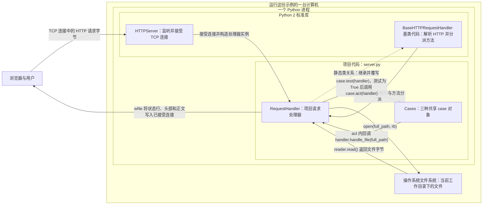
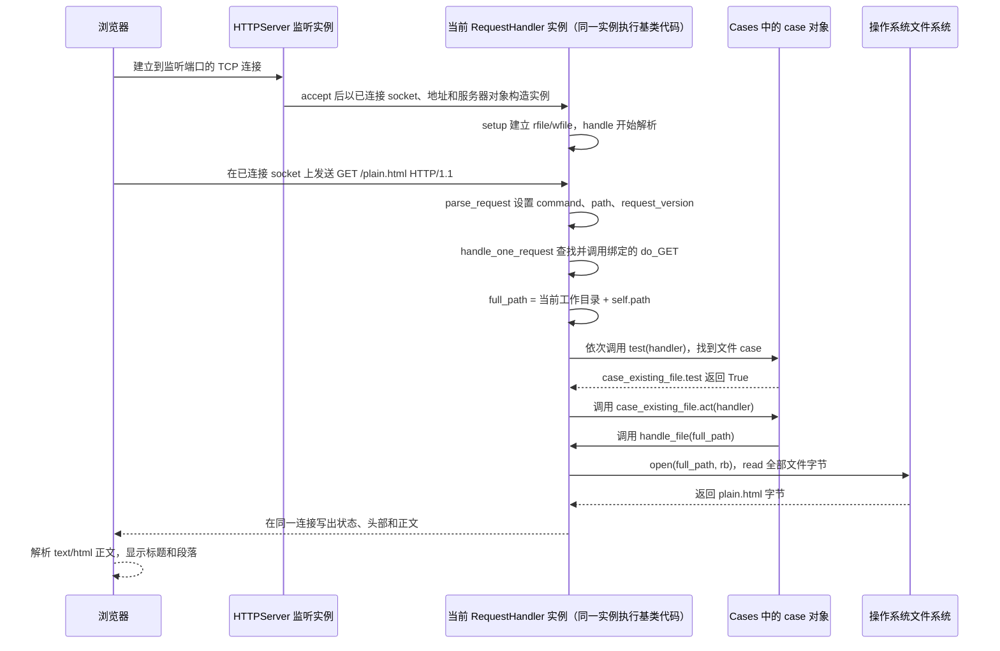

# 小型完整功能读码示例：浏览器打开 `/plain.html`，服务器如何识别请求、读取文件并返回页面

本页保留既有写法参照，尚未按 v1.11.8 [试行扩写基线](teaching.md#试行扩写基线重要小节要展开到什么程度) 逐节验收；不能以旧例篇幅或历史审读代替当前展开要求，也不声称真实教材已经修复。

> **阅读路线。** 当前主例是第 1–10 章的 HTTP 文件服务，从具体请求沿源码走到响应；页面后半的历史局部、JavaScript 与 JSX 示例是按需查阅的参照，不属于主例续章，也不代表本页的扩写基线或全课验收结论。

> **小型完整功能的读码示例。** 本课沿着源码实际完成的 `GET /plain.html` 路径：浏览器发出请求，Python 标准库解析并调用项目处理器，处理器从进程当前目录找到 `plain.html`、读出文件字节（每个字节由 8 个二进制位组成）、组装响应，浏览器再把响应正文解释为 HTML。下方原有的 Markdown 标题检查课保留为历史局部读码参照，不能用它的篇幅或范围校准本例。
>
>
> 这份小例子用于校准一个源码单元的代码前阅读准备、完整代码展示、代码后逐行推演、局部值演算、机制说明和上下游接线写法。它展示这些材料如何围绕一个真实、完整的 HTTP 文件读取响应路径组织；它不能证明大型仓库架构、前后端状态协作、全栈学习路线或其他技术栈已被完整覆盖。真实 lesson 应按项目实际结构与教学目标选择源代码规模和调用追踪深度，不受本例行数约束。固定主例 `server.py` 只有约 108 行，这只是示例程序的规模，不是课程片段的长度标准；遇到较长职责时会连续分块展示并把解释跟完。
>
> **源码与证据范围。** 项目源码固定为 [aosabook/500lines 提交 `fba689d101eb5600f5c8f4d7fd79912498e950e2` 的 `web-server/code/03-handlers/server.py` 原行 1–108](https://github.com/aosabook/500lines/blob/fba689d101eb5600f5c8f4d7fd79912498e950e2/web-server/code/03-handlers/server.py#L1-L108) 和同目录 [`plain.html` 原行 1–9](https://github.com/aosabook/500lines/blob/fba689d101eb5600f5c8f4d7fd79912498e950e2/web-server/code/03-handlers/plain.html#L1-L9)。行号来自固定提交的原始文件字节和 LF 换行，不来自网页抽取后的显示行号。机制依据是 CPython 2.7.18 的 `BaseHTTPServer.py`、`SocketServer.py` 与该版本标准库文档；本例实际默认 HTTP/1.0 响应的长度和边界依 RFC 1945 解释，第3章用 RFC 9112 说明 HTTP/1.1 的通用消息格式。源码是 Python 2 时代的示例，本文不把它改写成 Python 3，也没有启动服务或打开浏览器；运行命令只作可选操作说明。

## 1. 业务场景与本课目标

### 访问本机页面为什么需要服务器

你有一个写着网页标题和正文的文件（HTML 文件），双击它可以让本机浏览器直接从磁盘打开。这个动作不会向 Python 程序发送 HTTP（Hypertext Transfer Protocol，超文本传输协议）请求；HTTP 是浏览器与服务程序约定请求、响应结构的规则。若希望浏览器用 `http://...` 地址访问文件，就需要一个正在运行的服务程序：它在端口等待连接，收到请求后替浏览器读磁盘，再把结果写回网络。我们沿最小场景追踪这件事：浏览器访问同一台机器上的 `plain.html`。

### 浏览器地址中的四个现场值

URL（Uniform Resource Locator，统一资源定位符）是把访问方式、主机、端口和请求目标写在一起的地址。先看本次值：`http://127.0.0.1:8080/plain.html`。开头的 `http` 选择 HTTP（Hypertext Transfer Protocol，超文本传输协议）这套请求/响应格式；后面的主机和端口告诉浏览器要连到哪里；最后的 `/plain.html` 是它要取的目标文字。HTTP 规定请求和响应怎么排布；它不直接读服务器磁盘。

这里的 `127.0.0.1` 是 IPv4（Internet Protocol version 4，互联网协议第 4 版）的回环（loopback）地址，意思是连接回发起请求的本机；`8080` 是端口，操作系统借它把连接交给正在该端口监听的程序。远端访问时，浏览器和服务器可能在不同机器上；本例只是把客户端连接指回本机。

发送时，浏览器把 `GET /plain.html` 放进网络连接。TCP（Transmission Control Protocol，传输控制协议）负责按顺序运送连接中的字节，IP（Internet Protocol，互联网协议）负责网络寻址；程序通过 socket（套接字）读写网络连接。服务器收到请求后才由自己的进程访问文件，再把字节写回连接。URL 中的 `/plain.html` 是请求目标，不会让浏览器直接读取服务器进程的当前目录；它也还不是最终磁盘路径。

### 文件内容和浏览器显示的页面

HTML（HyperText Markup Language，超文本标记语言）是一组用尖括号标签标出标题、正文等结构的文字，浏览器读取后会把这些结构排成页面。固定版本把 `plain.html` 放在仓库相对路径 `web-server/code/03-handlers/plain.html`。文件的九行完整内容如下；这不是浏览器截图，而是服务器将读取的原始文件，来源定位为 [原行 1–9](https://github.com/aosabook/500lines/blob/fba689d101eb5600f5c8f4d7fd79912498e950e2/web-server/code/03-handlers/plain.html#L1-L9)：

```html
<html>
<head>
<title>Plain Page</title>
</head>
<body>
<h1>Plain Page</h1>
<p>Nothin' but HTML.</p>
</body>
</html>
```

`html` 根元素包住整个 HTML 文档；`head` 放文档信息，`title` 给文档一个标题；`body` 包住页面主体。主体里，`h1` 表示最高层级标题，`p` 表示一段正文。于是这九行给浏览器的可见结果是标题 `Plain Page` 和正文 `Nothin' but HTML.`；`title` 则用作文档标题。服务器不把这些标签画出来，而是按字节传回；响应头中的 `Content-Type: text/html` 告诉浏览器把正文作为 HTML 解析。可对照 [MDN 的标题元素说明](https://developer.mozilla.org/en-US/docs/Web/HTML/Reference/Elements/heading_elements)、[`p` 段落元素](https://developer.mozilla.org/en-US/docs/Web/HTML/Reference/Elements/p) 和 [`title` 文档标题元素](https://developer.mozilla.org/en-US/docs/Web/HTML/Reference/Elements/title)。

### 浏览器发送请求，服务器返回响应

一次典型请求可以抽象成下面的起始行和头部。浏览器可能附带更多头部；这里只列出本课解释所需的部分：

```http
GET /plain.html HTTP/1.1
Host: 127.0.0.1:8080

```

`GET` 是读取资源的请求方法；`/plain.html` 是这次请求的目标；`HTTP/1.1` 是客户端声明的请求版本。`Host: 127.0.0.1:8080` 告诉服务器请求所指向的主机和端口；HTTP/1.1 请求通常包含这个头。起始行和头部以一个空行结束，之后才可能是请求正文；此处 GET 没有要发送的正文。服务器按项目规则尝试取文件，成功时给出 `200`（成功）响应；下面用占位正文表示状态行和头部：

```http
HTTP/1.0 200 OK
Content-type: text/html
Content-Length: <正文的字节数>

<html>...原文件正文...</html>
```

`HTTP/1.0 200 OK` 中 `200` 表示成功，`OK` 是对应短语；`Content-Type: text/html` 表示正文按 HTML 解释；`Content-Length` 说明正文有多少字节，尖括号只是占位符，实际代码会将 `len(content)` 转成十进制文字。固定原始文件为 116 字节，其中包括 9 个 LF 换行；若按这个版本原样以二进制读取并写出，长度值就是 `116`。这是静态字节计数，不是一次运行观察。标准库的 `send_response` 还会写 `Server` 与 `Date` 头。请求块和响应块中头部后面的空行标出头部结束；响应正文从其后开始。状态行使用 `HTTP/1.0`，即使浏览器请求行写 `HTTP/1.1`，因为 Python 2.7.18 的处理器默认 `protocol_version` 是 `HTTP/1.0`；请求版本与响应版本来自不同字段，不能假设相同。本课读完后，你应能沿这组具体值说明请求如何进入 `do_GET`、路径如何变成文件名、谁构造成功或失败响应，以及浏览器凭什么把返回字节当作 HTML；不会要求你安装或运行旧版 Python 才能阅读。

## 2. 系统位置与架构分工

先把图分成两种线来看：实线跟一次请求的数据与调用，虚线表示项目处理器沿用标准库处理器定义的关系。浏览器在 Python 进程外；标准库服务器和项目处理器在同一进程；文件系统经操作系统 I/O（Input/Output，输入/输出）提供字节。TCP（Transmission Control Protocol，传输控制协议）让已连接两端交换连续字节；反向文件箭头表示读取结果返回给处理器。

先用图中的代码认识几个对象。**类**是可重复创建同类对象的定义，**实例**是按类创建出的一个具体对象：`RequestHandler` 是类，服务器每接受一条连接后才创建该连接的 `handler` 实例。类声明写成 `class RequestHandler(BaseHTTPServer.BaseHTTPRequestHandler):`；这里括号指定它沿用的**基类**，这是一条类定义语句，不是在调用构造函数。基类提供通用读请求和分派步骤；项目类继承这些步骤，再用同名 `do_GET` **覆写**需要定制的部分。

`Cases` 是类属性，也就是放在类上、所有 `handler` 实例可查到的共享规则表；`self.path` 和 `self.full_path` 是某个 `handler` 实例自己的请求状态。方法调用也分清接收者：`case.test(handler)` 中点号左侧的 `case` 自动绑定为方法里的 `self`，括号里的 `handler` 是显式传入的当前请求对象；基类调用 `handler.do_GET()` 时，`handler` 实例自动绑定为 `do_GET` 的 `self`。第三章会用同一组对象把绑定过程展开。



`HTTPServer` 的项目创建点在 [`server.py` 原行 105–108](https://github.com/aosabook/500lines/blob/fba689d101eb5600f5c8f4d7fd79912498e950e2/web-server/code/03-handlers/server.py#L105-L108)；它继承的标准库 `HTTPServer` 再继承同步 `TCPServer`，其 socket 建立、绑定与监听见 [CPython 2.7.18 `BaseHTTPServer.py` 原行 102–111](https://github.com/python/cpython/blob/v2.7.18/Lib/BaseHTTPServer.py#L102-L111)、[`SocketServer.py` 原行 413–443](https://github.com/python/cpython/blob/v2.7.18/Lib/SocketServer.py#L413-L443)。

项目处理器的定义与规则表在 [`server.py` 原行 44–52](https://github.com/aosabook/500lines/blob/fba689d101eb5600f5c8f4d7fd79912498e950e2/web-server/code/03-handlers/server.py#L44-L52)；它继承的基类是 [CPython 2.7.18 `BaseHTTPServer.py` 原行 114](https://github.com/python/cpython/blob/v2.7.18/Lib/BaseHTTPServer.py#L114)，该基类再通过 [SocketServer 的流连接处理器与 `rfile`/`wfile` 设置](https://github.com/python/cpython/blob/v2.7.18/Lib/SocketServer.py#L677-L706)接入 socket。基类代码从连接读请求行、头部，并将请求字段派发给覆写方法；项目的 `RequestHandler` 提供 `do_GET`、文件读取、错误页和正文写出，不自行监听 TCP 端口或解析请求行。

实际数据链从 [`do_GET` 构造 `full_path` 与遍历规则](https://github.com/aosabook/500lines/blob/fba689d101eb5600f5c8f4d7fd79912498e950e2/web-server/code/03-handlers/server.py#L65-L79)开始，经 [`handle_file` 读取字节](https://github.com/aosabook/500lines/blob/fba689d101eb5600f5c8f4d7fd79912498e950e2/web-server/code/03-handlers/server.py#L81-L88)，再到 [`send_content` 输出](https://github.com/aosabook/500lines/blob/fba689d101eb5600f5c8f4d7fd79912498e950e2/web-server/code/03-handlers/server.py#L95-L101)。`open(...)` 请求操作系统文件读取能力，读出的字节回到 Python 处理器；响应经标准库提供的写流返回到同一已接受连接。图里的“文件系统”不是 Python 项目内部的另一个控制器。

### 模块、进程和继承关系

模块是保存类和函数定义的源文件单位；进程是操作系统启动后执行这些定义、创建服务器对象的运行单位。本例的 `server.py` 模块和导入的标准库模块都在同一个 Python 进程里，不代表它们分别运行成服务器进程。`RequestHandler` 是类；标准库接收连接后才调用这个类构造一个处理器实例。图中虚线表示类继承关系，实线表示运行时调用或字节流动，因此“基类代码调用覆写方法”仍是在同一个实例上发生，不是两个 handler 互相转发。

### 类属性和每连接的实例状态
模块执行到 `class RequestHandler` 时会执行类体，并建立 `Cases` 列表和三个 case 实例；此时还没有客户端连接。之后主入口创建 `HTTPServer`，服务器对象持有监听 socket 与 `RequestHandler` 类。一个客户端 TCP 连接被接受后，标准库才创建该连接的 handler 实例；默认 HTTP/1.0 响应设置使它通常只处理这个连接上的一个请求。`self.path`、`self.command`、`self.full_path`、`rfile`、`wfile` 属于这次连接的 handler 实例；文件内容则是 `handle_file` 中局部变量 `content` 的值。`RequestHandler.Cases` 是类属性，多个 handler 实例访问同一列表；列表里的 case 对象不保存某个用户的路径，而是调用时接收当前 handler。

### 规则对象怎样回调当前处理器
图中的箭头按调用方向读。`do_GET` 循环拿到一个 case 后执行 `case.test(handler)`；在 `test` 方法里，点号左边的 case 绑定为该方法的 `self`，括号中的 handler 是显式参数 `handler`。结果为真时，处理器再调用 `case.act(handler)`；`act` 中 `self` 仍是 case，参数仍是当前 handler。接着 case 执行 `handler.handle_file(full_path)`，所以图上有一条从 case 回到 handler 的回调箭头。它表示真实方法调用，不表示 case 继承自 handler，也不表示项目代码和标准库各有一个独立处理器。

这条边界适合展示本课的实际责任：通用网络协议由标准库处理，项目代码只回答“这个请求路径对应什么文件、怎样读、怎样把成功或失败写回去”。若把请求行解析也塞进 `RequestHandler`，项目就需要重新处理协议细节；若把文件选择交给标准库，这份代码中的 `Cases` 和文件映射规则又失去作用。当前 `HTTPServer` 是同步的 `TCPServer` 子类，没有混入线程服务器；一个请求处理期间，主服务循环不会并行处理另一个连接。慢文件读取或慢客户端因此可能拖住后续请求，这一点来自实际运行类，不是图中额外虚构出的工作队列。

## 3. 读懂本课所需的概念

### HTTP 消息怎样把请求和正文分开

浏览器是客户端：它提出取回页面的请求；服务器是接收请求并回送答复的程序。HTTP（Hypertext Transfer Protocol，超文本传输协议）约定请求和响应的消息结构。HTTP/1.1 消息由起始行、头部行、一个空行和可选正文组成；起始行和每个头部行以 `CRLF` 结束，CRLF 是 Carriage Return Line Feed（回车换行，即 `\r\n`）。请求起始行依次给出方法、请求目标和版本，例如 `GET /plain.html HTTP/1.1`；响应起始行给出服务器使用的版本、状态码和说明文字。空行结束头部，后面的字节才属于正文。可对照 [RFC 9112 的消息格式](https://www.rfc-editor.org/rfc/rfc9112.html#section-2.1) 与 [`Content-Length` 定义](https://www.rfc-editor.org/rfc/rfc9112.html#section-6.2)。本项目是 Python 2 时代的 HTTP/1.0 默认响应示例；RFC 9112 在此只帮助理解消息边界，不证明项目完整支持 HTTP/1.1。

TCP（Transmission Control Protocol，传输控制协议）把已连接的两端表现为连续字节流；它不替应用程序标出 HTTP 头部在哪里结束。标准库读请求行、各头部行和空行，才得到 HTTP 字段边界。`wfile.write(...)` 把响应字节交给这个 TCP 连接的输出流；调用返回不表示浏览器已收到全部字节。

把两层放回这一次请求里：浏览器先把 `GET /plain.html HTTP/1.1` 编成字节交给 TCP；TCP 尽力按顺序把字节送到连接另一端，却不认识 `GET`、头部或 HTML。HTTP 才规定接收端如何把这些字节读成请求行、头部和正文。反方向也一样：TCP 不会替项目挑 `200`，是项目/标准库按 HTTP 规则写出状态行与头部，再把它们连同正文交给 TCP。

头部结束空行的意义是让解析器知道从哪里开始才是正文；`Content-Length` 则在正文长度需要明确时说明后续有多少个八位字节。它写的是字节数，不是字符数。请求和响应的换行符是协议边界的一部分，不能把看起来空白的那一行删掉后还声称消息结构相同。RFC 9112 解释的是通用 HTTP/1.1 消息格式；本课项目按 Python 2.7.18 默认发送 HTTP/1.0 响应，不因此获得完整 HTTP/1.1 能力。

#### 同一请求在传输层、HTTP层和socket对象上的不同读法

用本课输入做一张消息边界图。它是教学示意，不是程序抓包记录：

```text
浏览器交给 TCP 连接的有序字节：
GET /plain.html HTTP/1.1\r\n
Host: 127.0.0.1:8080\r\n
\r\n
[可选的请求正文字节]

HTTP 解析器据此识别：
起始行 = 方法 GET | 目标 /plain.html | 版本 HTTP/1.1
头部行 = Host: 127.0.0.1:8080
空行 = 头部结束；其后的字节才属于正文

当前连接的 socket/rfile = 程序从这条已接通通道读取上述字节的接口
```

第一部分是 TCP 能看到的顺序字节；它不理解 `GET` 或 `Host` 的含义，也不知道头部在哪结束。HTTP 解析器按 `CRLF` 读起始行和头部，并把空行作为边界；若请求正文存在，才从空行后读取正文。`socket` 是程序手上的连接对象，`rfile` 是标准库用该连接包装出的读取接口，它们都不替代 HTTP 规则。项目拿到解析后的 `self.path`，是在这几步之后；它再把目标文字交给文件路径拼接逻辑。

### URL 目标、网络地址和文件路径分别是谁

URL（Uniform Resource Locator，统一资源定位符）把访问方案、主机、端口和目标写在一起；它不是磁盘路径。这里 `http` 是 URL 的 scheme（访问方式前缀），选择 HTTP 访问；`127.0.0.1` 是 IPv4（Internet Protocol version 4，互联网协议第 4 版）地址，`8080` 是服务器监听端口，`/plain.html` 是请求目标。IP（Internet Protocol，互联网协议）是网络寻址协议；IPv4 是地址格式之一。本例的 `127.0.0.1` 是回环地址，表示连接回到发起它的本机，不代表所有服务器地址。

端口让操作系统把到达某个监听端口的连接交给相应 socket。socket（套接字）是程序操作网络连接一端的对象；它不是磁盘文件。URL 中的 `/plain.html` 只是发来的目标文字，不会自动成为服务器上的 `/plain.html` 文件。标准库把目标存到 `self.path`；项目随后才用 `os.getcwd() + self.path` 构造文件路径。因此当前工作目录、请求目标和最终磁盘路径是三个不同值；查询文字也仍包含在本例的 `self.path` 中。Python 的 tuple（元组）按顺序保存多个值；入口中的 `('', 8080)` 是一个二元组，第一项为空主机文字，第二项是端口整数 `8080`。

沿着值走一遍就能分清这些名字：浏览器地址 `http://127.0.0.1:8080/plain.html` 中，`127.0.0.1` 是本机回环地址，`8080` 是连接目标端口，`/plain.html` 是随 HTTP 请求发送的目标文字。入口另有绑定值 `('', 8080)`；空主机表示在本机 IPv4 接口上监听，不是请求中的 `127.0.0.1`。监听 socket 等连接；TCP `accept()` 之后得到的已连接 socket 才承载某个客户端的字节流。标准库把这条连接交给新 handler，HTTP 解析后 `self.path` 仍是 `/plain.html`。最后项目用进程当前工作目录拼出 `/work/500lines/web-server/code/03-handlers/plain.html`，这个字符串才交给文件系统打开。

所以至少有四种不能互换的东西：监听地址决定程序在哪里等连接；已连接 socket 对应一条已经接通的网络通道；URL/请求目标告诉服务器客户端要什么；磁盘路径告诉操作系统程序要读哪个本地文件。改请求目标不等于改服务器监听地址，改 URL 中的端口也不等于改源码里的文件目录。本项目把 `?rev=2` 也留在 `self.path` 并直接拼进路径，说明它没有单独解析查询参数。

### 类、实例、属性与继承怎样组成这条调用

类是创建一类对象的定义，实例是按定义创建出的具体对象。源码声明 `class case_no_file(object):` 时建立类；执行 `case_no_file()` 才调用这个类并创建规则实例。完整的项目类声明是 `class RequestHandler(BaseHTTPServer.BaseHTTPRequestHandler):`：括号中的名字是基类，表示项目类沿用它的通用请求读取与方法分派行为；这是定义类的语句，不是在调用构造函数。子类写出同名 `do_GET` 来**覆写**基类方法，运行时仍由同一个 handler 实例承载两边的方法和字段。

类属性是放在类定义上的值，实例可以查到它；`Cases` 因而是一份共享规则表。`self.path`、`self.full_path` 和 `self.wfile` 是某个处理器实例上的请求状态和连接流。服务器接受连接后才按 `RequestHandler` 类创建 handler 实例；三个规则实例却在执行类体中创建，跨连接复用。若把请求路径保存进共享的 case 字段，不同连接就会读写同一个可变位置。


Python 源文件也可作为模块导入；`import os` 让当前模块可用名字 `os` 找到该模块。解释器给模块提供 `__name__`：直接运行文件时它是 `'__main__'`，导入时通常是模块名。`==` 比较两边的值并产生布尔值，所以 `if __name__ == '__main__':` 只在直接运行时进入入口。`sys.argv` 保存脚本名与命令行参数；本文件虽然导入 `sys`，却未读取它，因此这些参数不会改变工作目录或监听端口。

`def method(self, handler):` 声明方法及其参数；参数是接收值的名字，调用时传入的值叫实参。`case.test(H)` 是调用时的写法：点号左侧的 `case` 自动绑定到 `test` 内的 `self`，括号中的 `H` 再绑定给 `handler`。因此 `case.test(self)` 中有两个不同用途的 `self`：外层的 `self` 是 `RequestHandler` 实例；进入 `test` 后，方法自己的 `self` 是 case 实例，显式参数 `handler` 才指向处理器。点号从对象取属性，例如 `os.getcwd` 是模块函数，`handler.full_path` 是请求字段，`self.Cases` 能沿类找到共享表。

方法首参 `self` 是约定，不是 Python 关键字。标准库调用已绑定的 `handler.do_GET()` 时不显式传 `handler`，它会自动成为 `do_GET` 的 `self`。类或方法体开头的三引号字符串可作文档字符串；多行三引号也能保存错误模板，开头的反斜线会去掉模板首个换行。`pass` 是占位语句，执行时不增加动作。

### 一个真实调用里的 H、N、E 对象

把当前连接的 `RequestHandler` 实例记作 `H`，把两个规则实例记作 `N = case_no_file()` 和 `E = case_existing_file()`。这只是给对象起便于跟踪的短名字，不会改程序。实际表达式是 `case.test(self)`；当 `case` 指向 `E`、外层 `self` 指向 `H` 时，它调用已绑定的方法 `E.test(H)`。进入方法体后，自动绑定令方法内的 `self` 指向 `E`，显式参数 `handler` 指向 `H`。写成 `E.test(self=E, handler=H)` 只能作为解释绑定结果的概念表达，不是读者应照着调用的源码。

本次请求给出具体状态：`H.full_path` 是 `/work/500lines/web-server/code/03-handlers/plain.html`，文件存在；`N` 与 `E` 已在共享列表中，循环只会让局部名 `case` 依次指向它们，不会重新创建对象。于是 `N.test(H)` 读取 `H.full_path`；进入 `N.test` 后的 `handler.full_path` 仍是 `H` 的路径。再进入 `E.test(H)` 时，`self` 改为规则对象 `E`，但传入的 `handler` 仍是同一个 `H`。相同拼写的 `self` 是不同方法调用各自的参数名，不是某个全局对象。

### 条件、循环、返回值与副作用怎样选择一个 case

`Cases` 是有序列表；`for` 依次让局部名 `case` 指向一个已有规则对象。`if` 消费 `case.test(...)` 的布尔结果：`False` 跳过动作，`True` 才进入动作。`return expression` 结束当前方法并把表达式值交给调用者，所以 `test` 返回的真假值决定 `if` 的分支。

下面四行是项目 `do_GET` 的真实循环，位于 AOSA 固定提交 `fba689d101eb5600f5c8f4d7fd79912498e950e2` 的 `web-server/code/03-handlers/server.py`，符号 `RequestHandler.do_GET`，原行 72–75；[固定原文](https://github.com/aosabook/500lines/blob/fba689d101eb5600f5c8f4d7fd79912498e950e2/web-server/code/03-handlers/server.py#L72-L75)。行尾中文是教学注释，未改动原语句。

```python
            for case in self.Cases:
                if case.test(self):  # 教学注释：test 的返回值决定是否进入动作分支。
                    case.act(self)  # 教学注释：测试为真时才执行这个规则的动作。
                    break  # 教学注释：动作正常返回后退出最近的 for 循环。
```

`for case in self.Cases` 按列表次序让 `case` 指向已有对象。第一次循环是 `case = N`，实际调用 `N.test(H)`；`os.path.exists(H.full_path)` 得到 `True`，`not True` 使 `N.test` 返回 `False`。`if` 消费这个布尔值，跳过 `N.act` 和 `break`，循环继续。第二次是 `case = E`，调用 `E.test(H)`；普通文件使 `os.path.isfile(H.full_path)` 返回 `True`，于是执行 `E.act(H)`，后者调用 `H.handle_file(H.full_path)`。

`return expression` 结束方法调用并把表达式值交回调用者；因此 `test` 的 `True`/`False` 会被 `if` 消费。`act` 没有显式 `return`，正常走到末尾就交回特殊值 `None`；这不代表它没有副作用，普通文件动作已经尝试读取和发送。`break` 只在 `act` 正常返回后运行。若 `act` 执行 `raise`，控制转向匹配的 `except`，越过 `break`；恒真兜底规则因此必须排在最后。

### Python 异常和 HTTP 状态不是同一种结果

`raise ServerException(...)` 抛出 Python 异常，会中断当前正常语句并沿调用链寻找匹配的 `except`。`try` 标出可能失败的语句范围；`IOError` 是 Python 输入/输出操作的异常，`except IOError as msg` 接住它并把异常对象绑定到 `msg`。`except Exception as msg` 也能接住它以及其他普通异常。本例 `do_GET` 的 `except Exception as msg` 把缺失路径异常交给 `handle_error`；它也会接住其他普通程序错误，所以项目内部错误可能被误显示成文件访问错误。

`404` 则是 HTTP 响应中的状态码，表示当前目标未找到。异常不会自动写状态行或 HTML 页面；只有 `send_content(content, 404)` 才把状态码写入响应。成功调用 `send_content(content)` 省略状态参数，Python 使用签名中的默认值 `status=200`。相同的发送方法因此由调用点选择成功还是失败的语义。

字符串的 `.format(...)` 会把花括号占位符替换成调用者给的值。`"'{0}' not found".format('/missing.html')` 用第一个位置实参替换 `{0}`，得到 `"'/missing.html' not found"`；`"{path}: {msg}".format(path=self.path, msg=error)` 则按名字填两个占位符。`path=...` 和 `msg=...` 是传给格式化方法的关键字实参，不会给 `self` 的字段赋值；这也是错误页模板把请求路径和异常说明组合成正文的方式。

### 文件字节怎样成为浏览器能解释的 HTML

Python 2 的普通 `str` 是字节串；`unicode` 是保存已解码文字字符的文本类型，可以先把它理解成字符层面的内容。`open(full_path, 'rb')` 中 `r` 表示读取，`b` 选择二进制模式：在区分文本/二进制的平台上保留文件原有换行字节；Python 2 的 `open(full_path, 'r')` 也不会自动把内容解码成 `unicode`。`.read()` 在本例得到 `plain.html` 的字节串。`with open(...) as reader` 把文件对象绑定给 `reader`，离开缩进块时关闭它，即使读取抛出异常也会清理资源；`with` 不创建新的局部变量作用域。这里一次读完整份小文件，因此内容会暂存在内存。

`Content-Type: text/html` 告诉浏览器正文应按 HTML 解释，不会转换文件内容。ASCII（American Standard Code for Information Interchange，美国信息交换标准代码）是常见英文字母、数字和标点的基本编码；例如大写字母 `A` 的 ASCII 字节是十六进制 `0x41`。这份 `plain.html` 只含 ASCII 字符，所以对它来说**字符数和字节数恰好相等**。`len(content)` 实际数的是读入的字节；HTTP 的 `Content-Length` 也声明正文的八位字节数量。Unicode 是不同文字字符的统一表示；Python 2 的 `unicode` 类型表达这种已解码文字，而不是原始文件字节。若文件中有 UTF-8 编码的 `中`，它是一个 Unicode 字符、在读入的 UTF-8 字节串中占三个字节，因此**字节数不是字符数**，用字符数代替编码后字节数会算错长度。`str(len(content))` 把字节整数转成头部所需的十进制文字；`wfile` 是标准库围绕已接受 socket 建立的输出文件接口。

这里的十六进制用 `0`–`9` 和 `A`–`F` 共 16 种数位表示数值；写在源码里的 `0x` 前缀表示后面的整数采用十六进制，两个十六进制位可表示一个字节（`0x00`–`0xFF`）。所以 `0x41` 是一个字节值，不是字符数。

这两种类型回答不同问题：Unicode 文本表示“是什么文字”，编码后的 `str` 表示“线上实际是哪几个字节”。UTF-8（8-bit Unicode Transformation Format，8 位 Unicode 转换格式）把 Unicode 字符编码成一串字节；常见 ASCII 字符在 UTF-8 中仍各占一个字节，而 `中` 的 UTF-8 序列是三个字节。若发送文本，正确顺序是先选编码得到最终字节，再对这些字节计算 `Content-Length`。本例用 `'rb'` 直接读取仓库文件，得到的已经是待发送字节，所以 `len(content)` 不需要把字符再编码一次。

下面是 Python 2 交互解释器的教学记录，不是项目源码。`>>>` 表示你在交互提示符输入；提示符会显示表达式的表示结果。这里用 `\u4e2d` 写出 Unicode 码点，因而示意本身全是 ASCII 字符，无需源文件中文编码声明。

```text
>>> text = u'\u4e2d'
>>> text
u'\u4e2d'
>>> len(text)
1
>>> encoded = text.encode('utf-8')
>>> len(encoded)
3
>>> encoded
'\xe4\xb8\xad'
```

输入 `u'\u4e2d'` 得到一个 Unicode 字符；`U+4E2D` 是该字符在 Unicode 编号表中的码点。`\u4e2d` 是把码点写进 Python 源码的 Unicode 转义；`encode('utf-8')` 把它编码成三个字节，十六进制依次为 `E4 B8 AD`。在字节串表示里，`\xe4`、`\xb8`、`\xad` 分别用两个十六进制位写出一个字节。提示符里 `len(text)` 显示 1，`len(encoded)` 显示 3。交互解释器会对刚输入的表达式显示表示结果；如果把 `len(encoded)` 或 `encoded` 裸写进 `.py` 脚本，脚本不会自动把它们打印出来。提示符末尾显示 `'\xe4\xb8\xad'` 是 Python 2 对这三个字节的 `repr`（对象的显示表示形式），不是再次编码的操作，也不是三个字符。项目的 `content` 来自二进制 read；原行 99 用 `str(len(content))` 把最终正文的字节数写到 `Content-Length`。文本若要发送，应先选定编码并取得最终字节，再对这些字节计数。

文件换行也计入总字节数。固定提交里的 `plain.html` 共 116 字节，其中有 9 个 LF 换行；若只把这 9 个 LF 各换成 CRLF，每处多一个字节，长度静态计算为 125。这里没有执行服务器，只是在源文件字节上计数。长度头若按字符数或另一份换行格式计算，浏览器看到的边界就可能与实际发送正文不一致。

## 4. 端到端流程与本课边界

### 启动阶段：先建规则表，再开始监听

为让路径值可以复算，以下静态示例假设仓库检出在 `/work/500lines`，启动进程时的当前工作目录为 `/work/500lines/web-server/code/03-handlers`。这是假设输入，不是本机运行记录。Python 按文件顺序先执行导入和类定义；执行 `class RequestHandler` 的类体时，原行 50–52 的三个 `case_*()` 调用立即创建三个共享对象。它发生在文件末尾主程序创建服务器之前，所以启动时已有规则列表，但还没有任何连接处理器。

文件定义全部完成后，`if __name__ == '__main__'` 才进入入口。`serverAddress = ('', 8080)` 把 IPv4 主机值与端口组成二元组。该版 socket 文档说明 IPv4 的空主机字符串代表 `INADDR_ANY`，即“任意本地 IPv4 接口”的地址常量，因此服务器绑定本机所有可用 IPv4 接口，而非只绑 `127.0.0.1`。`BaseHTTPServer.HTTPServer(serverAddress, RequestHandler)` 把监听地址和处理器类交给标准库；服务器构造 socket、绑定并监听，随后 `serve_forever()` 等待连接；构造与 `listen()` 的位置见 [CPython 2.7.18 `SocketServer.py` 原行 413–443](https://github.com/python/cpython/blob/v2.7.18/Lib/SocketServer.py#L413-L443)。入口和监听配置位于 [项目 `server.py` 原行 105–108](https://github.com/aosabook/500lines/blob/fba689d101eb5600f5c8f4d7fd79912498e950e2/web-server/code/03-handlers/server.py#L105-L108)，空主机的语义见 [CPython 2.7.18 socket 文档原行 54–58](https://github.com/python/cpython/blob/v2.7.18/Doc/library/socket.rst#L54-L58)。源码不读取命令行参数；启动目录取自进程当前工作目录，端口直接写在 tuple 中。

### 一次请求：连接被接受后才产生处理器实例

用户输入 `http://127.0.0.1:8080/plain.html` 后，浏览器对本机 8080 端口建立 TCP 连接，并在连接中写入请求。`serve_forever()` 轮询监听 socket；连接就绪时，标准库取出已接受 socket 和客户端地址，再沿同步默认路径创建处理器。`HTTPServer` 持有 `RequestHandler` 类；它不预先创建实例。每个被接受的连接才构造一个 `RequestHandler` 实例，实例绑定该连接的 `request`、客户端地址和服务器对象。



标准库 `BaseRequestHandler` 构造函数先存放 socket、客户端地址和服务器对象，再调用 `setup()`、`handle()`，最后清理；流处理器的 `setup()` 给同一连接建立 `rfile` 和 `wfile`。因此图中 `H` 是一个 handler 实例，基类方法和覆写方法都在它身上运行。服务器只接受连接并创建 handler；真正读请求行、识别 `GET` 并调用项目 `do_GET` 的是这个实例内部的 HTTP 基类分派代码，不是 `HTTPServer` 直接调用项目方法。[生命周期的原文位置](https://github.com/python/cpython/blob/v2.7.18/Lib/SocketServer.py#L649-L717)。

处理器构造发生在同步调用栈里：`BaseRequestHandler.__init__` 先存下三个字段，再 `setup()`；接着调用 `handle()`，并由 `finally` 执行 `finish()`。所以正常读完或处理过程中抛异常，handler 的收尾都会尝试刷新、关闭 `wfile` 和关闭 `rfile`。若 `handle()` 抛出的异常没有被项目接住，它会返回到服务器的 `process_request` 路径，由 `_handle_request_noblock` 调用服务器错误钩子并关闭已接受 socket；项目自己接住的 `ServerException` 则按第5章路径转成 404，不会走到这条未处理异常分支。`setup()` 本身位于 `try` 外，若资源建立阶段抛错，`finish()` 不会由这段 `finally` 执行。方法顺序和异常边界见 [CPython 2.7.18 `BaseRequestHandler.__init__`](https://github.com/python/cpython/blob/v2.7.18/Lib/SocketServer.py#L649-L657) 与 [`BaseHTTPRequestHandler.handle`](https://github.com/python/cpython/blob/v2.7.18/Lib/BaseHTTPServer.py#L336-L343)。

### 从请求行到文件路径：每次值变化由谁负责

对图中请求行 `GET /plain.html HTTP/1.1`，基类解析后把 `self.command` 设为 `'GET'`，把 `self.path` 设为 `'/plain.html'`，把 `self.request_version` 设为 `'HTTP/1.1'`。接着基类按 `do_` 加方法名的规则，在同一个实例上找到 `do_GET` 并调用。项目路径赋值所在位置是 [`server.py` 原行 64–79](https://github.com/aosabook/500lines/blob/fba689d101eb5600f5c8f4d7fd79912498e950e2/web-server/code/03-handlers/server.py#L64-L79)；基类解析与方法查找分别见 [`BaseHTTPServer.py` 原行 232–299](https://github.com/python/cpython/blob/v2.7.18/Lib/BaseHTTPServer.py#L232-L299) 和 [原行 301–343](https://github.com/python/cpython/blob/v2.7.18/Lib/BaseHTTPServer.py#L301-L343)。

本次静态值中，`os.getcwd()` 是 `/work/500lines/web-server/code/03-handlers`，`self.path` 是 `/plain.html`，所以 `self.full_path` 变成 `/work/500lines/web-server/code/03-handlers/plain.html`。这是项目的字符串拼接结果，不是标准库将 URL 自动转换成文件路径。随后循环先问缺失规则：`exists(full_path)` 为真，取反后该 case 返回 `False`；再问普通文件规则：`isfile(full_path)` 为真，选中它并调用 `act`。只有 `act` 正常返回后，`do_GET` 才执行 `break` 停止继续检查；`case_always_fail` 只有前两条都没处理时才轮到。

### 从选中的 case 到响应正文：文件字节由调用方消费

文件 case 把同一个 `full_path` 交给当前处理器的 `handle_file`。本例 `open(full_path, 'rb')` 返回二进制 reader，`read()` 读出 `plain.html` 九行字节；退出 `with` 块后文件关闭。成功路径随后调用 `send_content(content)`，没有传第二个参数，因此使用默认 `status=200`。这两个调用依次发生在 [`case_existing_file.act` 原行 22–29](https://github.com/aosabook/500lines/blob/fba689d101eb5600f5c8f4d7fd79912498e950e2/web-server/code/03-handlers/server.py#L22-L29)、[`handle_file` 原行 81–88](https://github.com/aosabook/500lines/blob/fba689d101eb5600f5c8f4d7fd79912498e950e2/web-server/code/03-handlers/server.py#L81-L88) 和 [`send_content` 原行 95–101](https://github.com/aosabook/500lines/blob/fba689d101eb5600f5c8f4d7fd79912498e950e2/web-server/code/03-handlers/server.py#L95-L101)。

`send_content` 先调用标准库 `send_response(200)`，再写项目选择的 `Content-type: text/html` 与按字节计算的 `Content-Length`，用空行结束头部，最后把正文交给 `wfile`。Python 2.7.18 的默认 `protocol_version` 使状态行是 `HTTP/1.0 200 OK`，即使输入请求写 `HTTP/1.1`。浏览器读取到完整响应后，按 `text/html` 解析原来的标签，页面主体显示 `Plain Page` 与 `Nothin' but HTML.`；`title` 是文档标题。`wfile.write` 调用只表明程序尝试向连接写字节，并不证明网络完整送达或浏览器成功绘制，本课没有实际观察这一步。

本课的链路范围是这一个 `GET /plain.html` 成功路径、缺失/非文件路径错误，以及它们依赖的标准库连接建立与分派。启动装配和每个请求的生命周期已分别追踪；浏览器缓存、CSS、JavaScript、域名解析与 TLS 不参与这份示例的文件读取链，因此不在本课展开。


## 5. 真实源码逐段逐行精读

本章按运行因果读源码：模块初始化先建立可复用的类型、规则表和模板；脚本入口建立监听服务器；用户发起 GET 后，标准库把解析结果交给项目方法；规则选择文件分支或失败分支；文件读取后进入成功发送或错误发送。下面数值是静态演算假设，不是运行观察：当前工作目录为 **/work/500lines/web-server/code/03-handlers**，成功目标为 **/plain.html**，缺失目标为 **/missing.html**，目录目标为 **/subdir**。行号指 AOSA 固定提交的原文件。源码块保留对应单元的行为语句与原注释；额外说明会标为“教学注释”。

### 5.1 初始化：模块先建立规则类型、处理器类属性和模板

#### 实际问题与实现思路

脚本还没监听端口时，解释器需要先加载后续会用的模块、项目异常类型和处理器类。类定义建立类对象和方法；它不会处理请求，也不会打开页面。`RequestHandler` 类体里的 `Cases` 表达式会立即创建三个 `case` 实例，但各自的 `test`、`act` 方法体要等 `GET` 请求到来才运行。

#### 架构位置、时机与输入

Python 从文件顶部顺序执行模块级语句。`import` 把导入的对象绑定到名字；`class` 语句执行缩进类体并创建类对象。原行 11–40 先定义三个 `case` 类型，随后执行 `RequestHandler` 类体中的原行 50–52：三个构造调用从左到右各创建一个新实例，`Cases` 列表保存这些对象的引用。每次真正执行这个模块时，处理器类体运行一次；普通重复 `import` 通常复用解释器已缓存的模块，不会再次执行类体。类体完成后名字 `RequestHandler` 才绑定到新类；直接运行或首次导入都会建立规则表，但导入本身不会进入文件末尾的监听入口。此时还没有连接，也没有连接专属的 `self.path`、`self.full_path`。Python 2.7 对 `class` 语句的执行规则见[语言参考](https://docs.python.org/2.7/reference/compound_stmts.html#class-definitions)。

#### 源码定位与阅读准备

来源是 AOSA 仓库固定提交 `fba689d101eb5600f5c8f4d7fd79912498e950e2` 的 `web-server/code/03-handlers/server.py`：模块导入与 `ServerException` 定义位于原行 1–7；`RequestHandler` 类、共享规则表和错误模板位于原行 44–62。[原行 1–7](https://github.com/aosabook/500lines/blob/fba689d101eb5600f5c8f4d7fd79912498e950e2/web-server/code/03-handlers/server.py#L1-L7)；[原行 44–62](https://github.com/aosabook/500lines/blob/fba689d101eb5600f5c8f4d7fd79912498e950e2/web-server/code/03-handlers/server.py#L44-L62)。规则方法在 5.4 按请求真正调用的顺序完整展开。

#### 完整源码：模块导入与项目异常（原行 1–7）

```python
import sys, os, BaseHTTPServer

#-------------------------------------------------------------------------------

class ServerException(Exception):
    '''For internal error reporting.'''
    pass
```

#### 按行推导：名字和异常类型

##### 原行 1：导入后绑定了什么

`import sys, os, BaseHTTPServer` 在当前模块建立三个可用名字。后文用 `os.getcwd()` 取得进程工作目录，用 `os.path.exists()`、`os.path.isfile()` 检查路径；`BaseHTTPServer` 提供 HTTP 处理器基类与 `HTTPServer`。`sys` 在固定文件的其余部分没有被读取，因此程序不会从它自动取得命令行参数。导入模块本身不会启动监听。

##### 原行 3、5–7：类的定义时机与异常的抛出时机

原行 3 的横线只是注释。原行 5 建立 `ServerException` 类；括号中的 `Exception` 是 Python 通用异常基类，继承它后，自定义类型能被 `raise` 抛出，也能被 `except Exception` 捕获。原行 6 是文档字符串，原行 7 的 `pass` 是空类体所需的占位语句，表示这个子类没有再添加自己的字段或方法；它仍继承 `Exception` 的构造方式、异常文字与其他父类行为。

执行 `class` 只定义一种以后可创建的类型，不会立即发生失败。等规则执行 `raise ServerException(...)` 才创建并抛出异常对象；对象沿调用栈寻找匹配的 `except`。它没有 HTTP 状态码和网络行为，后面要由处理器构造页面并明确选择 `404`。

类体里的 `def test`、`def act` 会创建函数对象并把名字放进类的命名空间；定义时不会运行函数体，只有后续调用才会执行其中的文件判断或动作。原行 5 的文档字符串成为类的 `__doc__` 说明；`pass` 是合法空语句，不会抛出或返回业务值。三个规则类都继承 `object`，没有自定义构造函数或实例字段，因此本例创建出的规则实例只靠方法接收显式传入的 handler。

#### 完整源码：处理器的共享表和错误模板（原行 44–62）

```python
class RequestHandler(BaseHTTPServer.BaseHTTPRequestHandler):
    '''
    If the requested path maps to a file, that file is served.
    If anything goes wrong, an error page is constructed.
    '''

    Cases = [case_no_file(),
             case_existing_file(),
             case_always_fail()]

    # How to display an error.
    Error_Page = """\
        <html>
        <body>
        <h1>Error accessing {path}</h1>
        <p>{msg}</p>
        </body>
        </html>
        """
```

#### 按行推导：继承、共享属性与模板

##### 原行 44–48：基类提供通用 HTTP 行为

`RequestHandler` 是项目类；括号内的 `BaseHTTPRequestHandler` 是基类，已经实现从已连接 `socket` 读取并解析 HTTP 请求、再按方法名分派处理的通用流程。子类沿用这些方法，并可提供同名实现。覆写指子类用自己的同名方法代替继承而来的行为；本例后来覆写 `do_GET`，没有覆写监听服务器。三引号文档字符串只给读者说明类用途。

##### 原行 50–52：类体执行时创建共享规则对象

`Cases = [...]` 是类体中的赋值，所以建立 `RequestHandler` 类时立即调用三次 `case_no_file()`、`case_existing_file()`、`case_always_fail()`，并按该顺序把新对象放进列表。这个列表是类属性，附着于类，可供所有处理器实例查找；它不是每条连接复制的路径状态。后文 5.4 逐个跟读规则方法。

在请求到来后，表达式 `H.Cases` 先在处理器实例 `H` 自己的属性字典里查找；本例没有实例级 `Cases`，于是继续到 `RequestHandler` 类属性并取回同一个列表。普通属性查找不会复制列表，也不会把列表变成某个连接专属的版本。因而三个 case 对象和模板字符串在各连接间共享；每次规则调用则把当前 `H` 显式作为 `handler` 传入，路径仍是实例级数据。以后若把临时路径或请求结果写进共享 case 对象的字段，就会把一个连接的值暴露给其他调用；若只是新增一个无状态规则并按顺序注册，当前接线无需为每个连接另造规则副本。

##### 原行 54–62：模板是数据，不负责发送

原行 54 是注释。原行 55 把多行文字赋给类属性 `Error_Page`；开引号后紧跟的反斜线去掉字符串开头的换行。`{path}`、`{msg}` 是稍后由 `.format(...)` 替换的占位符：`<h1>` 中的 `{path}` 显示当前请求路径，`<p>` 中的 `{msg}` 显示错误文字。HTML 标签在第一章已介绍；这里的 `</body>`、`</html>` 分别闭合正文区域和整个 HTML 文档，原行 62 的三引号则结束 Python 字符串。模板不调用网络接口，也不选择状态码。当前实现没有对插入值做 HTML 转义，因此两个值会原样进入 HTML；错误正文的调用点会在 5.7 展开。

连接建立后，标准库才按这个类创建实例，也就是一个具体 `handler` 对象。`self.path`、`self.full_path` 和 `wfile` 属于这条请求所用的实例；`self.Cases` 则沿类找到共享列表。方法调用时 `self` 自动绑定到接收调用的对象：在 `handler` 方法里是 `handler`，在 `case` 方法里则是 `case` 实例。

#### 初始化的工程含义和接线

当前连接路径 `full_path` 留在 handler 实例上，而规则表与模板由所有连接共享；每次调用都把 handler 显式传给规则，因此规则无需保存请求状态。要扩展判断，必须创建规则并登记到正确位置；只定义类不会被循环发现，登记在恒真兜底之后也永远轮不到。改模板影响所有错误页，改 `Cases` 顺序则影响运行时首个匹配者。初始化代码提供的是共享配置，实际请求动作仍由后续 handler 方法触发。

### 5.2 项目入口 创建监听服务器并等待连接

#### 实际问题、入口条件与方案

定义加载完毕后，脚本需要绑定端口，并告诉标准库新连接应使用哪个 handler 类。入口创建一个持有监听 socket 的服务器实例；它不预先创建连接级 handler，也不打开页面文件。只有脚本直接运行时 Python 才把 __name__ 设为 '__main__'；被导入时定义完成但跳过监听代码。

#### 架构位置、真实触发与具体输入

解释器先执行模块定义；直接运行脚本时，`__name__` 才等于 `'__main__'` 并触发入口。当前输入是 `serverAddress = ('', 8080)`，第二个构造参数是 `RequestHandler` 类对象。它保存在哪个地址监听、用哪个类处理后续连接；此时还没有连接专属的 `self.path`、`self.full_path` 或 `content`。

#### 源码定位与阅读准备

项目位置：AOSA 500 Lines 固定提交 `fba689d101eb5600f5c8f4d7fd79912498e950e2`，`web-server/code/03-handlers/server.py`，模块入口 `__main__`，原行 105–108；[固定原文](https://github.com/aosabook/500lines/blob/fba689d101eb5600f5c8f4d7fd79912498e950e2/web-server/code/03-handlers/server.py#L105-L108)。读之前区分类对象和实例：实参 `RequestHandler` 没有括号，所以标准库保存的是类，收到连接后才调用它创建实例。

#### 完整源码

```python
if __name__ == '__main__':  # 教学注释：仅作为脚本运行时启动服务。
    serverAddress = ('', 8080)  # 教学注释：空主机与端口组成监听地址。
    server = BaseHTTPServer.HTTPServer(serverAddress, RequestHandler)  # 教学注释：传类，不创建连接处理器实例。
    server.serve_forever()  # 教学注释：进入标准库的持续等待循环。
```

#### 按行推导：条件、地址和循环

##### 原行 105：解释器给出的模块名决定是否启动

`if` 只在条件为真时执行缩进块。Python 直接运行文件时把模块名设为 `'__main__'`；若别的模块导入它，`__name__` 是模块名，入口跳过，不会在导入时占用端口。文件导入了 `sys`，却没有读取 `sys.argv`，因此命令行尾参不会自动改变端口或工作目录。

##### 原行 106：二元组把主机值和端口放在一起

圆括号与逗号创建二元组：第一项是空主机字符串，第二项是整数 `8080`。CPython 2.7.18 的 IPv4 socket 规则中，空主机表示任意本地 IPv4 接口，并非只绑定 `127.0.0.1`。浏览器用 `127.0.0.1` 这个回环（loopback）地址可以连回本机，但服务器监听范围仍覆盖其他可用 IPv4 接口。若端口已被占用，绑定会在下一行构造服务器时失败，等待循环不会开始。

把主机改成 `127.0.0.1`、端口仍取 `8080`，服务器就只把监听地址指定为本机回环接口；本机浏览器访问同一个 `http://127.0.0.1:8080/plain.html` 仍可连接。差异在可达范围：空主机（IPv4 的 `INADDR_ANY`）接受发往本机其他 IPv4 接口地址的连接机会也存在，而回环绑定不接受从那些接口地址到来的连接。绑定范围只决定程序在哪些本地地址等待连接，不等于某个远端一定能或一定不能到达；路由、防火墙、虚拟网卡及操作系统配置仍会影响实际可达性。这里比较的是两个绑定值的设计含义，没有测量网络暴露情况。[Python 2.7.18 `socket` 地址格式说明](https://docs.python.org/2.7/library/socket.html)将 IPv4 的空字符串定义为 `INADDR_ANY`，并将地址绑定交给 `bind()`。

##### 原行 107：构造监听服务器并保存处理器类

`BaseHTTPServer.HTTPServer(serverAddress, RequestHandler)` 把地址值和类对象传给标准库构造器。这里没有写 `RequestHandler()`，所以此处未创建请求 handler。服务器保存这个类，创建并绑定监听 socket；赋值把服务器实例绑定到模块级名字 `server`。模块级 `if` 块不创建新的局部作用域。

这条构造链明确了“传类”之后谁调用它。`HTTPServer` 是标准库 `TCPServer` 的 HTTP 子类；父类构造器保存 `RequestHandlerClass`，按 IPv4 / TCP 默认类型创建监听 socket，再依次调用 `server_bind()` 和 `server_activate()`。前者把 socket 绑定到本课的空主机、8080 端口，后者调用系统 `listen()` 开始等待连接。绑定或监听失败时构造器关闭刚建的 socket 并重新抛错，因此服务器变量不会得到完整实例，下一行也不会执行。[固定版 `TCPServer` 构造、bind 与 listen 实现](https://github.com/python/cpython/blob/v2.7.18/Lib/SocketServer.py#L405-L443)和[Python 2.7 `HTTPServer` / `TCPServer` 文档](https://docs.python.org/2.7/library/basehttpserver.html)支撑这条源码映射；这类系统资源异常不是项目的 `ServerException`。

##### 原行 108：持续等待连接

`server.serve_forever()` 进入标准库的持续循环。CPython 2.7.18 的实现把服务器对象传给 `select.select([self], [], [], poll_interval)`。`select` 等待列表中对象对应的操作系统资源变为可读、可写或出现异常；这里仅监视读集合。操作系统用一个整数文件描述符识别被打开的 socket 等资源；`select` 可接收这个整数，也可接收实现 `fileno()` 并返回该整数的对象。就绪后，返回列表包含传入的服务器对象；`if self in r` 才会调用 `accept()`，取出新的已连接 socket 和客户端地址。CPython 文档还说明 Windows 的 `select` 只接受 socket；这里 `TCPServer.fileno()` 指向监听 socket 的描述符，因此这一限制不排除本例的监听端。被监视的是监听端，不是处理器的 `wfile`。[CPython 2.7.18 `select.rst` 的 `select()` 接口与平台说明，原行 61–101](https://github.com/python/cpython/blob/v2.7.18/Doc/library/select.rst#L61-L101)；服务器到 `fileno()` 的接线原文在第六章。

`accept()` 返回连接专属的 socket 与客户端地址后，默认的 `TCPServer.process_request()` 直接调用 `finish_request()`；后者才执行 `RequestHandlerClass(request, client_address, server)` 并构造新处理器。处理器初始化再把三个参数保存到实例，设置 `rfile` / `wfile`，调用 HTTP 处理，最后清理。因为当前入口没有使用 `ThreadingMixIn` 或 `ForkingMixIn`，默认服务器一次同步完成当前处理器后才回到接受新连接的循环；慢处理会占住服务线程。这里的类对象正是按连接创建实例的入口，源码见 [`process_request` 与 `finish_request`](https://github.com/python/cpython/blob/v2.7.18/Lib/SocketServer.py#L315-L335)；生命周期细节见[处理器构造函数](https://github.com/python/cpython/blob/v2.7.18/Lib/SocketServer.py#L649-L657)。

#### 同一启动输入的结果与重要失败

绑定成功后，当前已有一个服务器实例、一条监听 socket 和一个处理器类；还没有连接级 handler 或页面字节。若 `8080` 已被占用，失败发生在 `HTTPServer(...)` 构造过程中，`serve_forever()` 不会执行。工作目录不影响监听绑定；后面的 `os.getcwd()` 才会读取它来组成文件路径。

#### 机制判断与工程取舍

入口把“监听在哪里”与“连接到来后由谁处理”作为两个实参交给标准库。服务器对象拥有监听 socket；每条已接受连接稍后另有连接 socket 和 handler 实例。把 `RequestHandler` 类传进去，才能由标准库按连接创建 handler；若传入一个现成实例，后续构造调用所需的接口便不匹配。

#### 用法、上下游与修改影响

上游是模块定义完成，直接运行条件成立；下游是 `serve_forever()` 等待监听 socket 就绪，再由标准库接受连接并按类创建 handler。若改主机或端口，修改 `serverAddress`；若改请求处理行为，修改 `RequestHandler` 或其 `Cases`，不要在入口手工创建单个 handler。改变当前工作目录会影响后续路径拼接，但不会改变这行的监听地址。


### 5.3 浏览器发起 GET：基类把解析结果交给项目的 do_GET

#### 实际问题与实现思路

监听循环只知道监听端有连接可接收；它不决定请求目标该怎样变成磁盘路径。浏览器在连接里发送 `GET /plain.html HTTP/1.1`，标准库读取并解析请求行和头部，再按请求方法寻找项目处理器上的 `do_GET`。项目方法根据当前工作目录和请求目标构造路径，逐一询问规则，匹配后让动作处理。源码分派来自普通 Python 表达式：基类通过 `getattr(self, method_name)` 取实例方法，再调用 `method()`；访问实例上的函数得到绑定方法，所以当前 `handler` 自动成为 `self`。

#### 架构位置、真实触发与具体输入

实际触发者是 `BaseHTTPRequestHandler.handle_one_request()`，不是浏览器直接调用 Python。解析后，本次实例的字段为 `command='GET'`、`path='/plain.html'`、`request_version='HTTP/1.1'`。`os.getcwd()` 提供进程当前目录；本课假设它是 `/work/500lines/web-server/code/03-handlers`。标准库负责解析字段，项目 `do_GET` 消费 `path` 并设置 `full_path`。

#### 源码定位与阅读准备

项目位置：AOSA 500 Lines 固定提交 `fba689d101eb5600f5c8f4d7fd79912498e950e2`，`web-server/code/03-handlers/server.py`，符号 `RequestHandler.do_GET`，原行 64–79；[固定原文](https://github.com/aosabook/500lines/blob/fba689d101eb5600f5c8f4d7fd79912498e950e2/web-server/code/03-handlers/server.py#L64-L79)。阅读时区分三种结果：路径赋值产生字符串；`test` 返回供 `if` 使用的布尔值；`act` 执行被选规则的动作。基类解析和方法查找会在第六章对照 CPython 2.7.18 原文。

#### 完整源码

```python
    # Classify and handle request.
    def do_GET(self):
        try:

            # Figure out what exactly is being requested.
            self.full_path = os.getcwd() + self.path  # 教学注释：保存当前请求对应的磁盘路径文字。

            # Figure out how to handle it.
            for case in self.Cases:
                if case.test(self):  # 教学注释：把当前 handler 显式交给规则判断。
                    case.act(self)  # 教学注释：匹配时才执行动作。
                    break  # 教学注释：动作正常返回才会走到这里。

        # Handle errors.
        except Exception as msg:
            self.handle_error(msg)
```

#### 逐行推导：从请求字段到循环控制

##### 原行 64–66：原注释说明职责，方法名供基类查找

原行 64 的 `# Classify and handle request.` 是源码注释，不会执行；原行 65 的 `def do_GET(self):` 建立实例方法。基类按请求方法拼出 `do_` 加方法名，`GET` 因而查到 `do_GET`。调用的是绑定方法，当前连接的 `RequestHandler` 实例自动绑定为 `self`，项目不需要再把自身作为实参传入。源码没有新增文档字符串；注释和方法体才是这里的真实原文。

##### 原行 66–69：try 开始保护，路径由两个字符串拼成

原行 66 的 `try:` 开始保护后续缩进语句；只有这些语句抛出可匹配异常，才会跳到同一方法的 `except`。原行 67 是空行，不改变执行。原行 68 的英文注释提示要确定请求目标。原行 69 调用 `os.getcwd()` 取得进程当前目录，再用 `+` 接上基类放入 `self.path` 的请求目标。本课代入 `/work/500lines/web-server/code/03-handlers` 和 `/plain.html`，得到字符串 `/work/500lines/web-server/code/03-handlers/plain.html`。这不是标准库自动映射出的路径：该表达式没有解码 URL、规范化 `..` 或检查文件根目录边界。

再代一个常见请求目标可看出 query 的边界：标准库解析请求行时把第二段原样存入 `self.path`，不会在这里把问号后的部分拆成独立变量。于是 `GET /plain.html?download=1 HTTP/1.1` 代入同一拼接式后得到 `/work/500lines/web-server/code/03-handlers/plain.html?download=1`；本例规则把这个完整字符串交给文件系统检查，不会自动定位到不带 query 的 `plain.html`。[固定版 `parse_request` 保存 `command`、`path` 和版本字段的位置](https://github.com/python/cpython/blob/v2.7.18/Lib/BaseHTTPServer.py#L232-L299)。这是由标准库赋值与项目拼接共同推出的静态结果，不是浏览器实测。

##### 原行 70–72：按列表顺序取得规则并检查

原行 70 是空行，原行 71 的注释提示下面要找处理规则。原行 72 的 `for case in self.Cases:` 逐项取得 5.1 类体建立的共享规则对象，赋给局部名 `case`。每轮调用 `case.test(self)` 时，点号左侧 `case` 自动绑定成规则方法里的 `self`；括号里的当前处理器显式传给 `handler`。因此规则可以读取这条请求的 `handler.full_path`，不用把连接状态写进共享 case。

##### 原行 73–75：布尔结果选择动作，正常返回才退出循环

原行 73 的 `if case.test(self):` 调用本轮规则的测试方法。返回 `False` 时，缩进的动作和 `break` 都跳过，循环取得下一项；返回 `True` 才执行原行 74 的 `case.act(self)`。动作可能读文件、正常结束，也可能抛异常。只有它正常返回，原行 75 的 `break` 才退出最近的 `for`；`do_GET` 不检查 `act` 的返回值。

正常返回 None 仍然是正常结束：case_existing_file.act 最终没有显式 return；若 handle_file 处理完成并走到方法末尾，隐式结果为 None，调用点不检查它，仍执行 break。若缺失或兜底动作 raise，控制流直接离开 try 中的循环，break 被跳过。若 handle_file 捕获 IOError、尝试写错误页并正常返回，循环也会 break。这些分支不能只看返回值推测响应是否成功。

##### 原行 77–79：try 中的普通异常对象进入错误处理

原行 77 的注释标出错误出口。原行 78 的 `except Exception as msg:` 捕获 `try` 主体内的 `Exception` 子类，并先把异常对象绑定给 `msg`。缺失目标时这个对象是 `ServerException`，还不是格式化后的普通错误文字。原行 79 调用 `self.handle_error(msg)`。`KeyboardInterrupt` 与 `SystemExit` 直接继承 `BaseException`，不属于这里捕获的 `Exception`。

#### 同一请求值的成功、匹配失败与重要边界

成功 /plain.html：full_path 是工作目录加请求目标；缺失规则返回 False，文件规则返回 True；动作读取并发送，正常返回后 break。缺失 /missing.html：第一规则的动作抛 ServerException，break 被跳过，except 捕获。目录 /subdir：缺失测试和文件测试都返回 False，循环到兜底规则；它的异常同样回到 except。若路径获取或某个 test 抛出其他普通 Exception，也会进入该异常出口，因此错误页面可能掩盖程序缺陷。

把最后一种情况具体化：假设 `case.test(self)` 内因程序错误抛出 `TypeError`。当前 `except Exception` 会把它当作请求错误交给 `handle_error`，于是代码尝试以 404 输出异常页面；这不是“TypeError 对应 HTTP 404”的协议规则，而是宽捕获把不同原因送进同一项目分支。缺失文件的 `ServerException` 则是本程序有意表示“没有目标”的异常，当前代码同样捕获并尝试 404。一个较窄的设计是只在这里捕获预期的 `ServerException`：缺失文件仍进入项目错误页；未预期的 `TypeError` 则不冒充文件缺失，而沿 handler 调用栈到标准库服务器级错误钩子。CPython 2.7.18 的 `BaseServer._handle_request_noblock` 在处理器调用抛出异常时调用服务器的 `handle_error` 并关闭该连接；默认钩子记录 traceback（异常抛出时各调用层次的记录），并不替项目选择 HTTP 500（表示服务端内部错误）或保证写出错误响应。[本课第四章的处理器生命周期说明](#4-端到端流程与本课边界)与[第六章服务器级异常钩子原文](https://github.com/python/cpython/blob/v2.7.18/Lib/SocketServer.py#L280-L298)给出这条上层交接。这个窄捕获是工程改法的推演，没有改动或运行示例。

#### 机制判断

有序循环让第一个返回真的规则获得动作机会。`try` 从路径拼接一直包到规则动作，能把项目异常集中转成错误页，也会把意外的普通 `Exception` 当作请求错误。动作的副作用、`None` 返回值与 `break` 是三件不同的事：循环只根据条件选择动作，不会等待一个“成功”返回标记。

#### 用法、上下游与接入影响

上游是 CPython 2.7.18 `BaseHTTPRequestHandler` 解析字段后按名字调用绑定的 `do_GET`；本方法消费 `self.path`、写出 `self.full_path`，再把当前处理器传给规则。成功文件动作进入 `handle_file`，规则抛出的异常进入本方法的 `except` 再到 `handle_error`。新增规则必须实例化并登记到 `Cases`，位置要在普通文件规则与恒真兜底之间；只定义类不够。改变路径拼接会改变所有规则的输入，也会改变文件系统边界。

### 5.4 匹配分支：三种 case 各自判断并承担一个动作

#### 规则表的共同入口：test 选择动作，act 才产生处理结果

`do_GET` 每轮都把同一个 handler 实例显式传给 `case.test(handler)`；只有 `test` 返回真，才调用同一对象的 `case.act(handler)`。这些类在模块加载时定义，`Cases` 表达式在处理器类体执行时创建三个规则实例；请求到达循环时才调用它们的方法。下面每条规则各有完整八项职责说明。

#### 5.4.1 缺失规则：把不存在的目标送入异常路径

##### 实际问题与实现思路

文件查找要先区分“目标根本不存在”与“目标存在但不是普通文件”。`case_no_file.test` 只作存在性判断并返回布尔值；目标缺失时，`act` 抛出项目异常，让 `do_GET` 统一进入错误页处理。测试本身不写网络、不创建 HTML，也不直接选 HTTP 状态码。

##### 架构位置、触发者与具体输入

`do_GET` 在本次请求中先拼出 `/work/500lines/web-server/code/03-handlers/missing.html`，再按 `Cases` 顺序把当前 handler `H` 传给第一个规则 `N`。规则方法里自动绑定的 `self` 是 `N`，显式参数 `handler` 是 `H`。本段假设该完整路径不存在，而 `handler.path` 保持 `/missing.html`。

##### 源码定位与阅读准备

项目位置：AOSA 500 Lines 固定提交 `fba689d101eb5600f5c8f4d7fd79912498e950e2`，`web-server/code/03-handlers/server.py`，符号 `case_no_file.test` 与 `case_no_file.act`，原行 11–18；[固定原文](https://github.com/aosabook/500lines/blob/fba689d101eb5600f5c8f4d7fd79912498e950e2/web-server/code/03-handlers/server.py#L11-L18)。读时先分清 `test` 的布尔返回值与 `act` 的异常副作用：前者被外层 `if` 消费，后者会改变控制流。

Python 2.7 的 `os.path.exists(path)` 会询问这条路径能否指向一个现存对象。文件系统里的**符号链接**可以先理解成一块写着另一条路径的路牌；检查时操作系统会沿它去找目标。若路牌指向的目标已不存在，这就是断链，`exists` 会返回 `False`。这类判断会读取目标的属性信息：`stat` 是操作系统查询文件类型、大小等属性的能力，不会打开文件读取正文，也不会锁住目标；若当前进程没有检查路径所需的权限，也可能得到 `False`。[Python 2.7 的 `exists` 规则](https://docs.python.org/2.7/library/os.path.html#os.path.exists)适用于这里的 API。因此本段假设 `/missing.html` 对应路径不存在，`exists=False`；但这个布尔值不能说明具体原因一定是文件不存在，断链或无法检查也可能得到相同结果。

##### 完整源码与教学注释

```python
class case_no_file(object):  # 教学注释：类定义建立一种规则，不会在这里检查路径。
    '''File or directory does not exist.'''

    def test(self, handler):  # 教学注释：self 是规则实例，handler 是当前请求。
        return not os.path.exists(handler.full_path)  # 教学注释：只把是否缺失交回调用者。

    def act(self, handler):  # 教学注释：只在 test 为真时才会进入。
        raise ServerException("'{0}' not found".format(handler.path))  # 教学注释：抛异常，不在此发送404。
```

##### 逐行推导：定义、判断值和异常对象

原行 11 的 `class case_no_file(object):` 建立规则类；括号里的 `object` 是 Python 2 的基础类。原行 12 的三引号字符串是类的文档说明。空行只分隔类定义与方法，不执行动作。原行 14 的 `def test(self, handler):` 声明两个参数；调用 `N.test(H)` 时，点号左侧的 `N` 自动绑定给 `self`，唯一显式实参 `H` 绑定给 `handler`。

原行 15 调用 `os.path.exists(handler.full_path)`。本例该函数得到 `False`，`not False` 计算为 `True`，于是 `test` 把布尔值交回 `do_GET` 的 `if`。若文件存在，`exists` 为 `True`、`not True` 为 `False`，动作不会运行，扫描继续。空行把测试方法与动作方法隔开。原行 17 定义 `act`；原行 18 将 `handler.path`（`/missing.html`）代入格式串的 `{0}`，形成字符串 `'/missing.html' not found`（字符串本身包含引号字符）。`raise` 创建并抛出 `ServerException` 实例，不会返回这段文字。

##### 用同一输入局部演算与失败边界

对 `/missing.html`：`N.test(H)` → `exists(H.full_path)=False` → 返回 `True` → `do_GET` 调用 `N.act(H)` → `ServerException` 抛出。动作没有正常返回，所以循环内的 `break` 不会运行；异常对象跳到 `do_GET` 的 `except`。状态码仍未产生，直到 `handle_error` 调用 `send_content(content, 404)` 才有一次发送 404 的尝试。

##### 机制与工程判断

把测试和动作拆开后，外层可以在副作用前比较路径类别；但这个规则的布尔值只表达“路径不存在”，不等于 HTTP 404。异常是 Python 控制流对象，HTTP 状态要在错误处理方法中另行选择。权限或路径格式错误若需要不同结果，需细分异常或判断，而不能从 `True` 本身推断原因。

这里的权限边界会改变实际走向：若目标文件确实存在，但当前进程因为目录权限等原因无法查询它的属性，而 `os.path.exists` 因此返回 `False`，原行 15 的 `not False` 就是 `True`。外层遂执行原行 18 抛出的 `ServerException`，`do_GET` 再把它交给 `handle_error`，尝试返回 404；这条布尔结果本身没有保留“无法查询”的原因，所以当前程序会把它和确定缺失合并。若产品要区分权限拒绝，可改用能保留查询失败原因的路径检查，并按目标平台实际错误分类决定是否映射为 403（表示服务端理解请求但拒绝访问）；不能单凭 `exists=False` 推出权限结论，也没有在本例中验证这种实现。

##### 使用方法、上下游与接入影响

上游是 `do_GET` 在 `for` 中调用 `N.test(H)`；缺失时动作把 `ServerException` 交回 `do_GET`，再由它调用 `handle_error`。若新增一种路径类别，要说明它应排在该缺失判断之前还是之后，并在类属性 `RequestHandler.Cases` 注册实例。修改异常类型会影响 `do_GET` 的捕获边界；修改错误文字会影响错误页正文，但不改变这里的测试结果。

#### 5.4.2 普通文件规则：把已匹配的路径交给读取方法

##### 实际问题与实现思路

存在性检查会把文件和目录都视为“存在”。下一条规则要再问目标是不是普通文件；匹配后只负责把路径交给当前 handler 的 `handle_file`。这样文件读取、响应与异常处理留在 handler，不在规则的判断方法里写网络。

##### 架构位置、触发者与具体输入

只有 `case_no_file.test(H)` 返回 `False`，循环才会来到第二个规则 `E`。本例 `H.full_path` 是 `/work/500lines/web-server/code/03-handlers/plain.html`，假设它是普通文件；目录 `/subdir` 则会让 `isfile` 返回 `False`。

##### 源码定位与阅读准备

项目位置：AOSA 500 Lines 固定提交 `fba689d101eb5600f5c8f4d7fd79912498e950e2`，`web-server/code/03-handlers/server.py`，符号 `case_existing_file.test` 与 `case_existing_file.act`，原行 22–29；[固定原文](https://github.com/aosabook/500lines/blob/fba689d101eb5600f5c8f4d7fd79912498e950e2/web-server/code/03-handlers/server.py#L22-L29)。先看 `isfile` 的布尔值如何选分支，再看 `act` 传给读取函数的是哪一个实参。

Python 2.7 的 `os.path.isfile(path)` 会判断路径最终指向的对象是不是普通文件，并且会像上面的 `exists` 一样跟随符号链接。[历史版本 `isfile` 规则](https://docs.python.org/2.7/library/os.path.html#os.path.isfile)与源码的 `return os.path.isfile(handler.full_path)` 对上：假设当前目录里的链接 `public-copy` 写着目标 `/srv/private/secret.html`，操作系统会沿这条路径检查目标；若目标存在且是普通文件，`exists` 和 `isfile` 都可能返回 `True`，规则随后把路径交给 `open`，操作系统再沿链接读取目标。若目标已经消失，这条链接就是断链，两项检查都会返回 `False`。

##### 完整源码与教学注释

```python
class case_existing_file(object):  # 教学注释：这是共享规则表中的普通文件规则。
    '''File exists.'''

    def test(self, handler):  # 教学注释：检查完整磁盘路径是不是普通文件。
        return os.path.isfile(handler.full_path)  # 教学注释：目录不会在这里匹配。

    def act(self, handler):  # 教学注释：测试命中后把工作交给请求处理器。
        handler.handle_file(handler.full_path)  # 教学注释：括号内只有路径这个显式实参。
```

##### 逐行推导：测试与绑定后的委托

原行 22 定义 `case_existing_file` 类；原行 23 的文档字符串说明目标是已有文件。原行 25 定义 `test`，调用 `E.test(H)` 时，`E` 自动绑定到 `self`，`H` 作为一个显式实参绑定到 `handler`。原行 26 将 `H.full_path` 传给 `os.path.isfile`。普通文件返回 `True`；目录、缺失路径或其他非普通文件返回 `False`，随后 `return` 把该布尔值交回 `do_GET` 的条件。

原行 28 定义动作。原行 29 调用 `handler.handle_file(handler.full_path)`：点号左侧的 `handler` 自动绑定成 `handle_file` 的 `self`；括号中只有 `handler.full_path` 这一个显式实参，绑定给 `full_path`。例如值是 `/work/500lines/web-server/code/03-handlers/plain.html`。这里没有显式 `return`，所以读取方法正常结束后动作交回 `None`；真正的输出是它调用发送方法产生的副作用。

##### 用同一输入局部演算与重要失败

对 `/plain.html`：第一规则返回 `False`，`E.test(H)` 调用 `isfile` 得到 `True`，`do_GET` 于是执行 `E.act(H)`，再调用 `H.handle_file(H.full_path)`。若 `/subdir` 是目录，`isfile` 为 `False`，不会执行 `act`，循环继续到兜底。

这还说明检查与使用之间存在时间缝隙：`exists` 和 `isfile` 各自查询路径状态，随后 `handle_file` 才打开；前面的查询没有锁定一个仍有效的文件对象。文件变化、权限变化或链接目标变化，都可能让下一步看到不同状态。对本例 `/plain.html` 的静态演算只假设这些变化没有发生；源码通过 `handle_file` 的 `IOError` 捕获处理打开/读取失败，而不是把前置布尔值当成成功保证。

##### 从路径拼接到读取的越界条件演算

假设 `os.getcwd()` 仍为 `/work/500lines/web-server/code/03-handlers`，并且标准库已把收到的原始请求目标 `/../shared.txt` 放进 `self.path`。这是假设服务端确实收到该原样路径；客户端或浏览器可能先规范化它，本文不声称浏览器一定会如此发送。原行 69 只做字符串拼接，于是 `H.full_path` 得到 `/work/500lines/web-server/code/03-handlers/../shared.txt`，尚未规范化。再假设其上一级目录中的 `/work/500lines/web-server/code/shared.txt` 存在、是普通文件且当前进程可读：`N.test(H)` 中的 `exists` 跟随文件系统对 `..` 的解析，返回 `True`，所以缺失规则返回 `False`；`E.test(H)` 的 `isfile` 返回 `True`，`E.act(H)` 将这条路径交给 `H.handle_file`。`open(full_path, 'rb')` 也会解析 `..`，从 `03-handlers` 的父目录 `code` 打开并读出 `shared.txt`；若读取和响应写出都成功，原行 85 的 `send_content(content)` 使用默认 `status=200`。因此，若把启动目录 `03-handlers` 当作允许的文件根，这条条件路径会从其目录之外取到响应数据。这是对当前源码的静态条件推演，不是请求或文件系统实测。

若把 `03-handlers` 当作允许读取的根目录，设计检查需要判断解析后的目标是否仍在根目录之内，而不是检查两个路径字符串有没有相同前缀。例如 `/srv/site` 与兄弟目录 `/srv/site-backup/secret.html` 共享字符前缀，却不是同一目录树；Python 2.7 的 `os.path.commonprefix` 是逐字符比较，文档明确说它可能返回无效路径，因此不能拿它验证目录包含关系。`os.path.realpath` 在操作系统支持符号链接时会返回消除路径中符号链接后的规范路径，可作为理解“实际解析目标”的一部分；但还要按目录组件边界比较目标与根，不能只比较字符串。路径段 `..` 可能离开根内目录，根内符号链接也可能指向根外目标。即使检查时解析过路径，检查与稍后 `open` 之间目标仍可能变化，因此单独的先解析再检查不能证明消除 TOCTOU（time-of-check to time-of-use，即检查与使用之间状态变化）或覆盖所有攻击。[CPython 2.7.18 `os.path.commonprefix` 文档](https://github.com/python/cpython/blob/v2.7.18/Doc/library/os.path.rst#L59-L63) 与 [`realpath` 规则](https://github.com/python/cpython/blob/v2.7.18/Doc/library/os.path.rst#L234-L239)。这是从当前越界条件推导的设计要求，不是已实现或已验证的安全修复，也不提供未经验证的代码。

##### 机制与工程判断

`exists` 回答目标是否存在，`isfile` 收窄到普通文件。先后两次测试虽然都查路径，提供的事实不同。动作返回 `None` 不会让循环自动结束；`do_GET` 的下一条 `break` 因为动作正常返回才执行。若把文件打开或发送塞进 `test`，每次判断就可能产生副作用，也难以保持“仅命中后执行动作”的次序。

##### 使用方法、上下游与接入影响

上游是 `do_GET` 调用 `E.test(H)`；命中后本规则调用 `H.handle_file(H.full_path)`，随后正常返回 `do_GET` 的循环。目录首页扩展应放在普通文件规则之后、恒真兜底之前，并让它明确把目标文件路径交给 `handle_file`；第八章的同提交变体展示了这样的注册位置。改变此处传入路径会改变实际读取对象。

#### 5.4.3 兜底规则：为其余目标制造明确失败出口

##### 实际问题与实现思路

若缺失判断和普通文件判断都不匹配，循环仍需定义结果。`case_always_fail.test` 无条件返回 `True`，确保其动作会执行；动作抛出 `ServerException`，不让目录或其他非文件目标静默结束。它必须排在所有更具体的规则之后。

##### 架构位置、触发者与具体输入

调用者仍是 `do_GET`。本次用已存在的目录 `/subdir` 演算：缺失检查得到 `exists=True`，所以第一规则返回 `False`；普通文件检查得到 `isfile=False`，所以第二规则也返回 `False`；第三规则才收到 `H`。`handler.path` 是 `/subdir`。

##### 源码定位与阅读准备

项目位置：AOSA 500 Lines 固定提交 `fba689d101eb5600f5c8f4d7fd79912498e950e2`，`web-server/code/03-handlers/server.py`，符号 `case_always_fail.test` 与 `case_always_fail.act`，原行 33–40；[固定原文](https://github.com/aosabook/500lines/blob/fba689d101eb5600f5c8f4d7fd79912498e950e2/web-server/code/03-handlers/server.py#L33-L40)。先确认恒真测试只选中规则，再追踪动作如何构造异常消息。

##### 完整源码与教学注释

```python
class case_always_fail(object):  # 教学注释：这是规则表最后的兜底类型。
    '''Base case if nothing else worked.'''

    def test(self, handler):  # 教学注释：handler 不参与这条恒真测试。
        return True  # 教学注释：让调用者进入 act。

    def act(self, handler):  # 教学注释：只接收前序规则都未处理的目标。
        raise ServerException("Unknown object '{0}'".format(handler.path))  # 教学注释：异常回到do_GET。
```

##### 逐行推导：恒真值、字符串替换与抛出时机

原行 33 定义 `case_always_fail` 类，原行 34 用文档字符串说明它是最后的基础规则。原行 36 定义 `test`，它接收 `handler` 以符合各规则相同的方法形状，但本方法不读取该参数。原行 37 返回布尔对象 `True`，`do_GET` 因而进入动作。

原行 39 定义 `act`；原行 40 用 `handler.path` 替换格式串中的 `{0}`。本例生成异常文字 `Unknown object '/subdir'`，然后 `raise` 创建并抛出 `ServerException`。这不是正常返回：`do_GET` 不会执行紧跟动作调用后的 `break`，异常回到它的 `except`。测试返回 `True` 只表示“执行这个动作”，不表示目标成功。

##### 用同一输入局部演算与重要失败

`/subdir` 的测试序列是 `False`、`False`、`True`，最后动作抛出异常。若把该规则提前到普通文件规则之前，`/plain.html` 也会在恒真测试后进入 `act`，于是文件规则永远没有机会读取文件。这里不访问 socket、不生成 HTML；后续 `handle_error` 才会把异常转换为一次 404 响应尝试。

##### 机制与工程判断

兜底有序位置是行为的一部分，不是装饰。`test` 统一给外层布尔接口，`act` 承担失败控制流；把它移动会改变所有更具体规则是否可达。恒真判断也会把所有剩余情况归为同一 `ServerException`，因此若要区分目录、权限错误或不支持目标，就需在它之前新增更具体且有明确条件的规则。

##### 使用方法、上下游与接入影响

上游是循环在两个前置规则都返回 `False` 后调用兜底的 `test`，随后执行 `act`；下游是 `do_GET` 的 `except` 与 `handle_error`。新增规则既要写类，也要创建实例并登记在 `RequestHandler.Cases`；应插在适当的具体规则之后、这条恒真规则之前。第八章的目录首页变体可用来核对插入位置。

#### 三条规则合起来的顺序影响

| 请求目标与假设的磁盘状态 | 缺失规则 | 普通文件规则 | 兜底规则与结果 |
|---|---:|---:|---|
| `/plain.html`，普通文件 | `False` | `True` | 不再测试；进入 `handle_file` |
| `/missing.html`，不存在 | `True` | 不再测试 | 缺失动作抛 `ServerException` |
| `/subdir`，现存目录 | `False` | `False` | `True`，随后抛 `ServerException` |

公共接线是 `do_GET → test → act`：`test` 给循环一个判断值，`act` 执行读文件或抛异常。规则顺序决定第一个匹配者；测试的真假值不直接变成 HTTP 状态。修改列表、判断式或动作调用都会分别影响规则可达性、匹配范围或后续消费者。

### 5.5 文件读取 handle_file 关闭 reader 后交付完整字节

#### 实际问题与实现思路

文件规则只判断目标看起来是普通文件，并把完整磁盘路径交给 `handler`。`handle_file` 负责打开路径、读完内容、关闭文件，并把字节传给成功发送方法。它把读取和后续网络发送放在同一个 `try` 中，因此文件 I/O 与网络 I/O 的 `IOError` 都会被同一个 `except` 接住；这是后面要评估的实际边界。

#### 架构位置、真实触发与具体输入

触发调用来自 `case_existing_file.act(handler)` 中的 `handler.handle_file(handler.full_path)`。调用时点号左边的 `handler` 自动绑定为 `handle_file` 的 `self`；括号里只有一个显式实参 `handler.full_path`，绑定给形参 `full_path`。本课成功路径中它的值是 `/work/500lines/web-server/code/03-handlers/plain.html`。随后 `reader` 接收 `open` 返回的文件对象，`content` 接收 `read()` 返回的字节串。

#### 源码定位与阅读准备

项目位置：AOSA 500 Lines 固定提交 `fba689d101eb5600f5c8f4d7fd79912498e950e2`，`web-server/code/03-handlers/server.py`，符号 `RequestHandler.handle_file`，原行 81–88；[固定原文](https://github.com/aosabook/500lines/blob/fba689d101eb5600f5c8f4d7fd79912498e950e2/web-server/code/03-handlers/server.py#L81-L88)。CPython 2.7.18 的 [`open()` 文档原行 881–902](https://github.com/python/cpython/blob/v2.7.18/Doc/library/functions.rst#L881-L902)说明 `r` 表示读取、`b` 选择二进制模式；在区分文本与二进制的平台上，文本模式会处理平台换行形式，二进制模式保留原字节；在不区分的平台上 `b` 没有额外效果。Python 2 的 `open(path, 'r')` 不会自动解码为 Unicode；`b` 不是“防隐式解码”开关。

#### 完整源码

```python
    def handle_file(self, full_path):  # 教学注释：self 已绑定 handler，full_path 是唯一显式参数。
        try:
            with open(full_path, 'rb') as reader:  # 教学注释：读取二进制字节并由with管理关闭。
                content = reader.read()  # 教学注释：无长度实参表示读到文件末尾。
            self.send_content(content)  # 教学注释：退出with后才把完整字节交给发送方法。
        except IOError as msg:  # 教学注释：范围也包括上面的网络写入。
            msg = "'{0}' cannot be read: {1}".format(self.path, msg)  # 教学注释：局部msg改绑为字符串。
            self.handle_error(msg)  # 教学注释：错误页的第二次发送也可能失败。
```

#### 逐行推导：打开、读取、关闭和捕获

##### 原行 81–82：参数和异常保护范围

`def handle_file(self, full_path)` 定义实例方法。真实调用 `handler.handle_file(handler.full_path)` 只把路径作为一个括号内实参；点号左边的对象自动绑定给 `self`，不是再作为显式参数传一次。`try` 从打开开始包住读取、离开 `with` 和随后的 `send_content(content)`，所以这个 `except` 不只覆盖磁盘操作。

##### 原行 83：二进制读取建立 reader

`open(full_path, 'rb')` 尝试以读取模式打开路径，返回文件对象；`as reader` 把对象绑定到 `reader`。若打开本身失败，不会产生 `reader`，异常直接进入 `except`。`b` 在 Windows 这类区分模式的平台上阻止文本换行转换；它不负责 Unicode 解码，Python 2 的普通 `str` 原本就是字节串。

##### 原行 84–85：读入 content，关闭 reader 后再发送

`with expression as target` 先求值表达式，调用上下文对象的 `__enter__()`，把它返回的值绑定给 `target`；离开缩进块时调用 `__exit__()`。Python 2.7 的 [with 语句规则](https://docs.python.org/2.7/reference/compound_stmts.html#the-with-statement)规定：块内异常会作为参数交给 `__exit__()`，只有它返回真值时异常才被抑制。对本课固定的 CPython 2.7.18 内建文件对象，`file_exit` 调用 `close()`；关闭正常时它丢弃 `close()` 的返回值并返回 `None`，所以 `reader.read()` 若抛出 `IOError`，清理后原异常会继续到外层 `except IOError`。若 `close()` 自己失败，源码会把清理异常传出；[CPython `fileobject.c` 原行 2033–2045](https://github.com/python/cpython/blob/v2.7.18/Objects/fileobject.c#L2033-L2045)核实了这两种情况。这里 `open` 新建 reader 时读位置在文件开头。

原行 84 的 `reader.read()` 没有长度参数，从当前位置读到文件末尾；成功返回的字节串赋给局部变量 `content`。`with` 不创建新的 Python 局部作用域，因此离开代码块后 `content` 仍绑定读到的内容；`reader` 名称仍存在，但指向已关闭对象。原行 85 才调用 `self.send_content(content)`，使用已读出的字节串，而不是已关闭的 reader。

固定 plain.html 的原始内容为 116 字节，其中有 9 个 LF。如果只把这 9 处换为 CRLF，Windows 文本形式会多 9 字节，成为 125。这里解释二进制读取为何保留长度所依赖的字节形式；这些数值来自固定文件的静态内容，不是一次运行结果。

##### 原行 86–88：异常对象被重新绑定成文字

原行 87 的 `{0}` 取第一个位置实参 `self.path`，`{1}` 取第二个位置实参 `IOError` 对象；源码没有写 `!r`（选择供开发者查看对象表示的 `repr`）、`!s`（选择 `str` 消息文本）或定制格式说明。`__format__` 是 Python 格式化设施按值的类型调用的特殊方法，不是本项目新增函数；本例因此由默认对象格式化走到 `str(error)`。[Python 2.7.18 格式字段](https://github.com/python/cpython/blob/v2.7.18/Doc/library/string.rst#L221-L243)说明字段如何取值，[转换规则](https://github.com/python/cpython/blob/v2.7.18/Doc/library/string.rst#L273-L281)说明 `!s`/`!r` 的选择，[默认对象格式化实现](https://github.com/python/cpython/blob/v2.7.18/Objects/typeobject.c#L3602-L3643)说明空格式说明的处理。`IOError` 属于 `EnvironmentError`：两项参数时可分别取得 `errno`（错误号）与 `strerror`（系统错误文本），三项时还可有 `filename`（相关文件路径）；本行没有逐个读取这些属性，而是格式化异常对象本身。[Python 2.7.18 异常属性规则](https://github.com/python/cpython/blob/v2.7.18/Doc/library/exceptions.rst#L103-L124)。因此具体异常文字会受操作、操作系统和异常构造参数影响，不能把所有 `IOError` 说成同一种固定句式。

这一步是异常对象变为普通说明字符串，不同于先前把异常对象直接交给 `handle_error`。如果异常是文件操作产生的，`IOError` 可能保留文件名和系统错误信息；如果它来自 `wfile.write`，仍会经过同一个格式表达式并被写成“cannot be read”说明。对象先在这里格式化，下一层收到的 `msg` 已是字符串。

`except IOError as msg` 把被捕获的异常对象暂时绑定到局部名 `msg`。这个 `IOError` 可能来自 `open`、`read()`，也可能来自原行 85 的网络写出。原行 87 调用 `format`，将 `self.path` 和异常对象作为两个位置实参填入消息；格式化后 `msg` 被重新赋值为普通字符串，原异常对象不再由这个局部名引用。原行 88 将字符串传给 `handle_error`。

这条错误说明写着“cannot be read”，但异常范围也包括 `wfile.write`。若 `send_content` 已经写了 200 状态行、部分头部或正文，代码仍会把写入失败描述成读文件失败并尝试错误页。先前字节无法收回，第二次写出也可能失败；完整的嵌套异常路径见 5.7，不能将网络故障简化成“最终一定返回404”。

#### 同一输入下的成功和两类 IOError

对 `/plain.html`：`open` 建立 `reader`，`read()` 产生 116 字节；离开 `with` 关闭文件后才调用 `send_content`。若发送正常，`handle_file` 正常走到末尾并隐式返回 `None`，这个结果沿动作返回 `do_GET`，后者执行 `break`。`None` 说明没有另交回具体值，不代表没有尝试响应。

若 `open` 抛 `IOError`，文件还没打开；若 `read()` 抛错，解释器先退出 `with` 并清理 reader，再进入 `except`。假设错误页写出正常，`handle_file` 也正常结束，`do_GET` 会执行 `break`。若原来的 `send_content` 抛 `IOError`，此处会先格式化“cannot be read”文字并调用 `handle_error`；若这次错误页发送再次失败，异常会沿 `case.act` 回到外层 `do_GET` 的 `try`，随后触发 `do_GET` 的捕获并再尝试一次错误页。具体第三次发送条件见 5.7。

#### 机制判断

`with` 管理 reader 的生命周期，让文件在网络输出前关闭；`with` 退出会调用清理，即使读取块抛异常。一次 `read()` 读完整个文件，发送方法因此能直接计算完整长度，代价是内存用量随文件大小增长。一个 `try` 包住读盘和网络写入，代码少一条分支，却把网络故障写成“文件不可读”。

一种可行的控制流形状是让 `try` 只负责打开、读取和关闭 reader，在读盘异常的 `except` 中形成并交付错误页，再用 `else` 调用 `send_content(content)`。Python 的 `try` 语句只有在受保护部分正常流出、没有抛异常且没有执行 `return`、`continue` 或 `break` 时才执行 `else`；`else` 中抛出的异常不会由前面的 `except` 捕获。[CPython 2.7.18 的 try 语句规则原文](https://github.com/python/cpython/blob/v2.7.18/Doc/reference/compound_stmts.rst#L284-L288) 本例的受保护部分只读盘、没有这些提前退出语句，所以 `/plain.html` 的 `content` 绑定为原始 116 字节后正常进入 `else` 调用 sender；若 sender 抛错，异常向上层传播。若 `open` 或 `read()` 抛 `IOError`，错误分支尝试 `handle_error`，`else` 整块跳过；即使错误页正常写完，也不会继续引用这条失败路径没有赋值的 `content`。这比把 `send_content` 放在整个 `try/except` 之后更清楚，因为后者可能在错误处理正常返回后落到未绑定变量的发送调用。

但若成功响应的 `wfile.write` 在 `else` 中途抛错，它已不属于读盘捕获；本层不会把它改写成“文件不可读”。只移动 sender 还不够：当前外层 `do_GET` 的 `except Exception` 仍会接住冒出的 `IOError`，调用 `handle_error` 并尝试 404。要避免上层也把写失败伪装成文件错误，还需按 5.3 的讨论把 `do_GET` 捕获收窄到预期的 `ServerException`；读盘 `IOError` 仍由 `handle_file` 转成错误页，网络写 `IOError` 则交给标准库服务器级错误钩子，而不承诺某个 HTTP 500 响应。若状态行、头部或一部分正文已经写出，先前字节不能撤回，剩余响应仍可能写不完；分类和交接更准确，不等于修复网络故障。以上是以正常 116 字节、读失败和部分写失败三种情形推导的设计比较，不是当前源码行为或已验证补丁。

#### 用法、上下游与修改影响

上游是普通文件规则以 `handler.handle_file(handler.full_path)` 传入路径；成功下游是 `send_content(content)`，读取失败下游是 `handle_error(msg)`。若要区别磁盘读错和网络写错，需把发送语句移出读盘错误捕获范围，并单独决定连接写失败时怎样结束。改成流式读取不能只替换 `read()`：`Content-Length` 的来源、写块顺序和失败后的协议边界都要重新设计。


### 5.6 成功发送：send_content 按调用者给出的状态写完整响应

#### 实际问题与实现思路

读完文件只得到待发送正文；还需要先写响应状态和头部，再以空行分隔并写正文。`send_content` 负责共同的输出顺序。它不根据 `content` 内容猜成功或失败：`handle_file` 省略 `status` 参数，使用默认 `200`；错误处理器显式传 `404`。

#### 架构位置、触发与具体输入

成功触发表达式是 `handle_file` 中的 `self.send_content(content)`。输入 `content` 是原文件读到的字节串，调用没有提供 `status`，所以取默认整数 `200`。错误调用会显式传入整数 `404`。本例请求行声明 `HTTP/1.1`，但 CPython 2.7.18 `BaseHTTPRequestHandler` 默认 `protocol_version` 是 `HTTP/1.0`；响应状态行版本来自服务器处理器配置，不由请求行自动复制。

#### 源码定位与阅读准备

项目位置：AOSA 500 Lines 固定提交 `fba689d101eb5600f5c8f4d7fd79912498e950e2`，`web-server/code/03-handlers/server.py`，符号 `RequestHandler.send_content`，原行 95–101；[固定原文](https://github.com/aosabook/500lines/blob/fba689d101eb5600f5c8f4d7fd79912498e950e2/web-server/code/03-handlers/server.py#L95-L101)。CPython 2.7.18 基类的 `send_response`、`send_header`、`end_headers` 和 `wfile` 实现见第六章；先区分继承而来的协议写入与本方法固定写出的两个项目头。

#### 完整源码

```python
    # Send actual content.
    def send_content(self, content, status=200):  # 教学注释：调用点可省略或明确覆盖状态。
        self.send_response(status)  # 教学注释：基类先写状态行和标准响应头。
        self.send_header("Content-type", "text/html")  # 教学注释：本项目把正文标为HTML。
        self.send_header("Content-Length", str(len(content)))  # 教学注释：长度来自实际传入的字节。
        self.end_headers()  # 教学注释：空行标出响应正文起点。
        self.wfile.write(content)  # 教学注释：把正文写入当前连接流。
```

#### 逐行推导：状态、头部边界和正文

##### 原行 95–96：方法输入和默认参数

原行 95 是源码注释 `# Send actual content.`。原行 96 定义实例方法：`self` 是当前 handler，`content` 是待发正文，`status=200` 是默认参数。成功文件调用省略 `status` 实参，所以本次 `status` 取 `200`；错误方法用 `send_content(content, 404)`，第二个位置实参使它取 `404`。方法不从正文文字推断状态。

##### 原行 97：开始响应并写状态

`send_response(status)` 是从标准库基类继承的方法；它按当前协议版本写状态行，并在 Python 2.7.18 中还写标准的 `Server`、`Date` 响应头。对成功调用，程序尝试写 `HTTP/1.0 200 OK`。若这一步抛 `IOError`，后面的项目头部、空行和正文都不会执行。

固定版源码能看到报文不是先在内存组装后一次提交：`send_response` 用 `wfile.write` 写状态行，再逐个调用 `send_header`；本方法随后单独写两个项目头、空行和正文。`send_header` 按字段名、冒号和值后加 `\r\n` 写一行，`end_headers` 写一个 `\r\n` 作为边界。[基类实际写出位置](https://github.com/python/cpython/blob/v2.7.18/Lib/BaseHTTPServer.py#L389-L423)。所以头部或正文中的后续步骤失败时，先前写出无法撤回；这正是 `handle_file` 不能把一次失败发送当成尚未开始响应的原因。

##### 原行 98–99：项目头部和长度值

原行 98 调用 `send_header` 写 `Content-type: text/html`，告诉浏览器按 HTML 解释正文；这个头不会转换正文内容。原行 99 先调用 `len(content)`，再经 `str(...)` 把整数转成十进制头部文字。成功路径的 `content` 是二进制读取到的 Python 2 字节串，因此长度是实际准备发送的字节数。固定 `plain.html` 的长度是 116。若正文换成 Unicode 文本或另一编码，必须先确定最终要写出的字节，再按那些字节计算长度，不能拿字符数替代。

##### 原行 100–101：头部结束后才写正文

这里的 `wfile` 不是 `open()` 得到的磁盘文件。CPython 2.7.18 接受连接后把 socket 存入 `self.request`；`StreamRequestHandler.setup()` 将它绑定为 `self.connection`，再调用 `self.connection.makefile('wb', self.wbufsize)` 建立写流，而该类的 `wbufsize` 默认是 `0`。[原始连接和流的创建位置](https://github.com/python/cpython/blob/v2.7.18/Lib/SocketServer.py#L681-L706)。同版本 `socket._fileobject.write()` 把字节追加到自己的写缓冲区；因缓冲大小为零，它随即调用 `flush()`，后者用底层 socket 的 `sendall()` 发送这些字节。[写入、刷新和 `sendall` 调用](https://github.com/python/cpython/blob/v2.7.18/Lib/socket.py#L296-L328)。这只说明 Python 文件接口立即推进到 socket 发送接口，不代表浏览器已经收到、解析或显示。

把本次真实输入代入：`plain.html` 的二进制内容是 116 字节，小于该实现每次刷新使用的至少 8192 字节分块上限，因此在没有异常的静态推演中，正文这次 `write` 会令 `flush` 对 116 字节调用一次 `sendall`。这是 Python 层循环次数的推导，不是实测系统调用数量；`sendall` 内部怎样调用操作系统、TCP 何时送达、浏览器何时读取和解释正文，属于后续边界，当前源码没有确认信号。

返回值也沿调用链逐层变成 `None`：正常的 `_fileobject.write()` 和 `send_content()` 都没有显式返回正文或发送确认；`handle_file` 调用 `send_content` 后不接收其结果，`case_existing_file.act` 又不接收 `handle_file` 的结果，`do_GET` 对 `case.act(self)` 同样不检查返回值，只在动作正常结束后执行 `break`。`handle_error` 也只是调用 sender 后走到方法末尾。因而正常路径按副作用继续、失败路径按异常转入 5.7 所述的嵌套重试；一路返回的 `None` 只表示没有交回业务值，不是客户端交付证明。

HTTP/1.0 报文按起始行、头字段、空行、正文的次序组织；行与行之间用 CRLF 分隔，空行标出正文开始。[RFC 1945 §4.1 的报文结构](https://www.rfc-editor.org/rfc/rfc1945.html#section-4.1)与[§4.2 的头字段格式](https://www.rfc-editor.org/rfc/rfc1945.html#section-4.2)描述这两部分。该版本 §10.4 规定 `Content-Length` 是十进制八位字节数，§7.2.2 说明有该头时用它确定正文长度；没有时，响应正文由服务器关闭连接来结束。[长度字段](https://www.rfc-editor.org/rfc/rfc1945.html#section-10.4)和[正文长度判定](https://www.rfc-editor.org/rfc/rfc1945.html#section-7.2.2)正好对应本方法：它总是写 `Content-Length`，所以静态的 116 个正文字节就声明 116，而不能按 Unicode 字符个数计。此处实际响应默认 HTTP/1.0；这些 RFC 条款解释的是它选择的报文版本，不代表项目完整处理了所有 HTTP 情形。

原行 100 的 `end_headers()` 写出头部结束所需的空行；对端据此区分头部与正文。原行 101 的 `wfile.write(content)` 把正文交给当前已接受连接的输出流。状态行和头部先于正文；`write` 返回只表示这次调用没有报告错误，不证明字节已完整到达浏览器。

#### 同一输入下的完整响应形状与失败边界

`/plain.html` 的成功路径尝试写出 `HTTP/1.0 200 OK`、标准 `Server`/`Date`、`Content-type`、`Content-Length: 116`、头部空行和 116 字节正文。日期与服务器版本值由基类生成，不在此预造；这里也不声称浏览器收到响应。若 `send_response`、`send_header`、`end_headers` 或 `wfile.write` 某一步抛出 `IOError`，执行停在该步；之前交给输出流的状态行、头或正文无法撤回。失败后谁会再次捕获并重试，取决于调用栈，不是 `send_content` 自己做的事。

#### 机制与工程判断

方法按固定顺序逐项写出，没有先组成一个可撤销的整体。状态和头部先于正文，是接收端按 HTTP 消息边界解析的前提；`Content-Length` 数的是最终字节。部分写出失败后不能把先前的 200 收回。`send_content` 不捕获异常，因此错误能否重试由外层调用者决定。

工程上可以先在内存中把状态行、头部、空行和正文整理为一个完整字节串，再开始第一次 `wfile.write`；这会把正文格式、头部长度等构造错误留在网络输出之前，避免代码已经写出 `200` 后才发现后续内容无法构造。可是一次 Python 层写调用不能提供网络事务的原子性保证，也就是不能保证报文要么全收到、要么全没收到：底层仍可能分段发送，并在部分字节已经交出后报告错误；对端可能只收到这个前缀，而已送出的字节不能撤回。当前 `plain.html` 的完整正文仍是 116 字节，且本例先把它读入内存；即使改为一次写完整报文，也只能改进“构造先于输出”的次序，不能保证 socket 已向对端交付整条报文，也不能保证浏览器已收到全部 116 字节。这个替代描述的是设计边界，不是当前实现。

#### 用法、上下游与修改影响

上游成功调用来自 `handle_file` 并省略状态，错误页调用来自 `handle_error` 并传入 `404`。下游是同一个 handler 的 `wfile`。若增加文件类型，必须从文件类型信息确定正确的 `Content-type`；若改变正文编码，要先得到实际发送字节并按其长度写头。修改写出顺序会影响客户端识别响应边界，也会影响后续错误处理是否可能再次尝试。


### 5.7 失败入口 handle_error 组装错误页并显式选择 404

#### 实际问题与实现思路

异常对象不会自己写 HTTP 状态行，也不会生成页面。`handle_error` 负责把本次请求路径和调用者交来的异常/文字填入 `Error_Page`，再调用 `send_content`，并明确传入整数 `404`。正文拼装和网络发送因此是两步、两个职责不同的方法。

#### 架构位置、真实触发与具体输入

入口有两处：缺失/兜底规则抛出的 `ServerException` 被 `do_GET` 的 `except` 捕获后传入；`handle_file` 捕获 `IOError` 后先把异常对象格式化成普通说明字符串，再调用这里。前者的 `msg` 是异常对象，后者的 `msg` 已经是字符串。两者共用当前 handler 的 `self.path`，但值类型和形成时机不同。

#### 源码定位与阅读准备

项目位置：AOSA 500 Lines 固定提交 `fba689d101eb5600f5c8f4d7fd79912498e950e2`，`web-server/code/03-handlers/server.py`，符号 `RequestHandler.handle_error`，原行 90–93；[固定原文](https://github.com/aosabook/500lines/blob/fba689d101eb5600f5c8f4d7fd79912498e950e2/web-server/code/03-handlers/server.py#L90-L93)。`send_content` 已在 5.6 独立展开；这里追踪模板值如何形成，以及失败时异常由哪个外层捕获。

#### 完整源码

```python
    # Handle unknown objects.
    def handle_error(self, msg):  # 教学注释：统一接收异常对象或已经格式化的错误文字。
        content = self.Error_Page.format(path=self.path, msg=msg)  # 教学注释：填入本请求值，不做HTML转义。
        self.send_content(content, 404)  # 教学注释：在调用位置明确选择404。
```

#### 逐行推导：先格式化正文，再传状态

##### 原行 90–91：错误入口接收不同类型的 msg

原行 90 是源码注释。原行 91 定义实例方法，`self` 是当前 handler，`msg` 是调用方传来的值。缺失请求时它是 `ServerException` 实例；文件操作失败时，它已经是 `handle_file` 格式化过的普通字符串。方法不在此处重新读取磁盘，也不构造新异常。

##### 原行 92：模板占位符得到本请求的具体值

先看 `msg` 到底是什么：缺失规则用唯一字符串参数 `'/missing.html' not found` 构造 `ServerException`；`do_GET` 的 `except Exception as msg` 将该异常实例绑定到局部名 `msg`，再交给 `handle_error`。该类体只有 `pass`，没有自定义 `__str__` 或 `__format__`。[构造点与捕获点](https://github.com/aosabook/500lines/blob/fba689d101eb5600f5c8f4d7fd79912498e950e2/web-server/code/03-handlers/server.py#L17-L18) [异常类定义](https://github.com/aosabook/500lines/blob/fba689d101eb5600f5c8f4d7fd79912498e950e2/web-server/code/03-handlers/server.py#L5-L7) [外层捕获](https://github.com/aosabook/500lines/blob/fba689d101eb5600f5c8f4d7fd79912498e950e2/web-server/code/03-handlers/server.py#L65-L79)。`__format__` 是 Python 格式化设施按对象类型调用的特殊方法，不是本项目新增函数；格式字符串中的 `{path}` 和 `{msg}` 按同名关键字实参取值。`{msg}` 没有 `!s`、`!r` 或 `:` 后的格式说明，因此走默认格式协议；5.5 已说明 `!s` 选择 `str` 风格文字，`!r` 选择供开发者查看的 `repr` 表示。[Python 2.7.18 的字段规则](https://github.com/python/cpython/blob/v2.7.18/Doc/library/string.rst#L221-L243) [转换规则](https://github.com/python/cpython/blob/v2.7.18/Doc/library/string.rst#L273-L281)。

异常基类把构造参数保存在实例的 `args` 元组中；元组按顺序保存值，不能原地增删或替换元素。本例只有一个字符串参数，所以 `msg.args` 只有这条消息。[Python 2.7.18 对 `args` 的定义](https://github.com/python/cpython/blob/v2.7.18/Doc/library/exceptions.rst#L59-L64)。模板格式化的是异常对象的格式结果，并不直接读取 `args` 字段。

对这个没有覆盖格式方法的异常类，继承的默认对象格式化器把空格式说明交给 `str(msg)`；默认对象格式化对字符串格式说明调用 `PyObject_Str`，空格式说明则沿字符串格式化规则得到同样文字。[CPython 默认对象格式化实现](https://github.com/python/cpython/blob/v2.7.18/Objects/typeobject.c#L3602-L3643) [空格式说明的一般规则](https://github.com/python/cpython/blob/v2.7.18/Doc/library/string.rst#L320-L322)。`BaseException` 的 `str` 在只有一个参数时取该参数的字符串形式；这里唯一参数本身就是 `"'/missing.html' not found"`，所以插入的是这条消息，不是类名，也不是 `repr` 形式的 `ServerException(...)`。[CPython 异常字符串与表示实现](https://github.com/python/cpython/blob/v2.7.18/Objects/exceptions.c#L98-L115) [不同的 `repr` 实现](https://github.com/python/cpython/blob/v2.7.18/Objects/exceptions.c#L155-L177)。如果以后给 `ServerException` 覆盖 `__str__` 或 `__format__`，正文中的消息也会随之改变。

因而缺失路径这次可逐步核对为：异常的唯一消息参数是 `"'/missing.html' not found"`；`{path}` 取到 `'/missing.html'`；`{msg}` 经上述默认格式链得到 `'/missing.html' not found`；模板原样组合成前面的两行 HTML。`Error_Page` 仍是共享模板，结果只保存在本次调用的局部 `content`。`.format(...)` 只负责格式化，不会对路径或消息做 HTML 转义；文件错误传来的 `msg` 则已在 5.5 先成为普通字符串，进入此处时不再是 `IOError` 对象。

缺失输入的值链是具体的：`case_no_file.act(H)` 把 `'/missing.html' not found` 作为唯一参数构造 `ServerException`；异常文字随后进入 `{msg}`，`H.path` 的 `/missing.html` 进入 `{path}`。所以模板里对应的两行正文是：

```html
        <h1>Error accessing /missing.html</h1>
        <p>'/missing.html' not found</p>
```

这里是从源码和静态输入得出的模板结果片段，不是运行观察。

self.Error_Page 通过当前实例查找到共享模板字符串。`.format(path=self.path, msg=msg)` 的关键字实参 `path=self.path` 把请求目标交给 `{path}`；`msg=msg` 把异常对象或已有文字交给 `{msg}`。这些关键字只是给格式方法传值，不会给 handler 新增字段。对缺失请求，模板正文会出现 `/missing.html` 和异常消息；对文件错误，消息中还带 `handle_file` 拼出的说明。

format 把值转换为模板文字，但没有 HTML 转义。由于结果仅在函数局部名 content 保存，原模板不会被改写；下一条请求仍从类属性读取模板。如果请求路径或异常文本里有 HTML 特殊字符，这里会将它们放入 HTML 源文而非转义。

##### 原行 92 插值例：动态路径进入 HTML 文本位置

先沿 HTML 解析规则看插值所在位置：`<h1>...</h1>` 和 `<p>...</p>` 的开始、结束标签之间形成承载正文的文本节点。HTML 解析器逐字符处理源码，把识别出的标签结构与普通正文文字交给后续处理；tokenizer（词法分析器）是其中负责将字符输入拆成标记与文字等识别单元的阶段。此处 tokenizer 处于 Data state（数据状态），先把输入当作普通正文读取；遇到 `<` 时转入 tag-open state（标签开始状态），开始识别标签。映射到本次假设值 `/<em>MARK</em>`，`<em>` 和 `</em>` 会作为标签，`em` 元素表示其内容带有强调语义。[HTML Standard §13.2.5.1 的 Data state](https://html.spec.whatwg.org/multipage/parsing.html#data-state)与[`em` 元素定义](https://html.spec.whatwg.org/multipage/text-level-semantics.html#the-em-element)说明了这里用到的解析规则。

回到原行 92 的 `.format(path=self.path, msg=msg)`：只作静态演算，假设请求目标原样为 `/<em>MARK</em>`，并且这条路径确实不存在；还假设标准库交给项目的 `self.path` 保留了服务端收到的尖括号。本例没有实测请求编码，客户端可能把尖括号编码成 `%3C` 和 `%3E`。在当前模板里，`{path}` 会把该路径写进 `<h1>`，缺失异常的消息又把同一路径写进 `<p>`，所以未转义的 HTML 源码会含有下面两行。HTML tokenizer 会把值里的 `<em>` 和 `</em>` 解析成标记，`MARK` 成为 `em` 元素的内容，具有强调语义；显示的是 `MARK`，而不是供读者看到的字面字符串 `<em>MARK</em>`。

```html
<h1>Error accessing /<em>MARK</em></h1>
<p>'/<em>MARK</em>' not found</p>
```

若要让路径作为文字显示，需按原始输入逐个字符做一次 HTML 文本转义：`&` 变为 `&amp;`，`<` 变为 `&lt;`，`>` 变为 `&gt;`。这里使用的命名字符引用以 `&` 开头、以分号结束，用名称表示相应字符；在本例的文本位置，HTML tokenizer 会把 `&amp;`、`&lt;` 和 `&gt;` 解析为对应的 `&`、`<` 和 `>` 文本字符。具体解析过程见 HTML Standard 的 [Character reference state](https://html.spec.whatwg.org/multipage/parsing.html#character-reference-state) 和 [Named character reference state](https://html.spec.whatwg.org/multipage/parsing.html#named-character-reference-state)。每个原始字符只转换一次，不能把刚生成的 `&lt;` 再当原始输入转换成 `&amp;lt;`，否则页面会显示编码拼写而非尖括号。映射到本次路径后，模板源文的对应行会变成：

```html
<h1>Error accessing /&lt;em&gt;MARK&lt;/em&gt;</h1>
<p>'/&lt;em&gt;MARK&lt;/em&gt;' not found</p>
```

浏览器解析这些字符引用后，文本节点包含字面 `/<em>MARK</em>`，其中 `em` 字样不再成为元素。这个效果是官方解析规则对条件输入的静态推演，不是本例浏览器观察；路径是否以原样尖括号到达服务端仍受请求编码与客户端处理影响，本文没有验证这一边界。

##### 原行 93：选择失败状态并调用 sender

这条错误链调用的是 `send_content(content, 404)`；沿用本课的普通 HTTP/1.1 请求且写出成功时，状态行按基类默认值是 `HTTP/1.0 404 Not Found`。原始成功文件的 116 字节只属于 `/plain.html`；这里的 `content` 是填入路径、异常消息后的错误 HTML，若做了转义还会改变字节数，`send_content` 会重新对最终正文调用 `len(content)`，不能沿用 `116`。长度必须对应实际写出的字节；本段只给出求值规则，没有运行以测量一份错误正文。

用一个明确是假设的程序故障看这个宽捕获：假定某次 `GET /plain.html` 中，规则的 `test` 因代码错误抛出 `TypeError('bad value')`。当前 `do_GET` 的 `try` 包着规则遍历和 `case.test(self)`，而 Python 2.7 中 `TypeError` 属于 `Exception`；于是 `except Exception as msg` 把异常对象交给 `handle_error`，`{msg}` 按上面解释的格式规则成为 `bad value`，随后原行 93 仍调用 `send_content(content, 404)`。[当前捕获范围](https://github.com/aosabook/500lines/blob/fba689d101eb5600f5c8f4d7fd79912498e950e2/web-server/code/03-handlers/server.py#L65-L79) [Python 2.7.18 的异常层级](https://github.com/python/cpython/blob/v2.7.18/Doc/library/exceptions.rst#L49-L73)。这是帮助读者跟踪控制流的假设故障，不是原规则已发生的运行记录；现有 `test` 方法没有发送响应，故按这个假设第一次错误页写出从 404 开始。

`404` 因而是本次调用选择写入的状态，不是 `TypeError` 或 `IOError` 自动映射的结果；实际 `open`/`read` 的 `IOError` 也会由 5.5 的捕获路径进入这里并收到同一个 404 参数。工程上要把请求目标不存在与程序内部算错区分开：当前宽泛捕获会把后者伪装成文件访问错误，妨碍维护者定位。若前一轮响应已写出状态行、头部或正文，后续调用只是再次尝试写字节，不能改写已交给连接的内容；这也是 5.7 前面的三次发送推演不能保证最后得到完整 404 的原因。

`send_content(content, 404)` 把新生成的正文和整数 `404` 交给输出方法；该实参覆盖默认 `status=200`。状态来自调用位置，不来自 `Exception` 类型或正文文字。成功写完时 `handle_error` 隐式返回 `None`。若发送抛出 `IOError`，本方法没有自己的 `except`；异常会交给调用栈中仍包住该调用的外层代码，具体在哪层被捕获要看入口。

#### 同一错误输入下的值链与嵌套网络失败

缺失路径的普通错误链是：`case_no_file.act(H)` 抛 `ServerException` → `do_GET` 的 `except` 把异常对象绑定到 `msg` → `handle_error(msg)` 用模板生成正文 → `send_content(content, 404)` 尝试写 404。文件读取失败则是：`open`/`read` 抛 `IOError` → `handle_file` 的 `except` 捕获异常对象并把 `msg` 重绑定为字符串 → `handle_error(msg)` → `send_content(content, 404)`。最终正文中两者都成为文字，但最初传进 `handle_error` 的类型不同。

网络写失败要再沿外层调用栈走。假设 `/plain.html` 已读完，第一次成功响应在 `send_content` 中抛 `IOError`：它发生在 `handle_file` 的 `try` 内，所以 `handle_file` 的 `except IOError` 捕获它，形成“cannot be read”字符串并调用 `handle_error`，这是第二次发送尝试。如果第二次 `send_content` 也抛 `IOError`，这个异常来自 `handle_file` 的 `except` 主体，不会被同一个 `except` 再接一次；它沿 `case_existing_file.act` 回到仍在 `try` 中的 `do_GET`，由 `except Exception as msg` 捕获，再调用 `handle_error`，这是第三次发送尝试。

第三次尝试若正常返回，`do_GET` 的 `except` 主体结束，方法正常返回；原来的 `case.act` 没有正常返回，因此循环里的 `break` 没有执行。若第三次发送仍抛 `IOError`，异常来自 `do_GET` 的 `except` 主体，不会被这个同一 `except` 再捕获；它继续到 CPython `BaseServer._handle_request_noblock` 的服务器级错误钩子。第三次传入的状态参数仍是 `404`，但不能保证对端得到完整 404：之前可能已有 200 或部分响应字节，连接也可能已不可写。这个三次尝试链只在文件成功路径的发送和随后两次错误发送依次失败时成立；缺失路径的错误发送若失败，发生在 `do_GET` 的 `except` 主体内，不会自动回到同一个捕获点重试。

#### 机制与工程判断

`handle_error` 负责把异常对象或文字放进 HTML 模板，并在调用点选择 `404`；`send_content` 才逐步写协议状态、头部和正文。两者分开，所以正文如何拼装与状态如何编码可分别追踪，但发送失败仍会受外层 `try` 的覆盖范围影响。模板没有 HTML 转义；若路径或异常文字包含标记字符，它们会作为 HTML 源文插入。安全实现要在模板插值前按 HTML 上下文转义，同时保留原始异常信息供诊断。

#### 用法、上下游与修改影响

上游包括 `do_GET` 捕获的 `ServerException`，以及 `handle_file` 捕获的 `IOError`；下游是 `send_content(content, 404)` 和当前连接的 `wfile`。改模板影响错误正文，改状态实参影响 HTTP 语义，改 sender 会改变所有成功和失败响应的写出次序。若扩展错误类别，应先确定异常类型与消息如何保留，再接入本方法；不能依赖异常类自动产生状态码。

### 5.8 第五章的调用链回看

模块执行建立共享定义；脚本入口创建监听服务器并持续等待。连接被接受后，标准库建立一个 `handler` 实例，解析请求并调用项目 `do_GET`。它用当前目录与请求目标拼出 `full_path`，按 `Cases` 顺序检查；普通文件命中后，规则动作调用 `handle_file`。`handle_file` 读完整份字节、关闭 `reader`，再调用 `send_content`；成功路径使用默认 `200`。缺失/兜底异常由 `do_GET` 接管，读取异常由 `handle_file` 接管，两者最终进入 `handle_error`，由它生成错误正文并传 `404` 给 `send_content`。路径拼接、规则选择、磁盘读取、错误内容和网络输出分别能在源码的具体调用表达式中定位；它们不是隐含在一个黑盒“框架”里。


## 6. 关键机制与官方资料解读

本章标准库片段来自 CPython 官方仓库固定版本标签 `v2.7.18`，每段均在代码前列出模块、符号、原行和对应源码链接；AOSA 示例则引用固定提交 SHA。CPython 的链接定位到版本标签，并不把标签称为不可变提交。机制解释依据同标签的实现与 `.rst` 文档；这些标准库片段不是 AOSA 示例代码的一部分。CPython 源码的许可应以该标签随附的[官方 LICENSE](https://github.com/python/cpython/blob/v2.7.18/LICENSE)为准；本篇末尾的 AOSA MIT 说明只对应 AOSA 示例文件，不覆盖这里摘录的标准库代码。

### 监听服务器如何变成一次连接处理

项目入口调用 `BaseHTTPServer.HTTPServer(serverAddress, RequestHandler)`，并传入处理器**类**。CPython 2.7.18 的 `HTTPServer` 继承 `SocketServer.TCPServer`；TCP server 构造时创建 IPv4 stream socket，按 `serverAddress` 绑定并监听。父类保存 `RequestHandlerClass`，也就是 `RequestHandler` 类，而不是一份 handler 实例。可核对 [`HTTPServer` 定义](https://github.com/python/cpython/blob/v2.7.18/Lib/BaseHTTPServer.py#L102-L111)、[`TCPServer.__init__`](https://github.com/python/cpython/blob/v2.7.18/Lib/SocketServer.py#L413-L424) 与 [`BaseServer.__init__`](https://github.com/python/cpython/blob/v2.7.18/Lib/SocketServer.py#L201-L206)。

`serve_forever()` 等待监听 socket 可读；就绪后 `_handle_request_noblock()` 调用 `get_request()`，而 `TCPServer.get_request()` 实际用 `accept()` 得到一条已连接 socket 和客户端地址。默认 `process_request()` 同步调用 `finish_request()`；后者以这条 socket、客户端地址和服务器对象构造 `RequestHandlerClass`。因此请求处理不是服务器直接执行 `do_GET`，也没有自动为每个客户端创建线程。循环与接受链可核对 [`serve_forever` / `_handle_request_noblock`](https://github.com/python/cpython/blob/v2.7.18/Lib/SocketServer.py#L216-L298)、[`process_request` / `finish_request`](https://github.com/python/cpython/blob/v2.7.18/Lib/SocketServer.py#L315-L334) 和 [`get_request`](https://github.com/python/cpython/blob/v2.7.18/Lib/SocketServer.py#L461-L467)。

#### 为什么 select([self]) 能监视监听 socket：fileno() 接线原文

上一节入口把服务器对象传给 `serve_forever`；但 `select` 的读集合需要底层可监视的文件描述符。CPython 2.7.18 的 `select()` 文档允许传入实现无参数 `fileno()`、并返回整数描述符的对象；它等待资源就绪，并返回就绪输入对象的子集。Windows 上该接口只接受 socket，本例的服务器对象通过 `fileno()` 返回监听 socket 的描述符，符合这一要求。源码定位：`Lib/SocketServer.py`，`TCPServer.fileno`，原行 453–459；[固定版本原文](https://github.com/python/cpython/blob/v2.7.18/Lib/SocketServer.py#L453-L459)。接口依据见 [CPython 2.7.18 `select.rst` 原行 61–101](https://github.com/python/cpython/blob/v2.7.18/Doc/library/select.rst#L61-L101)。

```python
    def fileno(self):
        """Return socket file number.

        Interface required by select().

        """
        return self.socket.fileno()
```

原行 453 定义 `TCPServer` 实例方法 `fileno`；这里 `self` 是 `serve_forever` 正在使用的服务器对象。文档字符串明确说明它满足 `select` 的接口要求。最后一行调用该服务器的 `socket` 属性，再取底层 socket 的整数文件描述符。操作系统用这个整数编号识别已打开的资源。入口的 `select.select([self], [], [], poll_interval)` 因而能监视监听 socket：`select` 的读集合可放整数描述符，也可放带无参数 `fileno()` 的对象；它等待可读并返回原输入对象的就绪子集。Windows 上只允许 socket，本例的 `fileno()` 返回监听 socket 的描述符，因此满足该限制。于是返回的读就绪列表仍含传入的 `self`，`if self in r` 成立时进入接受请求的代码。随后 `get_request` 调用 `self.socket.accept()`，取回新的已连接 socket 与客户端地址，再由 `finish_request` 将新 socket 交给 handler 类。对象一路转接是：服务器对象 → `fileno` 接口 → 监听 socket → `select` 报告可读 → `accept` 新连接。[CPython 2.7.18 `select.rst` 原行 61–101](https://github.com/python/cpython/blob/v2.7.18/Doc/library/select.rst#L61-L101)列出这些输入、等待、返回及 Windows socket 限制。`select` 报告的只是监听 socket 可接受连接，不代表 HTTP 字节已解析。这是对固定版本源码的静态追踪，不是一次浏览器实测。

#### 从入口实参到监听 socket：标准库原文

先看父类保存入口传入的两个对象。源码定位：CPython 2.7.18 `Lib/SocketServer.py`，`BaseServer.__init__` 原行 201–206；[固定版本原文](https://github.com/python/cpython/blob/v2.7.18/Lib/SocketServer.py#L201-L206)。
```python
    def __init__(self, server_address, RequestHandlerClass):
        """Constructor.  May be extended, do not override."""
        self.server_address = server_address
        self.RequestHandlerClass = RequestHandlerClass
        self.__is_shut_down = threading.Event()
        self.__shutdown_request = False
```

原行 201 的两个参数正对应项目传入的 `('', 8080)` 和 `RequestHandler` 类。原行 203 把地址值保存在服务器实例；原行 204 保留类对象，尚未调用它，因此这里不会创建 handler。原行 205、206 建立循环停止与同步状态，服务循环稍后会读写这些状态。构造参数的大小写命名 `RequestHandlerClass` 提醒读者它是类，不是 handler 当前实例。

原行 205 的 `threading.Event()` 建立线程间可观察的信号对象；`__is_shut_down` 以至少两个下划线开头、但不以两个下划线结尾；类定义会把这种名字改写成带类名的形式，例如 `_BaseServer__is_shut_down`，以减少子类意外同名覆盖。`__init__` 两端都有双下划线，是特殊方法，不按这条规则改写。这个属性表示内部状态，不是 HTTP 头字段。原行 206 的 `__shutdown_request` 是另一个内部布尔标记。`serve_forever()` 开始时对 Event 调用 `clear()`，退出的 `finally` 中调用 `set()`；它用这个信号表示服务循环是否已经结束。当前项目只启动循环，没有另建线程调用 `shutdown()`，所以这两个值属于标准库生命周期机制，不是处理一个 GET 的业务字段。

再看 TCP 服务器如何处理同一组实参。源码定位：`TCPServer.__init__` 原行 413–424；[固定版本原文](https://github.com/python/cpython/blob/v2.7.18/Lib/SocketServer.py#L413-L424)。
```python
    def __init__(self, server_address, RequestHandlerClass, bind_and_activate=True):
        """Constructor.  May be extended, do not override."""
        BaseServer.__init__(self, server_address, RequestHandlerClass)
        self.socket = socket.socket(self.address_family,
                                    self.socket_type)
        if bind_and_activate:
            try:
                self.server_bind()
                self.server_activate()
            except:
                self.server_close()
                raise
```

原行 415 先用继承来的父类初始化保存地址与类；它把当前 TCPServer 实例作为父类方法的 `self`。原行 416–417 根据类属性 `address_family` 和 `socket_type` 创建监听用 socket，HTTPServer 的 IPv4 与 stream 类型定义在其继承关系中。原行 418 允许内部调用者选择只构造、不绑定；项目省略第三个参数，使用 `True`。原行 420–421 依次绑定地址、开始监听；`server_activate()` 的 TCPServer 实现会调用 `listen()`。若绑定或监听抛出异常，原行 422–424 先关闭已建 socket，再用裸 `raise` 把原异常继续交给入口调用者；没有可用监听实例时，后面的服务循环不会运行。

`def __init__(self, ..., bind_and_activate=True)` 定义构造方法，类调用自动把新服务器实例绑定到第一个参数 `self`；调用方这次没有给第三个参数，所以 `True` 生效。文档字符串中的“May be extended, do not override”是维护说明，提醒子类扩展时保留构造约定，不是运行指令。`BaseServer.__init__(self, ...)` 是显式父类调用，传入同一个 TCPServer 实例，让父类把地址与 handler 类保存在这个对象上。裸 `except:` 捕获绑定/监听中途的异常；单独的 `raise` 会把当前异常继续抛给构造调用者，而不是转成启动成功。

循环如何从监听 socket 到一个连接，关键段落如下。源码定位：`BaseServer.serve_forever` 原行 216–239、`_handle_request_noblock` 原行 280–298；[固定版本原文一](https://github.com/python/cpython/blob/v2.7.18/Lib/SocketServer.py#L216-L239)、[固定版本原文二](https://github.com/python/cpython/blob/v2.7.18/Lib/SocketServer.py#L280-L298)。
```python
    def serve_forever(self, poll_interval=0.5):
        """Handle one request at a time until shutdown.

        Polls for shutdown every poll_interval seconds. Ignores
        self.timeout. If you need to do periodic tasks, do them in
        another thread.
        """
        self.__is_shut_down.clear()  # 教学注释：重置“服务循环已结束”信号。
        try:
            while not self.__shutdown_request:  # 教学注释：只要没有收到停止标记，就继续轮询。
                # XXX: Consider using another file descriptor or
                # connecting to the socket to wake this up instead of
                # polling. Polling reduces our responsiveness to a
                # shutdown request and wastes cpu at all other times.
                r, w, e = _eintr_retry(select.select, [self], [], [],
                                       poll_interval)  # 教学注释：监视监听socket是否可读。
                # bpo-35017: shutdown() called during select(), exit immediately.
                if self.__shutdown_request:  # 教学注释：select等待期间也可能收到停止请求。
                    break
                if self in r:  # 教学注释：r中包含监听对象才有连接可接受。
                    self._handle_request_noblock()
        finally:  # 教学注释：正常退出或异常退出都会整理停止状态。
            self.__shutdown_request = False
            self.__is_shut_down.set()  # 教学注释：通知等待方循环已结束。

    def _handle_request_noblock(self):
        """Handle one request, without blocking.

        I assume that select.select has returned that the socket is
        readable before this function was called, so there should be
        no risk of blocking in get_request().
        """
        try:
            request, client_address = self.get_request()
        except socket.error:  # 教学注释：accept阶段取连接失败时结束这次尝试。
            return
        if self.verify_request(request, client_address):  # 教学注释：基类默认允许该连接。
            try:
                self.process_request(request, client_address)
            except:  # 教学注释：处理器构造/处理异常交给服务器级错误钩子。
                self.handle_error(request, client_address)  # 教学注释：这是BaseServer的错误处理方法。
                self.shutdown_request(request)
        else:  # 教学注释：校验拒绝时不创建handler，直接关闭连接。
            self.shutdown_request(request)
```

#### 逐行读：等待、就绪判断和停止信号

这里展示的是两个不相邻方法的原行组合；省掉的只是它们之间不参与本课主路径的 `shutdown()` 和 `handle_request()` 定义。`serve_forever(poll_interval=0.5)` 的默认实参是半秒轮询间隔，不是请求处理时限。`clear()` 把“已结束”事件重置；`while not self.__shutdown_request` 每次先读停止布尔值，值为假才继续循环。源码保留的 `XXX` 注释说明轮询会延迟响应 shutdown 并浪费空闲 CPU；这一注释指出权衡，不是额外执行语句。

`r, w, e = ...` 是把三个返回值一次解包到可读、可写、异常就绪列表。此处只关心 `r`：`[self]` 把监听服务器放入待观察对象列表，两个 `[]` 表示本次不监视可写或异常对象，末尾 `poll_interval` 作为超时。`select.select` 等待期间若被系统信号打断，`_eintr_retry` 会在系统错误标记 `EINTR`（interrupted system call，即系统调用被信号打断）时重试；其他错误仍抛出。返回后再次检查 `__shutdown_request`，处理“等待期间有人请求停止”的情况。只有 `self in r` 才调用 `_handle_request_noblock()`；这代表监听 socket 可读、有连接可接受，不代表 HTTP 请求正文已解析。

`finally` 不论循环正常结束还是循环体抛异常都会执行：先把停止请求标记复位，再 `set()` Event，通知等待关闭完成的调用者。这里的双下划线字段是服务器内部的协调状态；项目 handler 的 `self.path` 与它们无关。`w` 和 `e` 被解包但本方法不再使用，因为当前实现只注册监听 socket 的可读事件。

#### 逐行读：接受失败、校验和两层错误处理

`get_request()` 的返回值被拆成新连接 `request` 和客户端地址 `client_address`。若接受连接抛 `socket.error`，`except` 后的裸 `return` 只结束这一轮；没有 handler 可创建，也没有项目错误页可写。`verify_request` 是服务器的过滤钩子，核对本标签源码可见 `BaseServer.verify_request` 默认直接返回 `True`，所以本课不覆写它时继续往下走；子类可以改成拒绝，此时 `else` 分支关闭连接。

验证通过后，`process_request` 默认同步进入 handler 构造。里面若抛异常，这里的裸 `except` 把它交给 `BaseServer.handle_error(request, client_address)`，再调用 `shutdown_request(request)` 收尾。这个 `handle_error` 是服务器实例的方法，接收 socket 和地址；它不是 AOSA 的 `RequestHandler.handle_error(msg)`，后者接收项目错误值并尝试写 HTML 404。二者同名但对象、参数和职责不同。若验证拒绝，则不进入错误钩子，只关闭连接。`request` 是 accept 得到的已连接 socket，不是监听 socket，也不是解析后的 HTTP 请求对象。
这一步的类调用在原文中很短，值得直接读。源码定位：`BaseServer.process_request`、`BaseServer.finish_request` 原行 315–334；[固定版本原文](https://github.com/python/cpython/blob/v2.7.18/Lib/SocketServer.py#L315-L334)。
```python
    def process_request(self, request, client_address):
        """Call finish_request.

        Overridden by ForkingMixIn and ThreadingMixIn.

        """
        self.finish_request(request, client_address)
        self.shutdown_request(request)

    def server_close(self):
        """Called to clean-up the server.

        May be overridden.

        """
        pass

    def finish_request(self, request, client_address):
        """Finish one request by instantiating RequestHandlerClass."""
        self.RequestHandlerClass(request, client_address, self)
```

#### 逐行读：处理请求与 `pass` 的边界

`process_request` 把 accept 得到的 `request` 和 `client_address` 原样转给 `finish_request`，然后调用 `shutdown_request(request)`；该默认实现会结束并关闭这条请求连接。`finish_request` 最后一行才用保存的 `RequestHandlerClass` 调用类，三个位置实参依次是连接 socket、客户端地址和服务器对象。Python 的类调用创建 handler 实例并运行初始化；它不把 handler 返回值保存下来，因为处理动作在构造调用期间同步完成。

代码中间的 `server_close()` 是另一个清理钩子，只有服务器对象被显式关闭时由其调用链使用；它不夹在这里的单请求 `process_request` 路径里。基类实现正文 `pass` 表示没有通用动作，具体 server 子类可覆写；它与 `shutdown_request(request)` 关闭已接受连接不是同一清理。文档字符串中的“May be overridden”提示扩展点，不是一次调用。`process_request` 文档中的 `ForkingMixIn`、`ThreadingMixIn` 表示混入类可以覆写此方法改变同步处理方式；本课传入的是普通 `HTTPServer`，因此这里沿用顺序调用。

Python 2.7.18 的官方 [`socketserver` 文档](https://github.com/python/cpython/blob/v2.7.18/Doc/library/socketserver.rst)也把这个组合写成三步：创建并传入 handler 类、实例化 server、调用 `serve_forever()`；它说明 `TCPServer` 默认同步处理，并由 `finish_request` 实例化 handler。这里的源码将文档概览具体化为项目地址和类实参。

#### `accept()` 返回的是什么：标准库原文

从服务器方法看，二元组由 `TCPServer.get_request()` 原样交出。源码定位：CPython 2.7.18 `Lib/SocketServer.py`，`get_request` 原行 461–467；[固定版本原文](https://github.com/python/cpython/blob/v2.7.18/Lib/SocketServer.py#L461-L467)。
```python
    def get_request(self):
        """Get the request and client address from the socket.

        May be overridden.

        """
        return self.socket.accept()
```

此时 `self.socket` 仍是服务器的监听 socket。调用 `accept()` 后，返回值的第一个成员是新建的已连接 socket，第二个成员是客户端地址；赋值语句把它们分别命名为 `request` 与 `client_address`。socket 文档也明确区分 `accept()` 的连接结果与原监听 socket。接下来的 `finish_request` 把新连接传给 handler，而不是把监听 socket 交过去。

### 构造处理器时怎样把 socket 变成 `rfile` 和 `wfile`

基类构造器把已接受 socket、客户端地址和共享服务器对象分别存进处理器实例的 `request`、`client_address` 和 `server`，然后按顺序调用 `setup()`、`handle()`，并在 `finally` 中调用 `finish()`。`StreamRequestHandler.setup()` 将 `request` 赋给连接，并用它建立二进制 `rfile` 与 `wfile`。由此 `BaseHTTPRequestHandler.handle()` 能从同一个连接读请求、向它写响应；监听 socket 仍属于共享服务器对象。原始实现分别见 [`BaseRequestHandler.__init__` 原行 649–657](https://github.com/python/cpython/blob/v2.7.18/Lib/SocketServer.py#L649-L657) 和 [`StreamRequestHandler.setup/finish` 原行 698–717](https://github.com/python/cpython/blob/v2.7.18/Lib/SocketServer.py#L698-L717)。

这里有两种寿命不同的对象。服务器实例和 `RequestHandler.Cases` 列表跨连接存在；处理器实例携带一条已接受连接的 `self.path`、`self.full_path`、`rfile`、`wfile`。case 列表中的对象则不保留某个 handler，只在方法调用时接受当前 handler 参数。若把每个客户端的路径写进共享 case 实例，多条连接就会争用同一份可变状态；当前实现把连接状态留在 handler 上，规则对象只负责判断和委托。

#### 实例建立、读写流和清理：标准库原文

`BaseRequestHandler` 的初始化方法把生命周期写成直接的调用顺序。源码定位：CPython 2.7.18 `Lib/SocketServer.py`，`BaseRequestHandler.__init__` 原行 649–657；[固定版本原文](https://github.com/python/cpython/blob/v2.7.18/Lib/SocketServer.py#L649-L657)。
```python
    def __init__(self, request, client_address, server):
        self.request = request
        self.client_address = client_address
        self.server = server
        self.setup()
        try:
            self.handle()
        finally:
            self.finish()
```

构造调用收到的三个实参分别保存在新对象的三个字段中。`self.setup()` 先运行，给子类建立处理所需资源；`try` 包住 `handle()`，所以处理正常返回或抛出异常时都会执行 `finish()`。注意 `setup()` 在 `try` 外：若初始化读写流本身失败，这个 `finally` 尚未进入。项目继承的流处理器覆写 `setup()` 和 `finish()`，而 HTTP handler 再覆写 `handle()`。

流处理器实际把已接受 socket 包装为文件式对象。源码定位：`StreamRequestHandler.setup` 原行 698–706、`finish` 原行 708–717；[固定版本原文一](https://github.com/python/cpython/blob/v2.7.18/Lib/SocketServer.py#L698-L706)、[固定版本原文二](https://github.com/python/cpython/blob/v2.7.18/Lib/SocketServer.py#L708-L717)。
```python
    def setup(self):
        self.connection = self.request
        if self.timeout is not None:  # 教学注释：本例继承的默认值为None，因此跳过。
            self.connection.settimeout(self.timeout)
        if self.disable_nagle_algorithm:  # 教学注释：本例默认False，不设置TCP_NODELAY。
            self.connection.setsockopt(socket.IPPROTO_TCP,
                                       socket.TCP_NODELAY, True)
        self.rfile = self.connection.makefile('rb', self.rbufsize)  # 教学注释：读取缓冲大小来自类属性。
        self.wfile = self.connection.makefile('wb', self.wbufsize)  # 教学注释：输出缓冲大小也来自类属性。

    def finish(self):
        if not self.wfile.closed:
            try:
                self.wfile.flush()
            except socket.error:
                # A final socket error may have occurred here, such as
                # the local error ECONNABORTED.
                pass
        self.wfile.close()
        self.rfile.close()
```

#### 逐行读：连接字段、可选参数和流缓冲

原行 699 让 `connection` 指向 handler 保存的已接受 socket；没有新建第二条连接。`timeout` 的类属性默认是 `None`，所以第一个 `if` 跳过；若配置了非空值，`settimeout` 才会设置读写超时。`disable_nagle_algorithm` 默认是 `False`，第二个 `if` 也跳过。若改成真，`setsockopt(IPPROTO_TCP, TCP_NODELAY, True)` 会关闭 TCP Nagle 合并小段数据的算法；这可能降低某些小写入的等待，也可能增加小数据包，标准库注释提醒只在 `wbufsize != 0` 的配置下使用。当前例子两个条件都不成立。

默认类属性 `rbufsize=-1` 和 `wbufsize=0` 是 `makefile` 的第二个实参。`-1` 表示输入端采用默认缓冲，避免逐字节读取大型输入的低效；`0` 表示输出端不增加 Python 文件层缓冲，写出后可以及时继续读或结束响应。原行 705 的 `'rb'` 创建二进制输入文件对象给请求解析器；原行 706 的 `'wb'` 创建二进制输出文件对象给项目 `send_content`。两者都由 socket 的 `makefile` 建立，是连接流，不是磁盘文件。

#### 逐行读：finish 在什么范围内清理

`finish()` 若发现 `wfile.closed` 为假，就先尝试 `flush()`；原注释举出本地 `ECONNABORTED` 作为最后刷新可能遇到的 socket 错误。这里只有刷新步骤的 `socket.error` 被捕获并忽略。随后代码依次调用 `wfile.close()` 和 `rfile.close()`；如果这些关闭步骤本身抛出别的异常，源码没有额外捕获，所以不能把它说成无条件保证清理成功。即便清理调用都正常完成，也只说明程序关闭了流对象，不证明客户端已收到全部响应字节。

对当前请求而言，构造器的 `self.handle()` 进入 `BaseHTTPRequestHandler.handle()`，后者调用一次 `handle_one_request()`，并在 `close_connection` 为假时继续读同一连接的下一条请求。默认 HTTP/1.0 使本例通常走一次请求后关闭；若切换协议设置和连接条件，单个 handler 可能处理多条请求。`finish()` 是整个连接处理后的清理，不是 `do_GET` 返回后立刻执行；若 `setup()` 在 `BaseRequestHandler.__init__` 的 `try` 之前失败，则其对应的 `finish()` 也尚未进入。

Python 2.7.18 的官方 [`socketserver` 文档](https://github.com/python/cpython/blob/v2.7.18/Doc/library/socketserver.rst)说明 `BaseRequestHandler` 由 `setup`、`handle`、`finish` 组成；`StreamRequestHandler` 提供可读写的 `rfile` 与 `wfile`。[`socket` 文档](https://github.com/python/cpython/blob/v2.7.18/Doc/library/socket.rst)说明 `accept()` 返回新连接对象和地址，`makefile()` 返回与 socket 关联的类文件对象。这些定义对应本段的三个实参和两个流，不是另一个磁盘文件层。

### 请求行为什么最终调用覆写的 `do_GET`

`BaseHTTPRequestHandler.handle_one_request()` 从 `rfile` 读取一行，再调用 `parse_request()`。对 `GET /plain.html HTTP/1.1`，解析结果分别是 `self.command = 'GET'`、`self.path = '/plain.html'`、`self.request_version = 'HTTP/1.1'`。这一步只拆 HTTP 请求字段，不查磁盘。之后基类计算字符串 `mname = 'do_' + self.command`，得到 `'do_GET'`；先检查实例是否有该方法，再用 `getattr(self, mname)` 取出绑定方法并调用 `method()`。绑定使当前 handler 自动作为 `do_GET` 的 `self`，所以项目不需要自己再写一条调用语句。准确的解析与分派在 [`parse_request` 原行 232–299](https://github.com/python/cpython/blob/v2.7.18/Lib/BaseHTTPServer.py#L232-L299) 和 [`handle_one_request` 原行 301–334](https://github.com/python/cpython/blob/v2.7.18/Lib/BaseHTTPServer.py#L301-L334)。

解析代码先取得原请求行，再去掉末尾的 CR 和 LF，最后按空白拆成字段。源码定位：CPython 2.7.18 `Lib/BaseHTTPServer.py`，`parse_request` 原行 246–249；[固定版本原文](https://github.com/python/cpython/blob/v2.7.18/Lib/BaseHTTPServer.py#L246-L249)。
```python
        requestline = self.raw_requestline
        requestline = requestline.rstrip('\r\n')
        self.requestline = requestline
        words = requestline.split()  # 教学注释：按空白拆成请求方法、目标和版本。
```

这里假定浏览器送来的请求行是 `GET /plain.html HTTP/1.1\r\n`。`rstrip('\r\n')` 只移除行尾回车/换行字符；`split()` 按空白切成 `['GET', '/plain.html', 'HTTP/1.1']`。本代码块只展示原行 246–249；后面的原行 250–287 没有贴出，其中还会检查字段数量、HTTP版本写法与数字、旧式两字段请求和空/畸形请求，并在不合法时尝试 400 或 505 后返回失败。它们是 `parse_request` 的实际控制逻辑，不能把这四行误当成完整解析器。行号链接与展示范围一致，见 [原行246–249](https://github.com/python/cpython/blob/v2.7.18/Lib/BaseHTTPServer.py#L246-L249)。

字段解析完成后，原行 288–299 把局部变量转成当前 handler 的字段并读完头部。源码定位：同一 `parse_request` 原行 288–299；[固定版本原文](https://github.com/python/cpython/blob/v2.7.18/Lib/BaseHTTPServer.py#L288-L299)。
```python
        self.command, self.path, self.request_version = command, path, version  # 教学注释：将三个局部变量解包存入当前handler。

        # Examine the headers and look for a Connection directive
        self.headers = self.MessageClass(self.rfile, 0)  # 教学注释：解析类从输入流读取请求头。

        conntype = self.headers.get('Connection', "")  # 教学注释：没有Connection头时取空字符串。
        if conntype.lower() == 'close':  # 教学注释：大小写不影响close比较。
            self.close_connection = 1
        elif (conntype.lower() == 'keep-alive' and
              self.protocol_version >= "HTTP/1.1"):  # 教学注释：两个条件都要成立。
            self.close_connection = 0
        return True  # 教学注释：调用者可继续分派请求方法。
```

#### 逐行读：局部值、头部解析和连接标志

原行 288 的多目标赋值把右侧三个局部变量依序放入 handler 的三个属性；代入本例就是 `command='GET'`、`path='/plain.html'`、`version='HTTP/1.1'`。逗号位置一一对应，不会按属性名自动查找。原行 290 的注释指出接下来关注 `Connection` 头。原行 291 通过类属性 `MessageClass` 创建解析对象，以 `self.rfile` 为输入，第二实参 `0` 告诉消息解析器按不可回退的流读取；解析出的头字段保存在这个 handler 的 `self.headers`。

原行 293 的 `.get('Connection', "")` 从头集合取值，缺失时用空字符串。`lower()` 只规范化比较用的副本，所以 `Close`、`CLOSE` 等写法都能命中小写 `close`。第一个 `if` 命中时把整数 `1` 写入 `close_connection`，表示不继续读同一连接；`elif` 只有前一个分支不成立才检查 `keep-alive`，括号中的 `and` 要求头值匹配且服务器响应 `protocol_version` 至少为 `HTTP/1.1`，两者成立才把标志置 `0`。没有这两种条件时，先前默认值保持不变。原行 299 的 `return True` 把“请求解析成功”的布尔值交给 `handle_one_request`，后者才会构造 `do_GET` 名称。项目读取 `self.path` 并组磁盘路径是在之后，因此请求解析和文件查找是两步。

`handle_one_request` 用这个已解析的 `self.command` 选择实例方法。源码定位：同一文件 `BaseHTTPRequestHandler.handle_one_request` 原行 317–328；[固定版本原文](https://github.com/python/cpython/blob/v2.7.18/Lib/BaseHTTPServer.py#L317-L328)。下面只在难懂行尾加了明确的教学注释；原注释仍保留。
```python
            if not self.raw_requestline:  # 教学注释：空输入行表示连接已没有下一条请求。
                self.close_connection = 1
                return
            if not self.parse_request():  # 教学注释：失败时解析器已尝试发送错误响应。
                # An error code has been sent, just exit
                return
            mname = 'do_' + self.command  # 教学注释：'GET' 与前缀拼成属性名 'do_GET'。
            if not hasattr(self, mname):
                self.send_error(501, "Unsupported method (%r)" % self.command)  # 教学注释：%r用repr形式显示方法名。
                return
            method = getattr(self, mname)  # 教学注释：从当前实例取绑定方法。
            method()  # 教学注释：绑定方法调用时把当前 handler 作为 self。
```

#### 原行 317–328：从空行到绑定方法调用

第一条 `if not self.raw_requestline` 检查刚读到的请求行是否为空；空输入就把 `close_connection` 设为 1 并返回，不会进入项目方法。接着 `parse_request()` 返回假时，解析器已经尝试发错误响应，当前方法直接返回。对本例，解析器先把命令存成 `self.command='GET'`，原行 323 的字符串加法得到 `mname='do_GET'`。

`hasattr(self, mname)` 查询当前实例及其类继承链上是否有这个属性。没有就调用 `send_error(501, ...)` 后返回；这里旧式 `%` 格式里的 `%r` 用 `repr` 表示命令值，`self.command` 是 `'POST'` 等文字，因此错误消息会引用它。原行 327 的 `getattr(self, mname)` 按字符串名字取出方法；因为访问对象是 handler 实例，得到的是已绑定方法。原行 328 的 `method()` 没显式传入 handler，但调用时 Python 已把该实例绑定为方法的首个 `self` 参数，故实际效果是 `handler.do_GET()`。

因此给定 `GET` 时动态查找继承到的项目覆写方法，`do_GET` 才执行；若是 `POST` 而类中没有 `do_POST`，走基类 501 分支，不会先查磁盘，也不会到项目的 404 case。`return` 只结束本次 `handle_one_request`，后续清理仍由外围 handler 生命周期完成。

CPython 2.7.18 的官方 [`BaseHTTPServer` 文档](https://github.com/python/cpython/blob/v2.7.18/Doc/library/basehttpserver.rst)把这条规则写成：handler 解析请求和头部，再按请求方法构造 `do_*` 方法名，相关信息保存在 handler 实例变量中；实现具体方法即可，通常不需要覆写 `__init__` 或通用分派。文档里的 `SPAM → do_SPAM()` 例子与本课 `GET → do_GET()` 使用同一约定。上面贴出的实现补足文档没有逐句展示的 `hasattr`、`getattr` 和绑定调用。

如果方法名不是 `GET`，例如 `POST`，基类会找 `do_POST`。本项目没有实现它，因此基类调用自己的 `send_error(501, ...)` 并结束该处理；它不会进入项目 `do_GET` 的 `try`，也不会先检查文件是否存在。标准库的 501 分支见 [`handle_one_request` 原行 323–328](https://github.com/python/cpython/blob/v2.7.18/Lib/BaseHTTPServer.py#L323-L328)，其错误响应实现见 [`send_error` 原行 344–384](https://github.com/python/cpython/blob/v2.7.18/Lib/BaseHTTPServer.py#L344-L384)。这与项目将 `GET /missing.html` 转成 404 是两条不同的错误链。

### 请求版本和响应版本由不同字段控制

解析阶段把客户端版本存到 `self.request_version`；响应状态行使用类属性 `protocol_version`。CPython 2.7.18 将后者默认设为 `HTTP/1.0`，项目子类没有覆盖它。因此浏览器发 `HTTP/1.1` 请求，项目仍正常用 `HTTP/1.0` 状态行回应。基类 `send_response()` 从 `protocol_version` 格式化状态行，并在随后加上标准 `Server`、`Date` 头；默认值见 [`protocol_version` 原行 511–518](https://github.com/python/cpython/blob/v2.7.18/Lib/BaseHTTPServer.py#L511-L518)，写出规则见 [`send_response` 原行 389–408](https://github.com/python/cpython/blob/v2.7.18/Lib/BaseHTTPServer.py#L389-L408)。

基类中的默认值是类属性，定义在 `BaseHTTPRequestHandler` 上。源码定位：CPython 2.7.18 `Lib/BaseHTTPServer.py` 原行 511–518；[固定版本原文](https://github.com/python/cpython/blob/v2.7.18/Lib/BaseHTTPServer.py#L511-L518)。
```python
    # Essentially static class variables

    # The version of the HTTP protocol we support.
    # Set this to HTTP/1.1 to enable automatic keepalive
    protocol_version = "HTTP/1.0"

    # The Message-like class used to parse headers
    MessageClass = mimetools.Message
```

`protocol_version` 属于处理器类，项目子类没有重设它，所以当前实例从继承关系读取到 `HTTP/1.0`。客户端的 `request_version` 则是前面解析请求行写入的实例字段，示例值是 `HTTP/1.1`。这两个值服务于不同方向：前者写服务器响应和决定标准库能否保持 HTTP/1.1 连接，后者描述客户端请求并用于兼容旧式请求处理。`MessageClass` 是读头部时使用的解析类，不等于项目的 `Cases` 规则列表。

官方 [`BaseHTTPServer` 文档的 `protocol_version` 说明](https://github.com/python/cpython/blob/v2.7.18/Doc/library/basehttpserver.rst)特别指出：默认 `HTTP/1.0` 为向后兼容；若改为 `HTTP/1.1` 以允许持久连接，服务端每个响应都必须含准确的 `Content-Length`。这解释了为何版本字段不只是状态行装饰，也会改变连接何时继续读下一条请求。

处理器也不是普遍意义上的“一条 HTTP 请求一个实例”。标准库按已接受的 TCP 连接构造 handler；之后 `handle()` 会在 `close_connection` 为假时继续处理同一连接上的下一条请求。对 HTTP/1.1 输入，`parse_request()` 只有在服务器 `protocol_version` 也至少是 HTTP/1.1 时才允许 keep-alive（在同一条 TCP 连接上继续处理后续请求）；本例默认 HTTP/1.0，所以这个例子的一条连接通常只处理一次请求并关闭。若改变服务器协议设置，生命周期就可能变成一个连接上的多个请求。可核对 [`parse_request` 的连接判断](https://github.com/python/cpython/blob/v2.7.18/Lib/BaseHTTPServer.py#L270-L299) 和 [`handle` 循环](https://github.com/python/cpython/blob/v2.7.18/Lib/BaseHTTPServer.py#L336-L343)。

MIME 是 Multipurpose Internet Mail Extensions（多用途互联网邮件扩展）；这里的旧式 API 用它称呼头部，HTTP 的 `Content-Type` 值则标出媒体类型：`text/html` 表示按 HTML 解释，`text/plain` 表示纯文本。当前项目发送 `text/html`。

### 响应头和正文如何按顺序写出

项目 `send_content` 先让基类写状态行及标准头，随后项目依次写 `Content-type` 与 `Content-Length`，调用 `end_headers()` 写结束空行，最后对 `wfile` 写正文。基类的头部方法原文位于 [`send_response`、`send_header`、`end_headers` 原行 389–423](https://github.com/python/cpython/blob/v2.7.18/Lib/BaseHTTPServer.py#L389-L423)。在标准库 2.7.18 的 `StreamRequestHandler` 中，`wbufsize = 0`，写接口不做 Python 层缓冲（设置和创建位置见 [原行 681–706](https://github.com/python/cpython/blob/v2.7.18/Lib/SocketServer.py#L681-L706)）；具体每次底层写入仍可能因连接错误而失败。TCP 层的写入成功和浏览器端完整接收仍是不同事实。

#### 标准库按什么顺序把响应写到连接

源码定位：CPython 2.7.18 `Lib/BaseHTTPServer.py`，`send_response`、`send_header`、`end_headers` 原行 389–423；[固定版本原文](https://github.com/python/cpython/blob/v2.7.18/Lib/BaseHTTPServer.py#L389-L423)。

先补这几个条件所针对的旧协议边界。RFC 1945 §4.1 定义的 HTTP/0.9 简单请求只允许 `GET`，请求行由 `GET`、一个空格、请求目标和 CRLF（回车加换行）组成，例如 `GET /plain.html` 后接 CRLF；它没有版本字段，也没有请求头。对应的简单响应只包含可选正文，靠服务器关闭连接结束，不含状态行或响应头。因此这里检查请求版本是不是 HTTP/0.9 时，旧请求会跳过状态行、头行和头部空行，但后续项目 `wfile.write(content)` 仍可能写正文。这个分支解释的是标准库对旧式请求的兼容方式，不表示当前项目为 HTTP/0.9 构造完整状态/头部响应；本课常规 HTTP/1.1 请求仍走默认 HTTP/1.0 响应路径。[RFC 1945 §4.1 的 Simple-Request](https://www.rfc-editor.org/rfc/rfc1945.html#section-4.1)、[§5.1 的请求行差异](https://www.rfc-editor.org/rfc/rfc1945.html#section-5.1)与[§6 的 Simple-Response 定义](https://www.rfc-editor.org/rfc/rfc1945.html#section-6)给出该边界。

```python
    def send_response(self, code, message=None):
        """Send the response header and log the response code.

        Also send two standard headers with the server software
        version and the current date.

        """
        self.log_request(code)  # 教学注释：记录状态码；日志不是响应正文。
        if message is None:  # 教学注释：调用者没给状态短语时才查映射表。
            if code in self.responses:  # 教学注释：只对已知状态码取标准短语。
                message = self.responses[code][0]  # 教学注释：表项第0位是短语。
            else:
                message = ''  # 教学注释：未知状态码没有默认短语。
        if self.request_version != 'HTTP/0.9':  # 教学注释：旧式请求不写状态行。
            self.wfile.write("%s %d %s\r\n" %
                             (self.protocol_version, code, message))  # 教学注释：旧式%格式依次填协议、整数状态、短语。
            # print (self.protocol_version, code, message)
        self.send_header('Server', self.version_string())  # 教学注释：追加服务器标识头。
        self.send_header('Date', self.date_time_string())  # 教学注释：追加生成时的日期头。

    def send_header(self, keyword, value):
        """Send a MIME header."""
        if self.request_version != 'HTTP/0.9':  # 教学注释：HTTP/0.9没有头部格式。
            self.wfile.write("%s: %s\r\n" % (keyword, value))

        if keyword.lower() == 'connection':  # 教学注释：头名比较不区分大小写。
            if value.lower() == 'close':  # 教学注释：请求/响应要求关闭时设置标志。
                self.close_connection = 1
            elif value.lower() == 'keep-alive':  # 教学注释：保持连接时清除关闭标志。
                self.close_connection = 0

    def end_headers(self):
        """Send the blank line ending the MIME headers."""
        if self.request_version != 'HTTP/0.9':  # 教学注释：写头部结束所需的空行。
            self.wfile.write("\r\n")
```

#### 原行 389–407：短语查表和状态行格式

`send_response(code, message=None)` 收到项目传来的整数状态码，短语默认 `None`。原行 396 调用 `log_request(code)` 记录状态；日志不写进响应正文。原行 397 只在 `message is None` 时查短语，调用者若显式给短语便沿用它。原行 398 以 `code in self.responses` 检查状态表是否有这个整数键；例如 200 的第一项是 `OK`，404 的第一项是 `Not Found`。原行 399 的 `[code][0]` 先选状态对应的元组，再取第 0 项短语；如果状态不在表中，原行 401 改用空字符串，避免访问不存在的键。

原行 402 跳过 HTTP/0.9 的状态行；其他请求会走原行 403 的 `%` 格式表达式。`%s %d %s\r\n` 依次取 `self.protocol_version`、整数 `code`、短语 `message`，并以回车换行结束状态行。`# print (...)` 是原作者留着的注释调试行，不执行。原行 406–407 调用同一个头部方法写 `Server` 与 `Date`。项目的 `send_content` 调用 `send_response(200)` 或 `send_response(404)`，没传第二个实参，所以短语由表决定。

#### 原行 409–423：头部值、连接标志和结束空行

`send_header(keyword, value)` 收到头名称和值。原行 412 用 `%s: %s\r\n` 依次把名称和值写成头行；HTTP/0.9 时跳过这次头部写入。之后即使不写头，原行 414 仍会检查头名：`keyword.lower()` 让比较不受大小写影响；只有名称是 `connection`，才会将 `value.lower()` 与 `close` 或 `keep-alive` 比较，并分别把 `close_connection` 设为 1 或 0。项目这里发的是 `Content-type` 和 `Content-Length`，所以不改连接标志。

原行 420 定义 `end_headers()`，原行 421 是它的文档字符串，原行 422 检查请求版本，原行 423 才写一个 CRLF。此前每个头行自身已经有 CRLF；这次额外的空行才表示头部结束，后面的 `wfile.write(content)` 才能开始正文。标准库 `.rst` 对三个 API 的说明给出相同的外部顺序；CPython 2.7.18 源码表明这些调用直接写到 `wfile`，不是先放进 Python 3 的 `headers_buffer`。

CPython 2.7.18 的这些方法直接 `write` 到 `wfile`；不存在 Python 3 `http.server` 后来使用的 `headers_buffer` 暂存列表。当前 `StreamRequestHandler` 又设置 `wbufsize = 0`，所以每次程序写入会直达 socket 写接口；这仍不等同于浏览器已经收齐。项目逐行调用响应方法时，若中途 `IOError`，之前已写出的状态/头部/正文前缀都无法撤回，失败处理也不能将它们变成一条保证完整的 404。

官方 [`BaseHTTPServer` 文档的响应方法说明](https://github.com/python/cpython/blob/v2.7.18/Doc/library/basehttpserver.rst)分别描述 `send_response` 写响应行和 Server/Date 头、`send_header` 写一项头、`end_headers` 写结束空行；它们的次序正好对应源码中的直接写入。文档定义这些 API 的可见行为，Python 2.7.18 实现则说明了本版本直接写入 `wfile` 的具体机制。

成功时磁盘返回 `plain.html` 字节，`send_content` 默认状态为 200，长度按 Python 2 字节串 `len(content)` 计算。缺失路径和普通目录由项目 case 抛出 `ServerException`，然后 `handle_error` 显式传 404；不支持的 POST 则是基类 501。状态是应用写入响应的结果，不是磁盘异常自动转化出来的值。网络写失败若发生在状态或部分头部之后，源码仍会尝试错误出口，但已经交给连接的字节无法被撤回；真实结果只能描述为可能部分输出、再次写失败或连接中断。


## 7. 同一组数据的正常与失败回放

### 正常输入：`GET /plain.html`

沿用第四章的假设工作目录和同一 URL。标准库先得到 `command='GET'`、`path='/plain.html'`；`command` 用来让基类分派到 `do_GET`，而项目只把当前工作目录与 `self.path` 拼成 `full_path='/work/500lines/web-server/code/03-handlers/plain.html'`。`case_no_file.test` 检查该路径存在，结果为假；`case_existing_file.test` 检查它是文件，结果为真；`case_existing_file.act` 调 `handle_file`。`open(..., 'rb')` 返回的 reader 读取整份 HTML，随后关闭文件，`content` 包含其字节。

固定提交的原始 `plain.html` 是 LF 换行文本，九个换行符都在文件字节中；按原始字节逐个计算共 116 字节，所以对这个原始文件，`Content-Length` 静态推演值为 `116`。这是对源码数据的计算，不是请求运行记录；若 checkout 把九个 LF 都改为 CRLF，文件会多 9 字节而成为 125 字节。`handle_file` 以 `rb` 读取实际文件，再用实际 `len(content)` 生成长度，因此头部跟随读入字节数，不是固定常量。[原始文件九行](https://github.com/aosabook/500lines/blob/fba689d101eb5600f5c8f4d7fd79912498e950e2/web-server/code/03-handlers/plain.html#L1-L9)。

`handle_file` 没有给 `send_content` 传第二个参数，所以状态仍为 200。响应头说明 HTML 类型与正文长度；头部结束空行之后才写出文件内容。浏览器把正文解析为文档，用户看到 `Plain Page` 标题和 `Nothin' but HTML.` 段落。此链条是按代码逐步静态推演的预期结果，不是本机浏览器运行记录。

### 失败输入一：文件不存在

只把路径改为 `/missing.html`。`full_path` 随之成为当前工作目录下的 `missing.html`。第一条 `case_no_file.test` 返回真，`case_no_file.act` 抛出 `ServerException("'/missing.html' not found")`。异常让循环中的 `break` 和后续 case 都不执行，控制流直接进入 `do_GET` 的 `except`。`handle_error` 用同一个 `self.path` 和异常文字填入错误模板，并调用 `send_content(content, 404)`，于是响应状态是 404，正文包含标题 `Error accessing /missing.html` 以及错误文字。项目没有创建、修改或删除任何磁盘文件。

### 失败输入二：路径指向目录

若请求 `/subdir` 且当前目录确实有 `subdir` 目录，第一条规则因 `exists=True` 而返回假；第二条规则因 `isfile=False` 也返回假。第三条规则必定为真，它抛出 `Unknown object '/subdir'`，共同错误出口回 404。这个版本没有目录索引页或目录清单；不能因为 `subdir` 存在就推断它会返回目录内容。

### 失败输入三：检查和打开之间文件消失

假设另一个进程在 `case_existing_file.test` 确认文件存在之后、`open(full_path, 'rb')` 之前删除文件。前两次判断已经选中普通文件分支，但 `open` 此时抛 `IOError`。`handle_file` 捕获它并以 `cannot be read` 的消息进入同一个 404 错误页路径。若错误页的响应写出正常完成，控制会从 `handle_error` 正常回到 `handle_file` 的 `except` 末尾；两者都没有显式返回值，所以依次把 `None` 交回 `case_existing_file.act` 和 `do_GET`，原行 75 的 `break` 仍会执行。相反，缺失路径的 `case_no_file.act` 抛出的 `ServerException` 没有在动作内部捕获，直接跳到 `do_GET` 的 `except`，因此会跳过 `break`。这说明“规则匹配后”并不等于“循环立即退出”：动作必须正常结束才走到 break。此推演不是实测；它说明先检查存在不能保证稍后的打开一定成功。

### 失败输入四：响应输出中途发生 IOError

假设文件已完整读入，第一次 `send_content(content)` 写响应时抛出 `IOError`。它发生在 `handle_file` 的 `try` 内，于是 `handle_file` 的 `except IOError` 把它当作读取失败来处理，并调用 `handle_error`；该方法再调用 `send_content(error_page, 404)`，这是第二次写出尝试。若第二次也抛 `IOError`，这个异常发生在 `handle_file` 的 `except` 主体中，不会被同一个 `except` 再捕获；它随 `case.act(self)` 退回 `do_GET` 的 `try`，由外层 `except Exception as msg` 调用 `handle_error`，形成第三次写出尝试。第三次若仍抛错，就发生在 `do_GET` 的 `except` 主体中，不会被同一个捕获块再次接住，而会交给标准库服务器级错误钩子。若第一次发送已写出状态行或部分头部，后续尝试不能撤回这些字节；网络写入 `IOError` 也不证明浏览器收到完整的 200 或 404。这个三次尝试链只描述上述连续失败条件下源码的捕获位置，不是网络实测，也不表示 404 一定写成功。

### 容易看错的两种结果

`/plain.html?rev=2` 中的问号和 `rev=2` 是常见查询文字，但标准库把请求目标整体放进 `self.path`；项目既不切掉查询部分也不解析它，而是直接拼接路径。若工作目录下没有名为 `plain.html?rev=2` 的字面文件，文件检查就会失败。另一个容易混淆的点是 `send_content` 的默认状态：只有成功文件路径用默认的 200；错误出口显式传 404。若把默认值改为 404，正常文件响应也会变成错误状态。

### 一次响应结束后，处理器和连接怎样收尾

在正常 `/plain.html` 路径里，项目 `do_GET` 写完正文后返回；继承的 `BaseHTTPRequestHandler.handle_one_request()` 随之返回给 `handle()`。默认响应协议是 HTTP/1.0，连接关闭标志通常保持为真，因此 `handle()` 不再循环读下一条请求。随后 `BaseRequestHandler.__init__` 的 `finally` 调 `finish()`：流处理器尝试刷新仍打开的 `wfile`，再关闭读写流。处理器构造调用返回后，`BaseServer.process_request()` 调 `shutdown_request(request)`；TCPServer 结束已接受连接并关闭 socket。监听 socket仍归服务器持有，供下一轮 `serve_forever` 接受新连接。

缺失文件时，项目异常先被 `do_GET` 捕获并尝试写 404；若写出成功，接着走同一条 `handle_one_request`、`handle`、`finish`、`shutdown_request` 收尾链。文件读取失败也可能在 `handle_file` 内部转换为错误页后正常回到规则循环，再执行 `break`，然后走正常清理。若正常文件响应的第一次写入失败，`handle_file` 尝试第二次写错误页；第二次也失败时，异常回到 `do_GET` 的捕获块并触发第三次尝试；第三次异常才越过项目处理器并到达服务器级错误钩子。缺失路径的第一次错误页写入若失败，则直接从 `do_GET` 的捕获块传播出去，不会再由它自身重试。清理代码仍尝试刷新/关闭流和连接，但不能撤回已写字节，也不能证明浏览器收到了完整页面。本文只把 `200` 或 `404` 页面描述为整条相应写出成功时的可见结果。

## 8. 设计取舍与使用/扩展方法

### 在历史环境里怎样按实际入口查看页面

这份代码从进程当前工作目录拼出目标路径；因此开始前要把终端切到包含 `plain.html` 的实际目录，即检出仓库里的 `web-server/code/03-handlers/`。以下命令只描述操作，不是本课执行记录；`<500lines-checkout>` 是占位符，须替换成自己检出的仓库完整路径。只有已经有隔离的 Python 2.7 环境时才用对应解释器启动，不需要为只读学习安装旧运行时：

```powershell
Set-Location '<500lines-checkout>\web-server\code\03-handlers'
& '<existing-python27-path>\python.exe' .\server.py
```

第一条命令改变工作目录；第二条用 PowerShell 调用运算符 `&` 执行引号中的解释器完整路径，脚本仍没有目录参数。把占位符 `<existing-python27-path>` 换成已有隔离 Python 2.7 可执行文件所在路径；若路径含空格，引号会让 PowerShell 把它作为一个路径参数交给 `&`。启动时主入口绑定源码常量端口 8080，`os.getcwd()` 因而应得到这个 `03-handlers` 目录。进程不会打印项目自定义的“启动成功”文字，因为源码没有该打印语句。找不到这份已有解释器时命令无法启动；若绑定时端口已被占用，服务器构造会报错并无法监听；若工作目录不对，请求目标就会映射到错误位置。这里仅说明调用形式，不要求安装或实际运行 Python 2.7。

进程已启动时，在浏览器打开 `http://127.0.0.1:8080/plain.html`。按静态代码推演，若该目录下确有原始文件，成功响应状态应为 200，页面主体显示 `Plain Page` 和 `Nothin' but HTML.`，标签页标题为 `Plain Page`。若打开 `http://127.0.0.1:8080/missing.html`，项目应尝试返回 404 和错误 HTML。上面是阅读代码可以推导的预期信号，不是浏览器实测。关闭等待中的历史进程可在其终端按 Ctrl+C。

源代码把主机值写成 `''`；对该版 IPv4 socket，它代表 `INADDR_ANY`，会在本机所有可用 IPv4 接口监听。浏览器用回环地址连接并不会把服务器本身限制为回环监听，因此不要把原样示例放进共享网络。若只打算在本机隔离演示，可以将入口地址改成 `('127.0.0.1', 8080)`；这是对固定示例的源代码修改，不是它当前的默认行为。

### 同一提交的真实扩展：请求目录时读取 `index.html`

固定提交的同一目录还包含独立变体 [`server-index-page.py`](https://github.com/aosabook/500lines/blob/fba689d101eb5600f5c8f4d7fd79912498e950e2/web-server/code/03-handlers/server-index-page.py)。主课的 `server.py` 没有目录首页规则；以下是变体新增的完整 case 类，原始连续行 33–44。这里只摘新规则和下方注册片段；HTTP 解析、请求循环、公共文件读取和响应发送已在主课中展开，不重复粘贴。

假设当前工作目录仍是 `/work/500lines/web-server/code/03-handlers`，浏览器请求 `/guide`。项目先把请求目标拼到 `handler.full_path`，得到 `/work/500lines/web-server/code/03-handlers/guide`。这个 case 要判断它是否是目录，以及该目录下的首页是否真是一个文件：

```python
class case_directory_index_file(object):  # 教学注释：这是独立变体新增的目录首页规则。
    '''Serve index.html page for a directory.'''

    def index_path(self, handler):
        return os.path.join(handler.full_path, 'index.html')  # 教学注释：返回 guide/index.html 的完整路径。

    def test(self, handler):
        return os.path.isdir(handler.full_path) and \
               os.path.isfile(self.index_path(handler))  # 教学注释：目录与首页文件都成立才匹配。

    def act(self, handler):
        handler.handle_file(self.index_path(handler))  # 教学注释：复用处理器已有的读文件和发送流程。
```

原行 33–34 定义 `case_directory_index_file` 并说明职责。原行 36–37 的 `index_path(self, handler)` 是 case 实例的方法：调用时 case 自动绑定为 `self`，当前 `RequestHandler` 则由调用点作为 `handler` 传入。`os.path.join('/work/500lines/web-server/code/03-handlers/guide', 'index.html')` 组合成 `/work/500lines/web-server/code/03-handlers/guide/index.html`；它只算路径字符串，不打开文件，也不发送响应。完整原段见 [变体原行 33–44](https://github.com/aosabook/500lines/blob/fba689d101eb5600f5c8f4d7fd79912498e950e2/web-server/code/03-handlers/server-index-page.py#L33-L44)。

原行 39–41 的 `test` 先用 `os.path.isdir(handler.full_path)` 检查请求目标是不是目录。`and` 在左侧为假时会短路，不会计算右侧；只有目录存在，才调用 `self.index_path(handler)` 并用 `os.path.isfile(...)` 检查首页路径是否是普通文件。这里的 `self` 仍是共享 case 对象，`handler` 才带着本次连接的 `full_path`。所以“目录存在”单独不足以匹配，首页文件也必须存在。

源码第 40 行末尾的反斜线是显式续行符：它把第 40、41 两个物理行接成同一条 `return` 表达式，不是字符串里的反斜线。`os.path.isdir` 和 `os.path.isfile` 都返回布尔值；`and` 短路后得到的真假值就是 `test` 返回给 `if` 的条件。

原行 43–44 的 `act` 再次计算这个路径，并调用 `handler.handle_file(...)`。它把目录首页交给已有处理器读取和发送；`do_GET` 不消费 `act` 的返回值，真正的响应仍来自 `handle_file` 的副作用。若文件读取及响应写出正常结束，动作正常返回，循环才执行后续 `break`。

变体的完整 `Cases` 注册片段是原行 65–68：

```python
    Cases = [case_no_file(),
             case_existing_file(),
             case_directory_index_file(),
             case_always_fail()]  # 教学注释：新规则放在普通文件之后、兜底规则之前。
```

这张有序表先处理不存在的路径，再把普通文件交给原来的文件 case，随后才尝试目录首页，最后由恒真的 `case_always_fail` 兜底；逐行见[变体原行 65–68](https://github.com/aosabook/500lines/blob/fba689d101eb5600f5c8f4d7fd79912498e950e2/web-server/code/03-handlers/server-index-page.py#L65-L68)。普通文件 `/plain.html` 仍由第二条规则读取，正常发送后 `break` 会阻止目录规则接手。若请求 `/guide` 且目录及其 `index.html` 都存在，前两条 `test` 返回假，目录规则依次得到 `isdir=True`、`isfile=True`，调用 `handle_file('/work/500lines/web-server/code/03-handlers/guide/index.html')`，沿用默认 200 响应。若目录存在但没有 `index.html`，`isdir=True`、`isfile=False`，目录规则不匹配，最终由兜底规则抛出 `ServerException` 并走项目 404 错误页。这里假设的目录和首页文件只用于静态推演，不是仓库实测内容。

若已有隔离 Python 2.7 可执行文件，PowerShell 中可把脚本换为 `& '<existing-python27-path>\python.exe' .\server-index-page.py`；变体入口原行 121–124 仍设置空主机和端口 8080，见[启动代码](https://github.com/aosabook/500lines/blob/fba689d101eb5600f5c8f4d7fd79912498e950e2/web-server/code/03-handlers/server-index-page.py#L121-L124)。这里仍是可选的命令形状，不要求安装旧运行时或执行它，也不是运行记录。

### 三个实现选择会怎样改变接线

#### 有序规则表，还是一个 `if/elif`

当前 `Cases` 把判断和动作分开放在多个对象里，`do_GET` 统一扫描并在动作正常返回后 `break`。新增行为时，要新增规则对象并把实例注册在正确位置；目录首页变体的原行 65–68 就是在普通文件与兜底之间插入目录规则。如果这个例子永远只有三种情况，直接在 `do_GET` 写 `if not exists / elif isfile / else` 也能表达顺序，少一些类和方法跳转；代价是再加行为就继续增长同一段分支，而且判断、委托位置都集中回 handler。选哪种取决于规则数和是否需要独立扩展；两种写法都必须让兜底最后运行，改动后还要沿 `do_GET` 的首个匹配与退出条件重走 `/plain.html`、`/missing.html`、`/subdir`。

#### 共享无状态规则，还是在处理器实例保存数据

本例在类定义时只创建一份 case 列表，并把当前 handler 显式传给每次 `test`、`act`；case 不把 `full_path` 赋给自己的字段。这样多个连接会复用规则对象，却各自读取自己的 handler 状态。若某条规则要缓存每连接信息，可把该值放在 handler 字段，或者在 handler 初始化阶段构建实例级规则表，而不要写进共享 case 的可变字段。若信息属于单个 HTTP 请求而非整个连接，需在每次 `do_GET` 开始时更新/清理它；启用 keep-alive 后同一个 handler 可能处理多条请求，单纯“每连接创建一次”仍可能留下上一请求值。改动点是 `RequestHandler.Cases` 的类/实例归属和 `do_GET` 的赋值/调用，而非静态 `case.test` 文本本身。

#### 一次读完整文件，还是分块发送

当前 `read()` 把整份文件放进 `content`，所以 `len(content)` 可直接写入 `Content-Length`，发送方法只需一次正文写调用；代码容易沿“磁盘字节到响应正文”推演，代价是内存随文件大小增长。分块读取可降低峰值内存，但必须决定长度如何取得并应对检查后文件大小变化，或改用合适的响应结束策略；还要把 `handle_file` 的单个 `content` 实参改成循环写块的流程，并审视 `send_content` 的头部和 handler 的连接复用。不能只把 `reader.read()` 换成循环，因为当前 `Content-Length` 消费的是完整正文长度，且发送中失败的处理边界也会改变。

### 修改响应类型或文件根目录时要改消费值的地方

MIME（Multipurpose Internet Mail Extensions，多用途互联网邮件扩展）定义内容类型标签；HTTP 把媒体类型写在 `Content-Type` 头中。当前 `send_content` 对所有正文都写 `Content-type: text/html`，所以浏览器按 HTML 解释。若扩展为 `.txt`，应按实际文件类型选择媒体类型，例如 `text/plain` 表示纯文本，并确保发送字节与长度头一致；当前代码没有这项区分。

若要让调用者指定文件根目录，也不能只给脚本增加一个参数：入口没有读取 `sys.argv`，而路径来自 `os.getcwd() + self.path`。要新增配置读取，还要定义请求目标如何变为文件系统路径，并保证映射后的实际文件仍位于允许的根目录。当前表达式不规范化 `..`，也不验证最终路径边界。假设根目录是 `/srv/site`，请求 `/../private.txt` 会拼成 `/srv/site/../private.txt`；文件系统解析 `..` 后可能到达 `/srv/private.txt`。若该目标存在且为普通文件，当前 case 会读取它。

错误页中的 `self.path` 和 `msg` 也经 `.format(...)` 原样写入 HTML，没有 HTML 转义；请求目标若含标签字符，浏览器可能把错误文字中的内容当成标记。真实服务需要按 HTML 上下文转义错误正文。这个边界来自原模板和格式调用，不能因浏览器正常显示普通 `/missing.html` 就推断任意输入都安全。

最后，`reader.read()` 会把整个文件放进内存，之后一次性写正文；请求由同步 `TCPServer` 顺序处理。这样代码容易展示“文件字节如何变成响应”，但大文件会增加内存占用，慢 I/O 会延迟后续连接。若将来改为分块读取或并发服务，必须重新设计正文长度/传输结束条件与连接处理，不能只把一行 `read()` 换掉就认为整条协议链保持相同。


## 9. 易混淆点与带答案复习

### 请求与响应版本分别由哪个字段决定

浏览器送来 `GET /plain.html HTTP/1.1` 时，解析器把 `HTTP/1.1` 存入当前 handler 的 `request_version`；响应状态行却从类属性 `protocol_version` 取值，CPython 2.7.18 的默认是 `HTTP/1.0`。所以本例可静态推导为 `HTTP/1.0 200 OK`，并不要求请求与响应版本文字相同。若误把 `request_version` 当作服务器设置修改，响应版本不会因此变化；若把服务器改成 HTTP/1.1，还必须保证响应长度和连接行为符合该设置。细节见[第六章版本字段小节](#请求版本和响应版本由不同字段控制)。

### Python异常怎样变成HTTP 404

对 `/missing.html`，第一条规则的 `test` 返回 `True`，但动作抛出的只是 Python `ServerException`；`do_GET` 的 `except` 才把异常对象交给项目 `handle_error`，由它显式调用 `send_content(content, 404)`。如果把“raise 自动等于 HTTP 404”当成规则，改掉统一错误处理后就会误判响应。对 `/plain.html` 的文件写出异常则可能已经有状态行或头部，因此不能把每个捕获到的 `IOError` 都推导为浏览器必定得到完整 404。见[第5.7节错误页处理](#57-失败入口-handle_error-组装错误页并显式选择-404)和[第七章失败回放](#失败输入四响应输出中途发生-ioerror)。

### 规则列表和处理器实例何时创建

`RequestHandler` 类体执行一次时，`Cases` 列表里的三个 `case_*()` 调用各自创建一个规则对象；不是每个请求都再建一张表。服务端 `accept()` 每得到一条连接，才用 handler 类构造连接处理器。默认 HTTP/1.0 下连接通常处理一条请求；若将服务器协议与连接条件改为 keep-alive，一个 handler 可能处理同一连接上的多条请求。把请求路径保存到共享 case 字段会让多个连接看到同一个可变槽位；当前规则显式接收 handler，路径留在各自实例上。见[类属性与实例状态](#类属性和每连接的实例状态)。

### `case.test(self)`中的两个self分别是谁

外层 `do_GET` 的 `self` 是本次 handler，记作 `H`；若局部 `case` 是规则对象 `E`，真实调用写作 `case.test(self)`，本次值对应 `E.test(H)`。进入方法后，绑定结果是方法内 `self=E`、显式参数 `handler=H`；`E.test(self=E, handler=H)` 只是解释绑定结果的概念写法，不是实际调用表达式。点号左边对象自动绑定到方法的首参数，括号内的 `H` 仍按位置传给 `handler`。因此在规则里读取 `handler.full_path` 才会得到 `/work/500lines/web-server/code/03-handlers/plain.html`；如果误把规则里的 `self` 当成 handler，就会访问错误对象上的字段。完整值传递见[第3章 H、N、E 对象演算](#一个真实调用里的-hne-对象)。

### `exists`检查成功后`open`仍可能失败

假设 `isfile('/work/500lines/web-server/code/03-handlers/plain.html')` 返回 `True`，但另一进程随后删除了文件；`handle_file(full_path)` 仍可在 `open(full_path, 'rb')` 处抛出 `IOError`。检查只回答那一刻的状态，不锁定路径或替后续打开预约文件。若误认为判断成功就保证打开成功，`except IOError` 就会显得多余；实际代码要在读取处保留错误路径。读取错误发生在成功响应开始前，而网络发送错误可能发生在 200 状态或部分头部已经写出后，两者虽同为 `IOError`，可见结果不同。见[第5.4.2节普通文件规则](#542-普通文件规则把已匹配的路径交给读取方法)和[第5.5节文件读取](#55-文件读取-handle_file-关闭-reader-后交付完整字节)。

### `Content-Length`数的是最终字节

本例 `open(..., 'rb')` 让 `content` 是字节串；`len(content)` 对原始 `plain.html` 得 `116`，因为这份 LF 文件含 116 个字节。若内容是 Python 2 的 `u'中'`，字符长度是 1；先 `encode('utf-8')` 得 `E4 B8 AD` 三个字节，头部就要按编码后的三字节计。误把 Unicode 字符个数写作长度，会让接收端按错误边界读取正文。详见[第3章字符、编码与长度示例](#文件字节怎样成为浏览器能解释的-html)。

### 命令行目录参数是否改变文件根目录

若从 PowerShell 用 `& '<existing-python27-path>\python.exe' .\server.py some-folder` 启动，`some-folder` 只是进入 `sys.argv` 的文字；本文件虽然 `import sys`，但没有读取它。入口仍把 `('', 8080)` 作为地址传给服务器，路径仍由 `os.getcwd() + self.path` 形成。例如终端当前目录为 `/work/.../03-handlers` 且目标为 `/plain.html`，最终路径就是 `/work/.../03-handlers/plain.html`。误把脚本路径或命令行尾参当作文件根目录，会导致工作目录一变就找错文件。见[第5.2节项目入口](#52-项目入口-创建监听服务器并等待连接)。

### `GET`和`POST`为什么进入不同错误路径

对 `GET /missing.html`，标准库找到项目覆写的 `do_GET`，再由项目规则抛异常并明确选择 404。对 `POST /missing.html`，标准库会查找 `do_POST`；当前项目没有这个方法，于是标准库在文件规则之前发送 501。若以为所有方法都先查文件，便会错误预测为项目 404。方法名构造与绑定调用见[第六章动态分派小节](#请求行为什么最终调用覆写的-do_get)。

这些题目用实际值复走正文中的关键边界；答案是教学笔记，不是要求读者先作答的测验，也不代表读者已经掌握。


## 10. 本课收获、证据边界与下一课

本课走通的因果链是：启动脚本时创建共享 case 对象和监听服务器；浏览器把 `GET /plain.html` 写入 TCP 连接；Python 2.7 标准库解析请求行、给当前处理器设置 `command` 与 `path`，再按命名规则调用覆写的 `do_GET`；项目用当前工作目录拼出磁盘路径，按顺序试 `exists`、`isfile` 和兜底规则；文件 case 以二进制方式读取内容，再由 `send_content` 写出状态、头部和正文；浏览器按 `text/html` 解析正文。缺失文件会先转成 Python 异常，再由项目映射成 HTTP 404。

证据限于固定 AOSA 源码和 CPython 2.7.18 的标准库实现与文档，以及 HTTP 消息格式标准；工作目录、请求值和结果展示是明确标出的静态例子。没有在当前机器安装或运行 Python 2，没有启动网络服务、发请求、打开浏览器或观察响应。特别是当前 `server.py` 使用空主机地址、当前目录拼路径、完整读入文件并把错误文字原样写入 HTML；本文解释这些实际边界，不把示例描述为安全或生产可用的服务。

### 读完后可以实际做的读码练习

在不启动服务的情况下，重新打开固定提交 `server.py` 原行 69，把工作目录设为假设值 `/srv/site`，分别把 `self.path` 代入 `/plain.html` 和 `/../private.txt`。写下当前 `+` 拼接的原始结果，再逐步指出是哪一处把字符串交给 `os.path.isfile`、哪一处交给 `open`。接着在纸上或自己的临时副本里提出一条规则：只允许规范化后的目标仍位于 `/srv/site` 之下，并说明越界时如何沿现有异常和 `handle_error` 出口反馈。用 `/plain.html`、`/missing.html`、`/../private.txt` 三个输入逐一检查你的规则顺序和调用者；这是一项具体的阅读/设计练习，本文不替读者填写答案，也不要求提交作业。

### 已展开、静态推演和未实测的边界

AOSA 项目语句及原注释、固定提交中的 `plain.html` 字节数、CPython 2.7.18 的类/方法实现，是本文引用的源码事实；HTTP/1.0 响应正文长度依据 RFC 1945，HTTP/1.1 通用消息边界说明依据 RFC 9112。`/work/500lines/...`、浏览器发出的请求和 `/guide/index.html` 是标明的教学输入，输出说明是按这些输入逐步推导的结果，不是运行记录。没有安装 Python 2.7、运行服务器、发送请求、打开浏览器，也没有实测 bind 冲突或网络写中断。本文只说明本版本实际展示的处理路径，不据此宣称它完整符合 HTTP/1.1，也没有展开路径规范化、权限模型或生产部署方案。

### 下一课从哪个调用点继续

下一课目标是：保留 `/plain.html` 的读取行为，同时让 `/../private.txt` 无法越过配置的静态文件根目录。可以从原行 69 的 `full_path` 构造开始，继续追到 `case.test` 的文件判断、`handle_file` 的 `open` 和错误页调用点，比较 URL 解码、路径规范化、根目录包含检查及失败响应该放在哪里。预期交付是一份带有真实接线位置和三种输入推演的安全路径设计；后续依据读者能否独立解释、预测、实验或重建来评估掌握；读过或交付这份笔记本身不等于掌握，也不构成阅读门禁。

## 历史局部读码参照：从 Markdown 标题算出本地链接锚点

> 以下原稿保留了正确的局部 Python 语法、值变化和错误传播讲解。它示范的是一个标题转换 helper 的精读范围，不再作为完整功能课的主例或篇幅、架构深度验收基准。
### 1. 业务场景与本课目标

维护者改完文档后，发布检查要发现失效的本地链接，避免文档指向一个并不存在的文件或标题。这里的发布检查是仓库在交付前运行的一组自动检查；它读取仓库文件并给出通过或失败结果。Markdown 是用普通文字和少量标记写文档的格式；下面的 `## Setup` 用两个井号表示二级标题。

本课只跟一条链接：源文档在 `ROOT/docs/start.md`，目标文档在同一目录的 `ROOT/docs/guide.md`，两份文件都已在本次检查读取的文件集合中。`ROOT` 是为教学假设的项目根目录；为让示例中的相对路径和错误消息稳定，下面统一用斜杠写路径，例如 `/work/project`，这不是仓库里的真实路径。源文档包含一个指向目标文档第二个 `Setup` 标题的链接：

```markdown
<!-- 假设文件：ROOT/docs/start.md -->
参阅[设置指南](guide.md#setup-1)。

<!-- 假设文件：ROOT/docs/guide.md -->
# Café, Tea!
## Setup
## Setup
## Setup
### API_v2
```

链接目标 `guide.md#setup-1` 由两部分组成：文件名 `guide.md` 和井号 `#` 后的片段 `setup-1`。片段是链接中用于指向文档内部位置的文本。源文档和目标文档同目录，所以这个相对文件名从 `docs` 目录解析到 `ROOT/docs/guide.md`。这里预期的结果是：检查器把标题转换成标识集合，找到 `setup-1`，然后继续检查；如果把链接改为不存在的 `setup-9`，检查器会报告错误并停止当前这次发布检查。

读完本课，你应能沿着这条具体路径解释：目标文字怎样被拆成路径和片段、目标文件怎样定位、标题怎样生成标识、重复标题怎样编号、谁检查成员关系，以及错误怎样影响调用方。本文不要求你先懂 Python、正则表达式、文件路径或 URL。

### 2. 系统位置与架构分工

#### 从脚本入口走到链接检查

`scripts/validate.py` 是发布前检查仓库文件的 Python 脚本，不负责网页导航。文件末尾只有在脚本被直接运行时才调用 `validate()`；后续章节只沿这次调用的一条本地链接往下走。[入口在固定提交原行 121–122](https://github.com/zgozh/deep-codebase/blob/6d237d7c5665e0673b05b39bf072fceea112dcc5/scripts/validate.py#L121-L122)。

#### `validate()` 为什么持有文件和文本

`validate()` 先确定要检查的文件集合 `files`，再把文件内容读进 `texts`。`UTF-8` 是 `8-bit Unicode Transformation Format`（八位 Unicode 转换格式）：它把 Unicode 文字编码为字节以便存入文件，再把读出的字节还原为文字。一个字节由 8 个比特（0 或 1）组成，一个字符可能需要多个字节；本脚本用 UTF-8 读取，才能把 `Café` 这样的内容还原成字符串。`Path` 是代表文件系统位置的对象，不是文件内容。`texts` 用路径对象作键、文本字符串作值，因而稍后可以用已解析出的目标路径取回目标内容。[固定提交原行 43–53](https://github.com/zgozh/deep-codebase/blob/6d237d7c5665e0673b05b39bf072fceea112dcc5/scripts/validate.py#L43-L53)。

每轮链接循环里，当前文件路径 `path`、当前正文 `content` 和给错误消息用的相对路径 `relative` 已由外层绑定；目标循环再把一个目标放到 `target`。这些不是标题转换函数的输入。`validate()` 持有它们，是因为它必须把链接文字、文件清单和已读内容连接起来：先定位目标文件，再取出该文件正文，最后检查片段。

#### `heading_ids()` 为什么只收正文

`heading_ids(content)` 只接收一段文本并返回标题标识集合。它不自己打开文件，也不接收来源路径或链接片段。这样标题规则和文件读取分开：调用方负责取得正确文本；标题函数只根据给定文字算结果。维护者若要检查一种标题文字怎样转换，可以把该文字单独交给这个函数推演；文件定位错误仍由调用者处理。这个边界让文本转换不依赖磁盘读写，便于独立核对输入和输出；这里说明的是由函数接口带来的能力，不声称仓库已有专门测试。[函数在固定提交原行 31–39](https://github.com/zgozh/deep-codebase/blob/6d237d7c5665e0673b05b39bf072fceea112dcc5/scripts/validate.py#L31-L39)。

#### `check()` 把条件交回调用链

在原行 69，`check` 接收“目标是否在发布文件集合里”的真假结果和文件错误消息；在原行 71，它接收“目标片段是否在标题集合里”的真假结果和锚点错误消息。条件为真时，`check` 不抛出异常，调用者可以走到下一条语句；条件为假时，它抛出带有调用者消息的 `ValueError`，这是 Python 内置的异常类型，本例用它表示链接没有通过检查。异常是打断正常语句顺序的错误信号，传播方式在第三章展开。这个函数不打印消息、不改文档，也不替调用者选择继续还是退出；异常沿 `validate()` 调用链传播，脚本入口没有在这条路径上捕获它。[检查函数原行 21–23](https://github.com/zgozh/deep-codebase/blob/6d237d7c5665e0673b05b39bf072fceea112dcc5/scripts/validate.py#L21-L23)；[调用现场原行 64–72](https://github.com/zgozh/deep-codebase/blob/6d237d7c5665e0673b05b39bf072fceea112dcc5/scripts/validate.py#L64-L72)。

#### 状态在什么时候存在

一次 `validate()` 运行时，`files` 和 `texts` 为这次检查提供文件清单与文本；目标循环依次处理各个 `target`，成功处理后才在原行 72 增加 `links`。每次 `heading_ids` 调用会重新建立自己的标题列表、计数字典和标识集合。`return ids` 把标识集合交回调用方，供这一次 `fragment in ids` 判断；标题列表和计数字典留在函数内部。它们都是内存中的本次调用状态，不会写回文件，也不会保存到下一次脚本运行。若锚点检查抛错，行 72 尚未执行；本次调用会退出，未交出的局部值随函数退出而不再供后续目标使用。

### 3. 读懂本课所需的概念

#### 函数先定义，再由调用提供输入

Python 文件是一串交给解释器按顺序执行的语句。函数是有名字、可重复调用的一组语句。`def heading_ids(content):` 建立这个函数，**但不会在定义时处理标题**；真正调用 `heading_ids(texts[destination])` 时，Python 才先取出括号里的正文，再开始执行函数体。`content` 是形参，也就是定义里接收输入的名字；`texts[destination]` 是实参，也就是这次调用实际交来的值。形参绑定到实参后，函数内部通过 `content` 读到那段正文。

作用域是一个名字可以被代码直接使用的范围。`content`、`headings`、`slug` 是这次 `heading_ids` 调用里的局部名字；函数外不能直接读它们。函数可以通过 `return` 把指定结果交出去，调用方再把结果存入自己的名字。缩进表示哪些语句属于函数、循环或条件分支；冒号开启一个缩进块。第 39 行的 `return ids` 位于循环之后，所以循环处理完才交回集合。

#### 导入模块，让当前文件能使用工具

`import re` 运行时会把 Python 标准库里的正则表达式模块绑定到当前文件可用的名字 `re`。模块是一组相关工具；`re.findall` 表示从 `re` 模块取出 `findall` 工具，点号把名字和模块里的工具连起来。标准库是 Python 随附的常用模块集合，不需要项目另写这段匹配逻辑。脚本也导入 `Path` 和 `unquote`（原行 7–8）：`Path` 创建路径对象，`unquote` 解码百分号编码。导入只让这些名字可用，不会自动调用标题函数。

#### 用字符串和正则模式寻找标题

字符串是程序中的一段文字，例如 `"## Setup"`。正则表达式是描述文字形状的模式，`re` 模块按这个模式扫描字符串。标题模式是 `r"^#{1,6}\s+(.+)$"`：`r` 让 Python 把反斜线原样交给正则规则；`^` 找字符串开头，启用 `MULTILINE` 后也找每一行开头；`#` 是字面井号，`{1,6}` 表示前面的井号重复一到六次；`\s+` 要求一个或多个空白；`(.+)` 用括号捕获至少一个字符，`.` 默认不跨换行，`+` 表示一次或多次；`$` 找字符串结尾或其最后换行之前，启用 `MULTILINE` 后也找各行结尾。`findall` 按顺序收集括号捕获的文字。

另一条模式 `r"[^\w\s-]"` 用于删除标题中的字符：方括号表示一个字符集合，开头的 `^` 表示“不属于集合”；`\w` 是字母、数字或下划线，`\s` 是空白，放在末尾的 `-` 表示字面连字符而不是范围。此处的 `^` 在方括号外表示行首，方括号内则表示排除；位置不同，含义也不同。`\s` 也匹配换行，因此一行只有 `#`、下一行写 `Next` 时，`\s+` 可能跨过换行并捕获 `Next`；这条规则只是在文本中找形状，不是完整的 Markdown 标题解析器。

模式里的 `\w` 在 Python 默认 Unicode 字符串模式下匹配字母、数字和下划线，`\s` 匹配空白。`MULTILINE` 让 `^` 和 `$` 分别把每一行当作边界；`DOTALL` 会让点号也能匹配换行，本例没有启用它。`ASCII` 是 American Standard Code for Information Interchange（美国信息交换标准代码），这里的 `a-zA-Z` 只接受 ASCII 英文字母；链接前缀检查故意不使用所有 Unicode 字母。`slug` 在本文指由标题文字算出的短标识，例如 `Setup` 会变成 `setup`；它不是 Markdown 各平台共同规定的名字。

#### 标题文字、Unicode 和容器各自保存什么

Unicode 是让不同语言文字用统一字符编号表示的标准。`Café` 中的 `é` 若存成一个预组字符，会被 `\w` 保留；也有人用字母 `e` 加一个单独的组合重音符表示相同外观。当前模式会删掉不属于 `\w` 的组合重音符，因此两种写法可能分别产生 `café` 与 `cafe`。代码没有把这两种编码形式先统一，这就是此处的规范化限制。字符串方法会产生新的字符串，不会在原字符串内部改字。

标题提取先得到列表 `headings`，例如 `['Café, Tea!', 'Setup', 'Setup', 'Setup', 'API_v2']`；列表能保留出现顺序，所以第二次 `Setup` 可被识别为第二次。字典 `counts` 把基础名字映射到出现次数，例如处理三个 `Setup` 后是 `{'setup': 3}`。集合 `ids` 保存最终可查的名字，例如 `{'setup', 'setup-1', 'setup-2'}`；它去重，不记录插入顺序。三种容器不能互相替代：列表给处理顺序，字典记次数，集合用于回答“是否存在”。`API_v2` 只是本课的一个普通标题字符串，计算结果为 `api_v2`；这里没有调用任何项目 API。

`counts.get(slug, 0)` 在键不存在时给默认值 0。`count = ...` 让局部名字指向读出的旧整数；后续 `counts[slug] = ...` 改字典，`ids.add(...)` 改集合。这是重新绑定一个名字与修改已有容器的区别。表达式是一段能算出值的代码：`count == 0` 得到真或假，`fragment in ids` 得到成员检查结果；这两种比较会返回布尔值 `True` 或 `False`，`bool` 是它们的类型名。`if` 和条件表达式也能接收其他类型的值，再按真假判断：非空字符串为真，空字符串为假，数字 `0` 和 `None` 也是假。因此原行 68 的 `if filename` 与原行 70 的 `if fragment` 检查字符串是否非空，并不要求它们本身是布尔值。

#### 路径、URL 与目标文字的三段拆分

`URL` 是 Uniform Resource Locator（统一资源定位符），完整的网址通常还会包含用来定位网络服务的前缀和主机位置。本课里的 `guide.md#setup-1` 没有网址前缀或主机，是从当前文档出发的相对链接目标；`#` 后的 `setup-1` 是目标文档片段。`https:` 是安全网页传输地址常见的 scheme（处理方式前缀），`mailto:` 是邮件地址常见的 scheme；代码只用冒号前的前缀识别并跳过这些目标，不访问它们。

`str.partition('#')` 在第一个井号处切开，并给出固定三项的有序元组：分隔前的文本、分隔符、分隔后的文本。元组是一组有顺序且数量固定的值，因此 `guide.md#setup-1` 得到 `('guide.md', '#', 'setup-1')`。左侧的 `filename, _, fragment` 同时接收这三项；`_` 在 Python 里仍是普通名字，这里表示分隔符接到后不再使用。若目标是 `#setup-1`，文件名前半段为空，表示当前文件中的片段。

`unquote` 把 `%20` 这类百分号后跟十六进制数字（`0`–`9`、`A`–`F`，小写 `a`–`f` 也可）的编码还原为文字；它不联网，也不会把 `+` 当成空格。`Path` 路径对象代表文件系统位置，与保存路径文字的字符串不同：`path.parent / filename` 把目标文件名接到源文档目录后，`.resolve()` 得到绝对规范路径并处理 `.`、`..` 等路径部分，`.suffix` 读取后缀名并保留前面的点号，例如 `.md`；`destination in files` 再检查目标是否属于发布文件集合。

#### 返回、None 与异常怎样改变顺序

调用一个函数时，运行环境会记住当前函数做完后要回到哪一处；这份“谁调用谁、完成后返回哪里”的记录叫调用栈。例如 `validate()` 调用 `heading_ids(...)`，后者执行 `return ids` 后，调用栈让程序回到 `validate()` 继续算 `fragment in ids`。`check(...)` 是另一次函数调用。

`True` 和 `False` 是布尔类型的两个值，分别表示真和假；原行 71 的 `fragment in ids` 会算出其中一个值。`check` 在条件为真时跳过错误分支，然后走到函数末尾。没有显式 `return` 的函数会正常返回特殊值 `None`，意思是“没有交回具体结果”，它不等于 `False`。调用者在这里不靠返回值判断是否成功，而是看 `check` 有没有抛异常。

异常表示正常语句顺序被打断。`raise ValueError(message)` 创建并抛出携带消息的错误；若当前调用链没有捕获它，程序就沿调用栈退回调用者，当前函数后面的语句不再执行。本脚本入口直接调用 `validate()`，本课这条路径没有捕获该错误，因此失败会退出这次检查，不是浏览器跳转或网络错误。

### 4. 端到端流程与本课边界

先把同一组假设值放在一起：当前 `path` 是 `ROOT/docs/start.md`，`relative` 是 `docs/start.md`，`content` 含有上面的链接，`target` 是 `guide.md#setup-1`，`files` 含有 `ROOT/docs/start.md` 和 `ROOT/docs/guide.md`，`texts` 保存了这两份文件的字符串内容。

真实处理顺序是：

1. `local_targets(content)` 发现 `guide.md#setup-1`；本课不把它的正则实现当成标题解析器。
2. `re.match` 看到目标没有 `scheme:` 开头，所以它不是此处跳过的外部链接。
3. `target.strip("<>")` 去掉包在目标外侧的尖括号；`unquote` 解码百分号编码；`partition("#")` 得到文件名 `guide.md`、分隔符 `#` 和片段 `setup-1`。
4. 从源文档的父目录拼出 `ROOT/docs/guide.md`，`resolve()` 规范路径；第 69 行确认它确实属于 `files`。
5. 目标后缀是 `.md` 且片段非空；脚本把 `texts[destination]` 传给 `heading_ids`。
6. `heading_ids` 返回集合。若 `setup-1` 在集合里，`check` 正常结束；若不在，`check` 抛出 `ValueError`，当前调用链停止。

这条路径只证明脚本按自身规则核对仓库文件和标题文字。它不会让浏览器跳转、不会请求外网，也不证明任何网页渲染器恰好采用相同的锚点规则。第 69 行先检查目标是否在发布文件集合里；如果文件缺失，错误发生在标题检查之前。

### 5. 真实源码逐段逐行精读

本章先说每段为何出现、输入从哪来，再展示完整的本段职责代码，最后沿实际值解释。代码块里的新增注释只作读码提示；代码后说明负责推导语法和结果，注释不能替代正文。

#### 5.1 `check`：把条件变成失败信号

##### 业务问题与实现思路

标题转换函数只回答“这段正文有哪些标题标识”，不决定某条链接能否通过。调用者先算出目标文件或片段是否存在，再把这个真/假结果和对应的错误消息交给 `check`。分工很小：`check` 只统一处理失败条件，标题函数与路径解析不混进来；条件成立时它自然结束，调用者继续。

##### 完整函数与固定提交位置

`scripts/validate.py` 中的 `check(condition, message)` 完整函数，原行 21–23，固定提交 `6d237d7c5665e0673b05b39bf072fceea112dcc5`：[对应源码行 21–23](https://github.com/zgozh/deep-codebase/blob/6d237d7c5665e0673b05b39bf072fceea112dcc5/scripts/validate.py#L21-L23)。

```python
def check(condition, message):  # 教学注释：定义接收判断值和错误消息的函数。
    if not condition:  # 教学注释：只有判断值为假时才进入缩进块。
        raise ValueError(message)  # 教学注释：抛出调用方传来的错误消息。
```

##### 原行 21–23：条件成立时继续，失败时抛错

`def check(condition, message):` 定义名字为 `check` 的函数，并声明两个形参。调用者必须提供一个条件值和一个消息值；定义阶段没有开始检查。冒号后的缩进让下面两行属于这个函数体。

`if not condition:` 先读取 `condition`，再由 `not` 把真变假、把假变真。只有结果为真时，才执行下一行缩进的语句。条件成立时这里不会返回 `True`；它只是跳过错误分支，然后函数到末尾正常结束，隐式返回 `None`。

`raise ValueError(message)` 用第二个实参创建错误对象并抛出。`ValueError` 是 Python 标准库提供的异常类型；这里的具体消息由调用方传入。抛出后，`check` 不会执行后续语句，也不会把布尔值交回调用点。调用方是否继续，取决于更外层有没有捕获异常；本链没有这样的捕获。

#### 5.2 `heading_ids`：把标题文字变成可查找的名字

##### 调用现场与输入准备

前一段调用代码先确认目标路径属于 `files`，然后从 `texts[destination]` 取出完整目标正文，把这段字符串作为唯一实参交给 `heading_ids`。本例正文含有 `Café, Tea!`、三个 `Setup` 和 `API_v2`。函数没有路径或片段参数，因此它只计算文本结果；比较 `setup-1` 是否出现仍由调用者负责。

##### 导入模块的源码与固定提交位置

`scripts/validate.py` 中的模块导入 `re`（原行 4），固定提交 `6d237d7c5665e0673b05b39bf072fceea112dcc5`：[对应源码行 4](https://github.com/zgozh/deep-codebase/blob/6d237d7c5665e0673b05b39bf072fceea112dcc5/scripts/validate.py#L4-L4)。

```python
import re  # 教学注释：导入标准库正则模块，并绑定到名字 re。
```

##### 原行 4：导入后才能用 `re` 名称找到模块工具

`import` 在这里把模块绑定到当前文件可用的名字 `re`；后面的 `re.findall` 和 `re.sub` 通过 `re` 找到模块里的函数。只导入模块不会运行 `heading_ids`；函数要等到调用表达式执行时才运行。

##### 完整标题函数与固定提交位置

`scripts/validate.py` 中的 `heading_ids(content)` 完整函数，原行 31–39，同一固定提交：[对应源码行 31–39](https://github.com/zgozh/deep-codebase/blob/6d237d7c5665e0673b05b39bf072fceea112dcc5/scripts/validate.py#L31-L39)。

```python
def heading_ids(content):  # 教学注释：定义接收文档文本的函数。
    headings = re.findall(r"^#{1,6}\s+(.+)$", content, re.MULTILINE)  # 教学注释：按行找标题并收集捕获到的文字。
    ids, counts = set(), {}  # 教学注释：分别创建最终标识集合和计数表。
    for heading in headings:  # 教学注释：按标题在文本中的顺序逐个处理。
        slug = re.sub(r"[^\w\s-]", "", heading.lower()).strip().replace(" ", "-")  # 教学注释：小写、删除指定字符、修剪两端空白并替换普通空格。
        count = counts.get(slug, 0)  # 教学注释：读出这个基础名字此前出现次数，首次默认为 0。
        counts[slug] = count + 1  # 教学注释：把已经出现次数写回计数表。
        ids.add(slug if count == 0 else f"{slug}-{count}")  # 教学注释：首次用基础名字，重复项用旧次数加编号。
    return ids  # 教学注释：循环结束后把最终集合交还调用方。
```

##### 原行 31–32：接住正文并找到标题

`def heading_ids(content):` 定义标题转换函数。`content` 是形参，绑定调用时传进来的整篇字符串；这不是文件对象，也不是路径。函数签名只有一个参数，所以函数不会在这里知道源链接里的片段。冒号和缩进表明第 32–39 行属于函数体。

`re.findall(pattern, content, re.MULTILINE)` 在整个字符串里从左到右找所有不重叠匹配。模式的圆括号只捕获标题正文，因此它返回字符串列表。本例的结果是 `["Café, Tea!", "Setup", "Setup", "Setup", "API_v2"]`；井号本身不在捕获组里。`re.MULTILINE` 让 `^` 和 `$` 可在每一行的边界匹配；不带该标志时，`^` 只匹配字符串开头，`$` 匹配字符串结尾或末尾换行之前，因此这份多行正文不会逐行产生五个标题。点号依旧不跨换行，只有 `DOTALL` 才会改变这一点。

##### 原行 33–34：创建两种状态并按原序循环

`ids, counts = set(), {}` 先建立一个空集合和一个空字典，再按位置把它们分别绑定到 `ids` 与 `counts`。空花括号 `{}` 在这里表示字典；要得到空集合必须写 `set()`。`ids` 负责存最终可查名字，`counts` 负责记每种基础名字已经见过几次。它们是本次函数调用自己的可变容器。

`for heading in headings:` 每次把列表中的下一个标题文字绑定到 `heading`，然后执行缩进的第 35–38 行。列表保留标题出现顺序，因而第二个相同标题能看到第一个标题更新后的字典状态。循环结束后，缩进退回到第 39 行的函数体层级。

##### 原行 35：把一条标题逐步变成 slug

先执行 `heading.lower()`，生成小写字符串；本例的 `Café, Tea!` 变成 `café, tea!`，`API_v2` 变成 `api_v2`。这不是原地改写标题，字符串方法给出结果，随后把结果交给下一步。

`re.sub(r"[^\w\s-]", "", ...)` 对每个符合字符集合的字符用空字符串替换，效果就是删除逗号和感叹号。`strip()` 不带参数时去掉字符串首尾空白；它不会压缩中间连续空格。最后 `.replace(" ", "-")` 把每一个普通空格换成连字符。因此 `Café, Tea!` 最终成为 `café-tea`；若标题中间原有两个空格，代码会留下两个连字符。

点号把方法调用接到前一步的返回值上，整行从内到外求值，最后把最终字符串重新绑定到局部名字 `slug`。它没有直接修改 `heading`。此处理规则没有 Unicode 规范化或完整 Markdown 清理，所以“视觉相同”不保证生成相同名字。

##### 原行 36–38：旧计数决定后缀，集合保存可查名字

`count = counts.get(slug, 0)` 先读出这个基础 slug 的旧计数；第一次遇到 `setup` 时字典没有这个键，于是 `count` 是 `0`。`counts[slug] = count + 1` 随后把新计数 `1` 写入字典。**后缀使用本轮读出的旧 `count`，不是字典写回的新值**；第一次循环时，`count` 仍然是旧值 `0`。

下一条条件表达式 `A if condition else B` 会按条件选择一个结果。第一次 `count == 0` 为真，所以加入 `slug` 本身；第二个 `Setup` 读到旧 `count=1`，计数表先写入 `2`，然后加入 `f"{slug}-{count}"` 得到 `setup-1`；这里 `f` 前缀让花括号中的 `slug` 和 `count` 被当前值替换。`==` 比较两侧是否相等并产生真假结果，前一行的单个 `=` 则把右侧新次数赋给 `counts[slug]`，二者作用不同；第三个标题读到旧值 `2`，加入 `setup-2`。`ids.add(...)` 改动已有集合。它不返回“是否新加”的结果，也不保留加入顺序。

这两份状态不能混为一谈：字典保存次数，集合保存生成的名字。次数表可以让重复标题逐次编号；集合可以给调用者做成员检查。若只保留集合，第二次遇到 `Setup` 时它已经有 `setup`，但集合无法告诉代码应该接着用编号 1 还是 2。

##### 原行 39：循环结束后交回集合

`return ids` 的缩进位于 `for` 循环之外，所以它只在所有标题处理完成后执行一次。它把集合交还给调用点并结束这次函数执行；`counts`、`headings` 等局部名字不会随返回值一起交出。若输入没有匹配标题，循环执行零次，函数仍返回空集合。

#### 5.3 调用者：从链接目标走到通过或报错

##### 调用现场与输入准备

当前 `path` 是 `ROOT/docs/start.md`，`content` 是源文档正文，`relative` 是供错误消息使用的 `docs/start.md`；外层检查循环在原行 52–53 绑定这些值。`files` 和 `texts` 在原行 43–50 建立，`local_targets(content)` 在原行 26–28 找出当前目标。本例逐个跟踪的 `target` 是 `guide.md#setup-1`，目标文件位于 `ROOT/docs/guide.md`。这里展示从目标循环到片段成员检查的连续责任代码。

##### 完整调用责任与固定提交位置

`scripts/validate.py` 中 `validate` 的目标循环与条件（原行 64–71），固定提交 `6d237d7c5665e0673b05b39bf072fceea112dcc5`：[对应源码行 64–71](https://github.com/zgozh/deep-codebase/blob/6d237d7c5665e0673b05b39bf072fceea112dcc5/scripts/validate.py#L64-L71)。

```python
        for target in local_targets(content):  # 教学注释：逐个处理当前文档发现的链接目标。
            if re.match(r"^[a-zA-Z][a-zA-Z0-9+.-]*:", target):  # 教学注释：识别带 scheme: 前缀的目标。
                continue  # 教学注释：跳过此目标并开始本循环的下一轮。
            filename, _, fragment = unquote(target.strip("<>")).partition("#")  # 教学注释：清理外层括号、解码并按首个井号拆分。
            destination = (path.parent / filename).resolve() if filename else path  # 教学注释：相对当前文件目录定位目标，片段链接沿用当前文件。
            check(destination in files, f"Missing/unpublished link: {relative} -> {target}")  # 教学注释：先确认目标是发布文件。
            if fragment and destination.suffix == ".md":  # 教学注释：只对非空片段和 Markdown 文件检查标题。
                check(fragment in heading_ids(texts[destination]), f"Missing anchor: {relative} -> {target}")  # 教学注释：用目标文本生成标识并检查片段成员关系。
```

##### 原行 64–66：逐个取目标并跳过 scheme 地址

`for target in local_targets(content):` 调用提取函数并按返回顺序逐项绑定 `target`。当前源文件内容是 `content`，不是目标文件内容；此时还没查 `guide.md` 的标题。`local_targets` 只从内容里找它认可的 Markdown 链接目标，并会忽略标准三反引号代码围栏与行内代码；它不是浏览器或完整 Markdown 渲染器。

`re.match(r"^[a-zA-Z][a-zA-Z0-9+.-]*:", target)` 只尝试从目标开头匹配。方括号表示字符集合；第一组允许一个 ASCII 字母，后续 `[...] *` 允许零个或多个字母、数字、加号、点号或连字符，最后要求冒号。因此 `https:` 或 `mailto:` 这样的 scheme 会匹配，普通相对路径 `guide.md#setup-1` 不匹配。这个分支只跳过外部目标，不会请求它们。

命中时，`continue` 结束本轮循环并转到下一个目标，不执行本轮后面的文件和锚点检查。没有命中时则继续处理当前 `target`。`continue` 并不结束整个函数；它只影响最近一层循环。

##### 原行 67：先清理和解码，再按井号拆分

表达式从最里面开始：`target.strip("<>")` 去掉两端属于尖括号集合的字符；它不是一个完整的 URL 解析器。接着 `unquote(...)` 将 `%xx` 编码还原为文本。最后 `.partition("#")` 在第一个井号处分割。对当前目标，这些中间结果依次是 `guide.md#setup-1` 和 `("guide.md", "#", "setup-1")`。

左边的 `filename, _, fragment` 同时接收三元组的三项：`filename` 是 `guide.md`，`_` 接到分隔符 `#`，`fragment` 是 `setup-1`。下划线在 Python 中只是普通变量名；程序员常用它表示这个值之后不需要。若目标为 `#setup-1`，则 `filename` 是空字符串；若没有井号，`partition` 会把整个目标放在第一项，后两项为空字符串。

##### 原行 68–69：相对源文档定位目标并确认发布范围

条件表达式 `A if filename else path` 选择分支：本例 `filename` 非空，于是先读 `path.parent` 得到源文档所在的 `ROOT/docs`，再用路径的 `/` 操作符接上 `guide.md`，最后 `resolve()` 得到 `ROOT/docs/guide.md` 对应的绝对规范路径。如果 `filename` 为空，则该链接指向当前文档，直接使用 `path`。

`check(destination in files, message)` 先计算集合成员测试，再调用 `check`。本例的目标在 `files` 中，所以传入的条件是真，`check` 正常结束。若路径不在发布集合里，条件为假，第一段错误消息会抛出；执行流到此停止，不会继续读取 `texts[destination]`。`f"..."` 是格式化字符串：前缀 `f` 让花括号内的名字替换为当前值，所以这里的 `relative` 和 `target` 会填入源文档相对路径与原始目标文字。

##### 原行 70–71：仅为 Markdown 片段计算标题集合

`if fragment and destination.suffix == ".md":` 的 `and` 从左边先判断；片段为空时，右边不会再决定这个条件。当前 `fragment` 是 `setup-1`，而目标路径后缀是 `.md`，所以进入缩进块。无片段的普通文件链接仍经过上一行的文件存在检查；非 Markdown 文件即使带片段，也不会运行标题提取。

在第 71 行，Python 先计算传给 `check` 的两个实参。`texts[destination]` 按目标 `Path` 键取到目标文档字符串；该字符串传给 `heading_ids`，函数计算集合；`fragment in 集合` 返回布尔值；格式化字符串把源路径和目标拼成错误消息。最后这些值交给 `check`。即使条件为真，消息字符串也在调用之前构造，只是 `check` 不会显示它。

若 `check` 正常返回 `None`，原行 72 随后执行 `links += 1`，也就是把当前链接计数加一并存回去，然后循环继续。若 `check` 抛出异常，原行 72 不执行，当前函数和当前文档循环都不会再处理后续目标。

### 6. 关键机制与官方资料解读

下面用五个实际表达式看库规则怎样作用于本例的具体文字和状态。引用的官方页面都是 Python 3.15 文档；固定提交没有声明项目必须使用 Python 3.15，因此这些链接只说明所引用的语言规则，不证明项目的运行环境或实际执行结果。

#### 6.1 `MULTILINE` 怎样让五行标题都可匹配

原行 32 把整篇 `guide.md` 正文交给 `re.findall`，模式是 `r"^#{1,6}\s+(.+)$"`。字符串前的 `r` 让反斜线原样交给正则引擎。`^` 表示行首，`#{1,6}` 要求一到六个井号，`\s+` 要求至少一个空白，`(.+)` 捕获至少一个字符，`$` 表示行尾。圆括号只包住标题文字，所以后续拿到标题正文，不拿井号。

若不传 `re.MULTILINE`，`^` 只匹配整个字符串开头，`$` 匹配字符串结尾或末尾换行之前；对于有多行标题的这份正文，不能逐行找到五个标题。项目传入该标志后，`^` 和 `$` 也在各行边界匹配；点号仍不跨换行。于是捕获组依次得到 `Café, Tea!`、三个 `Setup` 和 `API_v2`，结果列表保留它们在文档中的顺序。`DOTALL` 才会改变点号能否匹配换行，本行没有使用它。[Python 3.15 `re.findall`](https://docs.python.org/3.15/library/re.html#re.findall)讲捕获组返回值；[`re.MULTILINE`](https://docs.python.org/3.15/library/re.html#re.MULTILINE)与[`re.DOTALL`](https://docs.python.org/3.15/library/re.html#re.DOTALL)分别说明这两个标志的作用。规则适用于这条模式，不代表代码理解了 Markdown 的全部语法。

#### 6.2 一条链式表达式怎样把标题变成名字

原行 35 收到 `heading = "Café, Tea!"`，先运行 `lower()` 得到 `"café, tea!"`。接着 `re.sub` 删除不属于字母、数字、空白或连字符的标点，得到 `"café tea"`；`strip()` 去掉首尾空白（此例没有），`replace(" ", "-")` 把普通空格换成连字符，最后得到 `"café-tea"`。逗号和感叹号被删，重音字母保留。

为看清嵌套调用的先后，下面把项目的一行写成等价的临时步骤；这些变量名是教学展开，不是项目源码：

```python
lowered = heading.lower()
cleaned = re.sub(r"[^\w\s-]", "", lowered)
trimmed = cleaned.strip()
slug = trimmed.replace(" ", "-")
```

Python 先算最内层 `heading.lower()`，把它的结果交给 `re.sub`；替换函数的结果接着交给 `strip`，再交给 `replace`，最后赋给 `slug`。每个字符串方法都产生新字符串，原来的 `heading` 不会被改写。`\w` 在默认 Unicode 字符串模式中包括 Unicode 字母数字和下划线，`\s` 包含空白；`re.sub` 把匹配项替换为空文字。官方对应说明分别见 [`str.lower`](https://docs.python.org/3.15/library/stdtypes.html#str.lower)、[`re.sub` 与字符类](https://docs.python.org/3.15/library/re.html#re.sub)、[`str.strip`](https://docs.python.org/3.15/library/stdtypes.html#str.strip) 和 [`str.replace`](https://docs.python.org/3.15/library/stdtypes.html#str.replace)。

这也说明一个边界：一个 `é` 可以作为单个预组字符，也可以由 `e` 加一个单独的组合重音符表示。两者看起来相同，但本模式会保留前者并删掉后者的重音符，可能分别得到 `café` 和 `cafe`。实现没有先把这两种字符组合规范成同一种写法，因此视觉相同的标题不保证名字相同。

#### 6.3 计数字典和标识集合保存不同状态

开始处理标题前，`counts` 是空字典 `{}`，`ids` 是空集合 `set()`。第一个 `Setup` 变成基础名字 `setup`：`counts.get("setup", 0)` 读出默认值 0，`count` 绑定到 0，随后字典改为 `{"setup": 1}`，集合加入 `setup`。

处理第二个 `Setup` 时，`get` 读出 1；局部名字 `count` 继续绑定这个旧值。字典项被重新赋为 2，并不会回头把局部 `count` 改成 2。条件 `count == 0` 因旧值是 1 而为假，`f"{slug}-{count}"` 拼出 `setup-1` 加进集合。第三个标题再经历 `2 → 3`，新名字为 `setup-2`。因此字典保存“每个基础名字出现几次”，集合保存“调用者能查哪些最终名字”。

`dict.get(key, default)` 在键不存在时给默认值；`set.add(value)` 把值加进集合，已存在的同值不会形成第二份。项目用这两个容器，是因为计数和成员检查是两种不同问题；只剩集合就无法知道接下来该编哪个号，只剩字典则不是要交给调用者做 `in` 检查的最终名字集合。[Python 3.15 `dict.get`](https://docs.python.org/3.15/library/stdtypes.html#dict.get)与[`set.add`](https://docs.python.org/3.15/library/stdtypes.html#set.add)分别说明这两项操作。

#### 6.4 解码文字、分开片段，再定位文件

本例原目标是 `guide.md#setup-1`。为了看出解码的作用，把同一目标改写为 `<guide%2Emd#setup-%31>`：它仍是本例的教学目标文字。`strip("<>")` 先得到 `guide%2Emd#setup-%31`；`unquote` 把 `%2E` 还原为点、把 `%31` 还原为数字 1，得到 `guide.md#setup-1`；然后 `partition("#")` 才按第一个井号给出 `("guide.md", "#", "setup-1")`。项目先解码再分割，后续把前后两段当作路径与片段。

`unquote` 只还原百分号编码，不联系远端地址；它也不会把 `+` 变成空格。`partition` 保留分隔符，并且只按第一次出现的位置切开。接着 `path.parent` 是 `ROOT/docs`，路径运算符 `/` 接上 `guide.md`，`.resolve()` 得到目标路径；`destination in files` 检查该路径是否属于本次发布文件集合。空文件名时，条件表达式直接沿用当前 `path`。只有目标在文件集合、片段非空且后缀为 `.md` 时，代码才从 `texts[destination]` 取正文。[Python 3.15 `urllib.parse.unquote`](https://docs.python.org/3.15/library/urllib.parse.html#urllib.parse.unquote)、[`str.partition`](https://docs.python.org/3.15/library/stdtypes.html#str.partition)、[`Path.resolve`](https://docs.python.org/3.15/library/pathlib.html#pathlib.Path.resolve)与[`PurePath.suffix`](https://docs.python.org/3.15/library/pathlib.html#pathlib.PurePath.suffix)分别支持这些操作说明。解码并按井号拆分仍只是本脚本的文字处理规则，不是完整 URL 解析器。

#### 6.5 返回值和异常怎样穿过调用栈

沿真实调用顺序看，`validate()` 先用 `texts[destination]` 调用 `heading_ids`。标题函数完成循环后执行 `return ids`，把集合交回调用点；接着调用者算 `fragment in ids`，再把真假值和错误文字传给 `check`。若成员测试为真，`check` 跳过 `raise`，正常走到末尾并隐式返回 `None`；调用者忽略这个无具体结果的返回值，继续到原行 72 增加 `links`。

若成员测试为假，`check` 执行 `raise ValueError(message)`，本函数此后没有正常返回。异常先退回 `validate()` 的调用位置；由于这条调用链没有捕获它，行 72 和后续目标循环都不会执行。`None` 是正常结束时“没有交回具体结果”的值，`False` 则是一个条件判断结果；二者不能混为一谈。[Python 3.15 `return`](https://docs.python.org/3.15/reference/simple_stmts.html#the-return-statement)、[`raise`](https://docs.python.org/3.15/reference/simple_stmts.html#the-raise-statement)以及[函数正常到末尾时的返回规则](https://docs.python.org/3.15/tutorial/controlflow.html#defining-functions)说明语言层面的控制流。这里的推演来自固定提交源码，不是脚本运行记录。

### 7. 同一组数据的正常与失败回放

#### 正常目标：命中后继续循环

先让 `heading_ids` 处理同一个 `guide.md` 内容。下表按文档顺序计算；计数写成“旧值 → 更新后的值”，所以加入重复编号时使用的是旧值：

| 标题文字 | 基础 slug | `count` 旧值 → 字典新值 | 加入 `ids` 的名字 |
|---|---|---:|---|
| `Café, Tea!` | `café-tea` | `0 → 1` | `café-tea` |
| 第一个 `Setup` | `setup` | `0 → 1` | `setup` |
| 第二个 `Setup` | `setup` | `1 → 2` | `setup-1` |
| 第三个 `Setup` | `setup` | `2 → 3` | `setup-2` |
| `API_v2` | `api_v2` | `0 → 1` | `api_v2` |

函数返回的集合包含 `café-tea`、`setup`、`setup-1`、`setup-2` 和 `api_v2`。集合不保证展示顺序；表格顺序来自输入标题列表，而不是集合。调用方拿到 `setup-1` 后，`fragment in ids` 为真，`check` 跳过 `raise`、正常返回 `None`，原行 72 才把 `links` 加一，然后同一源文件中的下一目标仍有机会检查。假设其余发布检查也通过，脚本会走到正常结束。

#### 失败目标：成员检查抛错并停在行 71

现在只把源文档目标改成 `guide.md#setup-9`。文件路径仍解析到同一个 `guide.md` 并通过文件成员检查，标题函数仍返回同一个集合，但 `setup-9 in ids` 为假。`check` 收到 `Missing anchor: docs/start.md -> guide.md#setup-9`，执行 `raise ValueError(message)`。异常发生在原行 71，因此原行 72 的 `links += 1` 没有执行；当前目标不计作成功，后续目标和后续文件检查也不会在本次调用中继续。

标题函数内部建立的 `headings`、`counts`、`ids` 都是运行时临时数据，返回的集合只用于这次成员判断；这条路径没有任何写文件语句，源文档和目标文档不会被改动。未捕获的异常沿 `validate()` 调用链退回脚本入口，结束本次发布检查。具体错误消息由检查代码构造；本课不推断运行环境怎样显示它。

#### 文件缺失与 scheme 跳过是另一条分支

若路径解析结果不在 `files` 中，先触发 `Missing/unpublished link`，标题函数还没运行。若目标带 `https:` 或 `mailto:` scheme，则 `continue` 跳过本地路径和标题检查；脚本没有验证这些地址是否可用。前者是文件成员条件失败，后者是代码主动跳过，都不代表浏览器行为。

#### 重复标题与自然编号的碰撞

计数器能区分相同基础标题，但不能保证最终字符串唯一。假设目标文件依次还有一个标题 `## Setup-1`：它的小写和清理结果本来就是 `setup-1`，而 `ids` 已经因为第二个 `Setup` 含有 `setup-1`。新标题这轮自己的 `counts["setup-1"]` 从 0 开始，仍会尝试加入同一个名字。集合会把相同字符串合并成一个成员，脚本看不出这两个不同标题发生了碰撞。

这与 `Setup` 重复三次的计数不是一回事：重复计数按基础 slug 记次数；碰撞是两个不同基础来源产生同一个最终字符串。成员检查只回答“集合里有没有 `setup-1`”，不回答它对应哪一个标题。当前脚本因而可能把一个有歧义的片段当成存在。

### 8. 设计取舍与使用/扩展方法

#### 为什么分开读文件、算标题和报告错误

固定提交里的 `heading_ids(content)` 只收文字并回集合，`validate()` 持有路径、`files`、`texts` 和错误消息，`check()` 负责在条件为假时抛错。这是从函数输入、输出和调用位置直接看到的责任边界，不足以证明原作者的主观动机。这样的分离让标题规则可以用给定正文单独推演：例如输入同一段 `guide.md` 正文，可以先检查 `setup`、`setup-1` 是否会生成，不必先打开路径或构造一条链接。它减少了测试标题转换时必须准备的文件系统状态；这是接口带来的便利，不声称项目已经有这类独立测试。

`counts` 和 `ids` 也各有职责。重复的 `Setup` 需要计数器从 0、1、2 生成不同后缀；调用方只需要对最终 `setup-1` 做成员检查。若只保留集合，重复次数消失；若只保留字典，调用方没有最终名字集合可查。这解释了当前两个容器一起出现的具体原因。

#### 轻量标题模式与同一 Markdown 渲染器的取舍

当前模式用行首井号匹配标题，执行简单，但不是完整的 Markdown 渲染器。比如正文中若有以三反引号开头和结尾的围栏代码块，里面写着 `# Setup`，`heading_ids` 仍会把那一行提取成标题；代码没有记录自己是否处于代码块中。另一种 Markdown 标题写法是先写 `Setup`，下一行再用 `-----` 作标记；当前正则要求行首井号，所以不会提取这种标题。标题中两个普通空格也会在替换后变成两个连字符。

若发布规则要求与网站最终显示的标题完全一致，可以选择网站采用的 Markdown 方言和对应渲染器版本，让检查复用相同解析规则。这样有机会减少“检查认为存在、页面却没有该锚点”的差异；代价是要引入并维护同一套解析器、配置和版本约束，而且渲染器升级可能改变已有锚点。这是基于当前边界的设计取舍，不是关于项目实际网站或原作者意图的事实。

#### 修改标题规则会影响已有链接

仅追踪原文中三个同名 `Setup` 对应的计数（下列状态省略 `Café, Tea!`、`API_v2` 等其他标题的字典项）。若把中间第二个标题改为 `Install`，这三个标题的序列是 `["Setup", "Install", "Setup"]`；按此序列更新后，`counts` 依次为 `{"setup": 1}`、`{"setup": 1, "install": 1}`、`{"setup": 2, "install": 1}`，生成名字为 `setup`、`install`、`setup-1`。**原链接 `guide.md#setup-1` 仍会通过成员检查，却会匹配第三个 `Setup`，而不是改名前的第二个标题**；若要继续指向改名后的第二个标题，应把链接片段改为 `#install`。修改大小写或字符清理规则也可能改变旧名字，因此任何转换规则变更都应先列出受影响的现有标题与链接，再一起迁移。

重复基础名的计数并不能解决不同标题产生同一结果的情况：已有两个 `Setup` 时再加 `Setup-1`，依然会产生相同的 `setup-1`。一种扩展设计是在加入候选名字前查 `ids`，若已占用就继续找下一个空名字；当前函数没有此步骤，也不会报告这种碰撞。增加该行为会改变过去可接受的名字，必须同时评估旧链接的指向和迁移方式。

#### 日常编辑如何进入发布检查

维护者编辑 `ROOT/docs/start.md` 的链接，或编辑 `ROOT/docs/guide.md` 的标题；脚本下一次读取这些文件时，会按固定规则重新计算目标和标题集合。成功检查只说明目标路径和片段满足脚本规则，不会改写任一文档，也不保证浏览器采用相同锚点。若新增语法支持，修改范围至少涉及链接目标提取或标题解析规则，并要拿重复标题、自然碰撞、百分号编码和缺失文件等具体输入核对行为；只改错误消息不会改变检查结果。

### 9. 易混淆点与带答案复习

**为什么 `heading_ids` 不收 `guide.md#setup-1`？** 调用者先把它拆成 `filename="guide.md"` 和 `fragment="setup-1"`，再用 `filename` 找到 `texts[destination]`。标题函数只收到目标正文，所以它能算出标识，却不知道哪条链接正在请求它；成员比较留在 `validate()` 中完成。

**第二个 `Setup` 为什么是 `setup-1`？** 第一次先读旧计数 0，字典随后保存 1；第二次读到旧值 1，字典更新为 2，但局部变量 `count` 仍是 1，于是格式化字符串生成 `setup-1`。第三次才读到旧值 2，生成 `setup-2`。

**为什么同时要 `headings`、`counts` 和 `ids`？** `headings` 是有顺序的列表，保留标题出现次序；`counts` 是字典，记录每种基础 slug 的旧次数；`ids` 是去重集合，供 `fragment in ids` 查询。只留 `ids` 无法知道重复标题的下一编号，只留 `counts` 则没有最终标识集合供调用者检查。

**`MULTILINE` 会让 `(.+)` 跨过下一行吗？** 不会。它只改变 `^` 和 `$` 对每行边界的判断；`.` 是否匹配换行由 `DOTALL` 控制，而原行 32 没有传入它。这样一行中的标题正文会被捕获，下一行仍由另一次匹配处理。

**`ids` 里有 `setup-1`，就能证明它对应第二个 `Setup` 吗？** 不能。若另一个标题本身是 `Setup-1`，它也转换成 `setup-1`；集合只保存一个相同字符串，不记录由哪个标题生成。成员检查会答“存在”，却不能辨认这个名字是否发生碰撞。

**`check` 通过时返回 `True` 吗？** 不会。传入的 `condition` 才是 `True`；`check` 跳过错误分支并走到末尾，按 Python 规则返回 `None`。调用者通过“未抛异常”继续执行原行 72，而不是读取 `check` 的布尔返回值。

**链接检查通过能证明浏览器会定位到第二个 `Setup` 吗？** 不能。这里的证据只到 `setup-1 in heading_ids(texts[destination])` 为真为止；它说明固定脚本自己的标题规则接受这个目标。没有验证浏览器或实际 Markdown 渲染器是否采用同一规则。

### 10. 本课收获、证据边界与下一课

这条真实代码路径的因果关系是：链接提取器给出目标文字，调用方识别外部 scheme、解码并分割片段、相对源文档解析目标路径、确认目标属于发布文件、读取对应文本、`heading_ids` 按行提取标题并转换名字、调用方检查集合成员，最后 `check` 正常返回或抛出异常。标题计数器使重复基础标题逐项编号；集合提供最终成员判断，但无法防止不同来源的名字碰撞。

源码依据固定为提交 `6d237d7c5665e0673b05b39bf072fceea112dcc5` 的 `scripts/validate.py`。官方机制说明链接到 Python 3.15 文档，但仓库没有在本例中声明必须使用这一 Python 版本。所有输入和路径都是静态教学假设；没有运行脚本、验证渲染结果或访问网络。本文没有讲完整的文件发现、其他发布检查或完整命令行。

可以接着读同一文件原行 26–28 的 `local_targets`，追问“它怎样从当前文档中筛出链接目标，为什么代码围栏中的例子会被忽略”；这会继续沿用本课的源文档与目标文档，不需要先读其他项目材料。

## 局部成品摘录：检查失败为何停止调用方

以下保留先前版本中有用的局部讲解，供对照局部来源展开；它不是完整课程，也不代表 v1.10.0 的完整正文布局标准。完整、自足的公开课程示范见上方十章主课。

维护者检查发布文件时，需要“条件符合就继续，不符合就说明原因并停止”。条件是一个可判断真假的值；本例 `True` 表示符合要求、`False` 表示不符合。函数是一段有名称、可被调用的行为，参数是调用者交给它的值。`check` 不修复文件，只决定正常返回还是抛出错误。

返回是把执行结果交回调用方；`None` 是表示没有具体结果的特殊值，不是 `False`。调用栈是运行时保存“谁调用了谁、完成后回哪”的记录；本例错误先向 `check` 的调用者传播，再向更外层传播。

源段：`scripts/validate.py` 原行 21–23，符号 `check`，完整函数，无省略。真实调用者为 `validate`，例如原行 48 的文件软链接检查；上游交入检查结果和错误文字，函数不改变这些值；正常返回 `None`，调用方继续，失败抛 `ValueError`，调用方不再执行下一顺序步骤。此处只展开共同检查函数，文件枚举/软链接识别内部不计本例已教。

原源码摘录，行尾“教学”注释为本例添加：

```python
def check(condition, message):  # 教学：定义两个参数，定义时不执行函数体
    if not condition:          # 教学：不符合要求才进入缩进的下一行
        raise ValueError(message)  # 教学：把原因交给异常，离开正常返回路径
```

| 原行 | 语法、值与因果展开 |
|---|---|
| 21 | `def` 定义函数，`check` 是名称；括号内 `condition, message` 是按位置接收的两个参数，逗号分隔。冒号后的缩进表示函数体。执行定义只建立名称和函数的关联；调用 `check(False, "bad")` 时，才令本次 `condition=False`、`message="bad"` 并进入函数体，不会因看见定义就立即报错。 |
| 22 | `not` 对真/假取反，所以 `not False=True`。`if` 在其条件为真时执行下一级缩进语句；条件为假时跳过该块。本例失败值会进入 23 行，成功值 `True` 则使 `not condition=False`，跳过 23 行，走到函数体末尾。这里没有给变量赋新值，也没有改发布文件。 |
| 23 | `ValueError` 是 Python 内置的值错误类型，`ValueError(message)` 用原因文字构造异常对象；`raise` 抛出该对象，正常顺序执行中断。异常沿调用栈向调用者传播，直到遇到匹配的异常处理或结束该执行。本函数没有捕获，也没有正常返回值；调用方不会收到一个 `False` 再继续检查。 |

Python 语言参考的 [函数定义与 if](https://docs.python.org/3.15/reference/compound_stmts.html) 说明定义和条件块的规则，[raise](https://docs.python.org/3.15/reference/simple_stmts.html#the-raise-statement) 说明异常抛出与传播；本例按已读 Python 3.15 规则解释，没有据此声称目标项目或维护者运行环境已锁定 3.15。正常走到函数末尾返回 `None` 的规则见 [Python 教程](https://docs.python.org/3.15/tutorial/controlflow.html#defining-functions)。这支持上述语句语义，不能证明发布检查已经实际执行。

下面是另标的教学调用，不是源码原文，也不是项目已经运行的结果：

```python
check(True, "bad")
check(False, "bad")
```

第一行把 `True` 交给 `condition`，`"bad"` 交给 `message`；22 行判假，跳过抛错，函数隐式返回 `None`，调用者忽略该返回值后继续。第二行交入 `False`；22 行判真，23 行抛出文字为 `bad` 的 `ValueError`。假设外层没有捕获，第二次调用不正常返回，后续顺序语句不执行。两个调用都不修改任何文件；输出错误文字还是由宿主捕获后怎样展示，须读外层或实际观察，本例不能保证界面展示。

本课只解释“同一检查为何继续/停止”。后续可进入真实 `validate` 调用现场，把文件路径、谓词计算和错误文字串起来；不能从这个片段宣称已教完整发布流程。


## 局部成品摘录：重复标题怎样成为不同锚点

维护者在文档写了两个 `## Setup`，链接 `#setup-1` 应能指到第二个标题。锚点是链接中 `#` 后用于定位文章内部位置的名字。这里的 `heading_ids` 只计算本脚本认可的名字集合，不执行浏览器跳转；Markdown（轻量文本标记格式）渲染器是否使用完全相同规则，还要核对目标平台，不能从本函数断言所有编辑器兼容。

源码依据：本仓库当前 `scripts/validate.py:31–39`，完整 `heading_ids` 函数，无省略。调用者是 `validate` 原行 71：把目标 Markdown 正文 `texts[destination]` 传入，拿返回的集合检查 `fragment` 是否在其中；不在则调用前例的 `check` 抛错。`texts` 是本次运行已读文件内容的字典，`destination` 是目标文件路径，`fragment` 是解析出的锚点；此处只展开标题名字计算，链接解析完整过程另讲。输入是假设正文 `## Setup\n## Setup`，不是实测日志。

原源码摘录，原语句无改写，行尾“教学”注释为本例添加；下面的正文按真实原行详细展开：

```python
def heading_ids(content):  # 教学：定义接收正文的函数，调用时才执行函数体
    headings = re.findall(r"^#{1,6}\s+(.+)$", content, re.MULTILINE)  # 教学：按每行模式提取标题文字列表
    ids, counts = set(), {}  # 教学：分别保存不重复锚点与基础名字已出现次数
    for heading in headings:  # 教学：依次处理每个标题，沿用本次调用的计数状态
        slug = re.sub(r"[^\w\s-]", "", heading.lower()).strip().replace(" ", "-")  # 教学：转小写、删其余字符、去首尾空白并替换普通空格
        count = counts.get(slug, 0)  # 教学：取更新前次数，首次出现按0处理
        counts[slug] = count + 1  # 教学：写回增加后的次数，供后续同名标题使用
        ids.add(slug if count == 0 else f"{slug}-{count}")  # 教学：首次保留基础名字，再次按旧次数加后缀
    return ids  # 教学：全部标题处理后交回集合，不是每轮循环返回
```

原行31定义 `heading_ids`，参数 `content` 接收调用者传来的整篇字符串；此时不读取磁盘，也不调用网络。运行定义不执行函数体，进入调用后才从32行处理输入。

原行32的 `re` 是 Python 正则表达式模块，在本文件原行4导入；正则表达式是一种用模式选择文字的规则。`findall` 找到所有符合模式的内容并返回列表，供后续依次处理。`r` 前缀让字符串中的反斜杠保留给正则解析。模式逐项读：`^` 是行首，`#{1,6}` 要1到6个井号，`\s+` 要至少一个空白字符，`(.+)` 捕获一个或更多非换行字符作为标题文字，`$` 是行尾。`re.MULTILINE` 让行首/行尾作用于每一行；只有一个捕获组，所以得到的是标题文字列表而非带井号整行。本输入得到 `["Setup", "Setup"]`。本规则不是完整 Markdown 解析器，例如没有剔除代码围栏中的伪标题，不能教成全部标准行为。

原行33同时赋两个名字：`set()` 创建不重复元素的集合 `ids`，`{}` 创建键→值字典 `counts`。前者装最终可用名字，后者记每个基础名字出现过几次；它们是函数本次调用的内存对象，不是数据库，也不保存到下次运行。单有集合只能去重，无法告诉第二个标题该加哪个编号，因此这里同时需要计数。

原行34的 `for heading in headings` 从列表依次拿一个字符串放入 `heading`，缩进的35–38行每个标题执行一次。第一次和第二次都拿 `"Setup"`，但字典状态已经不同，所以结果不同；不是并行执行两个标题。

原行35先 `heading.lower()` 转小写得 `"setup"`。`re.sub` 把匹配的字符换成空字符串：方括号是字符集合，开头 `^` 在这里表示取反（与32行方括号外的行首不同）；`\w` 是字母/数字/下划线等单词字符，`\s` 是空白，`-` 在末尾为普通连字符。因此删除其余字符。随后 `.strip()` 去首尾空白，`.replace(" ", "-")` 把普通空格变成连字符。各步返回字符串，链式调用是把前一步结果交下一步，最后赋给 `slug`，不原地改 `heading`。两次本例均得 `"setup"`；如 `"Quick Start!"` 则得 `"quick-start"`，感叹号被删。

原行36 `counts.get(slug, 0)` 按键取已存次数，没有键就用默认值0，不报缺键错误。第一次字典为空，所以 `count=0`；原行37把 `count+1` 写回这个键，字典成为 `{"setup": 1}`。第二次36行读到1，37行写成2。局部 `count` 是更新前的次数，不能把37行的新值误当38行所用的值。

原行38在传给 `.add` 前先算条件表达式：`A if 条件 else B` 在条件为真时取A，否则取B，`==` 比较相等而非赋值。第一次 `count==0` 为真，取 `slug`；第二次为假，`f"{slug}-{count}"` 用花括号插入当前值，拼出 `"setup-1"`。集合 `.add` 将选中的字符串加入 `ids`，所以最终装 `setup` 和 `setup-1`。若省掉分支只加 `slug`，集合会把重复项合成一个，第二个标题的可用名字就丢了。

原行39的 `return ids` 在循环结束后交回集合并结束函数，不是每轮返回；缩进比35–38行浅说明它不在循环体内。调用方原行71用 `fragment in 返回集合` 做成员检查；正常假设 `fragment="setup-1"` 为真，`check` 正常结束，发布检查继续。失败假设 `fragment="setup-2"` 为假，`check` 抛出带目标信息的 `ValueError`；本函数不修链接，不会自动新增第三个标题。若无匹配标题，循环零次，返回空集合，同样交调用方判断。以上都是静态回放，未称真实执行成功。

已读 [Python 3.15 正则文档](https://docs.python.org/3.15/library/re.html) 的模式、findall/sub 与 MULTILINE 说明，以及 [字典 get/集合操作](https://docs.python.org/3.15/library/stdtypes.html)：前者支持32/35行匹配与替换的读法，后者支持36/38行默认取值和集合去重。规则在上述原行映射中消化；它们不证明本脚本实现完整 Markdown 语法，也不证明实际渲染。这里示范的是机制/值/Why/失败一起展开，不要求所有课套这一章法或复制这种表述长度。

## 成品示例：`async` 不会替内部 Promise 自动等待

下面的代码和推演值都是虚构的公开教学示意：它们不是目标项目源码、运行记录或学习者证据。`Promise` 与 `async` 是 JavaScript 例子的具体语义，真实项目要按所用语言解释对应的异步规则。这个例子只回答一件事：函数标了 `async`，是否就会自动等待函数体里调用的 Promise？

先把三个词落到具体值上。Promise（承诺对象）是 JavaScript 用来表示一项结果的对象：它可以仍在等待（pending），可以成功兑现并带一个值（fulfilled），也可以失败并带一个原因（rejected）。`await` 写在 Promise 前面时，会让当前 `async` 函数暂停这一步，等 Promise 成功后把兑现值作为表达式结果；若 Promise 拒绝，`await` 表达式会在当前函数中抛出其拒绝原因，之后的顺序语句停止执行，除非有异常处理。`async` 的规则不同：调用一个 `async` 函数总会得到 Promise，但它不会替函数体内每个 Promise 自动加上 `await`。

本例传给 `Promise.resolve` 的是普通空字符串 `""`，不是另一个 Promise，所以 `createSession()` 立即返回一个已经 fulfilled、兑现值为 `""` 的 Promise。它没有访问网络，也没有真正创建会话；空字符串不是会话编号。

```js
function createSession() { // 教学：定义普通函数；调用它才会执行函数体
  return Promise.resolve(""); // 教学：立即交回一个兑现值为空字符串的 Promise
}

async function send() { // 教学：定义异步函数；每次调用 send 都会得到 Promise
  createSession().catch(() => null); // 教学：给创建结果接一个拒绝处理器，但没有保存或等待新链
  return "sent"; // 教学：把 send 自己的最终值设为字符串 sent
}
```

`function createSession() { ... }` 是普通函数定义；花括号里的语句只有调用 `createSession()` 时才执行。调用时没有传参数，因此函数体无需形参。`return` 把表达式结果交回调用者，结束这次函数执行。这里表达式是 `Promise.resolve("")`：标准库方法接收空字符串，并立即给出已兑现的 Promise。这个教学函数既不发送请求，也不提供可用的会话 ID。

`async function send() { ... }` 定义了另一个函数。`async` 让 `send()` 的调用结果总是 Promise；它不意味着里面的 `createSession()` 自动被等待。函数第一句实际调用 `createSession()`，拿到兑现值为 `""` 的 Promise，再调用它的 `.catch(...)`。点号表示从这个 Promise 上调用 `catch` 方法；括号里的 `() => null` 是箭头函数，没有声明形参，因此不读取 `catch` 传来的拒绝原因；`=>` 后面的 `null` 是它被调用时返回的值。`catch` 只在前一条 Promise 链拒绝时调用这个函数。

`.catch(...)` 自己会返回一个新的 Promise，代表处理后的链。本例上游 Promise 已经 fulfilled，所以拒绝处理器不会运行；`.catch` 返回的新 Promise 最终也会以原来的空字符串兑现。代码没有把这条新链赋给变量、从 `send` 返回它，或对它使用 `await`，因此它的兑现值没有被本例后续代码读取。注意，`.catch` 仍然接上了对上游拒绝的处理；没有被消费的是 `catch` 返回的新链。

最后的 `return "sent"` 属于外层 `send`，与 `catch` 回调的返回值不是一回事。它结束 `send` 的函数体并把字符串交给 `async` 规则包装成 Promise。因此调用 `send()` 得到的是一个以 `"sent"` fulfilled 的 Promise；若调用方 `await send()`，拿到的最终值才是字符串 `"sent"`。内层的空字符串从未成为 ID，也不影响这个返回值。

把当前代码按实际值走一遍：调用 `send()` → `createSession()` 立即返回 Promise(`""`) → `.catch` 接上拒绝处理器但不调用它 → `.catch` 返回一条稍后以空字符串兑现的新链 → 这条链没有被继续读取 → `send` 返回值 `"sent"` → 调用 `send()` 的位置收到 Promise(`"sent"`)。因为示例使用已经 fulfilled 的普通值 Promise，不能据此说创建动作会晚于 `send` 完成；示例里甚至没有网络动作。它只证明 `send` 没有显式等待或使用创建结果。

如果将来把 `createSession` 改成可能拒绝的实现，才会进入假设分支：`() => null` 会运行并返回 `null`，于是 `.catch` 新建的链会以 `null` fulfilled。这个 `null` 只是错误处理链的结果，不是会话 ID；而 `send` 自己的 `return "sent"` 仍然决定它返回的 Promise 值。本例当前没有拒绝，因此不能把这段假设说成已经发生的失败处理。

MDN 的 [async function](https://developer.mozilla.org/en-US/docs/Web/JavaScript/Reference/Statements/async_function) 章节说明每次调用 `async` 函数都会返回 Promise，函数可包含零个或多个 `await`；这对应 `send` 的异步返回规则，并不替缺失的 `await` 补出等待。MDN 的 [Promise.resolve](https://developer.mozilla.org/en-US/docs/Web/JavaScript/Reference/Global_Objects/Promise/resolve) 章节说明普通非 Promise 值会让返回 Promise 立即 fulfilled；[Promise.catch](https://developer.mozilla.org/en-US/docs/Web/JavaScript/Reference/Global_Objects/Promise/catch) 章节说明拒绝处理器在前序链拒绝时调用，`catch` 返回新 Promise。本例把这三条规则映射到 `""`、`() => null` 和 `"sent"`，只作静态语义推演；它不能证明任何真实会话创建或网络时序。

## 成品示例：父组件传入的值怎样决定 JSX

下面的组件、props 和界面结果也是虚构的教学示意：不是目标项目源码、浏览器运行记录或学习者证据。React 组件只是讲解界面条件的一种具体材料，真实项目没有前端或使用其他框架时不需要引入它。假设父组件要显示一条状态提示：只有 `thinking` 为真且 `isLoading` 为假时显示传入的文字；同时显示对应的状态标签。

JSX 是 JavaScript 的语法扩展，让代码可以写出类似 HTML 的标记。HTML（HyperText Markup Language，超文本标记语言）是网页常用的标记形式；这里 JSX 看起来像那些标签，但代码中的 JSX 是交给 React 的界面描述，不是 HTML 字符串。Props（properties 的简写，组件属性）是父组件通过子组件标签传给子组件的值；React 调用子组件函数时，会把这些值放在一个对象参数中。下面完整保留父组件调用、子组件定义、分支和所有 JSX 闭合符号：

```jsx
function NoticeExample() { // 教学：父组件函数，负责声明并传入本例的具体值
  return ( // 教学：把下面的子组件描述交给 React
    <StatusNotice
      thinking={true /* 教学：父组件传入布尔值 true */}
      isLoading={false /* 教学：父组件传入布尔值 false */}
      text={'正在整理答案' /* 教学：父组件传入这段字符串 */}
    />
  );
}

function StatusNotice({ thinking, isLoading, text }) { // 教学：React 用一个 props 对象调用此组件，参数解构出三个值
  const isThinking = thinking && !isLoading; // 教学：由两个布尔 props 算出本次渲染的判断值
  return ( // 教学：返回完整的 JSX 界面描述
    <section>
      {/* 教学：条件为真时才把文字段落放进界面描述 */}
      {isThinking && <p>{text}</p>}
      {/* 教学：保留条件成立与不成立时各自完整的标签 */}
      {isThinking ? (
        <strong>正在思考</strong>
      ) : (
        <strong>当前没有思考任务</strong>
      )}
    </section>
  );
}
```

先沿父子调用关系读。假设 React 正在处理 `<NoticeExample />`，它调用 `NoticeExample` 函数；父函数返回一个 `<StatusNotice ... />` 的 JSX 元素描述。`thinking`、`isLoading` 和 `text` 是这段调用现场的三个 props：具体值分别是布尔值 `true`、布尔值 `false` 和字符串 `正在整理答案`。React 接着处理这个子组件时，以包含这三个属性的对象调用 `StatusNotice`。组件不是由父代码直接写成 `StatusNotice(...)` 调用；React 在渲染组件时负责调用函数并读取它返回的描述。

`function StatusNotice({ thinking, isLoading, text })` 的参数是一个对象，并用 JavaScript 的对象解构把其中同名属性分别绑定到局部变量。于是这次调用中 `thinking === true`、`isLoading === false`、`text === "正在整理答案"`。`const` 声明一次赋值后不再重新绑定的局部变量；这句 `const isThinking = thinking && !isLoading` 先检查 `thinking`，为真才计算右侧 `!isLoading`。`!` 把布尔值取反，所以 `!false` 是 `true`；两个真值经 `&&` 得到 `true`，因此这次 `isThinking` 为 `true`。若改为 `isLoading={true}`，则 `!isLoading` 为 `false`，整个结果为 `false`。

`return (` 开始返回 JSX 描述。`<section>...</section>` 是完整的外层标签；`{...}` 在 JSX 标签内容中表示把大括号里的 JavaScript 表达式求值，并把结果放在界面描述中。第一处 `{isThinking && <p>{text}</p>}` 使用 `&&`：这里左侧确定是布尔值。当前 `isThinking` 为真，所以表达式结果是 `<p>` 元素描述，里面 `{text}` 取出父组件给的字符串，最终内容为“正在整理答案”。如果 `isThinking` 为假，表达式结果为 `false`，React 不显示一个写着 `false` 的文本，而是没有这个段落。

第二处 `{isThinking ? (...) : (...)}` 是条件（三元）表达式：`?` 后是条件为真时的结果，`:` 后是条件为假时的结果。当前值为真，所以 React 收到 `<strong>正在思考</strong>` 这一支；若值为假，则收到完整的 `<strong>当前没有思考任务</strong>` 这一支。真、假两侧都需要保留，括号帮助把多行 JSX 归在相应结果里。`</strong>`、`</section>`、`)` 和 `}` 分别关闭标签、返回表达式及条件表达式；它们共同构成可读且完整的 JSX 结构。

把本次具体值从头到尾代入，React 处理 `NoticeExample` → 父组件构造 `StatusNotice` 元素并传入 `true`、`false`、`正在整理答案` → React 以 props 对象调用 `StatusNotice` → `isThinking` 算为 `true` → `&&` 选中段落 → 三元表达式选中“正在思考” → React 消费返回的 JSX 描述。按这些规则演算，预期界面包含“正在整理答案”和“正在思考”。这是静态推演，不代表代码在浏览器中运行或已经观察到画面；示例也没有包含应用入口或挂载配置。

React 官方 [Writing Markup with JSX](https://react.dev/learn/writing-markup-with-jsx) 章节把 JSX 说明为 JavaScript 内可写 HTML-like 标记的语法扩展；[Passing Props to a Component](https://react.dev/learn/passing-props-to-a-component) 说明父组件把值传给子组件，组件通常从 props 对象中解构；[Conditional Rendering](https://react.dev/learn/conditional-rendering) 说明用 `&&` 和 `? :` 等 JavaScript 条件语法决定哪些 JSX 进入返回描述。本例分别映射到父标签的三个具体值、参数解构、局部布尔结果和两个完整分支。这些通用规则不能证明某个目标项目采用了哪一版 React，也不能证明真实浏览器画面。

## 这些写法必须退修

- “21行定义检查，22行判断条件，23行抛错误”：同义翻译，未解释 `def`/参数绑定/`not`/缩进/异常传播，仍未完成教学。
- “因为 `send` 是 `async`，所以它 await 了创建会话”：错误地把“调用总返回 Promise”说成“函数体自动等待内部 Promise”；本例实际调用 `send()` 得到兑现值为 `"sent"` 的 Promise，空字符串链没有进入 `send` 的返回值。
- 只贴 `createSession().catch(() => null)` 并说“失败时返回 null”：遗漏本例传入普通字符串的 `Promise.resolve("")` 已经 fulfilled，因此当前拒绝回调不会执行；也把回调的 `null` 错当成外层函数返回值或会话 ID。
- 只贴 `{isThinking && <p>{text}</p>}`，却没有给出 `isThinking` 的定义和父组件传值：读者无法知道条件来自哪里、当前真假如何计算，也无法复核最终显示内容。
- 只贴三元表达式真分支，删去 `:` 后的假分支，或裁掉 JSX 的关闭标签和括号：代码不再自足，不能说明条件为假时的完整结果，也无法确认返回结构闭合。
- 贴出 21–23 行后只说“检查失败会报错”：没有代码后逐句展开，即使行范围准确也失败；若把原文改成 `return False` 仍标该范围，也是错误源码。
- “点击按钮会调用 sendMessage，随后服务器收到 question”：若正文没写输入字段怎样交给状态对象、请求体/URL怎样形成及服务端取哪个参数，审核者不能自行补链，必须补正。
- “调用 sendEvent，所以页面先拿到编号”：静态调用可能遇关闭状态提前返回或网络未到达；未展示客户端接收/消费条件不能声称必然结果，末尾“未实测”不能抵消正文断言，必须补正。
- “检查通过：有源码链接、官方链接，作者已自查”：没有实际通读与必要解释，不能声称教材合格。

通读时只靠正文理解正常/失败过程，再核源码事实；自己懂 Python 或能查源码不表示文章已经解释。不需要把本例答案再抄成审查报告，具体缺口直接修正文。

---

## 新主课代码来源与许可证

第6章另有 CPython 2.7.18 标准库源码与文档摘录，来源是 Python Software Foundation 的 CPython 项目；该固定版本的 [`LICENSE`](https://github.com/python/cpython/blob/v2.7.18/LICENSE) 中列有 **Python Software Foundation License Version 2**。下方 MIT 文字只说明此前列出的 AOSA 软件文件，不用于标示 CPython 材料；历史局部读码示例的来源和许可也不因本课新增 CPython 引文而改变。

### CPython 2.7.18 的 Python Software Foundation License Version 2

CPython 2.7.18 的 `LICENSE` 要求在 Python 或基于它的衍生版本中保留此许可协议与 PSF 版权声明；第 3 条还要求随衍生作品提供简要修改摘要。以下保留固定标签中的协议文本和声明。本文摘录 `SocketServer.py` 与 `BaseHTTPServer.py` 的连接构造、请求解析/分派和响应写入片段，并添加中文教学注释；复制的 Python 语句未改写。

```text
PYTHON SOFTWARE FOUNDATION LICENSE VERSION 2

1. This LICENSE AGREEMENT is between the Python Software Foundation
("PSF"), and the Individual or Organization ("Licensee") accessing and
otherwise using this software ("Python") in source or binary form and
its associated documentation.

2. Subject to the terms and conditions of this License Agreement, PSF hereby
grants Licensee a nonexclusive, royalty-free, world-wide license to reproduce,
analyze, test, perform and/or display publicly, prepare derivative works,
distribute, and otherwise use Python alone or in any derivative version,
provided, however, that PSF's License Agreement and PSF's notice of copyright,
i.e., "Copyright (c) 2001, 2002, 2003, 2004, 2005, 2006, 2007, 2008, 2009, 2010,
2011, 2012, 2013, 2014, 2015, 2016, 2017, 2018, 2019, 2020 Python Software Foundation;
All Rights Reserved" are retained in Python alone or in any derivative version
prepared by Licensee.

3. In the event Licensee prepares a derivative work that is based on
or incorporates Python or any part thereof, and wants to make
the derivative work available to others as provided herein, then
Licensee hereby agrees to include in any such work a brief summary of
the changes made to Python.

4. PSF is making Python available to Licensee on an "AS IS"
basis. PSF MAKES NO REPRESENTATIONS OR WARRANTIES, EXPRESS OR
IMPLIED. BY WAY OF EXAMPLE, BUT NOT LIMITATION, PSF MAKES NO AND
DISCLAIMS ANY REPRESENTATION OR WARRANTY OF MERCHANTABILITY OR FITNESS
FOR ANY PARTICULAR PURPOSE OR THAT THE USE OF PYTHON WILL NOT
INFRINGE ANY THIRD PARTY RIGHTS.

5. PSF SHALL NOT BE LIABLE TO LICENSEE OR ANY OTHER USERS OF PYTHON
FOR ANY INCIDENTAL, SPECIAL, OR CONSEQUENTIAL DAMAGES OR LOSS AS
A RESULT OF MODIFYING, DISTRIBUTING, OR OTHERWISE USING PYTHON,
OR ANY DERIVATIVE THEREOF, EVEN IF ADVISED OF THE POSSIBILITY THEREOF.

6. This License Agreement will automatically terminate upon a material
breach of its terms and conditions.

7. Nothing in this License Agreement shall be deemed to create any
relationship of agency, partnership, or joint venture between PSF and
Licensee. This License Agreement does not grant permission to use PSF
trademarks or trade name in a trademark sense to endorse or promote
products or services of Licensee, or any third party.

8. By copying, installing or otherwise using Python, Licensee
agrees to be bound by the terms and conditions of this License
Agreement.

Copyright (c) 2001, 2002, 2003, 2004, 2005, 2006, 2007, 2008, 2009, 2010,
2011, 2012, 2013, 2014, 2015, 2016, 2017, 2018, 2019, 2020 Python Software Foundation;
All Rights Reserved
```

固定版本原始许可文件：[CPython v2.7.18 `LICENSE`](https://github.com/python/cpython/blob/v2.7.18/LICENSE)。本协议说明仅覆盖本课摘录的 CPython 标准库材料；AOSA 三份项目软件文件的 MIT 条款见下文，二者不是同一许可。

新主课中的 `server.py`、`plain.html` 与目录索引变体 `server-index-page.py` 摘自 Greg Wilson 所著的 AOSA 章节 [“A Simple Web Server”](https://aosabook.org/en/500L/a-simple-web-server.html)，对应仓库 [aosabook/500lines 固定提交](https://github.com/aosabook/500lines/tree/fba689d101eb5600f5c8f4d7fd79912498e950e2)。该仓库在此提交的 [`LICENSE.md`](https://github.com/aosabook/500lines/blob/fba689d101eb5600f5c8f4d7fd79912498e950e2/LICENSE.md) 将软件列为 MIT 许可，将书面材料列为 CC BY 3.0。本文复制并讲解许可下的 `server.py` 与 `plain.html`，并摘录 `server-index-page.py` 的目录索引扩展源码，共涉及三份软件文件；中文讲解是独立撰写的说明，不复制章节段落。MIT 条款全文如下，适用于本课复制的 AOSA 软件代码；本页历史局部例子的许可不因此改变。

```text
MIT License

Permission is hereby granted, free of charge, to any person obtaining
 a copy of this software and associated documentation files (the
 "Software"), to deal in the Software without restriction, including
 without limitation the rights to use, copy, modify, merge, publish,
 distribute, sublicense, and/or sell copies of the Software, and to
 permit persons to whom the Software is furnished to do so, subject to
 the following conditions:

The above copyright notice and this permission notice shall be
included in all copies or substantial portions of the Software.

THE SOFTWARE IS PROVIDED "AS IS", WITHOUT WARRANTY OF ANY KIND,
EXPRESS OR IMPLIED, INCLUDING BUT NOT LIMITED TO THE WARRANTIES OF
MERCHANTABILITY, FITNESS FOR A PARTICULAR PURPOSE AND
NONINFRINGEMENT. IN NO EVENT SHALL THE AUTHORS OR COPYRIGHT HOLDERS BE
LIABLE FOR ANY CLAIM, DAMAGES OR OTHER LIABILITY, WHETHER IN AN ACTION
OF CONTRACT, TORT OR OTHERWISE, ARISING FROM, OUT OF OR IN CONNECTION
WITH THE SOFTWARE OR THE USE OR OTHER DEALINGS IN THE SOFTWARE.
```
